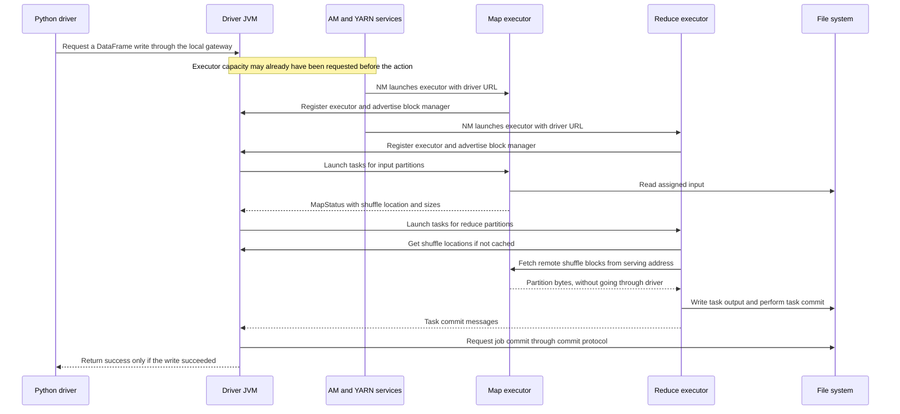

# PySpark on YARN: component design reference

Use this reference to follow a call across process boundaries or to find the
component that owns a decision. Each page starts with one worked handoff.
Read the three steps or follow the spatial topology diagram right below them.
The labels stay visible with motion off. If your Markdown viewer shows only a
still image, you can also open that component's SVG directly in a browser.

This is **classic PySpark batch execution on managed YARN**, not Spark Connect or
Spark Standalone. The pages describe the existing implementation at
[Spark `dada2a6`](https://github.com/apache/spark/tree/dada2a6db5d73b152d6ba16e4fe21406f86abfe3).
Hadoop service pages use [Apache Hadoop 3.4.1](https://hadoop.apache.org/docs/r3.4.1/).
HDFS, dynamic allocation, speculation, and the external shuffle service are not
required for every application. Ports given as defaults are not fixed deployment addresses.

**Companions:** [End-to-end lifecycle, discovery, and ports](../pyspark-on-yarn.md)
and [scenarios traced through the source](../pyspark-on-yarn-scenarios.md).

## Flow at a glance

1. **ApplicationMaster**: Asks the NodeManager named in the grant to launch an executor.
2. **Executor**: Registers for tasks and separately advertises its block-serving address.
3. **Reduce task**: Looks up its map output and fetches the bytes from the serving node.

> **Key distinction:** A grant identifies where a process *can* run. Registration tells Spark where it *can* send work. Neither transfers a shuffle block.

> **Interactive explorer:** [Open Spark Visualizer (Master Lifecycle & All 56 Map)](https://nuthanreddy.github.io/spark-visualizer/#flow=flow-cluster-lifecycle) to step through commands, wire payloads, category filters, and job/fault simulations live.

## Follow a record, not just a class name

Suppose a Python script groups paid orders by region and writes the counts to
Parquet. These are the handoffs for a typical shuffled aggregation:

The two executor lanes are roles, not dedicated pools. The AM and driver JVM
share a process in cluster mode, not client mode. For a built-in filter and
aggregation, a Python driver does **not** imply executor-side Python workers.
If the external shuffle service serves the map data, the reducer contacts the
service on the producer node instead of the original executor.

## Component directory

### 1. Submission and executor acquisition

| Component | Decision or handoff to look for |
|---|---|
| [`spark-submit`](spark-submit.md) | Which entry point runs locally, and which arguments move into the YARN application? |
| [Spark YARN client](yarn-client.md) | Which files are staged, what goes in the submission context, and when does submission fail before launch? |
| [ApplicationMaster](application-master.md) | Who starts or locates the driver, registers the attempt, and reports its final status? |
| [YarnAllocator](yarn-allocator.md) | How do desired executors become YARN container requests, matches, launches, and loss reports? |

### 2. Cluster and file-system services

| Component | Decision or handoff to look for |
|---|---|
| [ResourceManager](resource-manager.md) | Who arbitrates queue capacity, knows the live nodes, and tracks application attempts? |
| [NodeManager](node-manager.md) | Who localizes resources, physically starts a JVM, monitors its container, and cleans it up? |
| [YARN container](yarn-container.md) | What does a grant identify, and how is its lifecycle different from an executor or task? |
| [HDFS NameNode](hdfs-namenode.md) | Where does a client get namespace and block-location metadata? |
| [HDFS DataNode](hdfs-datanode.md) | Which process serves file bytes and participates in replicated block writes? |

### 3. The driver: two processes, different responsibilities

| Component | Decision or handoff to look for |
|---|---|
| [Spark driver JVM](spark-driver.md) | Which responsibilities share an application lifetime and failure boundary? |
| [Python driver](python-driver.md) | Who runs the script's top-level code and observes its exit? |
| [Py4J gateway](py4j-gateway.md) | How does a Python driver call its local JVM without sending that call directly to executors? |
| [SparkSession](spark-session.md) | Which SQL state belongs to a session, and what can two sessions share? |
| [SparkContext](spark-context.md) | Who initializes application services, submits RDD work, and coordinates shutdown? |
| [SparkEnv](spark-env.md) | How does a driver or executor obtain its own RPC, serializer, storage, and shuffle services? |

### 4. Scheduling: from dependencies to a launch message

| Component | Decision or handoff to look for |
|---|---|
| [DAGScheduler](dag-scheduler.md) | Which stages are ready, and when does recovery require rerunning a producer? |
| [TaskSchedulerImpl](task-scheduler.md) | How are executor resource offers matched to eligible task sets? |
| [TaskSetManager](task-set-manager.md) | Which partition attempt gets a slot? Which failures count, and which duplicate result wins? |
| [CoarseGrainedSchedulerBackend](driver-scheduler-backend.md) | Who tracks registered executor resources and sends `LaunchTask`? |
| [YarnSchedulerBackend](yarn-scheduler-backend.md) | How do capacity requests and executor loss reasons cross the driver/AM boundary? |

### 5. Executor runtime and control messages

| Component | Decision or handoff to look for |
|---|---|
| [CoarseGrainedExecutorBackend](executor-backend.md) | Who bootstraps from the driver URL, registers, and decodes launch instructions? |
| [Executor](executor.md) | Who owns the task thread pool, local execution services, and result serialization? |
| [Task attempt](task-attempt.md) | What is per-attempt state, and how does interruption differ from normal completion? |
| [TaskResultGetter](task-result-getter.md) | When does a status update contain the result, and when must the driver fetch a block? |
| [RpcEnv](rpc-env.md) | What is a named endpoint rather than a TCP listener, and how do replies find the caller? |

### 6. Capacity, liveness, and observation

| Component | Decision or handoff to look for |
|---|---|
| [ExecutorAllocationManager](executor-allocation-manager.md) | When does sustained backlog justify requesting a higher target? |
| [ExecutorMonitor](executor-monitor.md) | Which idle executors can be considered for removal given cached and shuffle state? |
| [HeartbeatReceiver](heartbeat-receiver.md) | When does the driver expire an executor independently of YARN node health? |
| [LiveListenerBus](listener-bus.md) | How do scheduler events reach listeners without turning an observation into a scheduling command? |
| [Spark event log](event-log.md) | What structured events are written for replay, as distinct from container stdout/stderr? |
| [Live Spark UI](spark-ui.md) | Which driver-side state explains a running job, stage, SQL execution, or executor? |
| [Spark History Server](history-server.md) | What can a separate service reconstruct after the driver is gone, and what evidence can be missing? |
| [MetricsSystem](metrics-system.md) | How do driver, executor, and AM JVMs each wire Dropwizard sources to local sinks and UI servlets? |
| [ExecutorMetricsPoller](executor-metrics-poller.md) | How are executor memory and `/proc` peaks sampled, cached for Dropwizard, and shipped via heartbeats? |

### 7. Block storage and reuse

| Component | Decision or handoff to look for |
|---|---|
| [BlockManager](block-manager.md) | Who stores bytes locally and falls back to other locations? |
| [BlockManagerMaster](block-manager-master.md) | Who tracks block managers and reported block locations without proxying the data? |
| [NettyBlockTransferService](block-transfer-service.md) | Which listener serves incoming block transfers, separate from scheduler RPC? |
| [Persisted RDD partition path](rdd-cache.md) | What happens to one partition on a local hit, remote hit, or complete miss? |
| [BroadcastManager](broadcast-manager.md) | How does a reusable broadcast value become pieces that executors can fetch? |

### 8. Shuffle: directory, files, and fetch

| Component | Decision or handoff to look for |
|---|---|
| [MapOutputTrackerMaster](map-output-tracker-master.md) | Where does the driver record the locations and sizes of map outputs? |
| [MapOutputTrackerWorker](map-output-tracker-worker.md) | How does a reducer discover and cache the metadata it needs? |
| [Shuffle writer](shuffle-writer.md) | Who partitions records, handles spill, and returns map-output status? |
| [Shuffle reader](shuffle-reader.md) | How are local and remote reads selected, fetched, and consumed? |
| [Shuffle block resolver](shuffle-block-resolver.md) | How does a logical shuffle block become a segment of a physical file? |
| [External shuffle service](external-shuffle-service.md) | When can shuffle data still be served after its executor exits? |

### 9. SQL planning and physical execution

| Component | Decision or handoff to look for |
|---|---|
| [Spark SQL planner](sql-planner.md) | How do logical operations become an executable physical plan rather than task assignments? |
| [Adaptive Query Execution](adaptive-query-execution.md) | Which decisions can change after a query stage materializes? |
| [Broadcast exchange](broadcast-exchange.md) | Who materializes the build side for distribution? |
| [Broadcast hash join](broadcast-hash-join.md) | Who probes that relation, and why need the large side not shuffle for the join? |
| [Python UDF physical operator](python-udf-operator.md) | Which inputs cross the JVM/Python boundary, and how are results associated with rows? |

### 10. Python workers and durable output

| Component | Decision or handoff to look for |
|---|---|
| [PythonWorkerFactory](python-worker-factory.md) | When is a worker started, reused, or discarded on an executor? |
| [Python worker](python-worker.md) | Which process runs a partition function or UDF, and how does it return data or an exception? |
| [Executor-side Python runner](python-runner.md) | Who frames the task inputs and consumes the worker stream? This is not the driver launcher. |
| [FileFormatWriter](file-format-writer.md) | How does a V1 file write collect task outcomes before invoking job commit? |
| [File commit protocol](file-commit-protocol.md) | What belongs to task commit versus job commit, and what does abort guarantee? |
| [OutputCommitCoordinator](output-commit-coordinator.md) | When authorization is used, which competing task attempt may commit? |

## Choose the right evidence

| Observation | Start here | Do not infer |
|---|---|---|
| Container granted; no Spark executor yet | [YarnAllocator](yarn-allocator.md) and [executor bootstrap](executor-backend.md) | A grant does not show that the JVM started or reached the driver. |
| Registered executor; tasks pending | [scheduler backend](driver-scheduler-backend.md), [resource offers](task-scheduler.md), [task-set locality](task-set-manager.md) | Registration does not guarantee a free compatible slot. |
| Reducer knows a producer's host but fetch fails | [map-output metadata](map-output-tracker-worker.md), [block resolver](shuffle-block-resolver.md), [serving endpoint](external-shuffle-service.md) if enabled | Knowing a location does not prove the file or service is still available. |
| UDF fails; other tasks on the same machine still run | [Python runner](python-runner.md) and [worker](python-worker.md) | A task exception need not mean its YARN container died. |
| All file-write tasks succeeded; write action failed | [FileFormatWriter](file-format-writer.md) and [file commit protocol](file-commit-protocol.md) | Task success does not prove the driver-side job commit succeeded. |
| Live UI disappeared after shutdown | [event log](event-log.md) and [History Server](history-server.md) | Container logs are not a substitute for the events used to rebuild the Spark UI. |

## Maintaining the flow diagrams

Edit the three numbered steps under **Flow at a glance** in the relevant page
or update the diagram layout specs in `visuals/topology-specs.json`.
From this directory, `node visuals/render-flows.mjs` rebuilds the SVG files;
`node visuals/render-flows.mjs --check` checks whether they are up to date.
Reading the guides does not require Node, JavaScript, or a network connection:
keep the `visuals` folder alongside the Markdown files when copying them.
