# Adaptive Query Execution: changing the unread part of a query

[component index](README.md) | [SQL physical planner](sql-planner.md)

AQE lets the **driver JVM** revise a physical plan after learning what an exchange
actually produced. It changes the *next* join or shuffle read; it does not migrate
a running task, split a live reducer, or acquire YARN containers. An AQE **query
stage** wraps a SQL subtree that can be materialized. The core
[DAGScheduler](dag-scheduler.md) still owns jobs, scheduler stages, task attempts,
and recovery of missing shuffle outputs.

## Flow at a glance

1. **Finished shuffle**: Map tasks write the shuffle blocks for both sides of a join.
2. **Driver**: AQE spots an oversized orders partition and splits its next read into slices.
3. **Join tasks**: Each task for that partition reads a different slice but the same regions partition.

> **Key distinction:** AQE changes how later tasks read existing blocks; it does not split a running task.

> **Interactive explorer:** [Open in Spark Visualizer](https://nuthanreddy.github.io/spark-visualizer/#component=adaptive-query-execution) to step through commands, wire payloads, category filters, and fault simulations on the live cluster canvas.

## The driver feedback loop

1. **Wrap.** With `spark.sql.adaptive.enabled=true`, `InsertAdaptiveSparkPlan` checks
   the plan. An existing exchange or a child distribution that might require one is
   sufficient reason to consider AQE; a plain scan need not be wrapped. Supported
   nodes must have logical links. `AdaptiveSparkPlanExec` owns the initial and current
   physical plans, a stage-ID counter, and `isFinalPlan`. Its `AdaptiveExecutionContext`
   is tied to the `QueryExecution`, not shared across unrelated applications.
   [Admission and logical-link guards][admission].
2. **Materialize ready work.** `withFinalPlanUpdate` walks up from the leaves. Once
   child stages are ready, an ordinary exchange becomes `ShuffleQueryStageExec` or
   `BroadcastQueryStageExec`. `materialize()` returns a future: a shuffle submits
   a map-stage job; a broadcast submits the [broadcast build](broadcast-exchange.md).
   With exchange reuse enabled, a canonical plan can reuse a stage result rather
   than repeat the work. A completion event sets the stage's result or error.
   [Result state][stage] · [exchange reuse][cache].
3. **Read the right statistics.** `ShuffleQueryStageExec.mapStats` exposes
   `MapOutputStatistics(shuffleId, bytesByPartitionId)`: approximate total shuffle
   bytes for each **reduce partition**, aggregated across mappers. These are not key
   frequencies, task durations, or raw rows. Separately, `getRuntimeStatistics`
   supplies the exchange's size and row count; `computeStats` marks materialized
   statistics `isRuntime=true`. A shuffle with zero input partitions has no map
   statistics. `LogicalQueryStage` falls back to logical estimates if no physical
   statistics are available. [Map-size accuracy][mapstats] ·
   [shuffle statistics and RDD interface][shuffle] · [logical statistics][logical-stats].
4. **Replan and finish.** The driver replaces matching logical subtrees with
   `LogicalQueryStage`s, invalidates old statistics, reruns the adaptive optimizer
   and physical planner, and compares costs. It adopts a cheaper candidate, or a
   **different** candidate of equal cost; otherwise it keeps the current plan.
   If an eligible build side turns out to be small, the new join can use a broadcast.
   When dependencies are ready the result stage runs the action's handler; AQE
   marks the plan final and returns that result. [Event loop and cost gate][loop] ·
   [replanning and invalid-plan handling][replan].

## Worked example: a hot `orders.region_id`

Assume an inner sort-merge join that stays a shuffled join, skew handling enabled,
and exchanges introduced to satisfy the join. These numbers illustrate the rule,
not a cluster measurement.

| Step | What happens to reduce partition 3 |
|---|---|
| Detect | The orders-side sizes are `[32, 32, 32, 640, 32]` MiB. The median is 32 MiB. With factor 5 and an absolute threshold of 256 MiB, the cutoff is `max(5 * 32, 256) = 256 MiB`. **640 > 256** qualifies; exactly 256 would not. Each side uses its own median. |
| Split | `OptimizeSkewedJoin.tryOptimizeJoinChildren` asks `ShufflePartitionsUtil.createSkewPartitionSpecs` for the individual map-block sizes for reducer 3. It groups contiguous mapper ranges into `PartialReducerPartitionSpec`s. A single indivisible block, missing map status, or a forbidden replication direction can prevent a split. |
| Pair | If the left splits into three ranges and the right does not split, three tasks each read a disjoint slice of left partition 3 **and the same right partition 3**. If both split, every left/right range pair is needed. For a left outer join, splitting the preserved left is legal; replicating that left side across right splits could duplicate unmatched rows. |
| Execute | After distribution validation, `AQEShuffleReadExec` passes the chosen specs to `getShuffleRDD`. It reads already-written map output differently; it does not rewrite the map files. Coalescing does the opposite for small adjacent reducer partitions. Forced skew optimization can accept an extra exchange to restore a required distribution. |

[Skew cutoffs and pairings][pair] · [range construction][split] ·
[validation and shuffle-origin guards][guards] · [coalescing][coalesce].

## Cost, failures, and evidence

Splitting can shorten a long tail at the price of more tasks and repeated reads of
the other side. It cannot eliminate genuine join-output explosion. Coalescing can
reduce task-launch overhead but also parallelism. If a candidate plan is invalid,
AQE can keep the old plan; a **required stage materialization failure** is different:
after core scheduling has reported failure, AQE attempts to cancel outstanding
exchanges and propagates the error.

Inspect the SQL UI **for the completed action**, not just `explain` before it runs.
Compare the initial and final plan (`isFinalPlan=true`); look for `SortMergeJoin(skew=true)`,
`AQEShuffleRead` marked `skewed` or `coalesced`, and the metrics **number of skewed
partitions** versus **number of skewed partition splits**. Then compare shuffle
read sizes and task duration in the linked scheduler stages.
[Shuffle-read metrics and execution][read] · [failure cleanup][failure].

[admission]: https://github.com/apache/spark/blob/dada2a6db5d73b152d6ba16e4fe21406f86abfe3/sql/core/src/main/scala/org/apache/spark/sql/execution/adaptive/InsertAdaptiveSparkPlan.scala#L49-L135
[stage]: https://github.com/apache/spark/blob/dada2a6db5d73b152d6ba16e4fe21406f86abfe3/sql/core/src/main/scala/org/apache/spark/sql/execution/adaptive/QueryStageExec.scala#L65-L106
[cache]: https://github.com/apache/spark/blob/dada2a6db5d73b152d6ba16e4fe21406f86abfe3/sql/core/src/main/scala/org/apache/spark/sql/execution/adaptive/AdaptiveSparkPlanExec.scala#L913-L964
[shuffle]: https://github.com/apache/spark/blob/dada2a6db5d73b152d6ba16e4fe21406f86abfe3/sql/core/src/main/scala/org/apache/spark/sql/execution/exchange/ShuffleExchangeExec.scala#L222-L247
[mapstats]: https://github.com/apache/spark/blob/dada2a6db5d73b152d6ba16e4fe21406f86abfe3/core/src/main/scala/org/apache/spark/MapOutputStatistics.scala#L20-L27
[logical-stats]: https://github.com/apache/spark/blob/dada2a6db5d73b152d6ba16e4fe21406f86abfe3/sql/core/src/main/scala/org/apache/spark/sql/execution/adaptive/LogicalQueryStage.scala#L55-L72
[loop]: https://github.com/apache/spark/blob/dada2a6db5d73b152d6ba16e4fe21406f86abfe3/sql/core/src/main/scala/org/apache/spark/sql/execution/adaptive/AdaptiveSparkPlanExec.scala#L359-L497
[replan]: https://github.com/apache/spark/blob/dada2a6db5d73b152d6ba16e4fe21406f86abfe3/sql/core/src/main/scala/org/apache/spark/sql/execution/adaptive/AdaptiveSparkPlanExec.scala#L1159-L1189
[pair]: https://github.com/apache/spark/blob/dada2a6db5d73b152d6ba16e4fe21406f86abfe3/sql/core/src/main/scala/org/apache/spark/sql/execution/adaptive/OptimizeSkewedJoin.scala#L59-L193
[split]: https://github.com/apache/spark/blob/dada2a6db5d73b152d6ba16e4fe21406f86abfe3/sql/core/src/main/scala/org/apache/spark/sql/execution/adaptive/ShufflePartitionsUtil.scala#L416-L459
[guards]: https://github.com/apache/spark/blob/dada2a6db5d73b152d6ba16e4fe21406f86abfe3/sql/core/src/main/scala/org/apache/spark/sql/execution/adaptive/OptimizeSkewedJoin.scala#L333-L362
[coalesce]: https://github.com/apache/spark/blob/dada2a6db5d73b152d6ba16e4fe21406f86abfe3/sql/core/src/main/scala/org/apache/spark/sql/execution/adaptive/CoalesceShufflePartitions.scala#L37-L126
[read]: https://github.com/apache/spark/blob/dada2a6db5d73b152d6ba16e4fe21406f86abfe3/sql/core/src/main/scala/org/apache/spark/sql/execution/adaptive/AQEShuffleReadExec.scala#L241-L280
[failure]: https://github.com/apache/spark/blob/dada2a6db5d73b152d6ba16e4fe21406f86abfe3/sql/core/src/main/scala/org/apache/spark/sql/execution/adaptive/AdaptiveSparkPlanExec.scala#L1241-L1271
