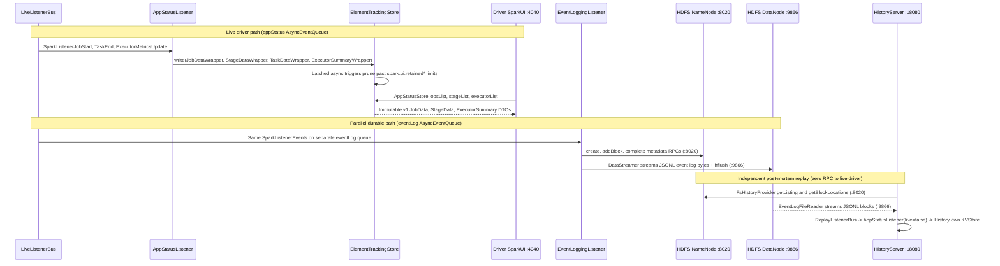

# AppStatusStore and KVStore: live UI state vs History Server replay

[component index](README.md)

`AppStatusStore` is **not** a durable log writer, does **not** serve post-mortem queries after the [driver JVM](spark-driver.md) exits, and is **not** queried over RPC by the [Spark History Server](history-server.md). Inside the driver JVM, `AppStatusStore` is a read-only status query facade over `ElementTrackingStore` (backed by `InMemoryStore` by default, or **RocksDB only** when `spark.ui.store.path` is set), populated asynchronously by `AppStatusListener` on the `appStatus` queue of [`LiveListenerBus`](listener-bus.md). It powers the live [`SparkUI`](spark-ui.md) (`:4040`), `/api/v1/applications/*` REST endpoints, and `SparkStatusTracker` identically across PySpark, Scala, and Java applications. Durable post-mortem state is written independently on a separate `eventLog` queue by [`EventLoggingListener`](event-log.md) to HDFS and replayed later by `HistoryServer` into its own isolated `KVStore`.

## Flow at a glance

1. **Async event ingestion**: `SparkContext` creates the live store via `AppStatusStore.createLiveStore` and attaches `AppStatusListener` to the dedicated `appStatus` queue on `LiveListenerBus`.
2. **Throttled KVStore writes and retention pruning**: `AppStatusListener` aggregates mutable live entities (`LiveJob`, `LiveStage`, `LiveTask`, `LiveExecutor`) and flushes immutable v1 wrappers (`JobDataWrapper`, `StageDataWrapper`, `TaskDataWrapper`, `ExecutorSummaryWrapper`) into `ElementTrackingStore`, whose async triggers prune entities past `spark.ui.retained*` caps.
3. **Lock-free live UI reads**: `SparkUI` HTML tabs and `/api/v1` REST handlers query `AppStatusStore` (`jobsList`, `stageList`, `taskList`, `executorList`) without acquiring `DAGScheduler` or `TaskScheduler` locks.
4. **Decoupled HDFS event log and History Server replay**: On a parallel `eventLog` bus queue, `EventLoggingListener` writes JSONL metadata to [HDFS NameNode](hdfs-namenode.md) (`:8020`) and bytes to [HDFS DataNode](hdfs-datanode.md) (`:9866`); `HistoryServer` (`FsHistoryProvider`) independently reads those HDFS files and replays them through `ReplayListenerBus` into its **own** separate `KVStore` and `AppStatusStore`.

> **Key distinction:** Live `AppStatusStore` exists only inside the running driver JVM (disk-backed live UI uses **RocksDB only** via `KVUtils.scala:50-58`, never LevelDB). `HistoryServer` never talks to `EventLoggingListener` or live `AppStatusStore`; `FsHistoryProvider` independently reads HDFS event logs and builds its own isolated `KVStore`.

> **Interactive explorer:** [Open in Spark Visualizer](https://nuthanreddy.github.io/spark-visualizer/#component=app-status-store) to step through commands, wire payloads, language modes, category filters, and fault simulations on the live cluster canvas.

## Live driver `AppStatusStore` vs `HistoryServer` replay store

| Aspect | Live Driver `AppStatusStore` | Post-Mortem `HistoryServer` (`FsHistoryProvider`) |
|---|---|---|
| **Creation entry point** | [`AppStatusStore.createLiveStore`][ass-create] (`AppStatusStore.scala:857-882`), called in [`SparkContext`][sc-status] (`SparkContext.scala:539-540`) | [`FsHistoryProvider.rebuildAppStore`][fsh-rebuild] (`FsHistoryProvider.scala:1428-1474`) |
| **Event source** | `LiveListenerBus` dedicated `appStatus` `AsyncEventQueue` (`live = true`) | `ReplayListenerBus` reading HDFS event log files via `EventLogFileReader.openEventLog` (`live = false`) |
| **KVStore disk backend** | `InMemoryStore` by default; if `spark.ui.store.path` (`LIVE_UI_LOCAL_STORE_DIR`) is set, **RocksDB only** (`HybridStoreDiskBackend.ROCKSDB`, [`KVUtils.scala:50-58`][kv-backend]) with `KVStoreProtobufSerializer` (NOT LevelDB) | Configurable `spark.history.store.hybridStore.diskBackend` (RocksDB default) under `spark.history.store.path`, completely isolated from the driver |
| **Live throttling and triggers** | Throttles flushes via `spark.ui.liveUpdate.period` (`100ms` default) and `minFlushPeriod` (`1s`); async retention pruning on `element-tracking-store-worker` (`spark.appStateStore.asyncTracking.enable=true`) | Sets `liveUpdatePeriodNs = -1L` (flushes final state on close) and `ASYNC_TRACKING_ENABLED = false` during replay to lower memory usage |
| **Lifetime** | Ephemeral -- closed and discarded on `SparkContext.stop()` or driver crash | Persists as long as HDFS event logs remain in `spark.eventLog.dir` |

## Live `appStatus` path vs parallel HDFS `eventLog` and History Server replay

1. **Throttled live aggregation ([`AppStatusListener.scala:48-95`][asl-class]).** `AppStatusListener` keeps in-flight mutable state (`liveJobs`, `liveStages`, `liveTasks`, `liveExecutors`, `liveRDDs`) so rapid task/heartbeat events do not hammer the underlying `KVStore`. Updates flush at `spark.ui.liveUpdate.period` (`100ms` default, [`Status.scala:29-65`][status-cfg]) or on completion boundaries.
2. **Latched retention triggers ([`ElementTrackingStore.scala:50-135`][ets-class]).** `AppStatusListener` registers count triggers on `ElementTrackingStore` for `ExecutorSummaryWrapper` (`spark.ui.retainedDeadExecutors=100`), `JobDataWrapper` (`spark.ui.retainedJobs=1000`), and `StageDataWrapper` (`spark.ui.retainedStages=1000`), while bounding per-stage tasks via `spark.ui.retainedTasks` (`100000`). `LatchedTriggers.fireOnce` coalesces bursty writes with an `AtomicBoolean` so only one cleanup task queues at a time on `element-tracking-store-worker`.
3. **Separate HDFS metadata vs data plane for `EventLoggingListener` and `HistoryServer`.** `SparkContext` registers `EventLoggingListener` on a separate `eventLog` queue ([`SparkContext.scala:713`][sc-eventlog]) so slow HDFS writes never stall live SparkUI updates. `EventLoggingListener` contacts NameNode (`:8020`) only for file/block metadata and streams JSONL bytes directly to DataNodes (`:9866`). Later, [`FsHistoryProvider.rebuildAppStore`][fsh-rebuild] (`FsHistoryProvider.scala:1428-1474`) reads those HDFS files via NameNode (`:8020`) + DataNode (`:9866`) and replays them through `ReplayListenerBus` into History Server's own `ElementTrackingStore` and `AppStatusStore`.

## Inputs, outputs, and state

| Boundary | Contract |
|---|---|
| Inputs | `SparkListener` lifecycle and metrics events on `LiveListenerBus` (`appStatus` queue); `SparkConf` status configs (`spark.ui.store.path`, `spark.ui.liveUpdate.period=100ms`, `spark.ui.liveUpdate.minFlushPeriod=1s`, `spark.ui.retainedJobs=1000`, `spark.ui.retainedStages=1000`, `spark.ui.retainedTasks=100000`, `spark.ui.retainedDeadExecutors=100`, `spark.appStateStore.asyncTracking.enable=true`). |
| Owned state | `AppStatusListener` live mutable maps (`liveJobs`, `liveStages`, `liveTasks`, `liveExecutors`, `deadExecutors`, `liveRDDs`); `ElementTrackingStore` wrapping `InMemoryStore` (default) or RocksDB + protobuf disk KVStore (`spark.ui.store.path`) with `LatchedTriggers` and single-threaded async worker; `AppStatusStore` read facade. |
| Outputs | Indexed `org.apache.spark.status.api.v1.*` snapshots (`JobData`, `StageData`, `TaskData`, `ExecutorSummary`, `RDDStorageInfo`) powering live `SparkUI` (`:4040`), `/api/v1/applications/*` REST JSON, `SparkStatusTracker`, and `PrometheusResource` (`/metrics/executors/prometheus`). |

## Failure clues and diagnosis

- **Driver heap OOM in long-running applications with hundreds of thousands of tasks or SQL executions:** Default `InMemoryStore` holds up to `retainedJobs=1000`, `retainedStages=1000`, and `retainedTasks=100000` per stage inside driver heap. Either lower `spark.ui.retained*` limits or set `spark.ui.store.path` to spill live UI state into the **RocksDB-only** protobuf disk KVStore ([`KVUtils.scala:50-58`][kv-backend]).
- **Live SparkUI (`:4040`) shows stale or missing tasks while the job keeps making progress:** Check `LiveListenerBus` drop warnings for the `appStatus` queue (`spark.scheduler.listenerbus.eventqueue.appStatus.capacity`). Queue overflow drops events before `AppStatusListener` sees them without affecting actual scheduler execution.
- **Discrepancy between live SparkUI (`:4040`) and History Server (`:18080`):** Because `EventLoggingListener` runs on a separate `eventLog` queue and `HistoryServer` replays HDFS event logs into an independent `KVStore` ([`FsHistoryProvider.scala:1428-1474`][fsh-rebuild]), differences trace to `eventLog` queue drops, unflushed `.inprogress` HDFS streams on an abrupt driver crash, or different retention thresholds on the History Server.
- **Attempting to configure LevelDB for live disk-backed UI has no effect:** [`KVUtils.backend`][kv-backend] hardcodes `HybridStoreDiskBackend.ROCKSDB` whenever `live == true`; `spark.history.store.hybridStore.diskBackend` applies only to non-live History Server stores.
- **Executor Prometheus metrics (`/metrics/executors/prometheus`) missing while `/metrics/json` works:** `/metrics/executors/prometheus` reads `AppStatusStore.executorList(true)` (gated by `spark.ui.prometheus.enabled=true`), not [`MetricsSystem`](metrics-system.md).

[sc-status]: https://github.com/apache/spark/blob/dada2a6db5d73b152d6ba16e4fe21406f86abfe3/core/src/main/scala/org/apache/spark/SparkContext.scala#L536-L542
[sc-eventlog]: https://github.com/apache/spark/blob/dada2a6db5d73b152d6ba16e4fe21406f86abfe3/core/src/main/scala/org/apache/spark/SparkContext.scala#L708-L717
[ass-create]: https://github.com/apache/spark/blob/dada2a6db5d73b152d6ba16e4fe21406f86abfe3/core/src/main/scala/org/apache/spark/status/AppStatusStore.scala#L857-L882
[kv-backend]: https://github.com/apache/spark/blob/dada2a6db5d73b152d6ba16e4fe21406f86abfe3/core/src/main/scala/org/apache/spark/status/KVUtils.scala#L50-L71
[asl-class]: https://github.com/apache/spark/blob/dada2a6db5d73b152d6ba16e4fe21406f86abfe3/core/src/main/scala/org/apache/spark/status/AppStatusListener.scala#L48-L96
[ets-class]: https://github.com/apache/spark/blob/dada2a6db5d73b152d6ba16e4fe21406f86abfe3/core/src/main/scala/org/apache/spark/status/ElementTrackingStore.scala#L50-L135
[status-cfg]: https://github.com/apache/spark/blob/dada2a6db5d73b152d6ba16e4fe21406f86abfe3/core/src/main/scala/org/apache/spark/internal/config/Status.scala#L24-L78
[fsh-rebuild]: https://github.com/apache/spark/blob/dada2a6db5d73b152d6ba16e4fe21406f86abfe3/core/src/main/scala/org/apache/spark/deploy/history/FsHistoryProvider.scala#L1428-L1474
