# ApplicationMaster: coordinating one YARN application attempt

[Component index](README.md) · [Submission client](yarn-client.md) · [Executor allocator](yarn-allocator.md)

The Spark ApplicationMaster (AM) represents **one attempt** of a YARN application. In the managed case, a [NodeManager](node-manager.md) starts its JVM from the launch instructions supplied by the [submission client](yarn-client.md). The AM registers with the [ResourceManager (RM)](resource-manager.md), connects the Spark driver to its allocator, and decides what outcome to report. It is not the RM, and it does not schedule Spark tasks. In cluster mode it **shares a JVM** with the JVM driver; in client mode it **connects to** that driver.

## Flow at a glance

1. **ApplicationMaster**: Starts PythonRunner on a driver thread in cluster mode.
2. **Driver scheduler**: Passes the SparkContext to the waiting AM.
3. **ApplicationMaster**: Registers with the ResourceManager and creates the executor allocator.

> **Key distinction:** In client mode the AM connects to an existing driver. It never starts the Python script.

Show the animated flow

## Trace startup: how does the AM find the driver?

1. **Read attempt inputs.** `ApplicationMaster.main` reads the localized Spark properties and constructs `YarnConfiguration`. The managed container's `CONTAINER_ID` identifies the `ApplicationAttemptId`. `ApplicationMasterArguments` carries the user class, script and arguments, or the external driver address, plus the cache-manifest path. A non-null `args.userClass` selects the cluster path. The client-mode process is named `ExecutorLauncher`, but its `main` delegates to the same AM implementation. [Attempt identity and mode][identity] · [bootstrap][bootstrap] · [launcher alias][alias]
2. **Cluster path: wait for a real JVM context.** `runDriver()` starts a thread named `Driver`. For `orders.py` it invokes `PythonRunner.main` with the localized script, an empty Python-files argument (the client built `PYTHONPATH`), and the user's arguments. `PythonRunner` starts the Python driver in the same container. When Python initializes the JVM `SparkContext`, `YarnClusterScheduler.postStartHook` publishes it through `sparkContextPromise`. The thread in that hook waits; the AM takes the configured driver host and actual port from the context, registers the AM with the RM, obtains the driver's `YarnScheduler` endpoint, and creates the allocator before resuming initialization. `runDriver` then joins the user thread. [User entry point][user] · [scheduler hook][hook] · [rendezvous][rendezvous] · [cluster startup and timeout][driver]
3. **Client path, instead:** `runExecutorLauncher()` creates its own client-mode `RpcEnv`, registers the AM's host and port **`-1`** with the RM (this AM does not listen for inbound connections), then reads `host:port` from `args.userArgs(0)` to contact the already-listening driver. It retrieves the driver's current delegation tokens when creating the allocator. The AM joins the reporter thread; it never invokes `orders.py`. [Client startup][client] · [driver lookup and allocator setup][allocator]
4. **Common path.** `YarnRMClient.createAllocator` requires successful AM registration. The AM reconstructs the executor `LocalResource` manifest, derives a **different endpoint** for executor registration (`CoarseGrainedScheduler` at the driver's address), and installs `YarnAM` *after* the allocator exists. It calls `allocateResources()` once, then starts the `Reporter` thread. The endpoint's `onStart` sends `RegisterClusterManager(self)` to the Spark driver. This advertises the **AM**, not an executor. [RM registration and guard][rm] · [allocator ordering][allocator] · [AM endpoint][messages]

## Messages and owned state

| Counterparty | Exchange and effect |
|---|---|
| RM | `registerApplicationMaster(host, port, trackingUrl)` registers this attempt. The reporter then drives [allocator](yarn-allocator.md) polls, which double as AM heartbeats. With pending allocations or loss-reason requests, the polling delay starts short and grows toward the steady heartbeat interval. This is not the executor-to-driver heartbeat. [Registration][rm] · [reporter loop][reporter] |
| Driver's `YarnScheduler` endpoint | `RequestExecutors` carries **totals per resource profile**, locality counts, and excluded nodes; `KillExecutors` carries specific executor IDs. `YarnAM` forwards them to the allocator. A `true` request reply means the AM handled the request, not that YARN granted capacity. `GetExecutorLossReason` can be answered later from a container completion. [Message handlers][messages] |
| User thread / driver / shutdown hook | The AM owns `sparkContextPromise`, `allocator`, `reporterThread` and the attempt fields `registered`, `finished`, `unregistered`, `exitCode`, `finalStatus`, `finalMsg`. `finish` records the first local outcome and can interrupt other AM threads; it **does not itself unregister** with the RM. [Fields][identity] · [finish and unregister guards][finish] |

## What outcome does the RM actually see?

| Event | Local decision and external consequence |
|---|---|
| `orders.py` returns normally **after registration**, or exits nonzero | The cluster-mode user thread calls `finish(SUCCEEDED, 0)` on normal return. A `SparkUserAppException` carries Python's exit code into `finish(FAILED, code, ...)`. If the cluster-mode AM **never registered**, `finish` records `FAILED / EXIT_SC_NOT_INITED` (13) instead, even if the script returned normally. [User outcomes][user] · [local outcome rule][finish] |
| Client-mode driver disconnects | `Shutdown(code)` records an orderly shutdown and marks the allocator as shutting down. On disconnect the managed AM reports success for a zero code and failure for nonzero. Without that handshake it can still report `SUCCEEDED` by default; `spark.yarn.am.clientModeTreatDisconnectAsFailed=true` makes the unexpected disconnect a failure. None proves the last output was committed. [Disconnect decision][disconnect] · [configuration default][disconnect-default] |
| AM JVM exits | The managed shutdown hook runs after the Spark context hook. On a **non-last success** it unregisters before cleaning staging; on a **non-last failure** it skips both, leaving the RM the option to retry. On the **last attempt** it tries cleanup and then unregisters if registered. A hard crash need not run the hook at all. The maximum attempt count is bounded by YARN; retry is not promised. A new cluster-mode attempt starts the driver script from its entry point, not its last Python statement. A client-mode AM restart cannot resurrect an external driver. [Hook branches][shutdown] · [attempt cap][cap] |

**Diagnostic boundary:** `Waiting for spark context initialization` followed by a timeout means the cluster AM never reached its first allocator poll; inspect earlier AM/Python output before investigating executor capacity. A reporter exit because executor failures exceeded the limit or all nodes were excluded is a *later* failure. Correlate the `ApplicationAttemptId` and `Final app status` in the AM log with the RM's **application-level** final report; after a retry these may describe different outcomes. With YARN log aggregation enabled, `yarn logs -applicationId <app-id>` retrieves container logs. [Context timeout][driver] · [reporter failure paths][reporter] · [log retrieval][logs]

[identity]: https://github.com/apache/spark/blob/dada2a6db5d73b152d6ba16e4fe21406f86abfe3/resource-managers/yarn/src/main/scala/org/apache/spark/deploy/yarn/ApplicationMaster.scala#L71-L135
[bootstrap]: https://github.com/apache/spark/blob/dada2a6db5d73b152d6ba16e4fe21406f86abfe3/resource-managers/yarn/src/main/scala/org/apache/spark/deploy/yarn/ApplicationMaster.scala#L917-L938
[alias]: https://github.com/apache/spark/blob/dada2a6db5d73b152d6ba16e4fe21406f86abfe3/resource-managers/yarn/src/main/scala/org/apache/spark/deploy/yarn/ApplicationMaster.scala#L991-L1001
[user]: https://github.com/apache/spark/blob/dada2a6db5d73b152d6ba16e4fe21406f86abfe3/resource-managers/yarn/src/main/scala/org/apache/spark/deploy/yarn/ApplicationMaster.scala#L741-L800
[hook]: https://github.com/apache/spark/blob/dada2a6db5d73b152d6ba16e4fe21406f86abfe3/resource-managers/yarn/src/main/scala/org/apache/spark/scheduler/cluster/YarnClusterScheduler.scala#L27-L36
[rendezvous]: https://github.com/apache/spark/blob/dada2a6db5d73b152d6ba16e4fe21406f86abfe3/resource-managers/yarn/src/main/scala/org/apache/spark/deploy/yarn/ApplicationMaster.scala#L405-L434
[driver]: https://github.com/apache/spark/blob/dada2a6db5d73b152d6ba16e4fe21406f86abfe3/resource-managers/yarn/src/main/scala/org/apache/spark/deploy/yarn/ApplicationMaster.scala#L496-L540
[client]: https://github.com/apache/spark/blob/dada2a6db5d73b152d6ba16e4fe21406f86abfe3/resource-managers/yarn/src/main/scala/org/apache/spark/deploy/yarn/ApplicationMaster.scala#L564-L585
[allocator]: https://github.com/apache/spark/blob/dada2a6db5d73b152d6ba16e4fe21406f86abfe3/resource-managers/yarn/src/main/scala/org/apache/spark/deploy/yarn/ApplicationMaster.scala#L436-L494
[rm]: https://github.com/apache/spark/blob/dada2a6db5d73b152d6ba16e4fe21406f86abfe3/resource-managers/yarn/src/main/scala/org/apache/spark/deploy/yarn/YarnRMClient.scala#L54-L88
[messages]: https://github.com/apache/spark/blob/dada2a6db5d73b152d6ba16e4fe21406f86abfe3/resource-managers/yarn/src/main/scala/org/apache/spark/deploy/yarn/ApplicationMaster.scala#L818-L876
[reporter]: https://github.com/apache/spark/blob/dada2a6db5d73b152d6ba16e4fe21406f86abfe3/resource-managers/yarn/src/main/scala/org/apache/spark/deploy/yarn/ApplicationMaster.scala#L587-L646
[finish]: https://github.com/apache/spark/blob/dada2a6db5d73b152d6ba16e4fe21406f86abfe3/resource-managers/yarn/src/main/scala/org/apache/spark/deploy/yarn/ApplicationMaster.scala#L352-L403
[disconnect]: https://github.com/apache/spark/blob/dada2a6db5d73b152d6ba16e4fe21406f86abfe3/resource-managers/yarn/src/main/scala/org/apache/spark/deploy/yarn/ApplicationMaster.scala#L878-L897
[disconnect-default]: https://github.com/apache/spark/blob/dada2a6db5d73b152d6ba16e4fe21406f86abfe3/resource-managers/yarn/src/main/scala/org/apache/spark/deploy/yarn/config/package.scala#L55-L68
[shutdown]: https://github.com/apache/spark/blob/dada2a6db5d73b152d6ba16e4fe21406f86abfe3/resource-managers/yarn/src/main/scala/org/apache/spark/deploy/yarn/ApplicationMaster.scala#L223-L256
[cap]: https://github.com/apache/spark/blob/dada2a6db5d73b152d6ba16e4fe21406f86abfe3/resource-managers/yarn/src/main/scala/org/apache/spark/deploy/yarn/YarnRMClient.scala#L125-L135
[logs]: https://github.com/apache/spark/blob/dada2a6db5d73b152d6ba16e4fe21406f86abfe3/docs/running-on-yarn.md#L110-L118
