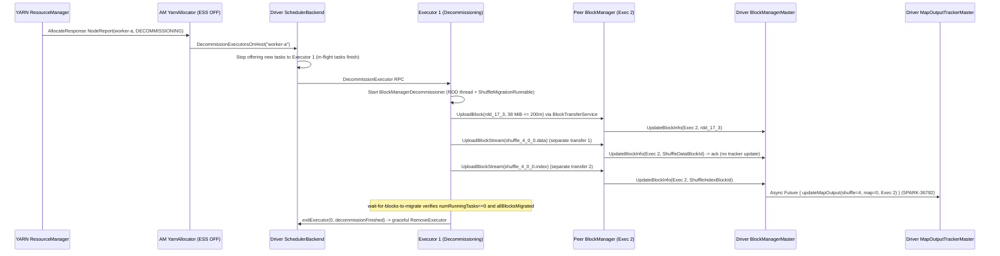

# BlockManagerDecommissioner: graceful RDD and shuffle migration on YARN

[component index](README.md)

`BlockManagerDecommissioner` runs inside an **Executor JVM** to proactively copy cached RDD blocks and local shuffle `.data`/`.index` files onto healthy peer executors (or configured fallback storage) before a decommissioning node shuts down, preventing `FetchFailed` stage recomputations when containers disappear. On YARN, this path sits in direct architectural contrast to [Push-Based Shuffle](push-based-shuffle.md): **`YarnAllocator` enables RM `DECOMMISSIONING` node handling ONLY when External Shuffle Service is OFF** (`spark.shuffle.service.enabled=false`, SPARK-39018) alongside `spark.decommission.enabled=true` and storage migration flags.

## Flow at a glance

1. **ESS OFF gate and RM `DECOMMISSIONING` signal**: When `spark.decommission.enabled=true` and `spark.shuffle.service.enabled=false`, `YarnAllocator` observes `NodeState.DECOMMISSIONING` in RM `AllocateResponse.getUpdatedNodes()`, notifies the driver via `DecommissionExecutorsOnHost`, and the driver stops offering new tasks to those executors while sending `DecommissionExecutor` RPCs.
2. **Separate RDD vs shuffle sub-block transfers**: `CoarseGrainedExecutorBackend.decommissionSelf()` starts `BlockManagerDecommissioner`. Its RDD thread replicates cached RDD blocks (`UploadBlock` RPC when `<= 200m` default), while per-peer `ShuffleMigrationRunnable` threads upload each shuffle sub-block one at a time via separate `UploadBlockStream` transfers (`.data`, then `.index`).
3. **Single-block `UpdateBlockInfo`, async `updateMapOutput`, and graceful exit**: The peer `BlockManager` reports individual `UpdateBlockInfo` RPCs to `BlockManagerMaster`; admitting `ShuffleIndexBlockId` triggers an asynchronous `Future` calling `MapOutputTrackerMaster.updateMapOutput()` (SPARK-36782). Once active tasks reach `0` and all blocks migrate, the executor sends graceful `RemoveExecutor` and exits.

> **Key distinction:** On YARN, `YarnAllocator` disables `DECOMMISSIONING` handling if `spark.shuffle.service.enabled=true` (SPARK-39018), directly contrasting Push-Based Shuffle, which requires ESS ON. Cached RDD blocks (`<= 200m`) migrate over `UploadBlock` RPC, whereas shuffle `.data` and `.index` sub-blocks migrate as **separate** `UploadBlockStream` transfers (`BlockManagerDecommissioner.scala:123-139`), and only the `ShuffleIndexBlockId` `UpdateBlockInfo` triggers the async `MapOutputTrackerMaster.updateMapOutput()` redirect.

> **Interactive explorer:** [Open in Spark Visualizer](https://nuthanreddy.github.io/spark-visualizer/#component=block-manager-decommissioner) to step through commands, wire payloads, category filters, and fault simulations on the live cluster canvas.

## YARN ESS-OFF gate and wire-protocol split

In [`YarnAllocator.scala:192-203`][ya-gate], `isYarnExecutorDecommissionEnabled` evaluates `(DECOMMISSION_ENABLED, SHUFFLE_SERVICE_ENABLED)`: only `(true, false)` returns `true`; `(true, true)` logs a `SPARK-39018` warning and disables YARN decommissioning because ESS already owns node-local shuffle files and cannot be migrated off by executors. When enabled, [`YarnAllocator.handleNodesInDecommissioningState`][ya-decom] forwards each `DECOMMISSIONING` host once to the driver via `DecommissionExecutorsOnHost`. On the executor, [`CoarseGrainedExecutorBackend.decommissionSelf()`][exec-decom] checks `spark.storage.decommission.enabled=true` plus at least one of `spark.storage.decommission.rddBlocks.enabled` or `spark.storage.decommission.shuffleBlocks.enabled`, then invokes [`BlockManager.decommissionBlockManager()`][bm-decom] to start `BlockManagerDecommissioner`.

| Migrated artifact | Executor worker thread | Wire protocol (`NettyBlockTransferService`) | Peer admission & driver metadata update |
|---|---|---|---|
| **Cached RDD blocks (`rdd_X_Y`)** | Single daemon thread [`block-manager-decommission-rdd`][bmd-rdd] (`decommissionRddCacheBlocks()` -> `BlockManager.replicateBlock()`, using standard peer priority). | Non-shuffle block `<= 200m` (`spark.network.maxRemoteBlockSizeFetchToMem`) uses single-RPC **`UploadBlock`**; `> 200m` uses `UploadBlockStream` ([`NettyBlockTransferService.scala:187-218`][bts-upload]). | Peer admits via [`putBlockData`][bm-put] (or `putBlockDataAsStream`) and sends single-block [`UpdateBlockInfo`][bmm-ubi] to `BlockManagerMaster`, registering the peer as a live replica. |
| **Shuffle `.data` (`ShuffleDataBlockId`)** | Per-peer [`ShuffleMigrationRunnable`][bmd-shuf] producer/consumer threads pulling `ShuffleBlockInfo` from `shufflesToMigrate` and calling `uploadBlockSync` per sub-block ([`BlockManagerDecommissioner.scala:123-139`][bmd-loop]). | Because `blockId.isShuffle == true`, always uses **`UploadBlockStream`** regardless of size ([`NettyBlockTransferService.scala:187-189`][bts-upload]). | Peer streams bytes directly into `IndexShuffleBlockResolver` disk dirs via [`putBlockDataAsStream`][bm-put] and sends `UpdateBlockInfo(ShuffleDataBlockId)`, which [`updateShuffleBlockInfo`][bmm-shuf] logs and returns `true` without updating `MapOutputTracker` yet. |
| **Shuffle `.index` (`ShuffleIndexBlockId`)** | Same `ShuffleMigrationRunnable` loop, uploaded in a **second, separate** `uploadBlockSync` call right after `.data` ([`BlockManagerDecommissioner.scala:123-139`][bmd-loop]). | Separate **`UploadBlockStream`** (`blockId.isShuffle == true`). | Peer admits `.index` via `putBlockDataAsStream` and sends single-block `UpdateBlockInfo(ShuffleIndexBlockId)`. [`BlockManagerMasterEndpoint.updateShuffleBlockInfo`][bmm-shuf] spawns a **`Future`** calling `mapOutputTracker.updateMapOutput(shuffleId, mapId, peerBmId)` (SPARK-36782 deadlock fix). |
| **Fallback storage (no peers)** | `ShuffleMigrationRunnable` when `peer == FALLBACK_BLOCK_MANAGER_ID` or after peer failure if `spark.storage.decommission.fallbackStorage.path` is set. | Copies shuffle files directly to shared DFS/object store via `FallbackStorage.copy()`. | Registers `FallbackStorage.FALLBACK_BLOCK_MANAGER_ID` so reducers can fetch migrated shuffle outputs even with zero live peer executors. |

## End-to-end decommission, migration, and graceful exit sequence

Why does [`BlockManagerMasterEndpoint.updateShuffleBlockInfo`][bmm-shuf] run `mapOutputTracker.updateMapOutput()` inside an asynchronous `Future` instead of inline on the `dispatcher-BlockManagerMaster` thread? Per **SPARK-36782**, `MapOutputTracker.serializeOutputStatuses()` holds `MapOutputTracker`'s write lock while broadcasting large serialized map statuses via `TorrentBroadcast`; that broadcast registers its block status back against `BlockManagerMasterEndpoint`. Calling `updateMapOutput()` synchronously on `BlockManagerMasterEndpoint`'s thread would block waiting for `MapOutputTracker`'s write lock while `MapOutputTracker` waits on `BlockManagerMasterEndpoint`, causing a mutual deadlock.

Once `CoarseGrainedExecutorBackend`'s daemon thread [`wait-for-blocks-to-migrate`][exec-wait] observes `executor.numRunningTasks == 0` AND `allBlocksMigrated && (migrationTime > lastTaskFinishTime.get())`, it calls [`exitExecutor(0, ExecutorLossMessage.decommissionFinished, notifyDriver = true)`][exec-exit], which sends a graceful `RemoveExecutor` message to the driver before sending `Shutdown` to itself.

## Inputs, outputs, and state

| Boundary | Contract |
|---|---|
| Inputs | RM `NodeState.DECOMMISSIONING` updates (gated on `spark.decommission.enabled=true` and `spark.shuffle.service.enabled=false`), `DecommissionExecutor` RPC, storage migration flags (`spark.storage.decommission.{enabled,rddBlocks.enabled,shuffleBlocks.enabled,fallbackStorage.path}`), and `migratableResolver.getMigrationBlocks()` local shuffle files + `MemoryStore`/`DiskStore` RDD blocks. |
| Owned state | `BlockManagerDecommissioner` queues and counters (`shufflesToMigrate: ConcurrentLinkedQueue`, `migratingShuffles`, `numMigratedShuffles`, `migrationPeers`, `lastRDDMigrationTime`, `lastShuffleMigrationTime`, `rddBlocksLeft`, `shuffleBlocksLeft`), `rddBlockMigrationExecutor`, and `CoarseGrainedExecutorBackend.wait-for-blocks-to-migrate` shutdown monitor. |
| Outputs | Peer `UploadBlock` (RDD `<= 200m`) and separate `UploadBlockStream` (shuffle `.data` then `.index`) transfers, single-block `UpdateBlockInfo` RPCs to `BlockManagerMaster`, asynchronous `MapOutputTrackerMaster.updateMapOutput()` redirects, and graceful `RemoveExecutor` on clean exit. |

## Failure clues and diagnosis

- **YARN puts a node in `DECOMMISSIONING`, but executors never migrate blocks:** Check AM logs for `Yarn Executor Decommissioning is supported only when spark.shuffle.service.enabled is set to false. See: SPARK-39018.` ([`YarnAllocator.scala:192-203`][ya-gate]). Also confirm `spark.decommission.enabled=true`, `spark.storage.decommission.enabled=true`, and at least one of `rddBlocks.enabled` or `shuffleBlocks.enabled` is `true` (otherwise `decommissionSelf()` logs an error and skips `BlockManagerDecommissioner`).
- **Decommissioning executor hits `BlockSavedOnDecommissionedBlockManagerException` during peer upload:** The chosen target peer itself entered decommissioning. [`ShuffleMigrationRunnable`][bmd-loop] sets `keepRunning = false` for that peer and requeues the shuffle block for another healthy peer without penalizing its retry count (`maxReplicationFailuresForDecommission`).
- **`FetchFailed` still occurs on reducers after node decommission:** Either the YARN graceful decommission timeout expired before `ShuffleMigrationRunnable` finished migrating large shuffle volumes (leaving unmigrated blocks lost when YARN killed the container), or zero healthy peer executors were alive and `spark.storage.decommission.fallbackStorage.path` was not configured.
- **Executor stays alive long after tasks finish during decommission:** Check `wait-for-blocks-to-migrate` logs (`All blocks not yet migrated.`): `lastMigrationInfo()` waits until both RDD and shuffle migrations report complete **after** `lastTaskFinishTime` so newly produced shuffle outputs from the final task are migrated before graceful `RemoveExecutor` shutdown.

[ya-gate]: https://github.com/apache/spark/blob/dada2a6db5d73b152d6ba16e4fe21406f86abfe3/resource-managers/yarn/src/main/scala/org/apache/spark/deploy/yarn/YarnAllocator.scala#L192-L203
[ya-decom]: https://github.com/apache/spark/blob/dada2a6db5d73b152d6ba16e4fe21406f86abfe3/resource-managers/yarn/src/main/scala/org/apache/spark/deploy/yarn/YarnAllocator.scala#L475-L492
[exec-exit]: https://github.com/apache/spark/blob/dada2a6db5d73b152d6ba16e4fe21406f86abfe3/core/src/main/scala/org/apache/spark/executor/CoarseGrainedExecutorBackend.scala#L293-L315
[exec-decom]: https://github.com/apache/spark/blob/dada2a6db5d73b152d6ba16e4fe21406f86abfe3/core/src/main/scala/org/apache/spark/executor/CoarseGrainedExecutorBackend.scala#L318-L355
[exec-wait]: https://github.com/apache/spark/blob/dada2a6db5d73b152d6ba16e4fe21406f86abfe3/core/src/main/scala/org/apache/spark/executor/CoarseGrainedExecutorBackend.scala#L353-L393
[bm-decom]: https://github.com/apache/spark/blob/dada2a6db5d73b152d6ba16e4fe21406f86abfe3/core/src/main/scala/org/apache/spark/storage/BlockManager.scala#L2321-L2332
[bm-put]: https://github.com/apache/spark/blob/dada2a6db5d73b152d6ba16e4fe21406f86abfe3/core/src/main/scala/org/apache/spark/storage/BlockManager.scala#L926-L955
[bmd-shuf]: https://github.com/apache/spark/blob/dada2a6db5d73b152d6ba16e4fe21406f86abfe3/core/src/main/scala/org/apache/spark/storage/BlockManagerDecommissioner.scala#L72-L115
[bmd-loop]: https://github.com/apache/spark/blob/dada2a6db5d73b152d6ba16e4fe21406f86abfe3/core/src/main/scala/org/apache/spark/storage/BlockManagerDecommissioner.scala#L118-L162
[bmd-rdd]: https://github.com/apache/spark/blob/dada2a6db5d73b152d6ba16e4fe21406f86abfe3/core/src/main/scala/org/apache/spark/storage/BlockManagerDecommissioner.scala#L236-L278
[bts-upload]: https://github.com/apache/spark/blob/dada2a6db5d73b152d6ba16e4fe21406f86abfe3/core/src/main/scala/org/apache/spark/network/netty/NettyBlockTransferService.scala#L175-L219
[bmm-ubi]: https://github.com/apache/spark/blob/dada2a6db5d73b152d6ba16e4fe21406f86abfe3/core/src/main/scala/org/apache/spark/storage/BlockManagerMasterEndpoint.scala#L154-L173
[bmm-shuf]: https://github.com/apache/spark/blob/dada2a6db5d73b152d6ba16e4fe21406f86abfe3/core/src/main/scala/org/apache/spark/storage/BlockManagerMasterEndpoint.scala#L801-L824
