# BlockManagerMaster: the driver's block directory

[component index](README.md) | [BlockManager](block-manager.md) | [Block transfer service](block-transfer-service.md)

If executor 5 wants `rdd_17_3`, the master can answer **which managers have reported it**. It cannot return partition 3's records. `BlockManagerMaster` is a client facade in each JVM. Only the driver creates the `BlockManagerMaster` and `BlockManagerMasterHeartbeat` RPC **endpoints**; executors look up references to those driver endpoints. The driver uses the same API but dispatches its own RPCs in-process. On YARN, neither endpoint is the ResourceManager or a NodeManager. [Endpoint creation and lookup][env] · [master wiring][wiring] · [local vs remote RPC][rpc]

## Flow at a glance

1. **Executor 2**: Report the block ID, storage tier and size.
2. **Driver directory**: Index executor 2 under that block ID.
3. **Executor 5**: Look up the block to get a holder's address.

> **Key distinction:** The directory returns a reported address, not the block or proof that it is still readable.

Show the animated flow

## State and message contracts

The driver keeps two indexes to answer different questions: `blockLocations: BlockId -> Set[BlockManagerId]` finds holders, while `blockManagerInfo: BlockManagerId -> BlockManagerInfo` knows each holder's storage endpoint, per-block statuses, memory limits, remaining memory, and last-seen time. An executor-ID index resolves registrations; a bounded directory cache maps executor IDs to local disk paths for same-host reads. No index stores the actual bytes. [Directory state][state] · [per-manager accounting][account]

| Request | Data in | Reply / side effect |
|---|---|---|
| `RegisterBlockManager` | Executor ID, host, transfer port, local dirs, max on/off-heap storage memory, storage RPC endpoint, re-registration flag | Adds topology if available; registers a new manager and posts a listener event. Replaces an old ID for the same executor. Re-registration for an executor no longer active can return an invalid ID. |
| `UpdateBlockInfo` | Manager ID, block ID, **effective** storage level, memory/disk sizes, optional checksum | Updates accounting and membership; an invalid level removes that location. A Boolean reply tells an ordinary executor whether to re-register. Successful replies trigger a block-updated listener event, not a transfer. |
| `GetLocations` / `GetLocationsAndStatus` | Block ID(s); the second form also takes the requester's host | Returns locations, or an optional bundle of locations, a representative `BlockStatus` and optional same-host directories. An empty result means no suitable report, not that Spark tested all disks. |
| `GetPeers` | Requesting manager ID | Returns candidate managers for replication; excludes the requester, driver and decommissioning managers. The caller chooses targets and sends bytes. |

[Client messages][client] · [registration decisions][register] · [update dispatch][dispatch] · [directory mutations][update] · [lookup and peers][lookup]

## One lifecycle: `rdd_17_3`

1. Executor 2 stores partition 3 in memory, then reports the block and size. Executor 5 can query the driver and receive executor 2's **transfer** address. The subsequent fetch goes to executor 2, not through the driver's master endpoint. The scheduler can also batch these location lookups to build preferred task locations. [Lookup][lookup] · [scheduler use][scheduler]
2. If executor 2 evicts the block to disk under `MEMORY_AND_DISK`, a new report changes its status. If memory was the only allowed tier, its location disappears instead. With ESS and disk-RDD fetching enabled, the directory can additionally advertise the service's port for a disk copy; this is a route to the **same file**, not a second replica on independent hardware. [Tier change reporting][evict] · [ESS location rule][ess]
3. A later executor-loss notification removes the manager from both indexes. For a block with no remaining location the driver logs that no replicas remain. If proactive replication is enabled and another RDD copy survives, it can ask a surviving manager to replicate. The master neither reconstructs lost partitions nor replays tasks. [Executor loss][loss]

Two optional policies qualify what “reported” means. With RDD cache visibility tracking enabled, a first report may not be reusable yet: a successful producing task marks the block visible. For a checksummed, sealed local checkpoint, a divergent or checksum-less update is **acknowledged** but kept out of the directory and eviction requested; `false` would incorrectly trigger re-registration. Neither policy turns ordinary block lookup into a content read. Normal shuffle map-output locations and per-reducer size estimates belong to the [MapOutputTracker master](map-output-tracker-master.md); special shuffle-index migration reports here are forwarded to it. [Visibility][visibility] · [sealed update handling][update] · [shuffle-index handling][shuffle]

## Liveness, cleanup and diagnosis

The driver scheduler forwards executor-heartbeat information to the separate heartbeat endpoint. It updates last-seen for a known manager or signals that an unknown executor manager should re-register. The executor registers again and reports its current reportable blocks; a lost-executor rejection is terminal for that executor. This tests **registry membership**, not whether a particular transfer port, file, or block is readable. [Heartbeat forwarding][heartbeat] · [known/unknown result][hb-endpoint] · [re-registration][retry]

`RemoveRdd` clears directory metadata first, then asynchronously asks storage endpoints to delete their local blocks. `RemoveBroadcast` must fan out: a whole broadcast value may exist locally without being advertised. The driver's caller can request blocking completion; a nonblocking call is not proof that disk space has been released. On application shutdown only the driver facade stops the two driver endpoints. [RDD removal][remove-rdd] · [broadcast removal][remove-bc] · [blocking semantics][blocking] · [shutdown][stop]

**Diagnostic split:** No reported location? Check the producer's status update, `tellMaster`, eviction and manager-removal events. Location returned but a fetch fails? Match executor ID **and host:port** to the serving JVM or ESS, then inspect its transfer and disk logs. A healthy heartbeat or nonzero storage-memory total does not prove a specific copy still exists.

[env]: https://github.com/apache/spark/blob/dada2a6db5d73b152d6ba16e4fe21406f86abfe3/core/src/main/scala/org/apache/spark/SparkEnv.scala#L735-L747
[wiring]: https://github.com/apache/spark/blob/dada2a6db5d73b152d6ba16e4fe21406f86abfe3/core/src/main/scala/org/apache/spark/SparkEnv.scala#L780-L805
[rpc]: https://github.com/apache/spark/blob/dada2a6db5d73b152d6ba16e4fe21406f86abfe3/core/src/main/scala/org/apache/spark/rpc/netty/NettyRpcEnv.scala#L238-L256
[state]: https://github.com/apache/spark/blob/dada2a6db5d73b152d6ba16e4fe21406f86abfe3/core/src/main/scala/org/apache/spark/storage/BlockManagerMasterEndpoint.scala#L49-L104
[account]: https://github.com/apache/spark/blob/dada2a6db5d73b152d6ba16e4fe21406f86abfe3/core/src/main/scala/org/apache/spark/storage/BlockManagerMasterEndpoint.scala#L1177-L1246
[client]: https://github.com/apache/spark/blob/dada2a6db5d73b152d6ba16e4fe21406f86abfe3/core/src/main/scala/org/apache/spark/storage/BlockManagerMaster.scala#L77-L124
[register]: https://github.com/apache/spark/blob/dada2a6db5d73b152d6ba16e4fe21406f86abfe3/core/src/main/scala/org/apache/spark/storage/BlockManagerMasterEndpoint.scala#L719-L798
[dispatch]: https://github.com/apache/spark/blob/dada2a6db5d73b152d6ba16e4fe21406f86abfe3/core/src/main/scala/org/apache/spark/storage/BlockManagerMasterEndpoint.scala#L147-L195
[update]: https://github.com/apache/spark/blob/dada2a6db5d73b152d6ba16e4fe21406f86abfe3/core/src/main/scala/org/apache/spark/storage/BlockManagerMasterEndpoint.scala#L828-L922
[lookup]: https://github.com/apache/spark/blob/dada2a6db5d73b152d6ba16e4fe21406f86abfe3/core/src/main/scala/org/apache/spark/storage/BlockManagerMasterEndpoint.scala#L1014-L1084
[scheduler]: https://github.com/apache/spark/blob/dada2a6db5d73b152d6ba16e4fe21406f86abfe3/core/src/main/scala/org/apache/spark/scheduler/DAGScheduler.scala#L640-L657
[evict]: https://github.com/apache/spark/blob/dada2a6db5d73b152d6ba16e4fe21406f86abfe3/core/src/main/scala/org/apache/spark/storage/BlockManager.scala#L2253-L2306
[ess]: https://github.com/apache/spark/blob/dada2a6db5d73b152d6ba16e4fe21406f86abfe3/core/src/main/scala/org/apache/spark/storage/BlockManagerMasterEndpoint.scala#L899-L922
[loss]: https://github.com/apache/spark/blob/dada2a6db5d73b152d6ba16e4fe21406f86abfe3/core/src/main/scala/org/apache/spark/storage/BlockManagerMasterEndpoint.scala#L530-L580
[visibility]: https://github.com/apache/spark/blob/dada2a6db5d73b152d6ba16e4fe21406f86abfe3/core/src/main/scala/org/apache/spark/storage/BlockManagerMasterEndpoint.scala#L283-L317
[shuffle]: https://github.com/apache/spark/blob/dada2a6db5d73b152d6ba16e4fe21406f86abfe3/core/src/main/scala/org/apache/spark/storage/BlockManagerMasterEndpoint.scala#L800-L826
[heartbeat]: https://github.com/apache/spark/blob/dada2a6db5d73b152d6ba16e4fe21406f86abfe3/core/src/main/scala/org/apache/spark/scheduler/DAGScheduler.scala#L569-L581
[hb-endpoint]: https://github.com/apache/spark/blob/dada2a6db5d73b152d6ba16e4fe21406f86abfe3/core/src/main/scala/org/apache/spark/storage/BlockManagerMasterHeartbeatEndpoint.scala#L26-L57
[retry]: https://github.com/apache/spark/blob/dada2a6db5d73b152d6ba16e4fe21406f86abfe3/core/src/main/scala/org/apache/spark/storage/BlockManager.scala#L812-L849
[remove-rdd]: https://github.com/apache/spark/blob/dada2a6db5d73b152d6ba16e4fe21406f86abfe3/core/src/main/scala/org/apache/spark/storage/BlockManagerMasterEndpoint.scala#L368-L419
[remove-bc]: https://github.com/apache/spark/blob/dada2a6db5d73b152d6ba16e4fe21406f86abfe3/core/src/main/scala/org/apache/spark/storage/BlockManagerMasterEndpoint.scala#L510-L528
[blocking]: https://github.com/apache/spark/blob/dada2a6db5d73b152d6ba16e4fe21406f86abfe3/core/src/main/scala/org/apache/spark/storage/BlockManagerMaster.scala#L223-L258
[stop]: https://github.com/apache/spark/blob/dada2a6db5d73b152d6ba16e4fe21406f86abfe3/core/src/main/scala/org/apache/spark/storage/BlockManagerMaster.scala#L328-L354
