# BlockManager: where a Spark JVM keeps its blocks

[component index](README.md) | [BlockManagerMaster](block-manager-master.md) | [Block transfer service](block-transfer-service.md) | [RDD cache](rdd-cache.md)

`BlockManager` answers two different questions: **“Can this JVM supply this block?”** and **“If not, can another location supply it?”** There is one instance in the driver `SparkEnv` and one in each executor `SparkEnv`. It is a Scala object inside a JVM, not a YARN service, Python worker, or cluster-wide store. A task on executor 5 calls its own manager directly; it does not send a request to the driver to read executor 5's memory.

## Flow at a glance

1. **Local writer**: Reserve the block ID with a write lock.
2. **Local store**: Keep the records in memory or on disk.
3. **Value reader**: Check memory, then disk, before a peer lookup.

> **Key distinction:** `MEMORY_AND_DISK` allows disk fallback; it does not require a copy in both stores.

Show the animated flow

## Runtime and state

| Part | What it owns |
|---|---|
| `BlockInfoManager` | Metadata keyed by `BlockId`: requested `StorageLevel`, class tag, reporting flag, size, reader count, writer task, and optional checksums. Multiple readers or one writer can hold a block, not both. |
| `MemoryStore` / `DiskStore` | The payload: JVM values or serialized buffers in memory, serialized bytes on local disk. `DiskBlockManager` maps a block name to a local directory and hashed subdirectory. Inside a YARN container the roots come from YARN, not HDFS. |
| Storage RPC endpoint | Receives **commands** such as remove this RDD, replicate this block, or return its status. Slow removals run asynchronously. |
| `BlockTransferService` / master client | The transfer service serves or fetches **bytes**; the master client exchanges **addresses, levels and sizes**. The directory can only list blocks whose holders report them. |

Sources: [construction in `SparkEnv`][env], [lock invariants][info], [stores and endpoints][stores], [YARN local directories][dirs], [file placement][file], [storage RPC handlers][commands].

Construction precedes registration. Once the application ID is known, `initialize(appId)` starts the transfer server. With an external shuffle service (ESS), an executor registers its shuffle directories there first. It then sends its executor ID, advertised host, **bound transfer port**, local directories, storage memory limits and storage RPC reference to the driver. The returned `BlockManagerId` can add rack topology. Without ESS, `shuffleServerId == blockManagerId`; with ESS the shuffle address uses the service port, not the executor's transfer port. [Initialization order][init]

## Follow a write, then a read

1. **Reserve the name.** An iterator put supplies `BlockId`, values, `StorageLevel` and element type; a byte put supplies a `ChunkedByteBuffer` instead. `doPut` checks the level and obtains a per-block write lock. It does not overwrite an existing block. A concurrent get-or-compute needing a read lock waits for the winning **local** writer. This is not a distributed lock across executors. [Put contract][put] · [first-writer rules][writer]
2. **Place the payload.** For an iterator, try memory first if requested, as values or serialized bytes according to the level. If memory cannot hold it, finish writing it to disk **only if disk is allowed**. A disk-only level writes directly. Thus `MEMORY_AND_DISK` is a policy, not two guaranteed copies. On success, measure the actual stores and, if `tellMaster`, report their effective level and sizes. An exceptional put removes partial state; lack of room can instead hand an iterator back to the RDD caller. [Placement and status][place] · [status calculation][status]
3. **Replicate if requested.** Iterator puts serialize a stored block for replication; a byte put can start replication while doing the local write. For replication factor `N`, the policy selects up to `N-1` peers and uploads with target replication `1` so recipients do not recursively replicate. Failures can leave fewer copies than requested. [Byte put][byte-put] · [peer selection and uploads][replicate]
4. **Read by ID.** `get[T]` returns `Option[BlockResult]`: an iterator, read method and byte count, or no usable copy. Local value reads try memory then disk, deserialize if needed, and can promote disk data to memory. The iterator releases its read lock when fully consumed; [task cleanup releases outstanding locks][unlock]. A **byte** request differs: for a deserialized level it prefers an existing serialized disk copy to serializing in-memory objects. A shuffle data request goes to the [shuffle block resolver](shuffle-block-resolver.md) instead of this ordinary cache lookup. [Value reads][local] · [byte reads][bytes] · [shuffle versus ordinary blocks][serve]
5. **Look elsewhere on a miss.** The master returns candidate locations and status, not the block. An accessible same-host disk file can be opened directly. Otherwise the manager orders peers by host, then rack when known, and fetches a `ManagedBuffer` over the [transfer service](block-transfer-service.md). Failures can trigger a location refresh; the search has a finite failure budget. Returning `None` is not an instruction to reschedule a stage: the caller decides whether it can recompute. [Local-first entry][get] · [same-host path and peer ordering][remote] · [fetch and retry][fetch]

## Failure, cleanup and diagnosis

For `rdd_17_3`, distinguish **never admitted**, **dropped from memory but still on disk**, and **last copy gone**. On eviction `dropFromMemory` writes to disk first if the level allows and no disk copy exists, drops the memory entry, then reports the new status. A serving executor asked for a missing non-shuffle block reports an empty status and fails that request; the directory is not a lease on the bytes. Look for the same block ID in the executor's placement/drop logs and the driver's location updates before concluding that recomputation was necessary. [Eviction][evict] · [serving a stale location][serve]

An unknown-manager response to a status update schedules re-registration and re-reporting of reportable blocks. Re-registration cannot restore bytes from a dead JVM. On shutdown the manager closes its clients/server, stops temporary-download and disk management, stops its RPC endpoint, and clears lock and memory state. Local-directory deletion is conditional so an external service can still serve retained files. [Re-registration][re-register] · [stop][stop] · [disk cleanup policy][disk-policy]

[env]: https://github.com/apache/spark/blob/dada2a6db5d73b152d6ba16e4fe21406f86abfe3/core/src/main/scala/org/apache/spark/SparkEnv.scala#L780-L823
[info]: https://github.com/apache/spark/blob/dada2a6db5d73b152d6ba16e4fe21406f86abfe3/core/src/main/scala/org/apache/spark/storage/BlockInfoManager.scala#L36-L117
[stores]: https://github.com/apache/spark/blob/dada2a6db5d73b152d6ba16e4fe21406f86abfe3/core/src/main/scala/org/apache/spark/storage/BlockManager.scala#L324-L362
[dirs]: https://github.com/apache/spark/blob/dada2a6db5d73b152d6ba16e4fe21406f86abfe3/core/src/main/scala/org/apache/spark/util/Utils.scala#L801-L821
[file]: https://github.com/apache/spark/blob/dada2a6db5d73b152d6ba16e4fe21406f86abfe3/core/src/main/scala/org/apache/spark/storage/DiskBlockManager.scala#L92-L128
[commands]: https://github.com/apache/spark/blob/dada2a6db5d73b152d6ba16e4fe21406f86abfe3/core/src/main/scala/org/apache/spark/storage/BlockManagerStorageEndpoint.scala#L39-L108
[init]: https://github.com/apache/spark/blob/dada2a6db5d73b152d6ba16e4fe21406f86abfe3/core/src/main/scala/org/apache/spark/storage/BlockManager.scala#L689-L748
[put]: https://github.com/apache/spark/blob/dada2a6db5d73b152d6ba16e4fe21406f86abfe3/core/src/main/scala/org/apache/spark/storage/BlockManager.scala#L1781-L1841
[writer]: https://github.com/apache/spark/blob/dada2a6db5d73b152d6ba16e4fe21406f86abfe3/core/src/main/scala/org/apache/spark/storage/BlockInfoManager.scala#L472-L530
[place]: https://github.com/apache/spark/blob/dada2a6db5d73b152d6ba16e4fe21406f86abfe3/core/src/main/scala/org/apache/spark/storage/BlockManager.scala#L1864-L1964
[status]: https://github.com/apache/spark/blob/dada2a6db5d73b152d6ba16e4fe21406f86abfe3/core/src/main/scala/org/apache/spark/storage/BlockManager.scala#L1041-L1111
[byte-put]: https://github.com/apache/spark/blob/dada2a6db5d73b152d6ba16e4fe21406f86abfe3/core/src/main/scala/org/apache/spark/storage/BlockManager.scala#L536-L552
[replicate]: https://github.com/apache/spark/blob/dada2a6db5d73b152d6ba16e4fe21406f86abfe3/core/src/main/scala/org/apache/spark/storage/BlockManager.scala#L2131-L2219
[local]: https://github.com/apache/spark/blob/dada2a6db5d73b152d6ba16e4fe21406f86abfe3/core/src/main/scala/org/apache/spark/storage/BlockManager.scala#L1151-L1225
[unlock]: https://github.com/apache/spark/blob/dada2a6db5d73b152d6ba16e4fe21406f86abfe3/core/src/main/scala/org/apache/spark/executor/Executor.scala#L903-L923
[bytes]: https://github.com/apache/spark/blob/dada2a6db5d73b152d6ba16e4fe21406f86abfe3/core/src/main/scala/org/apache/spark/storage/BlockManager.scala#L1245-L1298
[serve]: https://github.com/apache/spark/blob/dada2a6db5d73b152d6ba16e4fe21406f86abfe3/core/src/main/scala/org/apache/spark/storage/BlockManager.scala#L893-L917
[get]: https://github.com/apache/spark/blob/dada2a6db5d73b152d6ba16e4fe21406f86abfe3/core/src/main/scala/org/apache/spark/storage/BlockManager.scala#L1523-L1535
[remote]: https://github.com/apache/spark/blob/dada2a6db5d73b152d6ba16e4fe21406f86abfe3/core/src/main/scala/org/apache/spark/storage/BlockManager.scala#L1328-L1389
[fetch]: https://github.com/apache/spark/blob/dada2a6db5d73b152d6ba16e4fe21406f86abfe3/core/src/main/scala/org/apache/spark/storage/BlockManager.scala#L1395-L1467
[evict]: https://github.com/apache/spark/blob/dada2a6db5d73b152d6ba16e4fe21406f86abfe3/core/src/main/scala/org/apache/spark/storage/BlockManager.scala#L2253-L2306
[re-register]: https://github.com/apache/spark/blob/dada2a6db5d73b152d6ba16e4fe21406f86abfe3/core/src/main/scala/org/apache/spark/storage/BlockManager.scala#L812-L865
[stop]: https://github.com/apache/spark/blob/dada2a6db5d73b152d6ba16e4fe21406f86abfe3/core/src/main/scala/org/apache/spark/storage/BlockManager.scala#L2436-L2452
[disk-policy]: https://github.com/apache/spark/blob/dada2a6db5d73b152d6ba16e4fe21406f86abfe3/core/src/main/scala/org/apache/spark/storage/BlockManager.scala#L227-L241
