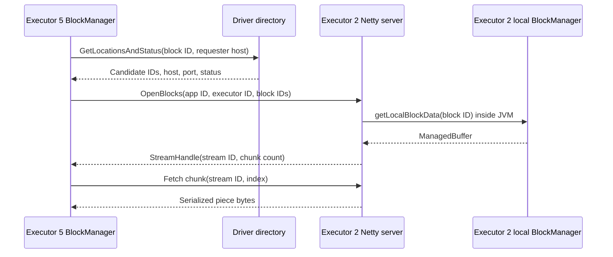

# Block transfer service: from a block name to bytes on a socket

[component index](README.md) | [BlockManager](block-manager.md) | [BlockManagerMaster](block-manager-master.md)

`NettyBlockTransferService` moves blocks between JVMs. Its caller must already know **which host, port, executor and block IDs to request**. It does not discover the producer, schedule a task, or recompute a partition. A successful lookup at the driver and a successful fetch at the producer are separate events.

## Flow at a glance

1. **Executor 5**: Ask executor 2 to open a broadcast piece.
2. **Executor 2**: Return a stream handle for the piece.
3. **Executor 5**: Request the chunk and receive its bytes.

> **Key distinction:** The open reply identifies the stream; the chunk response carries the bytes.

Show the animated flow

## Runtime, endpoints and contracts

The driver and every executor construct a service in their own `SparkEnv`. `BlockManager.initialize` passes itself in as the local `BlockDataManager`. `init` creates a Netty `TransportContext`, client factory, bound `TransportServer`, and `NettyBlockRpcServer`; it configures the shuffle transport and supplies authentication bootstraps when enabled. The executor uses `spark.blockManager.port` (default `0`, choose a port); `spark.driver.blockManager.port` overrides it on the driver. The `BlockManagerId` advertises the actual bound transfer port, **not** the driver's scheduler RPC port. [Wiring and port choice][env] · [port defaults][ports] · [server setup][init] · [registration][register]

| Operation | Inputs | Observable result |
|---|---|---|
| `fetchBlocks` | Target host/port and executor ID, array of block-name strings, `BlockFetchingListener`, optional `DownloadFileManager` | Asynchronous `onBlockFetchSuccess(id, ManagedBuffer)` or `onBlockFetchFailure(id, cause)` per block. |
| `fetchBlockSync` | Same address, one block ID and optional download manager | Waits on a promise. File-backed or encrypted results are passed through; other received buffers are copied so the returned buffer lives beyond the callback. |
| `uploadBlock` / `uploadBlockSync` | Target, `BlockId`, `ManagedBuffer` payload, `StorageLevel`, class tag, optional checksum and seal flag | A `Future[Unit]` acknowledgement or failure; the sync wrapper waits. An acknowledgement is not a directory of replicas. |

[Fetch implementation][fetch] · [synchronous adapters][sync] · [upload framing][upload]

## Follow `broadcast_9_piece1` from executor 2 to executor 5

Assume the piece is absent locally, the master has returned executor 2, and the two executors are on different hosts. The driver's response is metadata. Only the last exchange below carries the piece itself.

1. The requesting service obtains a `TransportClient`. `OneForOneBlockFetcher` uses `OpenBlocks` for RDD blocks and broadcast pieces. With the new protocol, a set of shuffle blocks instead gets a shuffle-specific request (including grouped map/reduce IDs); old-protocol requests use `OpenBlocks`. These are messages on the **block transfer connection**, not Spark scheduler RPCs. [Protocol selection][select]
2. On the serving executor the handler translates names into `BlockId`s and asks the local block manager for buffers. For an ordinary block that means local serialized bytes; for a shuffle block it delegates to the shuffle resolver. It registers the buffers with `OneForOneStreamManager`, associates the stream with the client channel, and returns a **handle**, not the payload. [Open request handler][open] · [local provider][provider] · [stream ownership][stream]
3. The requester issues a chunk request per index; the index maps back to a block ID for the listener. If the caller provided a download manager, the fetcher instead streams each chunk to a temporary file and delivers a file-backed buffer. The ordinary block manager chooses that path when the reported block size exceeds `spark.network.maxRemoteBlockSizeFetchToMem` (default `200m`). A local in-JVM hit and a successful direct read of another executor's same-host disk file bypass this network transfer. [Chunk callbacks and download][chunks] · [caller decisions][local] · [threshold][threshold]

**Reverse direction: replication.** An upload sends storage/type metadata plus the bytes. Small non-shuffle blocks use `UploadBlock` in a single RPC; blocks above the threshold and shuffle uploads use `UploadBlockStream` with a header and a separate data stream. The receiver calls `putBlockData` or `putBlockDataAsStream`; an ordinary streamed block is accumulated in a temp file, then admitted to the local store, while shuffle migration goes through its resolver. Failure to store is not a successful replication. [Upload sender][upload] · [receiver][receive] · [stream completion and failure][complete]

## Failure, cleanup and diagnosis

`RetryingBlockTransferor` retries **outstanding** IDs for eligible I/O failures after a wait and within its retry limit; stale callbacks from an earlier attempt are ignored. This is retrying a transfer to the same target. Trying another reported replica is a separate [BlockManager decision][peers]. A failed connection can also prompt a driver liveness query; a known-dead executor is reported distinctly. [Fetch startup/error handling][fetch] · [retry selection and state][retry]

Match the failing block ID with the **advertised host:port** on the producer. A connection failure before `StreamHandle` is different from “block not found” on a live server, and both differ from a consumer disk error writing a downloaded chunk. The [external shuffle service](external-shuffle-service.md), when configured, is a separate listener outside the executor JVM that can serve shuffle files (and optionally disk RDD blocks). YARN's ResourceManager does not relay the bytes. [Service address versus executor address][register] · [disk-RDD option][ess]

Downloaded files are registered for cleanup or deleted on failure. On the ordinary in-memory receive path the transport releases a chunk buffer after its callback; a caller keeping it must retain or copy it. The server stream is scoped to the connection; when the owning block manager stops, the service closes its server, client factory and transport context. [Download cleanup][files] · [callback buffer lifetime][release] · [shutdown][shutdown]

[env]: https://github.com/apache/spark/blob/dada2a6db5d73b152d6ba16e4fe21406f86abfe3/core/src/main/scala/org/apache/spark/SparkEnv.scala#L761-L806
[ports]: https://github.com/apache/spark/blob/dada2a6db5d73b152d6ba16e4fe21406f86abfe3/core/src/main/scala/org/apache/spark/internal/config/package.scala#L1273-L1282
[init]: https://github.com/apache/spark/blob/dada2a6db5d73b152d6ba16e4fe21406f86abfe3/core/src/main/scala/org/apache/spark/network/netty/NettyBlockTransferService.scala#L49-L104
[register]: https://github.com/apache/spark/blob/dada2a6db5d73b152d6ba16e4fe21406f86abfe3/core/src/main/scala/org/apache/spark/storage/BlockManager.scala#L698-L748
[fetch]: https://github.com/apache/spark/blob/dada2a6db5d73b152d6ba16e4fe21406f86abfe3/core/src/main/scala/org/apache/spark/network/netty/NettyBlockTransferService.scala#L119-L166
[sync]: https://github.com/apache/spark/blob/dada2a6db5d73b152d6ba16e4fe21406f86abfe3/core/src/main/scala/org/apache/spark/network/BlockTransferService.scala#L71-L131
[upload]: https://github.com/apache/spark/blob/dada2a6db5d73b152d6ba16e4fe21406f86abfe3/core/src/main/scala/org/apache/spark/network/netty/NettyBlockTransferService.scala#L170-L219
[select]: https://github.com/apache/spark/blob/dada2a6db5d73b152d6ba16e4fe21406f86abfe3/common/network-shuffle/src/main/java/org/apache/spark/network/shuffle/OneForOneBlockFetcher.java#L85-L123
[open]: https://github.com/apache/spark/blob/dada2a6db5d73b152d6ba16e4fe21406f86abfe3/core/src/main/scala/org/apache/spark/network/netty/NettyBlockRpcServer.scala#L78-L122
[provider]: https://github.com/apache/spark/blob/dada2a6db5d73b152d6ba16e4fe21406f86abfe3/core/src/main/scala/org/apache/spark/storage/BlockManager.scala#L893-L917
[stream]: https://github.com/apache/spark/blob/dada2a6db5d73b152d6ba16e4fe21406f86abfe3/common/network-common/src/main/java/org/apache/spark/network/server/OneForOneStreamManager.java#L230-L257
[chunks]: https://github.com/apache/spark/blob/dada2a6db5d73b152d6ba16e4fe21406f86abfe3/common/network-shuffle/src/main/java/org/apache/spark/network/shuffle/OneForOneBlockFetcher.java#L282-L332
[local]: https://github.com/apache/spark/blob/dada2a6db5d73b152d6ba16e4fe21406f86abfe3/core/src/main/scala/org/apache/spark/storage/BlockManager.scala#L1328-L1408
[threshold]: https://github.com/apache/spark/blob/dada2a6db5d73b152d6ba16e4fe21406f86abfe3/core/src/main/scala/org/apache/spark/internal/config/package.scala#L1536-L1552
[receive]: https://github.com/apache/spark/blob/dada2a6db5d73b152d6ba16e4fe21406f86abfe3/core/src/main/scala/org/apache/spark/network/netty/NettyBlockRpcServer.scala#L123-L145
[complete]: https://github.com/apache/spark/blob/dada2a6db5d73b152d6ba16e4fe21406f86abfe3/core/src/main/scala/org/apache/spark/storage/BlockManager.scala#L937-L992
[peers]: https://github.com/apache/spark/blob/dada2a6db5d73b152d6ba16e4fe21406f86abfe3/core/src/main/scala/org/apache/spark/storage/BlockManager.scala#L1395-L1467
[retry]: https://github.com/apache/spark/blob/dada2a6db5d73b152d6ba16e4fe21406f86abfe3/common/network-shuffle/src/main/java/org/apache/spark/network/shuffle/RetryingBlockTransferor.java#L203-L323
[ess]: https://github.com/apache/spark/blob/dada2a6db5d73b152d6ba16e4fe21406f86abfe3/core/src/main/scala/org/apache/spark/internal/config/package.scala#L872-L880
[files]: https://github.com/apache/spark/blob/dada2a6db5d73b152d6ba16e4fe21406f86abfe3/common/network-shuffle/src/main/java/org/apache/spark/network/shuffle/OneForOneBlockFetcher.java#L346-L392
[release]: https://github.com/apache/spark/blob/dada2a6db5d73b152d6ba16e4fe21406f86abfe3/common/network-common/src/main/java/org/apache/spark/network/client/TransportResponseHandler.java#L166-L178
[shutdown]: https://github.com/apache/spark/blob/dada2a6db5d73b152d6ba16e4fe21406f86abfe3/core/src/main/scala/org/apache/spark/network/netty/NettyBlockTransferService.scala#L222-L232
