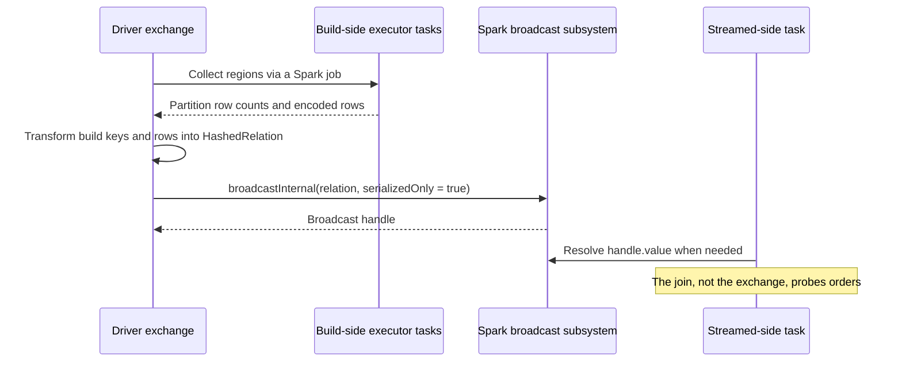

# Broadcast exchange: building the small side

[component index](README.md) | [Broadcast hash join: probing the result](broadcast-hash-join.md)

`BroadcastExchangeExec` turns the **entire output of one child** into a Spark
`Broadcast` handle. In a hash join it builds one lookup relation on the **driver
JVM**, from rows produced by executor tasks. It does not iterate the large
table, decide join matches, or implement [distribution of the broadcast blocks](broadcast-manager.md).
This is an internal SQL operator, not a Python call to `sc.broadcast`.

## Flow at a glance

1. **Build tasks**: Send region rows to the driver.
2. **Driver exchange**: Build a hashed relation keyed by region ID.
3. **Core broadcast**: Publish the relation and return its handle.

> **Key distinction:** The exchange builds the lookup table; join tasks probe it after resolving the handle.

Show the animated flow

## Contract and lifetime

| Interface | What it carries |
|---|---|
| From the parent | An unsatisfied `BroadcastDistribution(mode)` makes `EnsureRequirements.resolveChild` insert the exchange. For a hash join, `HashedRelationBroadcastMode` holds the build keys bound to the child's output and the null-aware flag. The exchange advertises `BroadcastPartitioning(mode)`. |
| From the child | `child.executeCollectIterator()` returns **`(rowCount, Iterator[InternalRow])` on the driver**. The ordinary implementation first collects counts and compressed row buffers for the partitions, then decodes the buffers on iteration. The iterator does not make this a bounded-memory, remote row stream. |
| To the consumer | `executeBroadcast[HashedRelation]()` obtains the broadcast handle. The ordinary row RDD path, `BroadcastExchangeExec.doExecute()`, is unsupported. AQE can instead observe completion via `BroadcastQueryStageExec.doMaterialize` and `submitBroadcastJob()`. |
| Owned state | Each exchange has a `runId`/job tag, a lazy `relationFuture`, a completion promise and SQL metrics. `doPrepare` starts the future on the driver's `broadcast-exchange` pool with SQL thread-local context. Consumers of the materialized exchange reuse its result; retained blocks and their transfer belong to Spark's broadcast subsystem. |

See [exchange insertion][insert], [collect and decode][collect], [submission and
cancellation APIs][submit] and [AQE's broadcast-stage adapter][stage].

## Trace: materializing `regions` for an orders join

1. Assume [the planner](sql-planner.md) chose `BuildRight` on `o.region_id = r.id`
   from a 6 MiB estimate. The asynchronous build tags its Spark job so it can be
   cancelled separately. `numOutputRows` records the actual count. A count **at
   or above** `maxBroadcastRows` fails before constructing the relation; the cap
   depends on the mode and key representation.
2. `mode.transform(input, Some(numRows))` builds the index. With an eligible
   single bound `LongType` key, `HashedRelation.apply` uses `LongHashedRelation`;
   other nonempty ordinary hash-key shapes use `UnsafeHashedRelation`. Empty
   input has a dedicated representation. A non-hash broadcast consumer need not
   request a hash table at all.
3. `dataSize` measures the built relation's **estimated memory size**, not the
   planner's estimate or the number of wire bytes. An actual 18 MiB relation can
   pass even with a 10 MiB automatic *planning* threshold. The distinct
   `spark.sql.maxBroadcastTableSize` limit is checked **after build**, using
   `>=`; in this revision it defaults to 8 GiB. A hint bypasses neither this
   guard nor the row guard.
4. `SparkContext.broadcastInternal(..., serializedOnly = true)` publishes the
   built relation without asking the core broadcast subsystem to cache its
   unserialized copy on the driver. This does not eliminate the memory needed to
   build it. Success completes the promise with the handle, **not** with joined rows.

[Build code and guards][build] · [hashed mode][mode] · [relation selection][relation] ·
[SparkContext handoff][broadcast] · [timeout and size settings][limits].

## When the consuming join appears to wait

In the SQL UI, find `BroadcastExchange` (possibly under `BroadcastQueryStage`)
and compare **time to collect**, **time to build**, and **time to broadcast**.
Collection includes waiting for the child job; build time includes decoding and
constructing the relation. Broadcast time measures the driver's publish call,
not later fetch latency on every executor. The completed exchange also reports
**data size** and **number of output rows** as runtime statistics.

If the bounded `doExecuteBroadcast` wait exceeds `spark.sql.broadcastTimeout`
(300 seconds by default here), the exchange logs a timeout, cancels the tagged
jobs and future **if still running**, then throws. A driver out-of-memory error
during build instead fails the future with a build/broadcast error. Raising the
timeout cannot make the relation fit; inspect the child projection, filtering,
estimate and hint before blaming streamed-side tasks. [Metrics][metrics] ·
[error, preparation and wait paths][wait].

[insert]: https://github.com/apache/spark/blob/dada2a6db5d73b152d6ba16e4fe21406f86abfe3/sql/core/src/main/scala/org/apache/spark/sql/execution/exchange/EnsureRequirements.scala#L179-L195
[collect]: https://github.com/apache/spark/blob/dada2a6db5d73b152d6ba16e4fe21406f86abfe3/sql/core/src/main/scala/org/apache/spark/sql/execution/SparkPlan.scala#L381-L492
[submit]: https://github.com/apache/spark/blob/dada2a6db5d73b152d6ba16e4fe21406f86abfe3/sql/core/src/main/scala/org/apache/spark/sql/execution/exchange/BroadcastExchangeExec.scala#L46-L111
[stage]: https://github.com/apache/spark/blob/dada2a6db5d73b152d6ba16e4fe21406f86abfe3/sql/core/src/main/scala/org/apache/spark/sql/execution/adaptive/QueryStageExec.scala#L246-L275
[build]: https://github.com/apache/spark/blob/dada2a6db5d73b152d6ba16e4fe21406f86abfe3/sql/core/src/main/scala/org/apache/spark/sql/execution/exchange/BroadcastExchangeExec.scala#L161-L229
[mode]: https://github.com/apache/spark/blob/dada2a6db5d73b152d6ba16e4fe21406f86abfe3/sql/core/src/main/scala/org/apache/spark/sql/execution/joins/HashedRelation.scala#L1215-L1234
[relation]: https://github.com/apache/spark/blob/dada2a6db5d73b152d6ba16e4fe21406f86abfe3/sql/core/src/main/scala/org/apache/spark/sql/execution/joins/HashedRelation.scala#L136-L165
[broadcast]: https://github.com/apache/spark/blob/dada2a6db5d73b152d6ba16e4fe21406f86abfe3/core/src/main/scala/org/apache/spark/SparkContext.scala#L1786-L1798
[limits]: https://github.com/apache/spark/blob/dada2a6db5d73b152d6ba16e4fe21406f86abfe3/sql/catalyst/src/main/scala/org/apache/spark/sql/internal/SQLConf.scala#L2555-L2565
[metrics]: https://github.com/apache/spark/blob/dada2a6db5d73b152d6ba16e4fe21406f86abfe3/sql/core/src/main/scala/org/apache/spark/sql/execution/exchange/BroadcastExchangeExec.scala#L124-L150
[wait]: https://github.com/apache/spark/blob/dada2a6db5d73b152d6ba16e4fe21406f86abfe3/sql/core/src/main/scala/org/apache/spark/sql/execution/exchange/BroadcastExchangeExec.scala#L231-L281
