# Broadcast hash join: probing one partition at a time

[component index](README.md) | [Broadcast exchange: building the relation](broadcast-exchange.md)

`BroadcastHashJoinExec` consumes an already built hash table. The driver holds
the plan node and obtains a `Broadcast[HashedRelation]`; an **executor JVM task**
probes that relation with rows from **one streamed partition**. The streamed
side need not be shuffled or sorted for this join. Exchanges elsewhere in the
query still count, and a DataFrame written in Python does not make this join
run in a Python worker.

## Flow at a glance

1. **Broadcast exchange**: The exchange builds and broadcasts a hash table keyed by region ID.
2. **Executor task**: The task looks up each order's region ID and checks each candidate's minimum amount.
3. **Left join output**: The task emits a row per match, or one row with a null label if none qualify.

> **Watch for:** A hash hit alone is not a match: the order must also meet the region's minimum amount.

<details>
<summary>Show the animated flow</summary>



</details>

## Input, state, and output

| Owner | Contract |
|---|---|
| Driver plan node | Stores left/right keys and children, `joinType`, `buildSide`, optional residual `condition`, and a null-aware flag. `HashJoin` maps the sides to build/stream, checks key count and compatible types, and binds key projections against the respective output schemas. |
| Build-side exchange | `requiredChildDistribution` requests `BroadcastDistribution(HashedRelationBroadcastMode(buildBoundKeys, ...))` only on the build child. `buildPlan.executeBroadcast[HashedRelation]()` returns a handle; the other child has `UnspecifiedDistribution`. The exchange, not each probe task, collects and indexes the build rows. |
| Executor task attempt | The non-codegen `doExecute` maps streamed partitions. `buildReadOnlyRelation` obtains `broadcast.value.asReadOnlyCopy()` and accounts its estimated size in task peak execution memory. Long and unsafe relations share backing storage with the copy: per-task lookup cursors and reusable result rows are separate, not an entire duplicate hash table per row or task. Whole-stage generated code initializes its relation through the same helper. |
| Downstream operator | Receives an `RDD[InternalRow]` on the row path. `HashJoin.join` projects the result to the declared left/right schema and counts emitted rows. Inner joins return both sides; left outer makes right fields nullable; left semi/anti return just the left side. Output partitioning derives from the streamed child, not the broadcast. |

[Plan contract][contract] · [key binding and projection][binding] ·
[row and codegen paths][probe] · [per-task relation and memory accounting][copy] ·
[shared unsafe map][unsafe] / [shared long map][long].

## Trace: two matching rows, and two kinds of miss

Use ordinary SQL equality, **not** null-safe equality:

```sql
SELECT o.order_id, r.label FROM orders o LEFT JOIN regions r
  ON o.region_id = r.id AND o.amount >= r.minimum
```

1. The [planner](sql-planner.md) finds hashable equality keys and a broadcastable
   right side. A left outer join must preserve `orders`: right-build is allowed;
   left-build is not. A full outer join cannot use this broadcast hash strategy.
2. Suppose the build table contains `(id=7, label=East, minimum=0)` and
   `(7, Outlet, 100)`. Both survive materialization. For order `(41, 7, 120)` the
   task generates key `7` once, iterates both candidates, and checks the residual
   amount predicate. It emits **two** rows: `(41, East)` and `(41, Outlet)`.
   A unique-key table uses a single-value lookup instead of a match iterator.
3. Order `(42, 9, 50)` has no hash entry. Order `(43, 7, -1)` has candidates but
   neither passes the residual. A left outer probe emits `(42, NULL)` and
   `(43, NULL)` exactly once each. An inner probe would emit neither. Thus a
   hash hit is not necessarily a SQL match. The four rows are a set of example
   results, not an ordering guarantee. [Outer probe and residual handling][outer].
4. Do not reuse ordinary anti-join intuition for `NOT IN`. The separate
   `isNullAwareAntiJoin` path requires **one key per side, LeftAnti, BuildRight,
   and no residual**. An empty build returns all left rows; a build containing a
   null key returns none; otherwise only non-null, unmatched probe keys survive.
   [Constructor guards][contract] · [executor branches][probe].

## Performance and failure clues

Look for `BroadcastHashJoin`, `BuildRight`/`BuildLeft`, and the separate
`BroadcastExchange` in `df.explain("formatted")` or the SQL UI's final plan.
Compare **number of output rows** at the join with streamed input rows: many
duplicates on both sides can produce a large output even when the broadcast
fits. A slow streamed partition can dominate the join without a join-induced
shuffle. Peak execution memory includes the recorded relation estimate; summing
it across tasks is **not** a measure of distinct executor-resident hash tables.

A build timeout fails while obtaining the handle, before these probes can run;
inspect the exchange and driver logs. A task that fails after starting its probe
can be retried over the streamed partition with the broadcast handle. The join
does not switch algorithms halfway through that partition or rebuild a table
from source for every retry. [Join dispatch and output metric][emit].

[contract]: https://github.com/apache/spark/blob/dada2a6db5d73b152d6ba16e4fe21406f86abfe3/sql/core/src/main/scala/org/apache/spark/sql/execution/joins/BroadcastHashJoinExec.scala#L40-L89
[binding]: https://github.com/apache/spark/blob/dada2a6db5d73b152d6ba16e4fe21406f86abfe3/sql/core/src/main/scala/org/apache/spark/sql/execution/joins/HashJoin.scala#L109-L182
[probe]: https://github.com/apache/spark/blob/dada2a6db5d73b152d6ba16e4fe21406f86abfe3/sql/core/src/main/scala/org/apache/spark/sql/execution/joins/BroadcastHashJoinExec.scala#L133-L219
[copy]: https://github.com/apache/spark/blob/dada2a6db5d73b152d6ba16e4fe21406f86abfe3/sql/core/src/main/scala/org/apache/spark/sql/execution/joins/BroadcastHashJoinExec.scala#L259-L269
[unsafe]: https://github.com/apache/spark/blob/dada2a6db5d73b152d6ba16e4fe21406f86abfe3/sql/core/src/main/scala/org/apache/spark/sql/execution/joins/HashedRelation.scala#L208-L231
[long]: https://github.com/apache/spark/blob/dada2a6db5d73b152d6ba16e4fe21406f86abfe3/sql/core/src/main/scala/org/apache/spark/sql/execution/joins/HashedRelation.scala#L1058-L1089
[outer]: https://github.com/apache/spark/blob/dada2a6db5d73b152d6ba16e4fe21406f86abfe3/sql/core/src/main/scala/org/apache/spark/sql/execution/joins/HashJoin.scala#L184-L273
[emit]: https://github.com/apache/spark/blob/dada2a6db5d73b152d6ba16e4fe21406f86abfe3/sql/core/src/main/scala/org/apache/spark/sql/execution/joins/HashJoin.scala#L368-L396
