# BroadcastManager: how a value becomes fetchable pieces

[component index](README.md) | [BlockManager](block-manager.md) | [BlockManagerMaster](block-manager-master.md) | [Block transfer service](block-transfer-service.md)

A Spark broadcast gives tasks a small **handle** for a read-only value. Creating it seeds pieces on the driver; it does **not** push the whole value to every executor. A consumer fetches only the pieces it lacks and can then serve those pieces to other consumers. This is the distribution mechanism, not the [SQL broadcast exchange](broadcast-exchange.md) that builds a relation for a join.

## Flow at a glance

1. **Driver**: Publish the value as numbered pieces.
2. **Cold executor**: Fetch missing pieces from their holders.
3. **Same executor**: Rebuild the value from the ordered pieces.

> **Key distinction:** Tasks carry a handle, not the whole value, and peers can supply pieces as well as the driver.

> **Interactive explorer:** [Open in Spark Visualizer](https://nuthanreddy.github.io/spark-visualizer/#component=broadcast-manager) to step through commands, wire payloads, category filters, and fault simulations on the live cluster canvas.

## Owners and representations

Each driver/executor `SparkEnv` constructs a JVM `BroadcastManager` and initializes a `TorrentBroadcastFactory`. The driver creates broadcasts through `SparkContext.broadcastInternal`: it checks the input, asks the manager for a handle, and registers it for cleanup. The manager allocates a `Long` ID, delegates to `TorrentBroadcast`, and maintains a per-JVM cache with strong keys and **weak values** so different handles for the same ID can share a reconstructed object. No separate YARN process or broadcast server is started. [Environment][env] · [creation API][sc] · [manager state][manager] · [factory][factory]

| Representation for broadcast 9 | Where and why it exists |
|---|---|
| `Broadcast[T]` / `TorrentBroadcast` handle | Serializable ID plus reconstruction information, including piece count and optional checksums. The memoized JVM value is transient; serializing the handle does not inline that value. |
| `broadcast_9` | **Whole JVM value**, stored with `MEMORY_AND_DISK`, `tellMaster=false` on the ordinary path. Reusable locally, not advertised as a block for remote consumers. |
| `broadcast_9_piece0`, `broadcast_9_piece1`, ... | Serialized pieces stored with `MEMORY_AND_DISK_SER`, `tellMaster=true`. These are the IDs remote peers can discover and fetch. |
| `broadcast_9_python` (classic PySpark) | On executor deserialization of `PythonBroadcast`, a local `DISK_ONLY` block backs the path to the Python payload. It is neither a torrent piece nor a Python object already loaded in a worker. |

[Handle fields][handle] · [block naming][names] · [whole value and pieces][write] · [Python backing file][python-file]

## Publish once, read on demand

1. **Seed.** Public `SparkContext.broadcast(value)` uses `serializedOnly=false`. The driver stores the whole value locally, serializes the value through an optionally compressed stream, and divides the resulting bytes into pieces (`spark.broadcast.blockSize`, default `4m`). If checksums are enabled, it records an Adler-32 for each piece. It stores and reports each numbered piece. A failure during piece creation/storage removes the partially written broadcast and rethrows; no usable handle is returned. [Driver write path][write] · [serialization][codec] · [configuration defaults][config]
2. **Look up the whole value before fetching.** `Broadcast.value` checks validity. `TorrentBroadcast.getValue` tries the handle's transient soft reference (weak for `serializedOnly`). On a miss it locks by broadcast ID within this JVM, checks `BroadcastManager.cachedValues`, then checks the local block manager for `broadcast_9`. A live whole-value hit skips all network requests; simultaneous first readers in one JVM need not download the same broadcast independently. [Handle cache][handle] · [keyed lookup and reconstruction][read]
3. **Fetch missing pieces.** On a whole-value miss, visit piece IDs in randomized order. First try `getLocalBytes`; otherwise call `getRemoteBytes`. The block manager gets locations from the driver and reads a same-host file or fetches from a holder over Netty. It need not choose the driver: executor 2 can serve `piece0` while the driver serves `piece1`. A remote piece is checksum-checked when enabled, stored locally, and **reported**. Random fetch order does not change reconstruction: each result is placed at its numbered index. [Piece reader][pieces] · [where the bytes come from][remote]
4. **Reassemble and reuse.** Concatenate the piece streams in index order, decompress if configured, then deserialize. Cache the object locally when appropriate, populate the weak-value cache, and dispose the temporary block data. The nonlocal `serializedOnly=true` optimization skips pinning the original whole value in the *driver's* block manager at creation; it does not eliminate pieces or forbid caching the merged object inside an executor task. [Reconstruction and cache conditions][read] · [stream ordering][codec]

## What `bc.value` means in Python

For `bc = sc.broadcast(lookup)`, the Python driver pickles `lookup` to a file (via a local socket to the JVM if I/O encryption is enabled). The JVM broadcasts a `PythonBroadcast` wrapping that payload, not a live Python dictionary. Pickling `bc` into a task closure records its broadcast ID rather than embedding `lookup` again. [Python driver and worker constructors][py-create] · [closure reduction][reduce]

On the executor, worker setup compares the IDs needed for this task with the IDs that Python worker already knows. For a new ID the JVM reads `broadcast.value.path` (which can trigger the torrent fetch) and gives the worker a local path, or serves decrypted data over a local socket. With a path, Python unpickles lazily on first `.value`; with the decryption socket it loads during worker setup. **The reusable JVM pieces and the unpickled object in each Python worker are different memory costs.** Large Python objects can exhaust worker memory even when all pieces were already local. [JVM worker handoff][handoff] · [Python registry][registry] · [lazy `.value`][py-value]

## Failure, cleanup and diagnosis

`unpersist` asks for executor-side block removal but keeps the driver seed and the handle valid; a later task can fetch again. `destroy` invalidates the handle and includes the driver in removal. Blocking controls whether the caller waits for block removal, not whether every application-held Java or Python reference vanishes. The master sends removal to the selected managers rather than relying only on advertised locations, so they also remove unreported whole-value blocks. The context cleaner can initiate removal when the driver handle is no longer referenced. At environment shutdown, Spark stops the broadcast manager and then the local block manager; the torrent factory has no separate service to shut down. [Lifecycle API][lifecycle] · [removal flags][flags] · [master fan-out][remove] · [cleaner][cleaner] · [shutdown order][stop]

For a cold or failed read, correlate the driver's **Created broadcast** ID with the executor's **Started reading broadcast variable** log and the specific `broadcast_9_pieceN`. A missing remote piece and a checksum mismatch fail at different points; neither runs RDD lineage to recreate the original value. If all pieces were read successfully but the Python worker fails while loading, investigate the local file/decryption/unpickle step, not the driver's scheduler port. [Creation log][sc] · [per-piece failures][pieces] · [read timing][read]

[env]: https://github.com/apache/spark/blob/dada2a6db5d73b152d6ba16e4fe21406f86abfe3/core/src/main/scala/org/apache/spark/SparkEnv.scala#L735-L754
[sc]: https://github.com/apache/spark/blob/dada2a6db5d73b152d6ba16e4fe21406f86abfe3/core/src/main/scala/org/apache/spark/SparkContext.scala#L1773-L1799
[manager]: https://github.com/apache/spark/blob/dada2a6db5d73b152d6ba16e4fe21406f86abfe3/core/src/main/scala/org/apache/spark/broadcast/BroadcastManager.scala#L32-L81
[factory]: https://github.com/apache/spark/blob/dada2a6db5d73b152d6ba16e4fe21406f86abfe3/core/src/main/scala/org/apache/spark/broadcast/TorrentBroadcastFactory.scala#L29-L49
[handle]: https://github.com/apache/spark/blob/dada2a6db5d73b152d6ba16e4fe21406f86abfe3/core/src/main/scala/org/apache/spark/broadcast/TorrentBroadcast.scala#L59-L131
[names]: https://github.com/apache/spark/blob/dada2a6db5d73b152d6ba16e4fe21406f86abfe3/core/src/main/scala/org/apache/spark/storage/BlockId.scala#L159-L163
[write]: https://github.com/apache/spark/blob/dada2a6db5d73b152d6ba16e4fe21406f86abfe3/core/src/main/scala/org/apache/spark/broadcast/TorrentBroadcast.scala#L139-L186
[python-file]: https://github.com/apache/spark/blob/dada2a6db5d73b152d6ba16e4fe21406f86abfe3/core/src/main/scala/org/apache/spark/api/python/PythonRDD.scala#L824-L873
[codec]: https://github.com/apache/spark/blob/dada2a6db5d73b152d6ba16e4fe21406f86abfe3/core/src/main/scala/org/apache/spark/broadcast/TorrentBroadcast.scala#L355-L390
[config]: https://github.com/apache/spark/blob/dada2a6db5d73b152d6ba16e4fe21406f86abfe3/core/src/main/scala/org/apache/spark/internal/config/package.scala#L2534-L2557
[read]: https://github.com/apache/spark/blob/dada2a6db5d73b152d6ba16e4fe21406f86abfe3/core/src/main/scala/org/apache/spark/broadcast/TorrentBroadcast.scala#L249-L312
[pieces]: https://github.com/apache/spark/blob/dada2a6db5d73b152d6ba16e4fe21406f86abfe3/core/src/main/scala/org/apache/spark/broadcast/TorrentBroadcast.scala#L189-L230
[remote]: https://github.com/apache/spark/blob/dada2a6db5d73b152d6ba16e4fe21406f86abfe3/core/src/main/scala/org/apache/spark/storage/BlockManager.scala#L1328-L1364
[py-create]: https://github.com/apache/spark/blob/dada2a6db5d73b152d6ba16e4fe21406f86abfe3/python/pyspark/core/broadcast.py#L112-L149
[reduce]: https://github.com/apache/spark/blob/dada2a6db5d73b152d6ba16e4fe21406f86abfe3/python/pyspark/core/broadcast.py#L334-L342
[handoff]: https://github.com/apache/spark/blob/dada2a6db5d73b152d6ba16e4fe21406f86abfe3/core/src/main/scala/org/apache/spark/api/python/PythonWorkerUtils.scala#L131-L188
[registry]: https://github.com/apache/spark/blob/dada2a6db5d73b152d6ba16e4fe21406f86abfe3/python/pyspark/worker_util.py#L247-L288
[py-value]: https://github.com/apache/spark/blob/dada2a6db5d73b152d6ba16e4fe21406f86abfe3/python/pyspark/core/broadcast.py#L255-L275
[lifecycle]: https://github.com/apache/spark/blob/dada2a6db5d73b152d6ba16e4fe21406f86abfe3/core/src/main/scala/org/apache/spark/broadcast/Broadcast.scala#L59-L113
[flags]: https://github.com/apache/spark/blob/dada2a6db5d73b152d6ba16e4fe21406f86abfe3/core/src/main/scala/org/apache/spark/broadcast/TorrentBroadcast.scala#L233-L252
[remove]: https://github.com/apache/spark/blob/dada2a6db5d73b152d6ba16e4fe21406f86abfe3/core/src/main/scala/org/apache/spark/storage/BlockManagerMasterEndpoint.scala#L510-L528
[cleaner]: https://github.com/apache/spark/blob/dada2a6db5d73b152d6ba16e4fe21406f86abfe3/core/src/main/scala/org/apache/spark/ContextCleaner.scala#L309-L320
[stop]: https://github.com/apache/spark/blob/dada2a6db5d73b152d6ba16e4fe21406f86abfe3/core/src/main/scala/org/apache/spark/SparkEnv.scala#L293-L310
