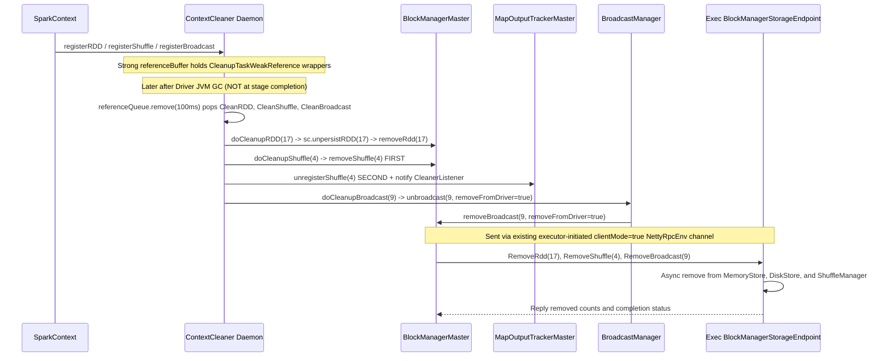

# ContextCleaner: async WeakReference GC cleanup daemon

[component index](README.md)

`ContextCleaner` is **not** a synchronous stage-completion hook, does **not** run inside [executor](executor.md) JVMs, and does **not** send block deletion traffic over the [`BlockTransferService`](block-transfer-service.md) data port (`:42001`). It is a single daemon thread (`"Spark Context Cleaner"`) inside the [driver JVM](spark-driver.md), started by [`SparkContext`](spark-context.md) when `spark.cleaner.referenceTracking=true` (default), that watches JVM `WeakReference` wrappers for RDDs, `ShuffleDependency` objects, [broadcast](broadcast-manager.md) variables, accumulators, checkpoints, and weak-owned listeners. Only **after** the driver JVM garbage collector determines an object is unreachable and enqueues its reference onto a `ReferenceQueue` does `ContextCleaner` trigger cluster-wide metadata and block removal across PySpark, Scala, and Java jobs alike (for PySpark, Py4J proxy objects hold Java references on the driver until Python GC releases the proxy and driver JVM GC then collects the referent).

## Flow at a glance

1. **Weak-reference registration**: When Spark constructs an RDD, `ShuffleDependency`, `Broadcast`, `AccumulatorV2`, or checkpoint, `ContextCleaner` wraps it in a `CleanupTaskWeakReference(task, referent, referenceQueue)` and holds the wrapper strongly inside `referenceBuffer`.
2. **Async driver GC trigger**: Stage completion does **not** delete blocks. Cleanup fires only after driver JVM GC (or periodic `System.gc()` every `spark.cleaner.periodicGC.interval`, default `30min`) collects the unreachable referent and enqueues its wrapper onto `referenceQueue`.
3. **Ordered driver-side dispatch**: The `"Spark Context Cleaner"` thread pops each task and runs `doCleanupRDD`, `doCleanupShuffle` (removing shuffle blocks **before** unregistering `MapOutputTrackerMaster`), or `doCleanupBroadcast` (`removeFromDriver = true`).
4. **Client-mode RPC fanout to executors**: `BlockManagerMasterEndpoint` sends `RemoveRdd`, `RemoveShuffle`, and `RemoveBroadcast` control RPCs to each executor's `BlockManagerStorageEndpoint` back over the existing executor-initiated `NettyRpcEnv` channel (`clientMode = true`), where removals execute asynchronously.

> **Key distinction:** Cleanup is asynchronous and driven strictly by driver JVM GC of `WeakReference`s -- never synchronously at stage end -- and its executor-bound `RemoveRdd`/`RemoveShuffle`/`RemoveBroadcast` RPCs ride the existing executor-initiated `NettyRpcEnv` control channel to `BlockManagerStorageEndpoint`, not the `:42001` block-data transfer port.

> **Interactive explorer:** [Open in Spark Visualizer](https://nuthanreddy.github.io/spark-visualizer/#component=context-cleaner) to step through commands, wire payloads, language modes, category filters, and fault simulations on the live cluster canvas.

## Cleanup task kinds, blocking modes, and shuffle ordering

`SparkContext` starts `ContextCleaner` during initialization ([`SparkContext.scala:719-725`][sc-cleaner]). Inside [`ContextCleaner`][cc-core], `referenceBuffer` (`Collections.newSetFromMap(new ConcurrentHashMap)`) keeps every `CleanupTaskWeakReference` wrapper alive until dequeued so the wrapper itself is never prematurely collected before its `CleanupTask` runs.

| Cleanup task | Triggering Spark object | Driver dispatch path | Blocking config default and key invariant |
|---|---|---|---|
| `CleanRDD(rddId)` | `RDD` | [`doCleanupRDD`][cc-tasks] -> `sc.unpersistRDD(rddId, blocking)` -> `BlockManagerMaster.removeRdd(rddId, blocking)` -> `CleanerListener.rddCleaned` | `spark.cleaner.referenceTracking.blocking=true` (default). Drops `rdd_<id>_*` from `MemoryStore`/`DiskStore` and removes RDD from Spark UI Storage tab. |
| `CleanShuffle(shuffleId)` | `ShuffleDependency` | [`doCleanupShuffle`][cc-tasks] -> `shuffleDriverComponents.removeShuffle(shuffleId, blocking)` **then** `mapOutputTrackerMaster.unregisterShuffle(shuffleId)` -> `CleanerListener.shuffleCleaned` | `spark.cleaner.referenceTracking.blocking.shuffle=false` (default, avoids RPC timeout storms per SPARK-3139). **Strict ordering:** `removeShuffle` runs **before** `unregisterShuffle` so blocks hosted by [External Shuffle Service](external-shuffle-service.md) on deallocated executors remain discoverable during removal. `shuffleCleaned` lets [`ExecutorMonitor`](executor-monitor.md) release shuffle-tracked executors. |
| `CleanBroadcast(broadcastId)` | `Broadcast` | [`doCleanupBroadcast`][cc-tasks] -> `broadcastManager.unbroadcast(broadcastId, removeFromDriver = true, blocking)` -> `BlockManagerMaster.removeBroadcast` -> `CleanerListener.broadcastCleaned` | `spark.cleaner.referenceTracking.blocking=true` (default). Passes `removeFromDriver = true`, purging both driver seed pieces and executor copies. |
| `CleanAccum`, `CleanCheckpoint`, `CleanSparkListener` | `AccumulatorV2`, `RDDCheckpointData`, listener owner | Removes accumulator from `AccumulatorContext`, cleans checkpoint files (if `spark.cleaner.referenceTracking.cleanCheckpoints=true`), or detaches weak-owned `SparkListener` | Keeps long-running driver state bounded when user accumulators, checkpoints, or SQL listeners go out of scope. |

### Why cleanup RPCs do NOT open a new connection to executors

Executor JVMs construct their `NettyRpcEnv` with `clientMode = true` ([`SparkEnv.scala:723`][env-rpc], passing `!isDriver`), meaning an executor `NettyRpcEnv` binds **no** RPC listening server socket (`receiver.address == null`). Each executor registers its [`BlockManagerStorageEndpoint`][bm-endpoint] (`BlockManager.scala:360-362`) on that client-mode `rpcEnv` and passes its endpoint reference during `RegisterBlockManager` over its outbound TCP connection to `driver:41000`. When [`BlockManagerMasterEndpoint`][bmm-ep] later sends `RemoveRdd`, `RemoveShuffle`, or `RemoveBroadcast` to that executor, [`NettyRpcEnv.postToOutbox`][rpc-outbox] (`NettyRpcEnv.scala:161-167`) sees `receiver.client != null` and sends the RPC back over that **existing executor-initiated `TransportClient` connection** -- completely bypassing the `:42001` `BlockTransferService` data port. On the executor, [`BlockManagerStorageEndpoint.receiveAndReply`][bmse-handlers] executes removals asynchronously via `block-manager-storage-async-thread-pool`.

## Async WeakReference GC and cleanup RPC flow

1. **Registration and zero active-path overhead.** Constructing RDDs, shuffles, or broadcasts inserts `CleanupTaskWeakReference` entries into `referenceBuffer` without interfering with active execution while user variables or Py4J references remain reachable.
2. **GC wakeup and periodic GC fallback.** `keepCleaning()` ([`ContextCleaner.scala:185-224`][cc-core]) polls `referenceQueue.remove(100ms)` in a loop synchronized against `stop()`. Because a large driver heap with little allocation pressure may rarely run major GC, `start()` also schedules `System.gc()` every `spark.cleaner.periodicGC.interval` (`30min` default) on `context-cleaner-periodic-gc`.
3. **Executor-side async removal.** Receiving `RemoveRdd`, `RemoveShuffle`, or `RemoveBroadcast` on `BlockManagerStorageEndpoint` dispatches work to `block-manager-storage-async-thread-pool` (up to 100 daemon threads) so slow local disk deletes never block the executor's `IsolatedThreadSafeRpcEndpoint` inbox. For `RemoveShuffle`, the executor unregisters the shuffle from `MapOutputTrackerWorker` and `SparkEnv.unregisterShuffleFromAllManagers(shuffleId)`.

## Inputs, outputs, and state

| Boundary | Contract |
|---|---|
| Inputs | `registerRDDForCleanup`, `registerShuffleForCleanup`, `registerBroadcastForCleanup`, `registerAccumulatorForCleanup`, `registerRDDCheckpointDataForCleanup`, `registerSparkListenerForCleanup`; JVM `ReferenceQueue` GC notifications; `spark.cleaner.referenceTracking` (`true`), `spark.cleaner.referenceTracking.blocking` (`true`), `spark.cleaner.referenceTracking.blocking.shuffle` (`false`), `spark.cleaner.periodicGC.interval` (`30min`). |
| Owned state | `referenceBuffer: java.util.Set[CleanupTaskWeakReference]` (strong guard on weak wrappers), `referenceQueue: ReferenceQueue[AnyRef]`, `listeners: ConcurrentLinkedQueue[CleanerListener]`, daemon thread `"Spark Context Cleaner"`, `periodicGCService`, and `@volatile stopped`. |
| Outputs | `sc.unpersistRDD`, `shuffleDriverComponents.removeShuffle`, `MapOutputTrackerMaster.unregisterShuffle`, `BroadcastManager.unbroadcast(..., removeFromDriver = true)`, `BlockManagerMaster` `RemoveRdd`/`RemoveShuffle`/`RemoveBroadcast` RPCs over executor client-mode `NettyRpcEnv` channels, and `CleanerListener` notifications (`rddCleaned`, `shuffleCleaned`, `broadcastCleaned`). |

## Failure clues and diagnosis

- **Executor local shuffle disk fills up during a long-running SparkSession despite completed stages:** Stage completion does not trigger cleanup. Check whether driver Scala/Python variables, collections, or uncollected Py4J DataFrame references still keep an `RDD` or `ShuffleDependency` strongly reachable (preventing GC), or whether driver heap is large enough that GC rarely triggers (lower `spark.cleaner.periodicGC.interval` or call `df.unpersist()` explicitly).
- **Dynamic allocation refuses to scale down executors after a shuffle job completes:** With `spark.dynamicAllocation.shuffleTracking.enabled=true` (when ESS is off), [`ExecutorMonitor`](executor-monitor.md) keeps executors alive until `CleanerListener.shuffleCleaned(shuffleId)` fires. Until driver GC collects the `ShuffleDependency` (or `spark.dynamicAllocation.shuffleTracking.timeout` expires), `ContextCleaner` will not emit `shuffleCleaned`.
- **Cached RDDs and broadcasts leak permanently until app exit:** Verify `spark.cleaner.referenceTracking` was not set to `false`, which prevents `SparkContext` from constructing `ContextCleaner` at all ([`SparkContext.scala:719-725`][sc-cleaner]).
- **RPC timeouts in `"Spark Context Cleaner"` thread logs during heavy shuffle cleanup:** Check whether `spark.cleaner.referenceTracking.blocking.shuffle` was overridden to `true`; keeping it `false` (default) avoids blocking the single cleaner thread on slow executor disk deletes.
- **Deterministic immediate cleanup needed between loop iterations:** Never rely on `ContextCleaner` GC timing for tight memory/disk budgets; invoke `rdd.unpersist(blocking = true)` / `df.unpersist()` and `broadcast.destroy()` explicitly.

[sc-cleaner]: https://github.com/apache/spark/blob/dada2a6db5d73b152d6ba16e4fe21406f86abfe3/core/src/main/scala/org/apache/spark/SparkContext.scala#L719-L726
[cc-core]: https://github.com/apache/spark/blob/dada2a6db5d73b152d6ba16e4fe21406f86abfe3/core/src/main/scala/org/apache/spark/ContextCleaner.scala#L65-L224
[cc-tasks]: https://github.com/apache/spark/blob/dada2a6db5d73b152d6ba16e4fe21406f86abfe3/core/src/main/scala/org/apache/spark/ContextCleaner.scala#L225-L330
[env-rpc]: https://github.com/apache/spark/blob/dada2a6db5d73b152d6ba16e4fe21406f86abfe3/core/src/main/scala/org/apache/spark/SparkEnv.scala#L720-L726
[rpc-outbox]: https://github.com/apache/spark/blob/dada2a6db5d73b152d6ba16e4fe21406f86abfe3/core/src/main/scala/org/apache/spark/rpc/netty/NettyRpcEnv.scala#L161-L167
[bm-endpoint]: https://github.com/apache/spark/blob/dada2a6db5d73b152d6ba16e4fe21406f86abfe3/core/src/main/scala/org/apache/spark/storage/BlockManager.scala#L359-L363
[bmm-ep]: https://github.com/apache/spark/blob/dada2a6db5d73b152d6ba16e4fe21406f86abfe3/core/src/main/scala/org/apache/spark/storage/BlockManagerMasterEndpoint.scala#L209-L217
[bmse-handlers]: https://github.com/apache/spark/blob/dada2a6db5d73b152d6ba16e4fe21406f86abfe3/core/src/main/scala/org/apache/spark/storage/BlockManagerStorageEndpoint.scala#L45-L86
