# DAGScheduler: which stage can run next?

[component index](README.md) · Driver JVM · Apache Spark `dada2a6`

## Overview

`DAGScheduler` turns a job on an RDD into **stage attempts**. Its question is
"are the inputs available?", not "is there a free executor?" A stage may be ready
and still have no running tasks. The [task scheduler](task-scheduler.md) places
work only after it receives a `TaskSet`. Neither scheduler transfers shuffle
blocks or asks YARN for a container to run an individual task.

## Flow at a glance

1. **Result stage**: Waits for two missing map outputs needed by partition 7.
2. **Map tasks**: Write the two shuffle outputs and report their locations to the driver.
3. **DAG scheduler**: Submits the result task for partition 7 once both outputs are known.

> **Key distinction:** A stage can have all its inputs and still be waiting for an executor slot.

Show the animated flow

## Requirements analysis

For an ordinary batch shuffle, keep narrow dependencies in the same stage, reuse
available shuffle outputs across jobs, and run only the partitions still needed.
If an input disappears, repair its producer before retrying the consumer. A
job's cancellation must not destroy work another active job still needs.
[Stage boundaries and sharing][boundaries] · [missing-parent test][missing] ·
[shared-stage cancellation][cancel].

## Component architecture and lifetime

The driver `SparkContext` creates the low-level scheduler/backend pair, then
one `DAGScheduler` and later starts the task scheduler. The DAG scheduler wires
itself back into `TaskScheduler`, uses the driver's [MapOutputTrackerMaster](map-output-tracker-master.md),
`BlockManagerMaster` and listener bus, and starts `dag-scheduler-event-loop`.
Application threads and task callbacks post events; the loop serializes changes
to the job/stage graph. On `SparkContext.stop`, the DAG scheduler stops its
timers and loop, fails outstanding job listeners during loop cleanup, then
calls `taskScheduler.stop(exitCode)`.
[Context initialization][create] · [collaborators][state] · [callback wiring][wire] ·
[context stop][sc-stop] · [loop cleanup][cleanup] · [stop sequence][stop].

## Data models

| Identity/state | What it means in the driver |
|---|---|
| `jobId` → `ActiveJob` | One submission, its requested output partitions, listener and finished-output bitmap. `jobIdToStageIds` and each stage's `jobIds` describe sharing, not a one-to-one ownership tree. |
| `stageId`, `stageAttemptId` | A stage is the logical computation; `makeNewStageAttempt` creates a fresh `StageInfo` and increments the next attempt ID. A task retry on a new executor does **not** by itself create a new stage attempt. |
| `shuffleId` → `ShuffleMapStage` | Active-stage lookup is distinct from retained map-output metadata. On an ordinary shuffle, availability means the tracker knows an output for every map partition; `pendingPartitions` tracks completions expected by the running stage. |
| `waitingStages`, `runningStages`, `failedStages` | Waiting for a parent, submitted for execution, or queued for resubmission. A running stage need not yet have an executor running one of its tasks. |

[Scheduler indexes][state] · [stage attempts][attempt] · [shuffle availability][availability] ·
[unfinished result outputs][result-missing].

## Design patterns used

**Event queue and dispatcher (behavioral).** `JobSubmitted`, `CompletionEvent`
and `JobCancelled` enter one queue instead of allowing submitter and executor
threads to mutate the same stage maps. This gives one order for competing
completion/cancellation decisions; it also means a slow handler delays events
for *other* jobs. `SparkListener` notifications report those decisions; they
are not the commands that release waiting stages. [Event loop][loop] ·
[dispatch][dispatch] · [child-stage recheck][children].

## API/interface definitions

| Caller and input | Output or side effect |
|---|---|
| `SparkContext.runJob` → `runJob(rdd, func, partitions, callSite, resultHandler, properties)` | `submitJob` validates indices, returns a `JobWaiter`, and posts `JobSubmitted` for nonempty work. The synchronous caller waits on the waiter's future; zero requested partitions succeed without a task set. [Submission][submit] |
| DAG scheduler → `TaskScheduler.submitTasks(TaskSet)` | One batch of missing `ShuffleMapTask`s or `ResultTask`s tagged with stage ID, attempt, job priority, stage properties and resource profile. Preferred locations are hints, not assignments. [Task construction][emit] |
| `TaskSetManager` → `dagScheduler.taskStarted(...)` / `taskEnded(...)` | Posts `BeginEvent` or `CompletionEvent(task, reason, result, accumUpdates, metricPeaks, taskInfo)`. A map success normally carries `MapStatus`; a result success carries the value for the job's output index. [Event inputs][inputs] · [result delivery][result] · [map registration][map] |
| Task set abort or job cancellation | `taskSetFailed` posts `TaskSetFailed`; an existing stage is aborted. `JobCancelled` instead targets a job, failing its listener and cancelling only its independent stages. [Abort handler][cleanup] · [cancellation][cancel] |

## Implementation notes: follow two map partitions to one result

1. Suppose an action asks for **partition 7** of a shuffled RDD and neither of
   its two upstream map outputs exists. `handleJobSubmitted` records the job
   and calls `submitStage(finalStage)`. `getMissingParentStages` traverses
   narrow dependencies, prunes fully cached RDDs, and finds the unavailable
   shuffle parent. The map stage is submitted first; the result stage waits.
   [Job registration][job] · [parent search][missing] · [submit decision][decision].
2. `submitMissingTasks` obtains missing partitions, computes preferred
   locations, creates the stage attempt and broadcasts the common task binary
   (`RDD` plus shuffle dependency, or `RDD` plus result function). The map task
   set contains two tasks, not two YARN requests. [Find missing work][find] ·
   [attempt and broadcast][broadcast] · [emit task set][emit].
3. Map successes register `(shuffleId, map partition, MapStatus)`. With no
   pending map partitions, the scheduler checks availability again; push-based
   shuffle can also require merge finalization. It then revisits waiting
   children. The result task for partition `7` has **output index `0`** in
   this job. Its first accepted result marks `job.finished(0)` and calls
   `job.listener.taskSucceeded(0, value)`; the waiter invokes the registered
   handler and completes the future. [Map completion][map] · [release or recompute][release] ·
   [result delivery][result] · [waiter][waiter].

**Retry and late messages.** A current-attempt `FetchFailed` is different from
a task exception: the DAG scheduler can invalidate a map output, mark consumer
and producer for resubmission, and coalesce failures via a delayed
`ResubmitFailedStages` (200 ms here). Stage-attempt limits still apply. A fetch
failure from an *older* consumer attempt is ignored. Conversely, a valid older
success can notify the current task set that a partition is done; invalidated
attempts and stale executor epochs have guards. If the stage is gone, a
`TaskEnd` is still posted for listeners without resurrecting it.
[Fetch-failure branches][fetch] · [invalidation][invalidate] · [retry queue][retry] ·
[retry delay][delay] · [older success][old-success] · [late event][late].

**Scope exception.** This revision also has `PipelinedShuffleDependency`:
eligible consumers may run alongside already-running producers after group
admission. Their successful completion events can be deferred until the
producers finish. That is not how an ordinary `groupBy` shuffle becomes ready.
[Admission][admission] · [co-scheduling][pipeline] · [deferred completion][late].

## Scalability and performance considerations

Repeatedly traversing large lineages and serializing common closures costs driver
time. Spark eagerly computes RDD partition metadata *outside* the event loop
and broadcasts shared stage bytes rather than embedding the whole closure in
each task. **Diagnostic:** a driver log naming the missing parent followed by
`Resubmitting ... due to fetch failure` points to shuffle recovery. Correlate
the producer's shuffle/map index with the consumer's stage attempt before
investigating container capacity. [Partition precomputation][submit] ·
[broadcast][broadcast] · [resubmission log][retry].

[boundaries]: https://github.com/apache/spark/blob/dada2a6db5d73b152d6ba16e4fe21406f86abfe3/core/src/main/scala/org/apache/spark/scheduler/DAGScheduler.scala#L66-L110
[missing]: https://github.com/apache/spark/blob/dada2a6db5d73b152d6ba16e4fe21406f86abfe3/core/src/main/scala/org/apache/spark/scheduler/DAGScheduler.scala#L1126-L1161
[cancel]: https://github.com/apache/spark/blob/dada2a6db5d73b152d6ba16e4fe21406f86abfe3/core/src/main/scala/org/apache/spark/scheduler/DAGScheduler.scala#L5282-L5324
[create]: https://github.com/apache/spark/blob/dada2a6db5d73b152d6ba16e4fe21406f86abfe3/core/src/main/scala/org/apache/spark/SparkContext.scala#L649-L678
[state]: https://github.com/apache/spark/blob/dada2a6db5d73b152d6ba16e4fe21406f86abfe3/core/src/main/scala/org/apache/spark/scheduler/DAGScheduler.scala#L124-L170
[wire]: https://github.com/apache/spark/blob/dada2a6db5d73b152d6ba16e4fe21406f86abfe3/core/src/main/scala/org/apache/spark/scheduler/DAGScheduler.scala#L466-L486
[sc-stop]: https://github.com/apache/spark/blob/dada2a6db5d73b152d6ba16e4fe21406f86abfe3/core/src/main/scala/org/apache/spark/SparkContext.scala#L2652-L2660
[cleanup]: https://github.com/apache/spark/blob/dada2a6db5d73b152d6ba16e4fe21406f86abfe3/core/src/main/scala/org/apache/spark/scheduler/DAGScheduler.scala#L2563-L2597
[stop]: https://github.com/apache/spark/blob/dada2a6db5d73b152d6ba16e4fe21406f86abfe3/core/src/main/scala/org/apache/spark/scheduler/DAGScheduler.scala#L5422-L5449
[attempt]: https://github.com/apache/spark/blob/dada2a6db5d73b152d6ba16e4fe21406f86abfe3/core/src/main/scala/org/apache/spark/scheduler/Stage.scala#L114-L150
[availability]: https://github.com/apache/spark/blob/dada2a6db5d73b152d6ba16e4fe21406f86abfe3/core/src/main/scala/org/apache/spark/scheduler/ShuffleMapStage.scala#L111-L132
[result-missing]: https://github.com/apache/spark/blob/dada2a6db5d73b152d6ba16e4fe21406f86abfe3/core/src/main/scala/org/apache/spark/scheduler/ResultStage.scala#L42-L65
[loop]: https://github.com/apache/spark/blob/dada2a6db5d73b152d6ba16e4fe21406f86abfe3/core/src/main/scala/org/apache/spark/util/EventLoop.scala#L35-L64
[dispatch]: https://github.com/apache/spark/blob/dada2a6db5d73b152d6ba16e4fe21406f86abfe3/core/src/main/scala/org/apache/spark/scheduler/DAGScheduler.scala#L5460-L5530
[children]: https://github.com/apache/spark/blob/dada2a6db5d73b152d6ba16e4fe21406f86abfe3/core/src/main/scala/org/apache/spark/scheduler/DAGScheduler.scala#L2100-L2130
[submit]: https://github.com/apache/spark/blob/dada2a6db5d73b152d6ba16e4fe21406f86abfe3/core/src/main/scala/org/apache/spark/scheduler/DAGScheduler.scala#L1827-L1897
[emit]: https://github.com/apache/spark/blob/dada2a6db5d73b152d6ba16e4fe21406f86abfe3/core/src/main/scala/org/apache/spark/scheduler/DAGScheduler.scala#L3441-L3490
[inputs]: https://github.com/apache/spark/blob/dada2a6db5d73b152d6ba16e4fe21406f86abfe3/core/src/main/scala/org/apache/spark/scheduler/DAGScheduler.scala#L538-L562
[result]: https://github.com/apache/spark/blob/dada2a6db5d73b152d6ba16e4fe21406f86abfe3/core/src/main/scala/org/apache/spark/scheduler/DAGScheduler.scala#L4015-L4066
[map]: https://github.com/apache/spark/blob/dada2a6db5d73b152d6ba16e4fe21406f86abfe3/core/src/main/scala/org/apache/spark/scheduler/DAGScheduler.scala#L4092-L4151
[job]: https://github.com/apache/spark/blob/dada2a6db5d73b152d6ba16e4fe21406f86abfe3/core/src/main/scala/org/apache/spark/scheduler/DAGScheduler.scala#L2773-L2801
[decision]: https://github.com/apache/spark/blob/dada2a6db5d73b152d6ba16e4fe21406f86abfe3/core/src/main/scala/org/apache/spark/scheduler/DAGScheduler.scala#L2887-L2912
[find]: https://github.com/apache/spark/blob/dada2a6db5d73b152d6ba16e4fe21406f86abfe3/core/src/main/scala/org/apache/spark/scheduler/DAGScheduler.scala#L3219-L3259
[broadcast]: https://github.com/apache/spark/blob/dada2a6db5d73b152d6ba16e4fe21406f86abfe3/core/src/main/scala/org/apache/spark/scheduler/DAGScheduler.scala#L3350-L3414
[release]: https://github.com/apache/spark/blob/dada2a6db5d73b152d6ba16e4fe21406f86abfe3/core/src/main/scala/org/apache/spark/scheduler/DAGScheduler.scala#L4726-L4756
[waiter]: https://github.com/apache/spark/blob/dada2a6db5d73b152d6ba16e4fe21406f86abfe3/core/src/main/scala/org/apache/spark/scheduler/JobWaiter.scala#L63-L77
[fetch]: https://github.com/apache/spark/blob/dada2a6db5d73b152d6ba16e4fe21406f86abfe3/core/src/main/scala/org/apache/spark/scheduler/DAGScheduler.scala#L4152-L4172
[invalidate]: https://github.com/apache/spark/blob/dada2a6db5d73b152d6ba16e4fe21406f86abfe3/core/src/main/scala/org/apache/spark/scheduler/DAGScheduler.scala#L4190-L4249
[retry]: https://github.com/apache/spark/blob/dada2a6db5d73b152d6ba16e4fe21406f86abfe3/core/src/main/scala/org/apache/spark/scheduler/DAGScheduler.scala#L4281-L4319
[delay]: https://github.com/apache/spark/blob/dada2a6db5d73b152d6ba16e4fe21406f86abfe3/core/src/main/scala/org/apache/spark/scheduler/DAGScheduler.scala#L5558-L5564
[old-success]: https://github.com/apache/spark/blob/dada2a6db5d73b152d6ba16e4fe21406f86abfe3/core/src/main/scala/org/apache/spark/scheduler/DAGScheduler.scala#L3992-L4009
[late]: https://github.com/apache/spark/blob/dada2a6db5d73b152d6ba16e4fe21406f86abfe3/core/src/main/scala/org/apache/spark/scheduler/DAGScheduler.scala#L3904-L3959
[admission]: https://github.com/apache/spark/blob/dada2a6db5d73b152d6ba16e4fe21406f86abfe3/core/src/main/scala/org/apache/spark/scheduler/DAGScheduler.scala#L2641-L2681
[pipeline]: https://github.com/apache/spark/blob/dada2a6db5d73b152d6ba16e4fe21406f86abfe3/core/src/main/scala/org/apache/spark/scheduler/DAGScheduler.scala#L2927-L2968
