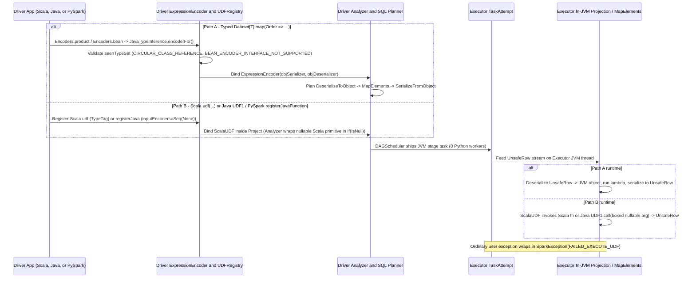

# Dataset Encoders and JVM UDFs: in-JVM InternalRow conversion and evaluation

[component index](README.md)

This component covers **two distinct in-JVM SQL execution mechanisms** that run inside the **Driver JVM** (for schema inference, binding, and planning) and **Executor JVMs** (for per-row execution) with **zero** Python worker subprocesses, `BatchEvalPythonExec`, or socket IPC:

- **(A) Typed `Dataset[T]` encoders (`ExpressionEncoder`)**: Convert Tungsten `InternalRow` / `UnsafeRow` into strongly typed Scala case classes (`Encoders.product`) or JavaBeans (`Encoders.bean` -> `JavaTypeInference.encoderFor` -> `JavaBeanEncoder`) for typed lambdas such as `Dataset[T].map(...)`.
- **(B) Scalar JVM UDFs (`ScalaUDF`)**: Evaluate Scala `udf(...)` closures and Java `UDF0`..`UDF22` classes directly inside SQL projections, including Java UDFs registered from **PySpark** via `spark.udf.registerJavaFunction(...)`, which execute on the exact same Executor JVM path with 0 Python workers.

## Flow at a glance

1. **Driver binding (two separate paths)**: Typed `Dataset[T].map` derives an `ExpressionEncoder[T]` (`objSerializer` and `objDeserializer` Catalyst expressions); scalar UDF registration creates a `SparkUserDefinedFunction` with `TypeTag` input encoders for Scala UDFs or `inputEncoders = Seq(None, ...)` for Java `UDF1..22` (including PySpark `registerJavaFunction`).
2. **Catalyst plan lowering**: Typed `Dataset.map` lowers into `DeserializeToObject -> MapElements -> SerializeFromObject` (potentially followed by `-> Project(ScalaUDF)`), whereas a standalone scalar UDF sits directly inside `Project(ScalaUDF)` with no `DeserializeToObject`.
3. **In-JVM executor evaluation**: Tasks execute generated encoder projections or `ScalaUDF` calls directly on the executor JVM thread, packing results back into `UnsafeRow` and wrapping ordinary user exceptions as `FAILED_EXECUTE_UDF`.

> **Key distinction:** Typed `Dataset[T].map` requires an `ExpressionEncoder` (`Encoders.product` / `Encoders.bean`) and `DeserializeToObject` / `SerializeFromObject` operators to materialize JVM domain objects, whereas Java scalar `UDF1..22` (including PySpark `spark.udf.registerJavaFunction`) passes `inputEncoders = Seq(None, ...)` and receives boxed nullable JVM arguments via `CatalystTypeConverters` / primitive boxing directly inside `Project(ScalaUDF)` with zero object-encoder overhead and zero Python workers.

> **Interactive explorer:** [Open in Spark Visualizer](https://nuthanreddy.github.io/spark-visualizer/#component=dataset-encoder-udf) to step through commands, wire payloads, category filters, and fault simulations on the live cluster canvas.

## Path A (typed `Dataset[T].map`) vs Path B (Scala, Java, and PySpark-registered JVM UDFs)

| Dimension | Path A: Typed `Dataset[T].map` | Path B1: Scala scalar `udf((d: Double) => ...)` | Path B2: Java `UDF1<Double, Double>` (Java / Scala / PySpark `registerJavaFunction`) |
|---|---|---|---|
| **Driver entry point** | [`Encoders.product`][enc-prod] (`ScalaReflection.encoderFor`) or [`Encoders.bean`][enc-bean] -> [`JavaTypeInference.encoderFor`][jti-enc] returning `JavaBeanEncoder`, bound into [`ExpressionEncoder`][expr-enc]. | `functions.udf` / `spark.udf.register` using `TypeTag` reflection to populate `inputEncoders` and `inputPrimitives`. | [`UDFRegistration.registerJava`][reg-java] (called from Java/Scala or from PySpark [`spark.udf.registerJavaFunction`][py-reg-java] over Py4J on driver), building [`SparkUserDefinedFunction(fn, returnType, cardinality)`][udf-apply] with `inputEncoders = Seq.fill(cardinality)(None)`. |
| **Catalyst operator shape** | Per [`MapElements.apply`][map-elems]: `DeserializeToObject -> MapElements -> SerializeFromObject` (and if followed by a scalar UDF, `-> Project(ScalaUDF)`). Note: `DeserializeToObject` outputs `ObjectType`, which breaks whole-stage fusion around that node. | `Project(ScalaUDF(...))` directly over `UnsafeRow` columns (no `DeserializeToObject`). | `Project(ScalaUDF(...))` directly over `UnsafeRow` columns (no `DeserializeToObject`, no `BatchEvalPythonExec`, 0 Python workers even when called from PySpark). |
| **Null-input handling** | Governed by field nullability (`Option[T]` in Scala, `@Nonnull` / boxed types in JavaBeans) inside `objDeserializer`. | [`Analyzer` (`HandleNullInputsForUDF`)][analyzer-null] detects `udf.inputPrimitives.contains(true)` and wraps nullable inputs in `If(IsNull(col), Literal(null), ScalaUDF(..., KnownNotNull(col)))` so SQL `NULL` returns `NULL` instead of `0.0`. | `inputPrimitives` is empty; [`ScalaUDF` codegen][scalaudf-gen] boxes primitive SQL types (`DoubleType` -> `java.lang.Double`) and passes `eval.isNull ? null : convertedTerm`, so `UDF1<Double, Double>.call(Double)` receives a nullable boxed `java.lang.Double` and must handle `null` explicitly. |
| **Converter mechanism** | Generated `SafeProjection` (`Deserializer`) and `UnsafeProjection` (`Serializer`) compiled from `objDeserializer` / `objSerializer` expressions. | Primitive inputs use identity/boxing; structured Scala inputs (case classes, `Option[T]`) use `ExpressionEncoder` in [`ScalaUDF.scalaConverter`][scalaudf-conv]. | Because `inputEncoders` entries are `None`, [`ScalaUDF.scalaConverter`][scalaudf-conv] bypasses `ExpressionEncoder` and uses `CatalystTypeConverters` / primitive boxing directly. |
| **Analysis-time errors** | [`CIRCULAR_CLASS_REFERENCE`][exec-errors] (via `seenTypeSet` in `JavaTypeInference`), [`ENCODER_NOT_FOUND`][exec-errors], and [`BEAN_ENCODER_INTERFACE_NOT_SUPPORTED`][jti-iface] (interfaces cannot be instantiated by deserializers). | Unsupported Scala argument/return type fails encoder inference during `udf(...)` creation. | Missing class, class implementing 0 or >1 `UDF*` interfaces, or invalid no-arg constructor fails in [`registerJava`][reg-java]. |

## Driver planning and executor in-JVM evaluation

## Inputs, outputs, and state

| Boundary | Contract |
|---|---|
| Inputs | Scala case classes / tuples (`Encoders.product`), JavaBean classes (`Encoders.bean`), Scala `Function0..22` closures (`udf`), or Java `UDF0..22` class names (`registerJava` / PySpark `registerJavaFunction`), plus executor `InternalRow` / `UnsafeRow` streams. |
| Owned state | Driver-side `ExpressionEncoder(encoder, objSerializer, objDeserializer)`, `JavaTypeInference` `seenTypeSet` recursion guard, and `SessionState.functionRegistry` UDF entries; executor-side compiled `SafeProjection`/`UnsafeProjection` converters and deserialized `ScalaUDF` function instances. |
| Outputs | Generated `InternalRow <-> T` conversions for typed `Dataset[T]` pipelines, or in-JVM scalar `ScalaUDF` outputs written directly into `UnsafeRow` without Python worker serialization. |

## Failure clues and diagnosis

- **`CIRCULAR_CLASS_REFERENCE` during `Encoders.bean(MyBean.class)`:** `JavaTypeInference.encoderFor()` encountered a class already present in `seenTypeSet` (self-referential or mutually recursive JavaBean properties, [`ExecutionErrors.scala:186-190`][exec-errors]). Break the cycle with a flat DTO bean.
- **`BEAN_ENCODER_INTERFACE_NOT_SUPPORTED` or `ENCODER_NOT_FOUND`:** Passing a Java interface to `Encoders.bean()` fails because Catalyst's generated deserializer must instantiate a concrete class ([`JavaTypeInference.scala:160-164`][jti-iface]); passing an unsupported type raises `ENCODER_NOT_FOUND` ([`ExecutionErrors.scala:180-184`][exec-errors]).
- **`NullPointerException` inside a Java `UDF1<Double, Double>` when a Scala `udf((d: Double) => ...)` did not throw:** Expected difference in null semantics. Scala primitive UDFs get an automatic `If(IsNull(col), Literal(null), ScalaUDF(...))` wrapper from [`Analyzer`][analyzer-null], whereas Java `UDF1` receives boxed nullable `java.lang.Double` ([`ScalaUDF.scala:1125-1145`][scalaudf-gen]) and must check `if (val == null) return null;`.
- **Task fails with `SparkException: [FAILED_EXECUTE_UDF]`:** [`ScalaUDF`][scalaudf-err] catches ordinary exceptions thrown by user Scala/Java UDF code and wraps them in `FAILED_EXECUTE_UDF`. Deterministic data bugs exhaust `spark.task.maxFailures` (default `4`) and abort the stage; inspect the caused-by stack trace in executor logs.
- **PySpark job wants JVM speed without Python workers:** Register a compiled Java `UDF1..22` JAR (`--jars`) with `spark.udf.registerJavaFunction(...)` ([`udf.py:941-992`][py-reg-java]). Confirm `df.explain()` shows `ScalaUDF` inside `Project` and no `BatchEvalPythonExec`.

[enc-bean]: https://github.com/apache/spark/blob/dada2a6db5d73b152d6ba16e4fe21406f86abfe3/sql/api/src/main/scala/org/apache/spark/sql/Encoders.scala#L211-L214
[enc-prod]: https://github.com/apache/spark/blob/dada2a6db5d73b152d6ba16e4fe21406f86abfe3/sql/api/src/main/scala/org/apache/spark/sql/Encoders.scala#L341-L343
[expr-enc]: https://github.com/apache/spark/blob/dada2a6db5d73b152d6ba16e4fe21406f86abfe3/sql/catalyst/src/main/scala/org/apache/spark/sql/catalyst/encoders/ExpressionEncoder.scala#L52-L155
[jti-enc]: https://github.com/apache/spark/blob/dada2a6db5d73b152d6ba16e4fe21406f86abfe3/sql/api/src/main/scala/org/apache/spark/sql/catalyst/JavaTypeInference.scala#L39-L95
[jti-iface]: https://github.com/apache/spark/blob/dada2a6db5d73b152d6ba16e4fe21406f86abfe3/sql/api/src/main/scala/org/apache/spark/sql/catalyst/JavaTypeInference.scala#L153-L196
[exec-errors]: https://github.com/apache/spark/blob/dada2a6db5d73b152d6ba16e4fe21406f86abfe3/sql/api/src/main/scala/org/apache/spark/sql/errors/ExecutionErrors.scala#L180-L203
[map-elems]: https://github.com/apache/spark/blob/dada2a6db5d73b152d6ba16e4fe21406f86abfe3/sql/catalyst/src/main/scala/org/apache/spark/sql/catalyst/plans/logical/object.scala#L205-L217
[analyzer-null]: https://github.com/apache/spark/blob/dada2a6db5d73b152d6ba16e4fe21406f86abfe3/sql/catalyst/src/main/scala/org/apache/spark/sql/catalyst/analysis/Analyzer.scala#L3926-L3948
[udf-apply]: https://github.com/apache/spark/blob/dada2a6db5d73b152d6ba16e4fe21406f86abfe3/sql/api/src/main/scala/org/apache/spark/sql/expressions/UserDefinedFunction.scala#L165-L175
[reg-java]: https://github.com/apache/spark/blob/dada2a6db5d73b152d6ba16e4fe21406f86abfe3/sql/core/src/main/scala/org/apache/spark/sql/classic/UDFRegistration.scala#L158-L190
[py-reg-java]: https://github.com/apache/spark/blob/dada2a6db5d73b152d6ba16e4fe21406f86abfe3/python/pyspark/sql/udf.py#L941-L992
[scalaudf-conv]: https://github.com/apache/spark/blob/dada2a6db5d73b152d6ba16e4fe21406f86abfe3/sql/catalyst/src/main/scala/org/apache/spark/sql/catalyst/expressions/ScalaUDF.scala#L142-L175
[scalaudf-gen]: https://github.com/apache/spark/blob/dada2a6db5d73b152d6ba16e4fe21406f86abfe3/sql/catalyst/src/main/scala/org/apache/spark/sql/catalyst/expressions/ScalaUDF.scala#L1125-L1145
[scalaudf-err]: https://github.com/apache/spark/blob/dada2a6db5d73b152d6ba16e4fe21406f86abfe3/sql/catalyst/src/main/scala/org/apache/spark/sql/catalyst/expressions/ScalaUDF.scala#L1171-L1216
