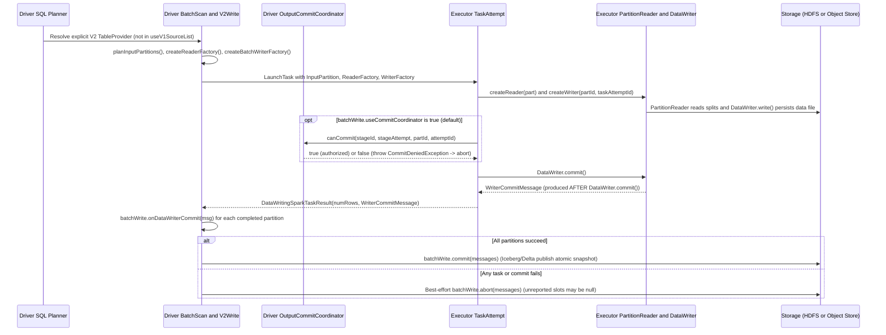

# DataSource V2: explicit TableProvider scans and BatchWrite commits

[component index](README.md)

DataSource V2 is **not** the default execution path for built-in file formats (`parquet`, `orc`, `json`, `csv`), which remain on DataSource V1 ([`FileFormatWriter`](file-format-writer.md) and [`FileCommitProtocol`](file-commit-protocol.md)) via `spark.sql.sources.useV1SourceList`. Instead, DataSource V2 executes explicit `TableProvider` / `TableCatalog` connectors such as Apache Iceberg, Delta Lake V2 catalogs, Kafka, Cassandra, or built-in formats explicitly removed from `useV1SourceList`. On the **Driver JVM**, Catalyst plans `BatchScanExec` for reads and `V2TableWriteExec` / `WriteToDataSourceV2Exec` for writes, negotiating pushdowns and driving final `BatchWrite.commit(messages)` (or best-effort `BatchWrite.abort(messages)`). On **Executor JVMs**, tasks deserialize lightweight factories to run `PartitionReader` and `DataWriter`, returning post-commit `WriterCommitMessage` payloads rather than staging Hadoop `_temporary` directory renames.

## Flow at a glance

1. **V2 lookup and driver planning**: `DataSource.lookupDataSourceV2()` resolves an explicit `TableProvider` (unless listed in `spark.sql.sources.useV1SourceList`). The driver plans `BatchScanExec` (`Batch.planInputPartitions()`, `createReaderFactory()`) and `V2TableWriteExec` (`BatchWrite.createBatchWriterFactory()`).
2. **Executor read/write and optional `canCommit`**: Tasks run `PartitionReader` (`DataSourceRDD`) and `DataWriter.write()`. Before calling `DataWriter.commit()`, if `batchWrite.useCommitCoordinator` is `true` (default), the task asks `OutputCommitCoordinator.canCommit(...)` on the driver for pre-commit authorization.
3. **Post-commit messages and driver `BatchWrite.commit()`**: Only after `DataWriter.commit()` succeeds does the task return its `WriterCommitMessage` inside `DataWritingSparkTaskResult`. Once all partitions succeed, the driver calls `BatchWrite.commit(messages)` (where transactional connectors like Iceberg or Delta Lake publish snapshots atomically) or best-effort `BatchWrite.abort(messages)` on failure.

> **Key distinction:** Built-in Parquet/ORC/JSON/CSV default to DataSource V1 via `spark.sql.sources.useV1SourceList`. On the V2 write path, optional `OutputCommitCoordinator.canCommit()` is a pre-commit authorization gate that runs **before** `DataWriter.commit()`, whereas `WriterCommitMessage` is produced and sent **after** `DataWriter.commit()` succeeds; Spark's `BatchWrite.abort()` contract is best-effort cleanup, so atomic all-or-nothing snapshot guarantees come from transactional connectors such as Iceberg or Delta Lake rather than every V2 provider.

> **Interactive explorer:** [Open in Spark Visualizer](https://nuthanreddy.github.io/spark-visualizer/#component=datasource-v2) to step through commands, wire payloads, category filters, and fault simulations on the live cluster canvas.

## V1 vs V2 selection and driver/executor split

[`DataSource.lookupDataSourceV2`][lookup-v2] instantiates the requested provider class and returns `None` (falling back to DataSource V1) if either the class does not implement `TableProvider` or its short name / canonical class name matches [`spark.sql.sources.useV1SourceList`][v1-list]. Only providers returning `Some(TableProvider)` (or tables resolved through a V2 `TableCatalog`) enter `DataSourceV2Strategy`.

| Responsibility | Driver JVM | Executor JVM |
|---|---|---|
| **Read path (`BatchScanExec`)** | Calls `ScanBuilder` pushdowns (filters, column pruning, aggregates), then `Batch.planInputPartitions()` and `Batch.createReaderFactory()` inside [`BatchScanExec`][batch-scan]. Runtime filters can prune `InputPartition`s via `filteredPartitions`. | [`DataSourceRDD.compute()`][ds-rdd] receives one `Option[InputPartition]` per partition, calls `partitionReaderFactory.createReader()` (or `createColumnarReader()` for `ColumnarBatch`), updates input and custom task metrics, and closes all readers in a task completion listener. |
| **Write path (`V2TableWriteExec`)** | [`V2TableWriteExec.writeWithV2()`][v2-write] invokes `batchWrite.createBatchWriterFactory(PhysicalWriteInfo)` (ensuring at least one dummy partition on an empty RDD for metadata writes), dispatches `sparkContext.runJob()`, collects `WriterCommitMessage`s via `onDataWriterCommit()`, and calls `batchWrite.commit(messages)` (or `batchWrite.abort(messages)` on any failure). | [`WritingSparkTask.writeAndCommit()`][write-task] instantiates `writerFactory.createWriter(partitionId, taskAttemptId)`, streams `InternalRow` or `ColumnarBatch` records into `DataWriter.write()`, updates custom metrics, optionally checks `OutputCommitCoordinator.canCommit()`, invokes `DataWriter.commit()`, returns `DataWritingSparkTaskResult(numRows, msg)`, and calls `DataWriter.abort()` on any error (always closing the writer in `finally`). |
| **Commit coordination** | [`OutputCommitCoordinator`](output-commit-coordinator.md) authorizes at most one speculative attempt per `(stageId, stageAttempt, partitionId)` when `batchWrite.useCommitCoordinator` is `true` (default). | Task asks `canCommit(...)` **before** `DataWriter.commit()`. A `false` reply throws `CommitDeniedException`, triggering `DataWriter.abort()`. |

## Two-step task commit and connector-scoped atomicity

Separating the commit boundary clarifies what Spark itself guarantees versus what individual connectors implement:

1. **Pre-commit authorization (`OutputCommitCoordinator.canCommit`)**: Runs before `DataWriter.commit()` in [`WritingSparkTask.writeAndCommit`][write-task] when `useCommitCoordinator` is `true`. It prevents two speculative attempts of the same partition from both executing `DataWriter.commit()`. A connector whose `DataWriter.commit()` is idempotent or writes unique UUID files may override `useCommitCoordinator()` to `false`.
2. **Post-commit metadata (`WriterCommitMessage`)**: Produced only after `DataWriter.commit()` succeeds and returned in `DataWritingSparkTaskResult`. The driver stores it in `messages(partitionIndex)` and calls `batchWrite.onDataWriterCommit(commitMessage)`.
3. **Driver finalization (`BatchWrite.commit` vs best-effort `BatchWrite.abort`)**: Per [`BatchWrite.java`][batch-write], `commit(messages)` signals that all partition writers succeeded; transactional table formats such as **Apache Iceberg** and **Delta Lake** commit a new metadata snapshot/manifest atomically here so partial task outputs stay invisible until commit succeeds. By contrast, Spark's [`BatchWrite.abort(messages)`][batch-write] explicitly documents **best-effort** cleanup: unless triggered by a `commit()` failure, `messages` can contain `null` slots for writers that never completed or whose messages never reached the driver, and arbitrary non-transactional V2 connectors cannot guarantee zero visible partial writes on failure.

## Inputs, outputs, and state

| Boundary | Contract |
|---|---|
| Inputs | Explicit V2 `TableProvider` / `TableCatalog` table implementing `SupportsRead` and/or `SupportsWrite`, pushed filters/projections/aggregates, `spark.sql.sources.useV1SourceList`, and upstream `RDD[InternalRow]` or `RDD[ColumnarBatch]`. |
| Owned state | Driver-side `PlannedScan` (`Batch`, `InputPartition` list, `PartitionReaderFactory`), `BatchWrite`, `messages: Array[WriterCommitMessage]`, `useCommitCoordinator: Boolean`, and `numOutputRowsMetric`; executor-side `DataSourceRDD` per-task `TaskState` (`partitionIterators`, `closedMetrics`) and active `DataWriter` instances. |
| Outputs | `InternalRow` or `ColumnarBatch` streams from `PartitionReader`; task-level `DataWritingSparkTaskResult(numRows, WriterCommitMessage)` returned to the driver; connector-specific durable files and metadata published by `BatchWrite.commit(messages)`. |

## Failure clues and diagnosis

- **Parquet / ORC / JSON / CSV write still uses `FileFormatWriter` and `_temporary` staging:** Expected default behavior. Check `spark.sql.sources.useV1SourceList` ([`SQLConf`][v1-list]); built-in file sources stay on V1 unless explicitly removed from that list or queried through a V2 catalog such as Iceberg or Delta.
- **Task fails with `CommitDeniedException` under speculation:** Normal duplicate-prevention behavior when `useCommitCoordinator=true`. The losing speculative attempt receives `canCommit=false`, throws `CommitDeniedException`, invokes `DataWriter.abort()`, and closes its writer while the authorized attempt commits cleanly.
- **Leftover uncommitted files after a failed V2 write job:** Expected under [`BatchWrite.abort(messages)`][batch-write] best-effort semantics when executors crash or lose connectivity before returning `WriterCommitMessage` (leaving `null` entries in `messages`). Use connector maintenance routines (such as Iceberg orphan-file cleanup or Delta `VACUUM`) rather than assuming `abort()` removed every partial file.
- **`ClassNotFoundException` on executors during V2 scan or write:** Driver resolved the `TableProvider` JAR locally, but executors failed to deserialize `InputPartition`, `PartitionReaderFactory`, or `DataWriterFactory`. Verify the connector JAR is distributed to executors via `--jars` or `--packages`.
- **Job fails inside `BatchWrite.commit(messages)` followed by `writingJobFailedError`:** If `commit()` throws, [`writeWithV2`][v2-write] attempts `batchWrite.abort(messages)`; if `abort()` also throws, Spark attaches the abort exception as suppressed and throws `writingJobFailedError(cause)`, leaving destination state connector-dependent and potentially needing manual inspection.

[lookup-v2]: https://github.com/apache/spark/blob/dada2a6db5d73b152d6ba16e4fe21406f86abfe3/sql/core/src/main/scala/org/apache/spark/sql/execution/datasources/DataSource.scala#L820-L841
[v1-list]: https://github.com/apache/spark/blob/dada2a6db5d73b152d6ba16e4fe21406f86abfe3/sql/catalyst/src/main/scala/org/apache/spark/sql/internal/SQLConf.scala#L6363-L6375
[batch-scan]: https://github.com/apache/spark/blob/dada2a6db5d73b152d6ba16e4fe21406f86abfe3/sql/core/src/main/scala/org/apache/spark/sql/execution/datasources/v2/BatchScanExec.scala#L50-L135
[ds-rdd]: https://github.com/apache/spark/blob/dada2a6db5d73b152d6ba16e4fe21406f86abfe3/sql/core/src/main/scala/org/apache/spark/sql/execution/datasources/v2/DataSourceRDD.scala#L150-L215
[v2-write]: https://github.com/apache/spark/blob/dada2a6db5d73b152d6ba16e4fe21406f86abfe3/sql/core/src/main/scala/org/apache/spark/sql/execution/datasources/v2/WriteToDataSourceV2Exec.scala#L653-L735
[write-task]: https://github.com/apache/spark/blob/dada2a6db5d73b152d6ba16e4fe21406f86abfe3/sql/core/src/main/scala/org/apache/spark/sql/execution/datasources/v2/WriteToDataSourceV2Exec.scala#L737-L826
[batch-write]: https://github.com/apache/spark/blob/dada2a6db5d73b152d6ba16e4fe21406f86abfe3/sql/catalyst/src/main/java/org/apache/spark/sql/connector/write/BatchWrite.java#L95-L137
