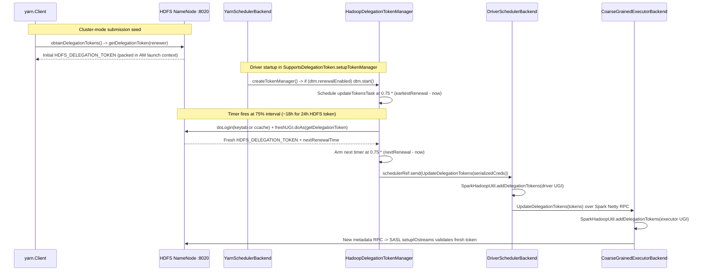

# HadoopDelegationTokenManager: Kerberos token renewal and executor fanout

[component index](README.md)

`HadoopDelegationTokenManager` is **not** a Kerberos KDC, does **not** issue [HDFS DataNode](hdfs-datanode.md) block access tokens, and does **not** manage OIDC cloud credentials (which run through the separate sibling `UserCredentialManager`) or Spark internal RPC SASL/AES authentication (`SecurityManager`). On YARN, it serves two roles for PySpark, Scala, and Java applications alike: at submission time (cluster mode), [`yarn.Client`](yarn-client.md) uses it once to pack initial Hadoop/Hive/HBase delegation tokens into the AM `ContainerLaunchContext`; at runtime, [`YarnSchedulerBackend`](yarn-scheduler-backend.md) constructs it on the [driver](spark-driver.md) and starts periodic renewal only when keytab, ticket-cache, or direct-provider renewal is enabled, fanning out fresh serialized `Credentials` to all live [executors](executor-backend.md) via `UpdateDelegationTokens` RPCs.

## Flow at a glance

1. **Submit-time seed**: In YARN cluster mode, `yarn.Client.setupSecurityToken` invokes `HadoopDelegationTokenManager.obtainDelegationTokens(credentials)` so the AM starts with initial `HDFS_DELEGATION_TOKEN` credentials without forwarding the user's Kerberos TGT.
2. **Driver renewal gate**: `YarnSchedulerBackend.createTokenManager` constructs `HadoopDelegationTokenManager`, and `SupportsDelegationToken.setupTokenManager` calls `dtm.start()` **only** when `dtm.renewalEnabled` is true (else it obtains one-shot tokens with zero background timer).
3. **75% KDC refresh**: On a daemon `ScheduledExecutorService`, `obtainTokensAndScheduleRenewal` logs into the KDC via keytab or ticket cache, acquires **fresh** delegation tokens from [HDFS NameNode](hdfs-namenode.md) (`:8020`) and other `ServiceLoader` providers, and arms the next cycle at `0.75 * (earliestProviderRenewalTime - now)`.
4. **RPC fanout and SASL IPC auth**: Serialized `Credentials` travel over `UpdateDelegationTokens` to `DriverEndpoint`, all live `CoarseGrainedExecutorBackend`s (plus client-mode `YarnAM`), refreshing each JVM's `UserGroupInformation` before new NameNode `:8020` SASL IPC connections occur.

> **Key distinction:** `HadoopDelegationTokenManager` refreshes Hadoop delegation tokens authenticated during SASL IPC handshakes against NameNode `:8020`. DataNode `:9866` block transfers validate short-lived per-block access tokens minted inside NameNode `LocatedBlock` responses, and OIDC cloud token propagation runs independently in `UserCredentialManager`.

> **Interactive explorer:** [Open in Spark Visualizer](https://nuthanreddy.github.io/spark-visualizer/#component=delegation-token-manager) to step through commands, wire payloads, language modes, category filters, and fault simulations on the live cluster canvas.

## Token boundaries: NameNode vs DataNode vs OIDC vs Spark RPC

| Security mechanism | Owner in Spark or Hadoop | Wire boundary | Lifetime / renewal behavior |
|---|---|---|---|
| **Hadoop delegation tokens** (`HDFS_DELEGATION_TOKEN`, Hive, HBase) | [`HadoopDelegationTokenManager`][dtm-class] (started via [`SupportsDelegationToken`][supports-dt] + [`YarnSchedulerBackend`][ysb-dtm]) | Hadoop SASL IPC connection setup to NameNode `:8020` ([`Client.java:764-800`][hadoop-client]); validated by [`AbstractDelegationTokenSecretManager.java:528-551`][hadoop-dtsm] | Hadoop 3.4.1 defaults ([`hdfs-default.xml:1458-1471`][hadoop-hdfs-xml]): **24h** `renew-interval` (`86400000` ms) and **7-day** `max-lifetime` (`604800000` ms). Spark fetches brand-new tokens at `0.75 * (earliestProviderRenewalTime - now)` when renewal is enabled. |
| **HDFS block access tokens** | NameNode `BlockTokenSecretManager` -> DataNode | DataTransferProtocol block read/write on DataNode `:9866` | Short-lived per-block tokens embedded inside NameNode `LocatedBlock` replies; never stored in or renewed by `HadoopDelegationTokenManager`. |
| **OIDC cloud credentials** | [`UserCredentialManager`][ucm-class] (`spark.security.oidc.enabled=true`) | `UpdateUserCredentials(version, bytes)` RPC from `DriverEndpoint` to executors | Independent sibling started via `SupportsDelegationToken.setupUserCredentialManager()`; exchanges identity tokens for cloud storage credentials without requiring Kerberos. |
| **Spark RPC / I/O auth** | `SecurityManager` (`spark.authenticate`, `spark.io.encryption.enabled`) | Spark Netty RPC (`:41000`) and block transfer (`:42001`) | Authenticates Spark-to-Spark channels via shared secret / SASL and encrypts shuffle/spill streams; separate from Hadoop UGI delegation tokens. |

## Submit-time seed, 0.75x renewal loop, and executor fanout

1. **Submit-time acquisition ([`Client.scala:355-365`][yarn-client-tok]).** In cluster mode, `yarn.Client.setupSecurityToken` constructs a `HadoopDelegationTokenManager(sparkConf, hadoopConf, null)` and runs one-shot `obtainDelegationTokens(credentials)` across loaded `ServiceLoader[HadoopDelegationTokenProvider]` plugins (`hadoopfs`, `hive`, `hbase`), attaching serialized `Credentials` to the AM `ContainerLaunchContext`.
2. **Conditional driver renewal startup ([`SupportsDelegationToken.scala:75-93`][supports-dt], [`YarnSchedulerBackend.scala:265-267`][ysb-dtm]).** When `CoarseGrainedSchedulerBackend.start()` runs `setupTokenManager()` and `tokenManagerRequired()` is true, `YarnSchedulerBackend.createTokenManager()` builds `HadoopDelegationTokenManager` wired to `driverEndpoint`. `setupTokenManager()` checks `dtm.renewalEnabled` (`spark.kerberos.principal` + `spark.kerberos.keytab`, `spark.kerberos.renewal.credentials=ccache` with an active TGT, or `spark.security.directCredentialProviders.enabled=true`):
   - If **`renewalEnabled == true`**, `dtm.start()` spawns the `"Credential Renewal Thread"` daemon, starts a periodic `ugi.checkTGTAndReloginFromKeytab()` task when using a keytab (`spark.kerberos.relogin.period`), and immediately invokes `updateTokensTask()`.
   - If **`renewalEnabled == false`**, Spark runs only a one-shot `dtm.obtainDelegationTokens(creds)` and starts **no** renewal thread.
3. **Renewal delay formula and failure retry ([`HadoopDelegationTokenManager.scala:230-313`][dtm-renew]).** `obtainTokensAndScheduleRenewal()` logs in via `doLogin()` (`UserGroupInformation.loginUserFromKeytabAndReturnUGI` or `getUGIFromTicketCache`), calls `freshUGI.doAs(() => obtainDelegationTokens())` to mint brand-new tokens (rather than renewing expiring ones in place), takes the minimum `nextRenewal` timestamp across providers, and schedules the next run at:
   `delay = (spark.security.credentials.renewalRatio * (nextRenewal - now)).toLong` (default ratio `0.75`, [`config/package.scala:1705-1717`][cfg-retry]).
   If `updateTokensTask()` catches a non-interrupt exception (such as a transient KDC or NameNode outage), it logs a warning and retries after `spark.security.credentials.retryWait` (default `1h`).
4. **Driver cache and executor/AM broadcast ([`CoarseGrainedSchedulerBackend.scala:231-232, 1237-1242`][dsb-tok], [`YarnClientSchedulerBackend.scala:194-196`][ycsb-tok], [`CoarseGrainedExecutorBackend.scala:222-224`][exec-tok]).** `DriverEndpoint` receives `UpdateDelegationTokens(tokens)`, adds them to the driver UGI, saves `delegationTokens` for future late-starting executors, and sends `UpdateDelegationTokens(tokens)` to every registered executor backend (plus `amEndpoint` in client mode). Each executor executes `SparkHadoopUtil.get.addDelegationTokens(tokenBytes, env.conf)` with zero task interruption.

## Inputs, outputs, and state

| Boundary | Contract |
|---|---|
| Inputs | `SparkConf` Kerberos/security settings (`spark.kerberos.principal`, `spark.kerberos.keytab`, `spark.kerberos.renewal.credentials`, `spark.security.credentials.renewalRatio=0.75`, `spark.security.credentials.retryWait=1h`, `spark.kerberos.relogin.period`), Hadoop `Configuration`, `ServiceLoader[HadoopDelegationTokenProvider]` plugins, and `schedulerRef: RpcEndpointRef`. |
| Owned state | Discovered `delegationTokenProviders` map, single-threaded `ScheduledExecutorService` (`"Credential Renewal Thread"`), `principal` / `keytab` paths, and cached serialized `Credentials` stored on `CoarseGrainedSchedulerBackend`. |
| Outputs | Initial `ContainerLaunchContext` tokens (cluster submit), updated driver and executor `UserGroupInformation` credentials, and periodic `UpdateDelegationTokens(Array[Byte])` RPC messages to executors and client-mode `YarnAM`. |

## Failure clues and diagnosis

- **`SecretManager$InvalidToken` ("token has expired") on a new NameNode `:8020` RPC in a long-running job:** Hadoop 3.4.1 defaults (`hdfs-default.xml:1458-1471`) grant a 24h `renew-interval` and a 7-day `max-lifetime`. Without keytab or externally refreshed `ccache` renewal (`dtm.renewalEnabled == false`), launch tokens fail on new NameNode metadata RPCs (`open`, `create`, `addBlock`, `rename`) once the 7-day max lifetime expires -- or after 24h if YARN RM renewal failed/was disabled or `max-lifetime` was capped at 24h. Supply `--principal` and `--keytab` (or enable `ccache` renewal with external `kinit`) so `dtm.start()` mints fresh tokens.
- **NameNode fails with `InvalidToken` while existing DataNode reads finish, or vice versa:** Hadoop IPC authenticates delegation tokens at SASL connection setup to NameNode `:8020` ([`Client.java:764-800`][hadoop-client], [`AbstractDelegationTokenSecretManager.java:528-551`][hadoop-dtsm]). DataNode `:9866` failures citing invalid block tokens point to NameNode/DataNode clock skew or stale `LocatedBlock` handles rather than `HadoopDelegationTokenManager`.
- **`Failed to update tokens, will try again in 1 h!` in driver logs:** `updateTokensTask()` caught an exception from KDC login or a provider RPC and backed off by `spark.security.credentials.retryWait`. Check keytab file readability on the driver host, KDC reachability, and provider service health before the remaining 25% of token lifetime elapses.
- **`Both principal and keytab must be defined, or neither.` at startup:** `HadoopDelegationTokenManager` constructor rejects partial Kerberos configuration. Pass both `spark.kerberos.principal` and `spark.kerberos.keytab`.
- **Cloud object store (`s3a://`, `abfss://`) auth failures when `spark.security.oidc.enabled=true`:** Inspect the sibling [`UserCredentialManager`][ucm-class] (`UpdateUserCredentials` logs) rather than `HadoopDelegationTokenManager`, as OIDC credential propagation runs independently of Kerberos.

[dtm-class]: https://github.com/apache/spark/blob/dada2a6db5d73b152d6ba16e4fe21406f86abfe3/core/src/main/scala/org/apache/spark/deploy/security/HadoopDelegationTokenManager.scala#L63-L165
[dtm-renew]: https://github.com/apache/spark/blob/dada2a6db5d73b152d6ba16e4fe21406f86abfe3/core/src/main/scala/org/apache/spark/deploy/security/HadoopDelegationTokenManager.scala#L230-L314
[supports-dt]: https://github.com/apache/spark/blob/dada2a6db5d73b152d6ba16e4fe21406f86abfe3/core/src/main/scala/org/apache/spark/scheduler/SupportsDelegationToken.scala#L75-L100
[ysb-dtm]: https://github.com/apache/spark/blob/dada2a6db5d73b152d6ba16e4fe21406f86abfe3/resource-managers/yarn/src/main/scala/org/apache/spark/scheduler/cluster/YarnSchedulerBackend.scala#L265-L267
[yarn-client-tok]: https://github.com/apache/spark/blob/dada2a6db5d73b152d6ba16e4fe21406f86abfe3/resource-managers/yarn/src/main/scala/org/apache/spark/deploy/yarn/Client.scala#L355-L366
[dsb-tok]: https://github.com/apache/spark/blob/dada2a6db5d73b152d6ba16e4fe21406f86abfe3/core/src/main/scala/org/apache/spark/scheduler/cluster/CoarseGrainedSchedulerBackend.scala#L1233-L1243
[ycsb-tok]: https://github.com/apache/spark/blob/dada2a6db5d73b152d6ba16e4fe21406f86abfe3/resource-managers/yarn/src/main/scala/org/apache/spark/scheduler/cluster/YarnClientSchedulerBackend.scala#L194-L197
[exec-tok]: https://github.com/apache/spark/blob/dada2a6db5d73b152d6ba16e4fe21406f86abfe3/core/src/main/scala/org/apache/spark/executor/CoarseGrainedExecutorBackend.scala#L222-L225
[cfg-retry]: https://github.com/apache/spark/blob/dada2a6db5d73b152d6ba16e4fe21406f86abfe3/core/src/main/scala/org/apache/spark/internal/config/package.scala#L1705-L1718
[ucm-class]: https://github.com/apache/spark/blob/dada2a6db5d73b152d6ba16e4fe21406f86abfe3/core/src/main/scala/org/apache/spark/deploy/security/UserCredentialManager.scala#L40-L72
[hadoop-hdfs-xml]: https://github.com/apache/hadoop/blob/rel/release-3.4.1/hadoop-hdfs-project/hadoop-hdfs/src/main/resources/hdfs-default.xml#L1458-L1471
[hadoop-client]: https://github.com/apache/hadoop/blob/rel/release-3.4.1/hadoop-common-project/hadoop-common/src/main/java/org/apache/hadoop/ipc/Client.java#L764-L800
[hadoop-dtsm]: https://github.com/apache/hadoop/blob/rel/release-3.4.1/hadoop-common-project/hadoop-common/src/main/java/org/apache/hadoop/security/token/delegation/AbstractDelegationTokenSecretManager.java#L528-L551
