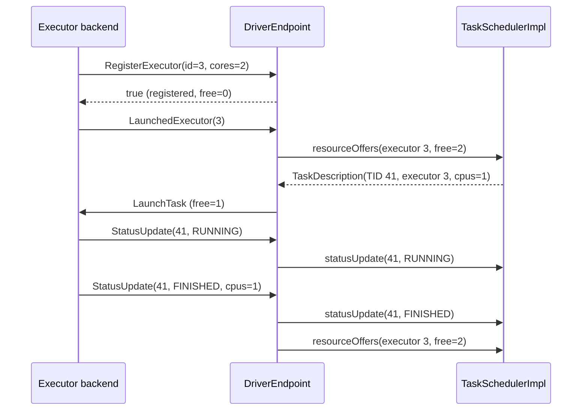

# CoarseGrainedSchedulerBackend: the driver's executor ledger

[component index](README.md) · Driver JVM, executor-facing endpoint · Apache Spark `dada2a6`

## Overview

`CoarseGrainedSchedulerBackend.DriverEndpoint` knows **which executor can
receive a launch and which of its advertised resources are free**. It turns
those resources into offers to [TaskSchedulerImpl](task-scheduler.md), then
sends the returned task descriptions to executors. Executors outlive individual
tasks: completing a task returns **Spark scheduling capacity on that executor**,
not memory or vcores to YARN. The [YARN adapter](yarn-scheduler-backend.md)
handles executor-count requests separately.

## Flow at a glance

1. **Registration**: The driver records executor 3 with two cores but zero free.
2. **Executor ready**: A launch acknowledgement lets the driver offer both cores.
3. **Task 41**: Uses one core until the driver receives its finish report.

> **Key distinction:** A finished task frees a Spark slot, not the executor's YARN container.

Show the animated flow

## Requirements analysis

Do not assign work to an uninitialized, removed, or decommissioning executor.
Track CPU and custom resource addresses across many launches; keep registration,
launch and terminal status distinct. Report executor loss so higher layers can
decide whether to retry tasks or stages. [Registry and counters][registry] ·
[active predicate][active] · [terminal update][status].

## Component architecture and lifetime

`YarnClusterManager` creates a client- or cluster-mode backend derived from
this class. During **construction**, the base backend registers
`createDriverEndpoint()` under the RPC name `CoarseGrainedScheduler`; on YARN
the factory returns a `YarnDriverEndpoint`. This is not the endpoint named
`YarnScheduler` that talks to the AM. The driver endpoint's `onStart` schedules
periodic `ReviveOffers` messages. The backend's separate `start()` initializes
credential managers. On normal scheduler shutdown it stops the timers, asks
`StopExecutors` (fan-out `StopExecutor`), then asks `StopDriver` to stop the
endpoint. An acknowledgement of the fan-out is not proof that every remote
process has exited. [YARN factory][factory] · [endpoint construction][setup] ·
[name][name] · [YARN override][yarn-endpoint] · [timer][timer] · [start/stop][stop] ·
[stop handlers][stop-rpc].

## Data models and concurrency

| Driver state | Meaning |
|---|---|
| `executorDataMap(executorId): ExecutorData` | RPC ref/address, hostname, integer `totalCores`, exact decimal `freeCores`, named resource addresses, profile ID and timestamps. `addressToExecutorId` supports disconnect lookup. An executor ID is not a task ID or YARN container ID. |
| `totalCoreCount`, `totalRegisteredExecutors` | Atomic totals across registered executors. `totalCoreCount` does **not** fall when a task starts; that task debits its executor's `freeCores`. |
| Pending removal, loss-reason and decommission sets | An executor can still have a registry record while excluded from future offers. Final removal drops metadata and totals and notifies the scheduler and listener bus. |

`DriverEndpoint` uses an isolated RPC endpoint with one delivery thread. The
backend monitor also protects registry changes visible to non-endpoint callers.
Where both scheduler and backend state are needed, `withLock` acquires the
scheduler monitor **then** the backend monitor. This serializes the offer
decision with changes such as an idle-executor removal. `launchTasks` runs
after that joint lock is released. [Offer and launch order][offers] · [ExecutorData][data] ·
[registry][registry] · [single-thread contract][thread] · [ordered locks][locks] ·
[removal][remove].

## Design patterns used

**Factory Method (creational).** The base class installs the endpoint through
`createDriverEndpoint` instead of constructing one fixed implementation. YARN
overrides the disconnected-executor behavior to ask the AM *why* an executor
exited, while inheriting the same register/launch/status protocol. A separate
implementation of that whole protocol per cluster manager would duplicate the
resource ledger; the trade-off is that the concrete disconnect behavior cannot
be inferred from the base class alone. [Base factory][stop] · [override][yarn-endpoint].

## API/interface definitions

| Message/caller | Driver action and output |
|---|---|
| Executor → `RegisterExecutor(id, ref, hostname, cores, ..., resources, resourceProfileId)` (ask) | Rejects duplicate IDs or excluded placements; otherwise records the endpoint with **zero free cores**, increments registration totals, posts `SparkListenerExecutorAdded` and replies `true`. [Register][register] · [insert and reply][insert] |
| Executor → `LaunchedExecutor(id)`; scheduler/timer → `ReviveOffers` (send) | Launch acknowledgement initializes `freeCores` from `totalCores` and makes a single-executor offer. Revival builds `WorkerOffer`s for all active executors. These are local scheduler calls, **not** RM offers. [Launched handler][launched] · [offer construction][offers] |
| Scheduler → descriptions; executor → `StatusUpdate(id, tid, state, data, taskCpus, resources)` | Backend encodes descriptions and sends `LaunchTask` to each selected RPC ref. It forwards status/payload to `scheduler.statusUpdate`; only a terminal state on a known executor returns CPU/address amounts and triggers another offer. [Send][launch] · [status sender][sender] · [status handler][status] |
| Scheduler → `killTask(tid, executorId, interruptThread, reason)` | Sends a `KillTask` to the driver endpoint, which forwards it if the executor is known. Sending a kill does not credit the slot; the terminal-status or executor-removal path accounts for it. [Public entry][kill] · [forward][status] |

## Implementation notes: a two-core executor registers and runs one task

The example assumes no other tasks. The [executor backend](executor-backend.md) constructs its `Executor`
*between* registry acceptance and `LaunchedExecutor`. The driver reserves the
description's CPU and named address amounts **before** sending the launch.
The executor echoes those same assignments from the running task description
in its status update. `RUNNING` confirms launch; it does not release anything.
The new offer after `FINISHED` does not wait for result decoding or stage
completion. [Executor initialization][executor] · [debit at launch][launch] ·
[return of resources][status] · [asynchronous result handling][result].

**Loss, cancellation and late status.** Base `onDisconnected` removes a known
executor with `ExecutorProcessLost`. On YARN the override can instead call
`disableExecutor`, stop offers immediately, report `LossReasonPending`, then
deliver `RemoveExecutor` when the AM answers. Final removal distinguishes a
driver-requested kill or decommission from another loss. A late terminal
status for an already-removed executor is forwarded to the scheduler, but
there is no ledger entry to credit or offer. No `LaunchTask` retry is initiated
by that late message; retry policy lives above this endpoint.
[Base disconnect][offers] · [disable][disable] · [final removal][remove] ·
[unknown executor][status].

## Scalability and performance considerations

`makeOffers(executorId)` targets just the freed executor, while periodic all-executor
rounds let locality-delayed work be reconsidered even if no task finishes.
Encoding large task descriptions also uses driver time. **Diagnostic:** if the
encoded launch is **at least** `spark.rpc.message.maxSize` in bytes after unit
conversion, the backend aborts the manager rather than debit resources and
send it. The driver's serialized-task-size error alongside no corresponding
executor `Got assigned task` is a launch-path problem, not a YARN allocation
timeout. [Offer scopes][offers] · [size guard and launch][launch] ·
[executor receive][executor].

[registry]: https://github.com/apache/spark/blob/dada2a6db5d73b152d6ba16e4fe21406f86abfe3/core/src/main/scala/org/apache/spark/scheduler/cluster/CoarseGrainedSchedulerBackend.scala#L56-L108
[active]: https://github.com/apache/spark/blob/dada2a6db5d73b152d6ba16e4fe21406f86abfe3/core/src/main/scala/org/apache/spark/scheduler/cluster/CoarseGrainedSchedulerBackend.scala#L921-L927
[status]: https://github.com/apache/spark/blob/dada2a6db5d73b152d6ba16e4fe21406f86abfe3/core/src/main/scala/org/apache/spark/scheduler/cluster/CoarseGrainedSchedulerBackend.scala#L178-L215
[factory]: https://github.com/apache/spark/blob/dada2a6db5d73b152d6ba16e4fe21406f86abfe3/resource-managers/yarn/src/main/scala/org/apache/spark/scheduler/cluster/YarnClusterManager.scala#L40-L55
[setup]: https://github.com/apache/spark/blob/dada2a6db5d73b152d6ba16e4fe21406f86abfe3/core/src/main/scala/org/apache/spark/scheduler/cluster/CoarseGrainedSchedulerBackend.scala#L565-L571
[name]: https://github.com/apache/spark/blob/dada2a6db5d73b152d6ba16e4fe21406f86abfe3/core/src/main/scala/org/apache/spark/scheduler/cluster/CoarseGrainedSchedulerBackend.scala#L1301-L1303
[yarn-endpoint]: https://github.com/apache/spark/blob/dada2a6db5d73b152d6ba16e4fe21406f86abfe3/resource-managers/yarn/src/main/scala/org/apache/spark/scheduler/cluster/YarnSchedulerBackend.scala#L251-L296
[timer]: https://github.com/apache/spark/blob/dada2a6db5d73b152d6ba16e4fe21406f86abfe3/core/src/main/scala/org/apache/spark/scheduler/cluster/CoarseGrainedSchedulerBackend.scala#L154-L175
[stop]: https://github.com/apache/spark/blob/dada2a6db5d73b152d6ba16e4fe21406f86abfe3/core/src/main/scala/org/apache/spark/scheduler/cluster/CoarseGrainedSchedulerBackend.scala#L665-L720
[stop-rpc]: https://github.com/apache/spark/blob/dada2a6db5d73b152d6ba16e4fe21406f86abfe3/core/src/main/scala/org/apache/spark/scheduler/cluster/CoarseGrainedSchedulerBackend.scala#L350-L369
[data]: https://github.com/apache/spark/blob/dada2a6db5d73b152d6ba16e4fe21406f86abfe3/core/src/main/scala/org/apache/spark/scheduler/cluster/ExecutorData.scala#L24-L52
[thread]: https://github.com/apache/spark/blob/dada2a6db5d73b152d6ba16e4fe21406f86abfe3/core/src/main/scala/org/apache/spark/rpc/RpcEndpoint.scala#L165-L177
[locks]: https://github.com/apache/spark/blob/dada2a6db5d73b152d6ba16e4fe21406f86abfe3/core/src/main/scala/org/apache/spark/scheduler/cluster/CoarseGrainedSchedulerBackend.scala#L1282-L1287
[remove]: https://github.com/apache/spark/blob/dada2a6db5d73b152d6ba16e4fe21406f86abfe3/core/src/main/scala/org/apache/spark/scheduler/cluster/CoarseGrainedSchedulerBackend.scala#L490-L540
[register]: https://github.com/apache/spark/blob/dada2a6db5d73b152d6ba16e4fe21406f86abfe3/core/src/main/scala/org/apache/spark/scheduler/cluster/CoarseGrainedSchedulerBackend.scala#L263-L294
[insert]: https://github.com/apache/spark/blob/dada2a6db5d73b152d6ba16e4fe21406f86abfe3/core/src/main/scala/org/apache/spark/scheduler/cluster/CoarseGrainedSchedulerBackend.scala#L310-L348
[launched]: https://github.com/apache/spark/blob/dada2a6db5d73b152d6ba16e4fe21406f86abfe3/core/src/main/scala/org/apache/spark/scheduler/cluster/CoarseGrainedSchedulerBackend.scala#L237-L252
[offers]: https://github.com/apache/spark/blob/dada2a6db5d73b152d6ba16e4fe21406f86abfe3/core/src/main/scala/org/apache/spark/scheduler/cluster/CoarseGrainedSchedulerBackend.scala#L402-L455
[launch]: https://github.com/apache/spark/blob/dada2a6db5d73b152d6ba16e4fe21406f86abfe3/core/src/main/scala/org/apache/spark/scheduler/cluster/CoarseGrainedSchedulerBackend.scala#L457-L487
[sender]: https://github.com/apache/spark/blob/dada2a6db5d73b152d6ba16e4fe21406f86abfe3/core/src/main/scala/org/apache/spark/executor/CoarseGrainedExecutorBackend.scala#L273-L284
[kill]: https://github.com/apache/spark/blob/dada2a6db5d73b152d6ba16e4fe21406f86abfe3/core/src/main/scala/org/apache/spark/scheduler/cluster/CoarseGrainedSchedulerBackend.scala#L760-L768
[executor]: https://github.com/apache/spark/blob/dada2a6db5d73b152d6ba16e4fe21406f86abfe3/core/src/main/scala/org/apache/spark/executor/CoarseGrainedExecutorBackend.scala#L168-L196
[result]: https://github.com/apache/spark/blob/dada2a6db5d73b152d6ba16e4fe21406f86abfe3/core/src/main/scala/org/apache/spark/scheduler/TaskSchedulerImpl.scala#L865-L891
[disable]: https://github.com/apache/spark/blob/dada2a6db5d73b152d6ba16e4fe21406f86abfe3/core/src/main/scala/org/apache/spark/scheduler/cluster/CoarseGrainedSchedulerBackend.scala#L543-L567
