# Spark event log: the records a later reader can replay

[component index](README.md)

The event log records **what Spark reported about an application attempt**. The producer is `EventLoggingListener` in the driver JVM; the durable output is a file or directory on the configured filesystem. The [History Server](history-server.md) reads that output later. No History Server connection is involved in a write, and the [live UI](spark-ui.md) does not need event logging to work.

## Flow at a glance

1. **Log startup**: With event logging enabled, the driver opens the attempt's log and writes the Spark version.
2. **Event listener**: Encodes each selected event from its queue as one JSON line.
3. **Log writer**: The writer flushes at stage completion and finalizes the log on orderly shutdown.

> **Key distinction:** A failed task's record can name its executor and end reason; look in the YARN container log for raw stdout.

> **Interactive explorer:** [Open in Spark Visualizer](https://nuthanreddy.github.io/spark-visualizer/#component=event-log) to step through commands, wire payloads, category filters, and fault simulations on the live cluster canvas.

## From listener callback to stored record

1. **Open.** With [`spark.eventLog.enabled=true`][config] (off by default), `SparkContext` [constructs and starts the listener][start] after obtaining the application ID and optional attempt ID. It passes the event-log base URI, Spark and Hadoop configuration. The writer needs an existing writable base directory. It opens its output and [writes and flushes `SparkListenerLogStart`][header] with the Spark version, then the context registers it on the dedicated `eventLog` queue.
2. **Encode.** The [listener bus](listener-bus.md) dispatches typed events on that queue's thread. `JsonProtocol` turns a selected event into one JSON object, written as one UTF-8 line before optional compression. A [`SparkListenerTaskEnd` record][task-json] has an `Event` discriminator, `Stage ID`, `Stage Attempt ID`, `Task Type`, `Task End Reason`, `Task Info`, executor metrics and, when available, `Task Metrics`. It contains neither the computed partition nor the task's stdout.
3. **Select and flush.** Task starts/ends can remain buffered; stage completion, job start/end, executor changes and application end request a flush. The writer [flushes its buffer and calls `hflush` on a Hadoop output stream][io] when requested. Stage/job properties and environment updates have redaction paths. This is not a promise that every listener event is persisted: [block updates are opt-in and metrics have a special path][selection]. With `spark.eventLog.logStageExecutorMetrics`, the listener accumulates peaks per `(stageId, stageAttemptId, executorId)` and emits stage summaries at [stage completion][stage]; it does not record every executor heartbeat. Configured event names can also be excluded.
4. **Close.** On orderly shutdown the context posts application end, [stops the bus, then stops the writer][stop]. Application end need not be the very last JSON line. Writer finalization marks the end of *writing*, not a successful job outcome.

## The two on-disk layouts

| Writer | While the driver is running | At clean writer shutdown |
|---|---|---|
| [Single file][single] | One attempt-specific file, with optional codec suffix and `.inprogress`. | Close and rename the file without `.inprogress`. |
| [Rolling files][rolling] | `eventlog_v2_<key>` (key identifies the app and optional attempt) contains numbered `events_<index>_<key>` segments, optionally with a codec suffix, and a zero-byte `appstatus_<key>.inprogress` marker. Rollover uses the pre-compression stream count plus the next JSON string length, not the compressed file size. | Close the current segment and rename the **status marker**; do not rename every segment. |

[`spark.eventLog.rolling.enabled`][roll-config] selects the writer (true at this revision). Use a filesystem URI visible to the driver **and** the history service, e.g. a shared HDFS directory. Two machines can resolve the same `file:` pathname to different local files.

## Worked example: one failed attempt, two kinds of evidence

Suppose an orders task fails in stage `3`, attempt `0`. The event log can supply the task attempt ID, executor ID, times and structured failure reason. A later successful attempt for the same partition is a **different event**; it does not erase the failed attempt. This is what lets history reconstruct a retry. A diagnostic `println` next to the failing code is not another event. For raw process output, consult driver or executor logs: YARN launch commands redirect [AM stdout/stderr][am-logs] and [executor stdout/stderr][exec-logs] to their container log directories; a client-mode driver's own output stays on the client. A failure event can contain exception text without containing the full process log.

**If the last attempts are missing:** look for queue drops in the driver, the event filter/settings, writer I/O errors, and an in-progress file/marker. A killed driver may leave buffered records unwritten and no application-end event. Opening the live UI or starting the History Server later cannot regenerate those records. Event logging is also distinct from an RDD/stream checkpoint: replay reconstructs status, not an executable Spark application.

[config]: https://github.com/apache/spark/blob/dada2a6db5d73b152d6ba16e4fe21406f86abfe3/core/src/main/scala/org/apache/spark/internal/config/package.scala#L206-L234
[start]: https://github.com/apache/spark/blob/dada2a6db5d73b152d6ba16e4fe21406f86abfe3/core/src/main/scala/org/apache/spark/SparkContext.scala#L707-L717
[header]: https://github.com/apache/spark/blob/dada2a6db5d73b152d6ba16e4fe21406f86abfe3/core/src/main/scala/org/apache/spark/scheduler/EventLoggingListener.scala#L63-L104
[task-json]: https://github.com/apache/spark/blob/dada2a6db5d73b152d6ba16e4fe21406f86abfe3/core/src/main/scala/org/apache/spark/util/JsonProtocol.scala#L196-L216
[stage]: https://github.com/apache/spark/blob/dada2a6db5d73b152d6ba16e4fe21406f86abfe3/core/src/main/scala/org/apache/spark/scheduler/EventLoggingListener.scala#L106-L166
[selection]: https://github.com/apache/spark/blob/dada2a6db5d73b152d6ba16e4fe21406f86abfe3/core/src/main/scala/org/apache/spark/scheduler/EventLoggingListener.scala#L244-L282
[io]: https://github.com/apache/spark/blob/dada2a6db5d73b152d6ba16e4fe21406f86abfe3/core/src/main/scala/org/apache/spark/deploy/history/EventLogFileWriters.scala#L60-L148
[single]: https://github.com/apache/spark/blob/dada2a6db5d73b152d6ba16e4fe21406f86abfe3/core/src/main/scala/org/apache/spark/deploy/history/EventLogFileWriters.scala#L223-L257
[rolling]: https://github.com/apache/spark/blob/dada2a6db5d73b152d6ba16e4fe21406f86abfe3/core/src/main/scala/org/apache/spark/deploy/history/EventLogFileWriters.scala#L300-L399
[roll-config]: https://github.com/apache/spark/blob/dada2a6db5d73b152d6ba16e4fe21406f86abfe3/core/src/main/scala/org/apache/spark/internal/config/package.scala#L307-L323
[stop]: https://github.com/apache/spark/blob/dada2a6db5d73b152d6ba16e4fe21406f86abfe3/core/src/main/scala/org/apache/spark/SparkContext.scala#L2638-L2692
[am-logs]: https://github.com/apache/spark/blob/dada2a6db5d73b152d6ba16e4fe21406f86abfe3/resource-managers/yarn/src/main/scala/org/apache/spark/deploy/yarn/Client.scala#L1160-L1169
[exec-logs]: https://github.com/apache/spark/blob/dada2a6db5d73b152d6ba16e4fe21406f86abfe3/resource-managers/yarn/src/main/scala/org/apache/spark/deploy/yarn/ExecutorRunnable.scala#L198-L210
