# ExecutorAllocationManager: deciding how many executors to request

[component index](README.md)

`ExecutorAllocationManager` maintains the **desired total number of executors per resource profile**. A target of six means "six in all," not "launch six more." This is driver-JVM policy, not the YARN allocator: it neither grants a container nor chooses the node on which to run it.

## Flow at a glance

1. **Task counts**: The allocation listener tracks running and pending tasks by resource profile.
2. **Executor target**: The manager can raise the target for sustained backlog or lower it as demand falls.
3. **YARN handoff**: The backend sends the desired totals to the application master, which requests containers.

> **Key distinction:** Lowering the target from six to one does not kill five executors; idle removal is a separate decision.

> **Interactive explorer:** [Open in Spark Visualizer](https://nuthanreddy.github.io/spark-visualizer/#component=executor-allocation-manager) to step through commands, wire payloads, category filters, and fault simulations on the live cluster canvas.

## Ownership and contracts

`SparkContext` [creates the manager][sc-start] only when dynamic allocation is enabled and the scheduler backend implements `ExecutorAllocationClient`. The driver is in the AM JVM in YARN cluster mode and on the client in client mode. With a fixed executor count, this manager is absent. Its [start method][start] registers two listeners on the `executorManagement` queue, attaches the [ExecutorMonitor](executor-monitor.md) to the cleaner if present, starts a single daemon with a 100 ms fixed delay, and sends an initial target. [`SparkContext.stop()`][sc-stop] stops the manager's daemon; it also stops the cleaner and, later, the listener bus.

The manager [validates shuffle safety][shuffle-safety] before starting. On YARN an external shuffle service is one option, not a universal requirement: tracking shuffle holders, decommissioning shuffle blocks, or using a shuffle implementation with reliable storage are alternatives at this revision.

| Input or output | What crosses the boundary |
|---|---|
| Scheduler events in | The allocation listener tracks stage attempts and their resource profiles, number of tasks, started partition indices, running attempts, speculative work, unschedulable task sets and preferred hosts. A stage submission arms the backlog timer; starting the last pending task clears it. [Listener state and callbacks][listener] |
| Monitor snapshot in | Counts by profile and `(executorId, profileId)` pairs whose **idle** deadline expired. These are removal candidates, not evidence of heartbeat loss. |
| Target out | `requestTotalExecutors` sends all profile totals plus locality counts and host hints. [`YarnSchedulerBackend`][yarn-request] forwards `RequestExecutors` to the [registered AM][am-request]. Its allocator updates desired totals and separately [polls the RM for grants][allocate]. |
| Removal out | `killExecutors` or `decommissionExecutorsIfIdle` names specific executors. The manager passes `adjustTargetNumExecutors = false`, reasserts its desired totals, and marks only the returned IDs as pending removal or decommissioning. [Removal path][remove] |

## One allocation tick

1. **Estimate demand.** For each profile, the ordinary case is `ceil((running + pendingRegular + pendingSpeculative) * executorAllocationRatio / maxTasksPerExecutor)`. Slots come from the resource profile, not necessarily the executor core count. There are [separate adjustments][demand] for speculative locality and for task sets that cannot run on existing executors because of exclusions.
2. **Change the target.** The [initial target][initial] is the largest of the configured minimum, initial count and executor instances. The manager protects that warm-up until a stage is submitted or an executor times out. After `schedulerBacklogTimeout`, it tries to add one; after each full, acknowledged increment, the next increment doubles while backlog persists. The increase starts from at least the known executor count and is capped by demand and configured bounds. A drained queue resets the timer and the increment. If demand falls, the target can fall immediately to `max(demand, minExecutors)` **without killing anything**. [Tick and downward adjustment][tick]; [acknowledgement and ramp][ramp].
3. **Decide which IDs can leave.** For each timed-out candidate, subtract already pending removals and decommissions from the profile count. Skip an unknown profile or a removal that would cross the minimum or current target. A non-forced backend kill [checks again for busy executors][busy]. Thus a stale idle observation need not interrupt a task.

## Worked example: twelve unfinished partitions

Suppose the orders stage has one profile, two slots per executor, ratio `1`, minimum and initial target `1`, and maximum at least `6`. With no completions during the ramp and a sustained backlog, demand is `ceil(12/2) = 6`. Successive acknowledged targets can be **2, 4, 6** (increments `1`, `2`, then `2` capped by demand). A target of 6 alongside only 2 registered executors is consistent: the AM may still be waiting for grants or for processes to start. When the stage finishes, the target can drop to 1 even if all 6 are still registered. The other 5 leave only if they become eligible and the backend accepts the removals.

**If reality differs from the target:** compare `numberMaxNeededExecutors`, `numberTargetExecutors`, `numberAllExecutors` and `numberExecutorsPendingToRemove` in the [driver metrics][gauges] with the AM's requested/granted containers. These gauges sum across profiles. A rejected ordinary target change restores the previous target; at this revision, a deferred target push after hold/resume or an AM reset has its own [retry/backoff path][deferred]. Neither acknowledgement nor a high target promises capacity.

[sc-start]: https://github.com/apache/spark/blob/dada2a6db5d73b152d6ba16e4fe21406f86abfe3/core/src/main/scala/org/apache/spark/SparkContext.scala#L727-L745
[sc-stop]: https://github.com/apache/spark/blob/dada2a6db5d73b152d6ba16e4fe21406f86abfe3/core/src/main/scala/org/apache/spark/SparkContext.scala#L2646-L2670
[shuffle-safety]: https://github.com/apache/spark/blob/dada2a6db5d73b152d6ba16e4fe21406f86abfe3/core/src/main/scala/org/apache/spark/ExecutorAllocationManager.scala#L233-L257
[start]: https://github.com/apache/spark/blob/dada2a6db5d73b152d6ba16e4fe21406f86abfe3/core/src/main/scala/org/apache/spark/ExecutorAllocationManager.scala#L269-L297
[listener]: https://github.com/apache/spark/blob/dada2a6db5d73b152d6ba16e4fe21406f86abfe3/core/src/main/scala/org/apache/spark/ExecutorAllocationManager.scala#L785-L920
[yarn-request]: https://github.com/apache/spark/blob/dada2a6db5d73b152d6ba16e4fe21406f86abfe3/resource-managers/yarn/src/main/scala/org/apache/spark/scheduler/cluster/YarnSchedulerBackend.scala#L146-L164
[am-request]: https://github.com/apache/spark/blob/dada2a6db5d73b152d6ba16e4fe21406f86abfe3/resource-managers/yarn/src/main/scala/org/apache/spark/deploy/yarn/ApplicationMaster.scala#L842-L857
[allocate]: https://github.com/apache/spark/blob/dada2a6db5d73b152d6ba16e4fe21406f86abfe3/resource-managers/yarn/src/main/scala/org/apache/spark/deploy/yarn/YarnAllocator.scala#L385-L464
[initial]: https://github.com/apache/spark/blob/dada2a6db5d73b152d6ba16e4fe21406f86abfe3/core/src/main/scala/org/apache/spark/util/Utils.scala#L2725-L2747
[demand]: https://github.com/apache/spark/blob/dada2a6db5d73b152d6ba16e4fe21406f86abfe3/core/src/main/scala/org/apache/spark/ExecutorAllocationManager.scala#L416-L448
[tick]: https://github.com/apache/spark/blob/dada2a6db5d73b152d6ba16e4fe21406f86abfe3/core/src/main/scala/org/apache/spark/ExecutorAllocationManager.scala#L460-L528
[ramp]: https://github.com/apache/spark/blob/dada2a6db5d73b152d6ba16e4fe21406f86abfe3/core/src/main/scala/org/apache/spark/ExecutorAllocationManager.scala#L558-L668
[remove]: https://github.com/apache/spark/blob/dada2a6db5d73b152d6ba16e4fe21406f86abfe3/core/src/main/scala/org/apache/spark/ExecutorAllocationManager.scala#L675-L749
[busy]: https://github.com/apache/spark/blob/dada2a6db5d73b152d6ba16e4fe21406f86abfe3/core/src/main/scala/org/apache/spark/scheduler/cluster/CoarseGrainedSchedulerBackend.scala#L1141-L1161
[deferred]: https://github.com/apache/spark/blob/dada2a6db5d73b152d6ba16e4fe21406f86abfe3/core/src/main/scala/org/apache/spark/ExecutorAllocationManager.scala#L301-L354
[gauges]: https://github.com/apache/spark/blob/dada2a6db5d73b152d6ba16e4fe21406f86abfe3/core/src/main/scala/org/apache/spark/ExecutorAllocationManager.scala#L1139-L1158
