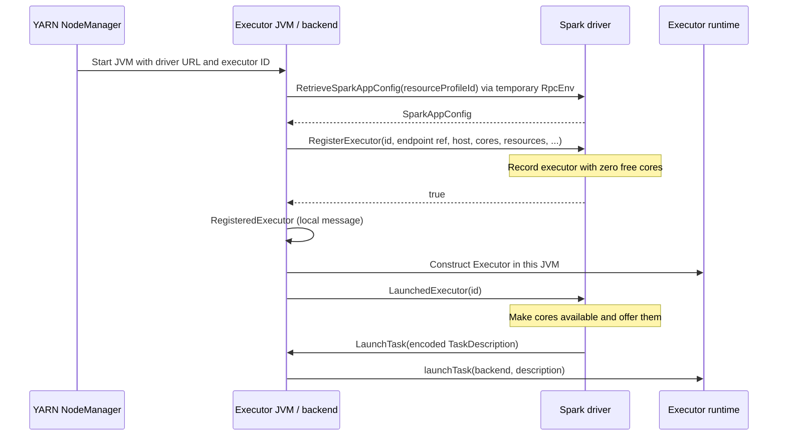

# Executor backend: from YARN container to schedulable executor

[component index](README.md) | [Lifecycle guide](../pyspark-on-yarn.md)

`YarnCoarseGrainedExecutorBackend` is the **scheduler-facing endpoint in an executor JVM**. The [NodeManager](node-manager.md) launches that JVM; the backend speaks [Spark RPC](rpc-env.md) to the driver in either deploy mode. It turns `LaunchTask` messages into local method calls and turns local status updates back into driver messages. It neither allocates containers nor runs partition code on its RPC thread.

## Flow at a glance

1. **Driver**: Register the executor with zero free cores.
2. **Executor backend**: Build the local runtime and report it ready.
3. **Driver backend**: Offer the executor's cores to the scheduler.

> **Key distinction:** The executor-added event confirms registration. Its cores become available only after the driver receives `LaunchedExecutor`.

Show the animated flow

## One launch, three milestones

1. **Container running.** The AM supplies the [launch command][command]: driver URL, executor ID, hostname, cores, application ID and resource-profile ID. The [YARN entry point][yarn] supplies the YARN user classpath, log URLs and container attributes; it delegates the protocol to `CoarseGrainedExecutorBackend`. A temporary client-only `driverPropsFetcher` resolves the driver endpoint (up to three lookup attempts), then synchronously asks for the profile's `SparkAppConfig`. The reply includes Spark properties, the profile and optional credentials, I/O encryption key and log level. The fetcher shuts down; this is **not** the channel retained for task launches. [Bootstrap][bootstrap]
2. **Registered.** The process builds the executor `SparkEnv`, initializes its credential state and registers the backend under the endpoint name `Executor`. Its [`onStart`][register] checks direct memory when applicable, discovers resource addresses and asynchronously asks the driver to register `self`. The [driver][admission] rejects a duplicate ID or excluded executor/host; on acceptance it stores `ExecutorData` with **zero free cores**, posts `SparkListenerExecutorAdded` and replies `true`. That reply is not a `LaunchTask`.
3. **Ready.** The registration callback posts `RegisteredExecutor` **to itself**, not to the driver. The endpoint constructs the [Executor runtime](executor.md) and only then sends `LaunchedExecutor`. The [driver's readiness handler][ready] sets free cores to total cores and makes resource offers. A registered executor visible to a listener need not yet have offered any capacity. [Executor-side handoff][handoff]

## Steady-state contract and shutdown

| Direction | What crosses the boundary |
|---|---|
| Driver to backend | `LaunchTask` carries an encoded description; the backend decodes it and calls `executor.launchTask`. `KillTask` supplies the attempt ID, interrupt flag and reason; the backend delegates to `executor.killTask`. Neither command starts a container. |
| Task runner to backend to driver | `statusUpdate` joins the attempt ID, state and payload to the CPU/resource assignments in `runningTasks`, then sends `StatusUpdate`. On terminal status the driver passes the data to the scheduler and returns resources to its offers; it need not wait for [result retrieval](task-result-getter.md). |
| Driver to backend, during operation or retirement | Credential updates refresh executor-side state. `DecommissionExecutor` starts a drain if enabled; `StopExecutor` instead schedules shutdown. |

Before sending `LaunchTask`, the driver also checks the encoded `TaskDescription`. If it is at least the RPC message limit, the [driver aborts the task set][launch-check]. This limits serialized launch instructions, **not** the size of the input partition or the eventual result.

The endpoint has [one dedicated dispatch thread][isolated]. It keeps a volatile driver ref, an initially null executor and an atomic `stopping` flag. Tasks call the [status path][status] from other threads. During decommission the backend can wait for running tasks and, if configured, block migration; a last-task-finish timestamp prevents accepting an out-of-date migration check. A normal stop posts `Shutdown` locally and calls `executor.stop()` on **another thread**: stopping `SparkEnv` waits for RPC termination, so doing that inside the dispatcher could deadlock. [Commands and stop][handoff] | [Drain condition][drain]

**Failure clue:** If YARN shows a running container but Spark has no usable executor, find the last milestone. A failed config lookup precedes registration; `Cannot register with driver` is a lookup/registration failure in `onStart`; `Successfully registered with driver` followed by an executor construction error narrows the problem to the readiness gap. If the established driver disconnects unexpectedly, the backend initiates shutdown without trying to notify that driver. In the opposite direction, the [YARN driver endpoint][loss] disables a disconnected executor and asks the AM for its loss reason; a lost socket alone does not establish that the task caused the exit.

[command]: https://github.com/apache/spark/blob/dada2a6db5d73b152d6ba16e4fe21406f86abfe3/resource-managers/yarn/src/main/scala/org/apache/spark/deploy/yarn/ExecutorRunnable.scala#L196-L211
[yarn]: https://github.com/apache/spark/blob/dada2a6db5d73b152d6ba16e4fe21406f86abfe3/resource-managers/yarn/src/main/scala/org/apache/spark/executor/YarnCoarseGrainedExecutorBackend.scala#L36-L86
[bootstrap]: https://github.com/apache/spark/blob/dada2a6db5d73b152d6ba16e4fe21406f86abfe3/core/src/main/scala/org/apache/spark/executor/CoarseGrainedExecutorBackend.scala#L439-L538
[register]: https://github.com/apache/spark/blob/dada2a6db5d73b152d6ba16e4fe21406f86abfe3/core/src/main/scala/org/apache/spark/executor/CoarseGrainedExecutorBackend.scala#L48-L116
[admission]: https://github.com/apache/spark/blob/dada2a6db5d73b152d6ba16e4fe21406f86abfe3/core/src/main/scala/org/apache/spark/scheduler/cluster/CoarseGrainedSchedulerBackend.scala#L261-L352
[ready]: https://github.com/apache/spark/blob/dada2a6db5d73b152d6ba16e4fe21406f86abfe3/core/src/main/scala/org/apache/spark/scheduler/cluster/CoarseGrainedSchedulerBackend.scala#L246-L251
[handoff]: https://github.com/apache/spark/blob/dada2a6db5d73b152d6ba16e4fe21406f86abfe3/core/src/main/scala/org/apache/spark/executor/CoarseGrainedExecutorBackend.scala#L167-L234
[launch-check]: https://github.com/apache/spark/blob/dada2a6db5d73b152d6ba16e4fe21406f86abfe3/core/src/main/scala/org/apache/spark/scheduler/cluster/CoarseGrainedSchedulerBackend.scala#L457-L486
[isolated]: https://github.com/apache/spark/blob/dada2a6db5d73b152d6ba16e4fe21406f86abfe3/core/src/main/scala/org/apache/spark/rpc/RpcEndpoint.scala#L166-L177
[status]: https://github.com/apache/spark/blob/dada2a6db5d73b152d6ba16e4fe21406f86abfe3/core/src/main/scala/org/apache/spark/executor/CoarseGrainedExecutorBackend.scala#L260-L316
[drain]: https://github.com/apache/spark/blob/dada2a6db5d73b152d6ba16e4fe21406f86abfe3/core/src/main/scala/org/apache/spark/executor/CoarseGrainedExecutorBackend.scala#L319-L387
[loss]: https://github.com/apache/spark/blob/dada2a6db5d73b152d6ba16e4fe21406f86abfe3/resource-managers/yarn/src/main/scala/org/apache/spark/scheduler/cluster/YarnSchedulerBackend.scala#L270-L328
