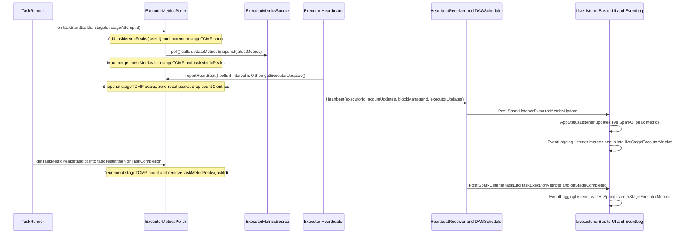

# ExecutorMetricsPoller & ExecutorMetricsSource: memory peak sampling

[component index](README.md)

Apache Spark `dada2a6` has **no class named `ExecutorMetricsReporter`**. Executor-level memory, GC, and optional Linux `/proc` process-tree metrics are instead sampled inside each executor JVM by **`ExecutorMetricsPoller`** (`stageTCMP` and `taskMetricPeaks`), cached for local Dropwizard export in **`ExecutorMetricsSource`** (`updateMetricsSnapshot`), and shipped to the driver over two existing channels: periodically inside [`Executor.reportHeartBeat()`][exec-hb] (`Heartbeater` -> [`HeartbeatReceiver`](heartbeat-receiver.md) -> `TaskSchedulerImpl` -> `DAGScheduler` -> [`LiveListenerBus`](listener-bus.md) -> [`EventLoggingListener`](event-log.md) and [`SparkUI`](spark-ui.md)), and at task completion inside task results (`DirectTaskResult`, `TaskKilled`, or `ExceptionFailure`).

## Flow at a glance

1. **Metric sampling**: `ExecutorMetricsPoller.poll()` reads JVM, `MemoryManager`, buffer pool, GC, and optional `/proc` stats, updating `ExecutorMetricsSource` plus per-stage (`stageTCMP`) and per-task (`taskMetricPeaks`) peaks.
2. **Heartbeat shipping**: `Executor.reportHeartBeat()` drains and resets per-stage peaks via `getExecutorUpdates()` (polling first when `pollingInterval == 0`) and sends them in `Heartbeat` to `HeartbeatReceiver`.
3. **Driver fan-out**: `DAGScheduler` posts `SparkListenerExecutorMetricsUpdate` on `LiveListenerBus`, updating live `SparkUI` peaks and letting `EventLoggingListener` emit `SparkListenerStageExecutorMetrics` at stage completion.

> **Key distinction:** Spark `dada2a6` has no `ExecutorMetricsReporter`. `ExecutorMetricsSource` exposes the latest sampled snapshot to the executor's local [`MetricsSystem`](metrics-system.md), while heartbeats carry per-stage peaks since the last heartbeat and task results carry per-task peaks so sub-interval tasks are not missed.

> **Interactive explorer:** [Open in Spark Visualizer](https://nuthanreddy.github.io/spark-visualizer/#component=executor-metrics-poller) to step through commands, wire payloads, category filters, and fault simulations on the live cluster canvas.

## Polling modes and sampled metrics

`Executor` constructs one [`ExecutorMetricsPoller`][exec-wiring] with `env.memoryManager`, [`spark.executor.metrics.pollingInterval`][conf-polling], and an optional [`ExecutorMetricsSource`][exec-register] (created and registered on the executor's `MetricsSystem` when [`spark.metrics.executorMetricsSource.enabled=true`][conf-source], the default). How often `poll()` runs depends on one branch:

| Mode | Configuration | Threading and sampling cadence |
|---|---|---|
| **Lazy on heartbeat (default)** | `spark.executor.metrics.pollingInterval = 0` | `Executor` sets `pollOnHeartbeat = true`, and `ExecutorMetricsPoller` creates **no** poller thread (`poller = None`) ([poller setup][poller-state]). `Executor.reportHeartBeat()` calls `metricsPoller.poll()` right before `metricsPoller.getExecutorUpdates()` on the `executor-heartbeater` thread every `spark.executor.heartbeatInterval` (default `10s`, after a randomized initial delay in [`Heartbeater`][heartbeater]). |
| **Dedicated poller thread** | `spark.executor.metrics.pollingInterval > 0` | `Executor` sets `pollOnHeartbeat = false`. `ExecutorMetricsPoller` creates a daemon single-thread scheduler named `executor-metrics-poller` and [`metricsPoller.start()`][exec-start] runs `poll()` via `scheduleAtFixedRate` from `0L` every `pollingInterval` ms ([`start()`][poller-poll]). Heartbeats still ship peaks every `spark.executor.heartbeatInterval`, without triggering an extra poll. |

Each `poll()` calls [`ExecutorMetrics.getCurrentMetrics(memoryManager)`][exec-metrics], filling a 23-element `Array[Long]` ordered by [`ExecutorMetricType.metricToOffset`][metric-types]:

- **JVM and Spark memory (10 metrics):** `JVMHeapMemory` and `JVMOffHeapMemory` from `ManagementFactory.getMemoryMXBean`; `OnHeapExecutionMemory`, `OffHeapExecutionMemory`, `OnHeapStorageMemory`, `OffHeapStorageMemory`, `OnHeapUnifiedMemory`, and `OffHeapUnifiedMemory` from `MemoryManager`; `DirectPoolMemory` and `MappedPoolMemory` from NIO `BufferPoolMXBean`s.
- **Process tree `/proc` metrics (6 metrics):** [`ProcessTreeMetrics`][proc-types] (`ProcessTreeJVMVMemory`, `ProcessTreeJVMRSSMemory`, `ProcessTreePythonVMemory`, `ProcessTreePythonRSSMemory`, `ProcessTreeOtherVMemory`, `ProcessTreeOtherRSSMemory`). [`ProcfsMetricsGetter`][procfs] checks that `/proc/` exists **and** [`spark.executor.processTreeMetrics.enabled=true`][conf-polling] (default `false`). When active, [`computeProcessTree()` and `computeAllMetrics()`][procfs-walk] walk `ProcessHandle.current().descendants()` plus the executor JVM PID, read `/proc/<pid>/stat`, multiply RSS pages by `getconf PAGESIZE`, and bucket each process by whether its `comm` name contains `"java"`, `"python"`, or other. On PySpark on YARN, this is how off-JVM Python worker RSS becomes visible alongside executor JVM RSS.
- **GC metrics (7 metrics):** [`GarbageCollectionMetrics`][gc-types] (`MinorGCCount`, `MinorGCTime`, `MajorGCCount`, `MajorGCTime`, `TotalGCTime`, `ConcurrentGCCount`, `ConcurrentGCTime`) from `GarbageCollectorMXBean`s.

Immediately after collecting `latestMetrics`, [`poll()`][poller-poll] calls `executorMetricsSource.foreach(_.updateMetricsSnapshot(latestMetrics))` so the 23 Dropwizard gauges in [`ExecutorMetricsSource`][source] (`sourceName = "ExecutorMetrics"`) serve the cached volatile array without re-reading MXBeans or `/proc` on sink scrapes. It then updates every entry in `stageTCMP` and `taskMetricPeaks` with lock-free `AtomicLongArray.getAndAccumulate(i, latestMetrics(i), math.max)`.

On the **driver**, `SparkContext` does not create an `ExecutorMetricsPoller`. Instead, a [`driver-heartbeater`][driver-hb] (`Heartbeater`, cadence `spark.driver.metrics.pollingInterval`, falling back to `spark.executor.heartbeatInterval`) calls `ExecutorMetrics.getCurrentMetrics(env.memoryManager)`, updates the driver's optional `ExecutorMetricsSource`, and posts [`SparkListenerExecutorMetricsUpdate("driver", ..., Map((-1, -1) -> metrics))`][driver-report] directly to `LiveListenerBus`.

## End-to-end sampling and reporting pipeline

1. **Task start and peak tracking.** After deserializing a task, [`TaskRunner.run()`][exec-task-start] calls [`metricsPoller.onTaskStart(taskId, task.stageId, task.stageAttemptId)`][poller-task], allocating an `AtomicLongArray` in `taskMetricPeaks` and incrementing `count` in `stageTCMP((stageId, stageAttemptId))`.
2. **Heartbeat drain and reset.** On each heartbeat tick, [`Executor.reportHeartBeat()`][exec-hb] calls `metricsPoller.poll()` (when `pollingInterval == 0`), then calls [`metricsPoller.getExecutorUpdates()`][poller-drain]. `stageTCMP.replaceAll` copies each stage's `AtomicLongArray` into an `ExecutorMetrics` snapshot and replaces it with a fresh zeroed `AtomicLongArray`; a second pass removes keys whose `count == 0`. That two-step design ensures a stage whose last task finished before the heartbeat still reports its final peak once before eviction.
3. **Driver routing and fan-out.** [`HeartbeatReceiver`][hb-recv] forwards `executorUpdates` through [`TaskSchedulerImpl.executorHeartbeatReceived`][ts-hb] to [`DAGScheduler.executorHeartbeatReceived`][dag-hb], which posts [`SparkListenerExecutorMetricsUpdate`][events] onto `LiveListenerBus`.
   - [`AppStatusListener.onExecutorMetricsUpdate`][status-listener] merges `peakUpdates` into each live executor's `peakExecutorMetrics`, each live stage's `peakExecutorMetrics`, and each stage's per-executor summary (driving `SparkUI` peak memory columns and `/metrics/executors/prometheus`).
   - [`EventLoggingListener.onExecutorMetricsUpdate`][event-log-hb] does **not** log every executor heartbeat to disk; when [`spark.eventLog.logStageExecutorMetrics=true`][conf-eventlog], it merges peaks into `liveStageExecutorMetrics` (plus driver `(-1, -1)` updates across active stages) and emits one [`SparkListenerStageExecutorMetrics`][events] record per executor at [`onStageCompleted`][event-log-stage]. On replay, History Server's [`AppStatusListener.onStageExecutorMetrics`][status-listener] restores those peaks.
4. **Short-task fallback and cleanup.** On success, [`TaskRunner`][exec-task-end] reads [`getTaskMetricPeaks(taskId)`][poller-task] into `DirectTaskResult` (and into `TaskKilled` or `ExceptionFailure` on kill/failure), which [`DAGScheduler.postTaskEnd`][dag-task-end] attaches to `SparkListenerTaskEnd.taskExecutorMetrics` for both [`AppStatusListener`][status-task-end] and [`EventLoggingListener`][event-log-stage]. In `finally`, [`onTaskCompletion`][exec-task-finally] decrements `stageTCMP` count and deletes `taskMetricPeaks(taskId)`. On shutdown, [`Executor.stop()`][exec-stop] flushes `metricsSystem.report()`, stops `metricsPoller` (waiting up to 10s), and then stops `heartbeater`.

## Inputs, outputs, and state

| Boundary | Contract |
|---|---|
| Inputs | `MemoryManager` accounting counters, JVM/NIO/GC MXBeans, Linux `/proc/<pid>/stat` (when `spark.executor.processTreeMetrics.enabled=true`), task lifecycle calls (`onTaskStart`, `onTaskCompletion`), and config (`spark.executor.metrics.pollingInterval`, `spark.executor.heartbeatInterval`, `spark.metrics.executorMetricsSource.enabled`, `spark.eventLog.logStageExecutorMetrics`). |
| Owned state | Executor-side `ExecutorMetricsPoller.stageTCMP: ConcurrentHashMap[(Int, Int), TCMP]` (`count` plus `AtomicLongArray` peaks), `taskMetricPeaks: ConcurrentHashMap[Long, AtomicLongArray]`, optional `executor-metrics-poller` scheduled executor, and `ExecutorMetricsSource.metricsSnapshot: @volatile Array[Long]`. Driver-side `AppStatusListener` live `peakExecutorMetrics` and `EventLoggingListener.liveStageExecutorMetrics`. |
| Outputs | 23 local Dropwizard gauges under `ExecutorMetrics.*` in the executor's `MetricsSystem`; `Heartbeat.executorUpdates` (`Map[(Int, Int), ExecutorMetrics]`) -> `SparkListenerExecutorMetricsUpdate`; per-task `metricPeaks` in task results -> `SparkListenerTaskEnd.taskExecutorMetrics`; and stage-end `SparkListenerStageExecutorMetrics` in the event log when enabled. |

## Failure clues and diagnosis

- **All `ProcessTree*` metrics stay `0`:** Verify `spark.executor.processTreeMetrics.enabled=true` (default is `false`), that executors run on Linux with `/proc/` readable, and that `getconf PAGESIZE` succeeds. Note also that [`computeAllMetrics()`][procfs-walk] returns all zeros on **any** `IOException` while scanning descendant PIDs (for example, if a short-lived Python worker exits mid-scan) rather than publishing a misleading partial sum.
- **Short memory spike missing from Spark UI or event log:** With the default `spark.executor.metrics.pollingInterval=0`, `poll()` runs only inside `reportHeartBeat()` every `spark.executor.heartbeatInterval` (`10s`). A brief Python UDF or spill spike that starts and finishes between two heartbeats can miss every sample, leaving zero or low peaks in both `stageTCMP` and `taskMetricPeaks`. Set a positive `spark.executor.metrics.pollingInterval` (such as `1000ms`) to run the dedicated `executor-metrics-poller` thread, balancing peak accuracy against MXBean and `/proc` polling overhead.
- **Peak memory appears in live Spark UI but disappears in History Server:** [`spark.eventLog.logStageExecutorMetrics`][conf-eventlog] defaults to `false`. When false, `EventLoggingListener` ignores `SparkListenerExecutorMetricsUpdate` and writes no `SparkListenerStageExecutorMetrics` at stage completion. Even when true, per-stage summaries are emitted only when `onStageCompleted` runs, not on every heartbeat.
- **Executor killed by YARN before the next heartbeat:** If the NodeManager kills an executor container for exceeding physical or virtual memory limits between heartbeats, unsent peaks sitting in `stageTCMP` vanish with the JVM. The driver retains only peaks from prior heartbeats or already-completed tasks.
- **GC metrics stay `0` with non-default JVM collectors:** [`GarbageCollectionMetrics`][gc-types] matches built-in young/old/G1 MXBean names and logs `To enable non-built-in garbage collector(s) ...` once when an unrecognized collector appears; map custom collectors via `spark.eventLog.gcMetrics.youngGenerationGarbageCollectors` and `oldGenerationGarbageCollectors`.
- **Dropwizard `ExecutorMetrics` differs from Spark UI peaks:** `ExecutorMetricsSource` gauges reflect the **most recent** `poll()` snapshot (so values rise and fall), whereas `SparkUI` displays monotonic high-water marks merged with [`compareAndUpdatePeakValues`][exec-metrics].

[poller-state]: https://github.com/apache/spark/blob/dada2a6db5d73b152d6ba16e4fe21406f86abfe3/core/src/main/scala/org/apache/spark/executor/ExecutorMetricsPoller.scala#L49-L69
[poller-poll]: https://github.com/apache/spark/blob/dada2a6db5d73b152d6ba16e4fe21406f86abfe3/core/src/main/scala/org/apache/spark/executor/ExecutorMetricsPoller.scala#L77-L104
[poller-task]: https://github.com/apache/spark/blob/dada2a6db5d73b152d6ba16e4fe21406f86abfe3/core/src/main/scala/org/apache/spark/executor/ExecutorMetricsPoller.scala#L109-L158
[poller-drain]: https://github.com/apache/spark/blob/dada2a6db5d73b152d6ba16e4fe21406f86abfe3/core/src/main/scala/org/apache/spark/executor/ExecutorMetricsPoller.scala#L167-L200
[source]: https://github.com/apache/spark/blob/dada2a6db5d73b152d6ba16e4fe21406f86abfe3/core/src/main/scala/org/apache/spark/executor/ExecutorMetricsSource.scala#L37-L64
[exec-metrics]: https://github.com/apache/spark/blob/dada2a6db5d73b152d6ba16e4fe21406f86abfe3/core/src/main/scala/org/apache/spark/executor/ExecutorMetrics.scala#L78-L109
[metric-types]: https://github.com/apache/spark/blob/dada2a6db5d73b152d6ba16e4fe21406f86abfe3/core/src/main/scala/org/apache/spark/metrics/ExecutorMetricType.scala#L200-L229
[proc-types]: https://github.com/apache/spark/blob/dada2a6db5d73b152d6ba16e4fe21406f86abfe3/core/src/main/scala/org/apache/spark/metrics/ExecutorMetricType.scala#L84-L104
[gc-types]: https://github.com/apache/spark/blob/dada2a6db5d73b152d6ba16e4fe21406f86abfe3/core/src/main/scala/org/apache/spark/metrics/ExecutorMetricType.scala#L106-L170
[procfs]: https://github.com/apache/spark/blob/dada2a6db5d73b152d6ba16e4fe21406f86abfe3/core/src/main/scala/org/apache/spark/executor/ProcfsMetricsGetter.scala#L44-L82
[procfs-walk]: https://github.com/apache/spark/blob/dada2a6db5d73b152d6ba16e4fe21406f86abfe3/core/src/main/scala/org/apache/spark/executor/ProcfsMetricsGetter.scala#L136-L166
[exec-wiring]: https://github.com/apache/spark/blob/dada2a6db5d73b152d6ba16e4fe21406f86abfe3/core/src/main/scala/org/apache/spark/executor/Executor.scala#L472-L504
[exec-start]: https://github.com/apache/spark/blob/dada2a6db5d73b152d6ba16e4fe21406f86abfe3/core/src/main/scala/org/apache/spark/executor/Executor.scala#L537
[exec-register]: https://github.com/apache/spark/blob/dada2a6db5d73b152d6ba16e4fe21406f86abfe3/core/src/main/scala/org/apache/spark/executor/Executor.scala#L329-L341
[exec-hb]: https://github.com/apache/spark/blob/dada2a6db5d73b152d6ba16e4fe21406f86abfe3/core/src/main/scala/org/apache/spark/executor/Executor.scala#L1544-L1590
[exec-task-start]: https://github.com/apache/spark/blob/dada2a6db5d73b152d6ba16e4fe21406f86abfe3/core/src/main/scala/org/apache/spark/executor/Executor.scala#L892-L893
[exec-task-end]: https://github.com/apache/spark/blob/dada2a6db5d73b152d6ba16e4fe21406f86abfe3/core/src/main/scala/org/apache/spark/executor/Executor.scala#L1007-L1014
[exec-task-finally]: https://github.com/apache/spark/blob/dada2a6db5d73b152d6ba16e4fe21406f86abfe3/core/src/main/scala/org/apache/spark/executor/Executor.scala#L1148-L1154
[exec-stop]: https://github.com/apache/spark/blob/dada2a6db5d73b152d6ba16e4fe21406f86abfe3/core/src/main/scala/org/apache/spark/executor/Executor.scala#L651-L671
[heartbeater]: https://github.com/apache/spark/blob/dada2a6db5d73b152d6ba16e4fe21406f86abfe3/core/src/main/scala/org/apache/spark/Heartbeater.scala#L33-L62
[hb-recv]: https://github.com/apache/spark/blob/dada2a6db5d73b152d6ba16e4fe21406f86abfe3/core/src/main/scala/org/apache/spark/HeartbeatReceiver.scala#L136-L151
[ts-hb]: https://github.com/apache/spark/blob/dada2a6db5d73b152d6ba16e4fe21406f86abfe3/core/src/main/scala/org/apache/spark/scheduler/TaskSchedulerImpl.scala#L900-L921
[dag-hb]: https://github.com/apache/spark/blob/dada2a6db5d73b152d6ba16e4fe21406f86abfe3/core/src/main/scala/org/apache/spark/scheduler/DAGScheduler.scala#L569-L581
[dag-task-end]: https://github.com/apache/spark/blob/dada2a6db5d73b152d6ba16e4fe21406f86abfe3/core/src/main/scala/org/apache/spark/scheduler/DAGScheduler.scala#L3582-L3585
[events]: https://github.com/apache/spark/blob/dada2a6db5d73b152d6ba16e4fe21406f86abfe3/core/src/main/scala/org/apache/spark/scheduler/SparkListener.scala#L250-L270
[event-log-stage]: https://github.com/apache/spark/blob/dada2a6db5d73b152d6ba16e4fe21406f86abfe3/core/src/main/scala/org/apache/spark/scheduler/EventLoggingListener.scala#L106-L158
[event-log-hb]: https://github.com/apache/spark/blob/dada2a6db5d73b152d6ba16e4fe21406f86abfe3/core/src/main/scala/org/apache/spark/scheduler/EventLoggingListener.scala#L250-L272
[status-listener]: https://github.com/apache/spark/blob/dada2a6db5d73b152d6ba16e4fe21406f86abfe3/core/src/main/scala/org/apache/spark/status/AppStatusListener.scala#L970-L1046
[status-task-end]: https://github.com/apache/spark/blob/dada2a6db5d73b152d6ba16e4fe21406f86abfe3/core/src/main/scala/org/apache/spark/status/AppStatusListener.scala#L734-L736
[driver-hb]: https://github.com/apache/spark/blob/dada2a6db5d73b152d6ba16e4fe21406f86abfe3/core/src/main/scala/org/apache/spark/SparkContext.scala#L662-L674
[driver-report]: https://github.com/apache/spark/blob/dada2a6db5d73b152d6ba16e4fe21406f86abfe3/core/src/main/scala/org/apache/spark/SparkContext.scala#L3325-L3335
[conf-polling]: https://github.com/apache/spark/blob/dada2a6db5d73b152d6ba16e4fe21406f86abfe3/core/src/main/scala/org/apache/spark/internal/config/package.scala#L349-L386
[conf-eventlog]: https://github.com/apache/spark/blob/dada2a6db5d73b152d6ba16e4fe21406f86abfe3/core/src/main/scala/org/apache/spark/internal/config/package.scala#L255-L261
[conf-source]: https://github.com/apache/spark/blob/dada2a6db5d73b152d6ba16e4fe21406f86abfe3/core/src/main/scala/org/apache/spark/internal/config/package.scala#L1184-L1189
