# ExecutorMonitor: deciding which idle executors are candidates

[component index](README.md)

`ExecutorMonitor` answers a different question from [ExecutorAllocationManager](executor-allocation-manager.md): **which existing executor IDs have been idle long enough, given the data they hold?** It returns candidates and counts. It does not choose a target, kill a JVM, ask YARN for resources, or detect a dead executor from missing heartbeats.

## Flow at a glance

1. **Idle start**: The monitor records when an executor's last running task ends.
2. **Stored data**: Cached blocks or shuffle data can extend the idle deadline; an active tracked shuffle keeps the executor ineligible.
3. **Candidate list**: Once the deadline expires, the monitor can return the executor's ID and resource profile to the manager.

> **Key distinction:** Executor `7` can appear on the list and still stay if removing it would put its profile below target.

> **Interactive explorer:** [Open in Spark Visualizer](https://nuthanreddy.github.io/spark-visualizer/#component=executor-monitor) to step through commands, wire payloads, category filters, and fault simulations on the live cluster canvas.

## Owner, inputs and state

The dynamic allocation manager constructs this **driver-JVM listener**, [registers it][owner] on the `executorManagement` queue, and optionally attaches it to `ContextCleaner`. It has no process, RPC endpoint, or timer of its own. The queue thread updates most state; the manager's allocation thread calls `timedOutExecutors()`. When `SparkContext` [stops the cleaner, manager and bus][stop], the callback and polling paths end.

| Event or call | State transition |
|---|---|
| Executor added/removed | Create a `Tracker` keyed by executor ID; count executors by resource-profile ID. A task or block event can arrive before the add, so an unknown profile can be [filled in later][track]. Actual removal deletes the tracker and updates a reason counter. |
| Task start/end | A start from an active executor adds one to `runningTasks`. On successful shuffle-map completion, record the shuffle **before** decrementing the count. At zero, set `idleStart` from the monotonic clock; while running, the deadline is effectively infinite. [Task and removal handlers][tasks] |
| Block and job events | `cachedBlocks` maps RDD IDs to partition bitsets. Block updates and unpersist change it. Disk-backed RDD blocks that the external shuffle service is configured to serve do not extend the cache timeout. With shuffle tracking enabled **and no external shuffle service**, job/stage-to-shuffle maps tell the tracker whether any held shuffle belongs to an active job. [Block rules][blocks]; [job-to-shuffle tracking][jobs]. |
| Shuffle cleanup / accepted removal | The cleaner posts a private `ShuffleCleanedEvent` back to the bus rather than mutating listener-owned state from its thread. The manager marks accepted IDs `pendingRemoval` or `decommissioning`; these are excluded on the next scan, but are not yet counted as gone. [Cleaner handoff][cleaner]; [flags and counts][flags]. |

## The candidate test

For a tracker with zero running tasks, the [deadline calculation][deadline] is `idleStart + max(ordinaryIdleTimeout, applicableCacheTimeout, applicableShuffleTimeout)`. A timeout for a kind of data the executor does not hold contributes zero. An **active** tracked shuffle excludes the executor entirely, even if that calculated deadline has passed. Once no active job uses the shuffle, its data can still extend the deadline until cleanup or the configured shuffle-tracking timeout.

The manager calls [`timedOutExecutors()`][scan] on each ordinary allocation tick, but the monitor need not scan every executor each time. An atomic `nextTimeout` and a cached candidate list avoid repeated scans until a deadline or an invalidating change. A scan excludes pending removals, decommissions and active shuffles, compares `timeoutAt <= now`, and returns `(executorId, resourceProfileId)` pairs sorted by ID. **A returned pair is not permission to kill.** The manager still enforces the target/minimum and the backend [checks for busy executors][backend].

## Worked example: an idle map executor that must stay

Assume ordinary, cached-RDD and shuffle timeouts of 30, 120 and 90 seconds respectively, shuffle tracking on, and no external shuffle service. Executor `7` holds a cached RDD partition and output for shuffle `S`.

| Time since its last task ended | Why `7` stays or becomes eligible |
|---|---|
| 0 s | `idleStart` is set. A job still uses `S`; zero running tasks is not sufficient. |
| 40 s | The job ends and no other job uses `S`. The cache and shuffle still exist, so the deadline is 120 s **from the original idle start**, not from job end. |
| 55 s | The last cached RDD is unpersisted. Only the shuffle extends the ordinary timeout; the recalculated deadline is 90 s. |
| At or after 90 s | A scan can return `(7, profileId)` if no task has started and no job reuses `S`. Removal is a separate manager/backend decision. |

**Limit of the evidence:** a timeout here means *eligible for idle removal*, not unresponsive. A task start can be [queued while the allocation thread is scanning][scan]. Conversely, the [task-end handler][tasks] tracks even successful speculative map copies. An executor may stay because it produced a copy, not because a reducer actually fetched that copy.

[owner]: https://github.com/apache/spark/blob/dada2a6db5d73b152d6ba16e4fe21406f86abfe3/core/src/main/scala/org/apache/spark/ExecutorAllocationManager.scala#L269-L291
[stop]: https://github.com/apache/spark/blob/dada2a6db5d73b152d6ba16e4fe21406f86abfe3/core/src/main/scala/org/apache/spark/SparkContext.scala#L2646-L2670
[scan]: https://github.com/apache/spark/blob/dada2a6db5d73b152d6ba16e4fe21406f86abfe3/core/src/main/scala/org/apache/spark/scheduler/dynalloc/ExecutorMonitor.scala#L45-L138
[flags]: https://github.com/apache/spark/blob/dada2a6db5d73b152d6ba16e4fe21406f86abfe3/core/src/main/scala/org/apache/spark/scheduler/dynalloc/ExecutorMonitor.scala#L144-L200
[jobs]: https://github.com/apache/spark/blob/dada2a6db5d73b152d6ba16e4fe21406f86abfe3/core/src/main/scala/org/apache/spark/scheduler/dynalloc/ExecutorMonitor.scala#L202-L307
[tasks]: https://github.com/apache/spark/blob/dada2a6db5d73b152d6ba16e4fe21406f86abfe3/core/src/main/scala/org/apache/spark/scheduler/dynalloc/ExecutorMonitor.scala#L309-L380
[blocks]: https://github.com/apache/spark/blob/dada2a6db5d73b152d6ba16e4fe21406f86abfe3/core/src/main/scala/org/apache/spark/scheduler/dynalloc/ExecutorMonitor.scala#L383-L445
[cleaner]: https://github.com/apache/spark/blob/dada2a6db5d73b152d6ba16e4fe21406f86abfe3/core/src/main/scala/org/apache/spark/scheduler/dynalloc/ExecutorMonitor.scala#L447-L461
[track]: https://github.com/apache/spark/blob/dada2a6db5d73b152d6ba16e4fe21406f86abfe3/core/src/main/scala/org/apache/spark/scheduler/dynalloc/ExecutorMonitor.scala#L497-L518
[deadline]: https://github.com/apache/spark/blob/dada2a6db5d73b152d6ba16e4fe21406f86abfe3/core/src/main/scala/org/apache/spark/scheduler/dynalloc/ExecutorMonitor.scala#L537-L617
[backend]: https://github.com/apache/spark/blob/dada2a6db5d73b152d6ba16e4fe21406f86abfe3/core/src/main/scala/org/apache/spark/scheduler/cluster/CoarseGrainedSchedulerBackend.scala#L1141-L1161
