# Executor: the runtime shared by task attempts

[component index](README.md) | [Lifecycle guide](../pyspark-on-yarn.md)

On classic YARN, `Executor` is a long-lived **object inside the executor JVM**, not the NodeManager, the [backend RPC endpoint](executor-backend.md), or a Python worker. One instance serves many attempts using the same `SparkEnv`, block manager and JVM. The driver chooses what fits on the executor; the executor runs what it is assigned.

## Flow at a glance

1. **Early cancellation**: The executor saves a kill mark for the attempt ID.
2. **Late launch**: The executor applies the mark before submitting the runner.
3. **Task runner**: Report the attempt killed without running the partition.

> **Key distinction:** The kill mark belongs to one attempt ID, not to every attempt for that partition.

Show the animated flow

## What lives for the executor's lifetime?

| State or thread | What it does |
|---|---|
| Task worker pool and `runningTasks` | A cached pool of daemon `UninterruptibleThread` workers runs `TaskRunner`s. The concurrent map is keyed by **attempt ID**, not partition. The pool size is not the advertised slot count: the driver [accounts for CPUs and other resources at launch][launch-budget]. |
| Artifacts and class loaders | Tracks files, jars and archives by version/timestamp. Updates use an interruptible lock rather than letting concurrent tasks race to install dependencies. A task sets its thread's loader before deserializing user classes. |
| Kill marks and optional reapers | `killMarks` remembers `(interruptThread, reason, timestamp)` if cancellation wins the race with launch. A scheduled sweep expires stale marks. Reapers, when enabled, run in a separate pool so the backend need not wait for user code to stop. |
| Heartbeater and metrics poller | Periodically snapshot executor metrics and available accumulator updates from active tasks. They are separate from both the task workers and the RPC endpoint dispatcher. |

[Pool and storage setup][pool] | [Class loaders, maps and cleanup timer][state] | [Dependency lock][dependencies]

## Startup, work and retirement

1. **Initialize the runtime.** After driver registration the backend constructs `Executor(id, host, env, userClassPath, isLocal = false, resources)`. It installs the process uncaught-exception handler, initializes the block manager with the application ID and registers metrics sources. Block manager initialization starts its transfer service and [registers its own storage identity][block-init]; this is distinct from scheduler registration. The heartbeater starts before plugin initialization; initial artifacts are loaded before plugins and the shuffle manager. Only after construction returns does the backend announce readiness. [Initialization order][init] | [Readiness message][ready]
2. **Accept a launch.** `launchTask(backend, description)` constructs a [TaskRunner for the attempt](task-attempt.md), puts it in `runningTasks`, applies any pending kill mark, then submits it to the pool. The RPC dispatcher can return without waiting for the partition. The runner uses the backend to report `RUNNING` and a terminal state with a result or failure reason. On the usual exit path its `finally` removes the map entry; it does not destroy the executor. [Submission and cancellation][launch] | [Runner cleanup][cleanup]
3. **Report liveness independently.** `Heartbeat(executorId, accumulatorUpdates, blockManagerId, executorUpdates)` goes to the driver's [HeartbeatReceiver](heartbeat-receiver.md), not the AM. A successful `HeartbeatResponse` resets the failure count and can request **block manager** re-registration. Repeated send/response failures reaching the configured maximum make the executor exit. Separately, the driver [expires executors][expiry] whose last heartbeat is too old. A heartbeat is neither task completion nor a request to launch more tasks. [Heartbeat request and reply][heartbeat]
4. **Retire.** During decommission the driver stops offering new work and the backend monitors draining. The executor's local flag diagnoses a racing launch; it is **not** a hard rejection in `launchTask`. `stop()` is guarded by an atomic flag: it reports metrics, stops polling and heartbeats, shuts down the task pool and kill-mark timer, notifies plugins and stops the non-local `SparkEnv`. The shutdown hook uses the same method. [Decommission and launch][launch] | [Stop sequence][stop]

**Failure clue:** If one TID stops making progress while heartbeats and other attempts continue, look at that task rather than treating the whole container as lost. With the reaper enabled, `Killed task ... is still running` means cancellation was requested but the code has not finished; the reaper can log its stack. Only if a configured positive kill timeout expires does the non-local reaper escalate a stuck kill to JVM failure. Conversely, `Issue communicating with driver in heartbeater` is from the heartbeat thread; it does not identify a particular task. [Reaper decisions][reaper] | [Heartbeat failure counter][heartbeat]

For a PySpark job, a JVM-only expression stays on the task thread. When the plan actually invokes Python, a [Python runner][python] obtains a worker and streams input/output for that attempt. The worker does not register as another Spark executor or receive `LaunchTask` from YARN.

[launch-budget]: https://github.com/apache/spark/blob/dada2a6db5d73b152d6ba16e4fe21406f86abfe3/core/src/main/scala/org/apache/spark/scheduler/cluster/CoarseGrainedSchedulerBackend.scala#L457-L486
[pool]: https://github.com/apache/spark/blob/dada2a6db5d73b152d6ba16e4fe21406f86abfe3/core/src/main/scala/org/apache/spark/executor/Executor.scala#L249-L345
[state]: https://github.com/apache/spark/blob/dada2a6db5d73b152d6ba16e4fe21406f86abfe3/core/src/main/scala/org/apache/spark/executor/Executor.scala#L388-L450
[dependencies]: https://github.com/apache/spark/blob/dada2a6db5d73b152d6ba16e4fe21406f86abfe3/core/src/main/scala/org/apache/spark/executor/Executor.scala#L1450-L1483
[block-init]: https://github.com/apache/spark/blob/dada2a6db5d73b152d6ba16e4fe21406f86abfe3/core/src/main/scala/org/apache/spark/storage/BlockManager.scala#L694-L742
[init]: https://github.com/apache/spark/blob/dada2a6db5d73b152d6ba16e4fe21406f86abfe3/core/src/main/scala/org/apache/spark/executor/Executor.scala#L478-L539
[ready]: https://github.com/apache/spark/blob/dada2a6db5d73b152d6ba16e4fe21406f86abfe3/core/src/main/scala/org/apache/spark/executor/CoarseGrainedExecutorBackend.scala#L167-L177
[launch]: https://github.com/apache/spark/blob/dada2a6db5d73b152d6ba16e4fe21406f86abfe3/core/src/main/scala/org/apache/spark/executor/Executor.scala#L541-L639
[cleanup]: https://github.com/apache/spark/blob/dada2a6db5d73b152d6ba16e4fe21406f86abfe3/core/src/main/scala/org/apache/spark/executor/Executor.scala#L1134-L1161
[expiry]: https://github.com/apache/spark/blob/dada2a6db5d73b152d6ba16e4fe21406f86abfe3/core/src/main/scala/org/apache/spark/HeartbeatReceiver.scala#L210-L246
[heartbeat]: https://github.com/apache/spark/blob/dada2a6db5d73b152d6ba16e4fe21406f86abfe3/core/src/main/scala/org/apache/spark/executor/Executor.scala#L1543-L1591
[stop]: https://github.com/apache/spark/blob/dada2a6db5d73b152d6ba16e4fe21406f86abfe3/core/src/main/scala/org/apache/spark/executor/Executor.scala#L651-L688
[reaper]: https://github.com/apache/spark/blob/dada2a6db5d73b152d6ba16e4fe21406f86abfe3/core/src/main/scala/org/apache/spark/executor/Executor.scala#L1274-L1332
[python]: https://github.com/apache/spark/blob/dada2a6db5d73b152d6ba16e4fe21406f86abfe3/core/src/main/scala/org/apache/spark/api/python/PythonRunner.scala#L763-L806
