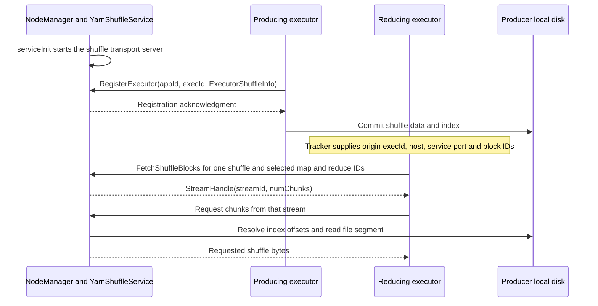

# External shuffle service: serving map files after an executor exits

[component index](README.md) | [Shuffle block resolver](shuffle-block-resolver.md) | [Shuffle reader](shuffle-reader.md)

On YARN, `YarnShuffleService` is an **optional NodeManager auxiliary service**. A reducer can ask it for a byte range from the producing executor's local shuffle files even after that executor JVM exits. “External” means outside the executor, **not** outside the node: the service does not replicate files or survive loss of the disk that contains them. It runs no Spark tasks and does not own `MapStatus` entries.

## Flow at a glance

1. **Producing executor**: Registers its local shuffle directories with the NodeManager service.
2. **Reducing executor**: Asks the service for reducer 2's block from attempt 41.
3. **Shuffle service**: Reads the indexed byte range from local disk and sends it to the reducer.

> **Watch for:** Registration tells the service where the files are; it does not copy them. The service can outlive the executor, but it cannot serve bytes from a lost disk.

> **Interactive explorer:** [Open in Spark Visualizer](https://nuthanreddy.github.io/spark-visualizer/#component=external-shuffle-service) to step through commands, wire payloads, category filters, and fault simulations on the live cluster canvas.

## Two distinct deployments

| | No external service | External service enabled |
| --- | --- | --- |
| Remote fetch address in `MapStatus` | Producing executor's `BlockManagerId`, including its block-transfer port. | Origin **executor ID** and host, but the **service port** (default 7337). Executors on one node can advertise the same host/port without sharing an executor ID. |
| Process serving bytes | The executor's Netty block-transfer service calls its `BlockManager`. | Netty server inside the node's `NodeManager` JVM; it reads the origin executor's files directly. |
| Executor exits with default local storage | Losing the serving executor normally means recomputing needed outputs. | Executor exit alone does not invalidate otherwise accessible shuffle files. Node, disk, or service failure can still make them unavailable. |

The application setting [`spark.shuffle.service.enabled` defaults to false][defaults]. Setting it to true does **not** start a service. Administrators must [install and configure the auxiliary service on participating NodeManagers][yarn-setup]; its configured name (normally `spark_shuffle`) must [match the Spark setting][name]. [`BlockManager.initialize` chooses the advertised address][address] and the [scheduler distinguishes executor loss from file loss][loss]. Neither deployment requires a remote transfer for a block that the consumer can read locally.

## Registration, then fetch

1. **Start and application scope.** During [`serviceInit`][init] the NM service creates an `ExternalBlockHandler`, optional authentication bootstrap, and a server bound to the configured port. This happens independently of Spark task launch. The AM's [`ExecutorRunnable`][launch] supplies named application service data in the container launch context; the NM's [`initializeApplication`][app-init] handles per-application settings and authentication when enabled. This is distinct from registering the executor's file layout.
2. **Registration metadata.** During `BlockManager.initialize`, each non-driver executor synchronously sends [`RegisterExecutor`][register] with application ID, executor ID and `ExecutorShuffleInfo` (local directory roots, subdirectory count, shuffle-manager information). The handler validates the registration and acknowledges it. The [service-side resolver][registry] keys this layout by **`(appId, execId)`**, optionally persisting it for NM recovery and reloading it on restart. No map outputs, offsets, or rows are uploaded during registration.
3. **Block discovery versus block serving.** The [tracker worker](map-output-tracker-worker.md) supplies locations; the service does not answer which attempt won. The reducing executor sends `FetchShuffleBlocks(appId, execId, shuffleId, mapIds, reduceIds, batchFetchEnabled)` (legacy: `OpenBlocks`). For shuffle 7, map ID 41, reduce ID 2, it needs no logical map slot 3. The [handler creates a stream over managed buffers][open]; the client [requests chunks or streams them to disk][chunks]. For each block, the Java `ExternalShuffleBlockResolver` combines the registered layout with the filename, [looks up index offsets and returns a data-file segment][segment]. A bounded index cache stores offsets, not shuffle payloads.

## Lifetime, failure, and diagnosis

With the service enabled, a normal executor's `DiskBlockManager` [does not delete its local files on stop][retain]. `YarnShuffleService.stopContainer` only logs the event; `stopApplication` removes that application's registrations and asks the handler **not** to delete the directories (YARN handles directory cleanup). `serviceStop` [closes the server, transport context, handler and state DB][stop]. Recovering the registration DB after an NM restart can restore file discovery, not recover missing file contents.

**Diagnostic:** An executor failing **during startup** with `Failed to connect to external shuffle server` is on the [bounded registration-retry path][reg-retry]. Compare its reported port with `Started YARN shuffle service for Spark on port ...` in that node's NM log. A reducer failing **later** with `Executor is not registered (appId=..., execId=...)` reached the service but lost or never had the [registration for that exact pair][missing]; check NM restart/recovery and application cleanup. A registered executor with a missing index is a disk/layout problem instead. The client [retries eligible transfers][fetch-retry]; if data remains unavailable the **driver**, not the service, schedules recomputation.

[defaults]: https://github.com/apache/spark/blob/dada2a6db5d73b152d6ba16e4fe21406f86abfe3/core/src/main/scala/org/apache/spark/internal/config/package.scala#L856-L860
[yarn-setup]: https://github.com/apache/spark/blob/dada2a6db5d73b152d6ba16e4fe21406f86abfe3/docs/running-on-yarn.md#L877-L896
[name]: https://github.com/apache/spark/blob/dada2a6db5d73b152d6ba16e4fe21406f86abfe3/core/src/main/scala/org/apache/spark/internal/config/package.scala#L898-L909
[address]: https://github.com/apache/spark/blob/dada2a6db5d73b152d6ba16e4fe21406f86abfe3/core/src/main/scala/org/apache/spark/storage/BlockManager.scala#L710-L744
[loss]: https://github.com/apache/spark/blob/dada2a6db5d73b152d6ba16e4fe21406f86abfe3/core/src/main/scala/org/apache/spark/scheduler/DAGScheduler.scala#L4845-L4863
[init]: https://github.com/apache/spark/blob/dada2a6db5d73b152d6ba16e4fe21406f86abfe3/common/network-yarn/src/main/java/org/apache/spark/network/yarn/YarnShuffleService.java#L268-L338
[launch]: https://github.com/apache/spark/blob/dada2a6db5d73b152d6ba16e4fe21406f86abfe3/resource-managers/yarn/src/main/scala/org/apache/spark/deploy/yarn/ExecutorRunnable.scala#L111-L151
[app-init]: https://github.com/apache/spark/blob/dada2a6db5d73b152d6ba16e4fe21406f86abfe3/common/network-yarn/src/main/java/org/apache/spark/network/yarn/YarnShuffleService.java#L422-L458
[register]: https://github.com/apache/spark/blob/dada2a6db5d73b152d6ba16e4fe21406f86abfe3/common/network-shuffle/src/main/java/org/apache/spark/network/shuffle/ExternalBlockStoreClient.java#L295-L305
[registry]: https://github.com/apache/spark/blob/dada2a6db5d73b152d6ba16e4fe21406f86abfe3/common/network-shuffle/src/main/java/org/apache/spark/network/shuffle/ExternalShuffleBlockResolver.java#L127-L178
[open]: https://github.com/apache/spark/blob/dada2a6db5d73b152d6ba16e4fe21406f86abfe3/common/network-shuffle/src/main/java/org/apache/spark/network/shuffle/ExternalBlockHandler.java#L188-L236
[chunks]: https://github.com/apache/spark/blob/dada2a6db5d73b152d6ba16e4fe21406f86abfe3/common/network-shuffle/src/main/java/org/apache/spark/network/shuffle/OneForOneBlockFetcher.java#L303-L320
[segment]: https://github.com/apache/spark/blob/dada2a6db5d73b152d6ba16e4fe21406f86abfe3/common/network-shuffle/src/main/java/org/apache/spark/network/shuffle/ExternalShuffleBlockResolver.java#L399-L428
[retain]: https://github.com/apache/spark/blob/dada2a6db5d73b152d6ba16e4fe21406f86abfe3/core/src/main/scala/org/apache/spark/storage/BlockManager.scala#L228-L240
[stop]: https://github.com/apache/spark/blob/dada2a6db5d73b152d6ba16e4fe21406f86abfe3/common/network-yarn/src/main/java/org/apache/spark/network/yarn/YarnShuffleService.java#L466-L522
[reg-retry]: https://github.com/apache/spark/blob/dada2a6db5d73b152d6ba16e4fe21406f86abfe3/core/src/main/scala/org/apache/spark/storage/BlockManager.scala#L770-L804
[missing]: https://github.com/apache/spark/blob/dada2a6db5d73b152d6ba16e4fe21406f86abfe3/common/network-shuffle/src/main/java/org/apache/spark/network/shuffle/ExternalShuffleBlockResolver.java#L196-L221
[fetch-retry]: https://github.com/apache/spark/blob/dada2a6db5d73b152d6ba16e4fe21406f86abfe3/common/network-shuffle/src/main/java/org/apache/spark/network/shuffle/ExternalBlockStoreClient.java#L114-L151
