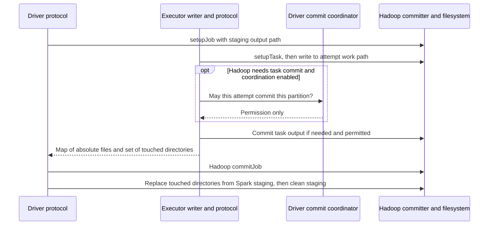

# FileCommitProtocol: staging and finalizing V1 file output

[component index](README.md)

`FileCommitProtocol` separates **writing records** from **committing their files**. For a Spark SQL V1 write, [FileFormatWriter](file-format-writer.md) delegates attempt paths, task completion, and job completion to one protocol instance per write, serialized to executor tasks. The default SQL implementation at this revision, `SQLHadoopMapReduceCommitProtocol`, adapts a Hadoop **`mapreduce.OutputCommitter`**. It is distinct from both the Parquet encoder and the [driver's per-task permission service](output-commit-coordinator.md). DataSource V1 here does not mean Hadoop `FileOutputCommitter` algorithm version 1.

## Flow at a glance

1. **Executor writer**: Stage new east and west files for a dynamic partition overwrite.
2. **Task protocol**: Commit the attempt output and report east and west as touched directories.
3. **Driver protocol**: Run Hadoop job commit, then replace east and west from staging.

> **Watch for:** North keeps its old data because no task touched it, and east and west are replaced separately rather than in one atomic swap.

Show the animated flow

## What state travels where?

| Owner | Inputs, state, and outputs |
|---|---|
| Driver | The V1 command selects the protocol with a write UUID, target path, and dynamic-overwrite flag. `setupJob(JobContext)` creates the underlying committer and calls Hadoop setup. The Hadoop committer itself is transient: tasks do not share the driver's object. |
| Executor attempt | `setupTask(TaskAttemptContext)` obtains its own Hadoop committer and initializes `addedAbsPathFiles` (temporary file to final absolute file) and `partitionPaths` (touched default directories for dynamic overwrite). Path requests take a directory and `FileNameSpec`; they return **where the format writer should write**, not where the file can already be read. |
| Back to driver | `commitTask` returns `TaskCommitMessage`. The Hadoop adapter's payload is an immutable map/set pair, **not** the file contents. `onTaskCommit` is an optional per-result hook; `commitJob(job, messages)` finalizes the job. `abortTask` and `abortJob` are best effort. |

See the [protocol contract][contract], [default configuration][config], [SQL committer selection][selection], and [per-attempt state][state]. `spark.sql.sources.commitProtocolClass` selects the Spark adapter; `spark.sql.sources.outputCommitterClass` can override the Hadoop committer. Those settings do not name the same interface.

## Trace: overwrite two HDFS directory partitions dynamically

Assume `hdfs:///reports/orders` has `region=east`, `region=west`, and `region=north`. The new data touches only east and west. This trace uses the SQL Hadoop protocol with a `FileOutputCommitter`; another committer need not have the same paths or publication timing.

1. The V1 command detects dynamic partition overwrite and directs this job to `.spark-staging-<write UUID>` under the target. It does **not** pre-delete all matching partitions. For a normal relative path, the adapter uses the `FileOutputCommitter` work path and adds `region=east` and the filename. The filename includes the Spark split number and write ID; the caller supplies a suffix (for example a counter) when one task writes multiple files. [Mode selection][mode], [staging decision][staging], [path allocation][allocate].
2. A custom **absolute** partition location takes a different route: allocate a unique staging file and remember its final absolute path in `addedAbsPathFiles`. After the writer closes its files, `commitTask` delegates to `SparkHadoopMapRedUtil`: if Hadoop needs a commit and coordination is enabled, ask the driver; if allowed, invoke Hadoop `commitTask`. A grant is not a filesystem operation. [Absolute path and naming][absolute], [task message][task], [permission gate][gate].
3. The driver calls Hadoop `commitJob` **first**. For a valid output path it then unions the messages, creates absolute destination parents and moves custom-location files if any. In dynamic mode it replaces each touched default directory from Spark staging and finally deletes staging. East and west are handled separately; north was not in the messages and is left alone. For a non-`FileOutputCommitter` in dynamic mode this adapter first checks the staged default partitions still exist before deleting destinations. [Hadoop commit and preflight][preflight], [moves and cleanup][moves].

## Failures and visibility

`Using output committer class ...` identifies which implementation to inspect. Hadoop `FileOutputCommitter` algorithms 1 and 2 perform different amounts of promotion at task commit versus job commit; custom committers and object stores can differ again. A successful task or a visible `part-...` file is **not proof that the job committed atomically**.

If a task fails, inspect its Hadoop attempt ID and temporary work path. If all tasks finished but the driver reports `Failed to rename`, inspect the named source and destination and the driver-side commit exception. For dynamic overwrite there are separate delete/rename operations per partition; later failure need not restore an earlier directory. A killed driver may never call abort, and IO failures during abort are logged. Keep evidence of the attempt paths and selected committer rather than treating leftover staging as published data. [Algorithm differences][algorithms], [job abort][job-abort], [task abort][task-abort].

[contract]: https://github.com/apache/spark/blob/dada2a6db5d73b152d6ba16e4fe21406f86abfe3/core/src/main/scala/org/apache/spark/internal/io/FileCommitProtocol.scala#L29-L76
[config]: https://github.com/apache/spark/blob/dada2a6db5d73b152d6ba16e4fe21406f86abfe3/sql/catalyst/src/main/scala/org/apache/spark/sql/internal/SQLConf.scala#L3053-L3069
[selection]: https://github.com/apache/spark/blob/dada2a6db5d73b152d6ba16e4fe21406f86abfe3/sql/core/src/main/scala/org/apache/spark/sql/execution/datasources/SQLHadoopMapReduceCommitProtocol.scala#L33-L72
[state]: https://github.com/apache/spark/blob/dada2a6db5d73b152d6ba16e4fe21406f86abfe3/core/src/main/scala/org/apache/spark/internal/io/HadoopMapReduceCommitProtocol.scala#L71-L121
[mode]: https://github.com/apache/spark/blob/dada2a6db5d73b152d6ba16e4fe21406f86abfe3/sql/core/src/main/scala/org/apache/spark/sql/execution/datasources/InsertIntoHadoopFsRelationCommand.scala#L66-L77
[staging]: https://github.com/apache/spark/blob/dada2a6db5d73b152d6ba16e4fe21406f86abfe3/sql/core/src/main/scala/org/apache/spark/sql/execution/datasources/InsertIntoHadoopFsRelationCommand.scala#L177-L205
[allocate]: https://github.com/apache/spark/blob/dada2a6db5d73b152d6ba16e4fe21406f86abfe3/core/src/main/scala/org/apache/spark/internal/io/HadoopMapReduceCommitProtocol.scala#L123-L147
[absolute]: https://github.com/apache/spark/blob/dada2a6db5d73b152d6ba16e4fe21406f86abfe3/core/src/main/scala/org/apache/spark/internal/io/HadoopMapReduceCommitProtocol.scala#L149-L169
[task]: https://github.com/apache/spark/blob/dada2a6db5d73b152d6ba16e4fe21406f86abfe3/core/src/main/scala/org/apache/spark/internal/io/HadoopMapReduceCommitProtocol.scala#L280-L294
[gate]: https://github.com/apache/spark/blob/dada2a6db5d73b152d6ba16e4fe21406f86abfe3/core/src/main/scala/org/apache/spark/mapred/SparkHadoopMapRedUtil.scala#L64-L102
[preflight]: https://github.com/apache/spark/blob/dada2a6db5d73b152d6ba16e4fe21406f86abfe3/core/src/main/scala/org/apache/spark/internal/io/HadoopMapReduceCommitProtocol.scala#L189-L211
[moves]: https://github.com/apache/spark/blob/dada2a6db5d73b152d6ba16e4fe21406f86abfe3/core/src/main/scala/org/apache/spark/internal/io/HadoopMapReduceCommitProtocol.scala#L212-L253
[algorithms]: https://github.com/apache/spark/blob/dada2a6db5d73b152d6ba16e4fe21406f86abfe3/core/src/main/scala/org/apache/spark/internal/io/HadoopMapReduceCommitProtocol.scala#L44-L69
[job-abort]: https://github.com/apache/spark/blob/dada2a6db5d73b152d6ba16e4fe21406f86abfe3/core/src/main/scala/org/apache/spark/internal/io/HadoopMapReduceCommitProtocol.scala#L255-L278
[task-abort]: https://github.com/apache/spark/blob/dada2a6db5d73b152d6ba16e4fe21406f86abfe3/core/src/main/scala/org/apache/spark/internal/io/HadoopMapReduceCommitProtocol.scala#L302-L321
