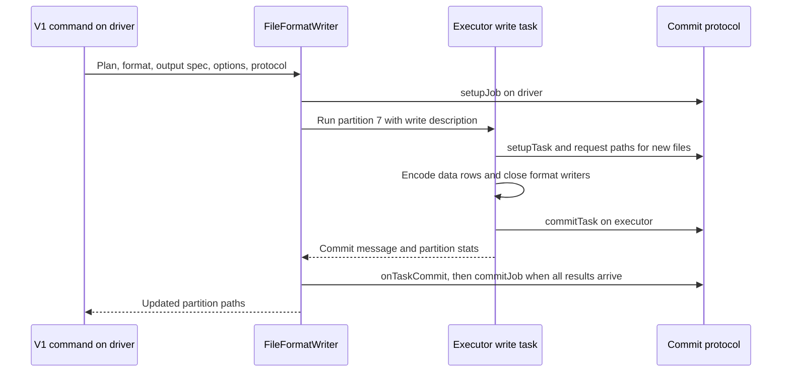

# FileFormatWriter: turning a V1 file write into Spark tasks

[component index](README.md)

`FileFormatWriter` coordinates a **Spark SQL DataSource V1** file write. The driver prepares one write job and collects task summaries; executor JVMs consume `InternalRow` iterators and write the actual files. The format's `OutputWriter` encodes bytes, while the [file commit protocol](file-commit-protocol.md) chooses paths and finalizes output. A Hadoop `Job` here supplies configuration and commit contexts: Spark submits Spark tasks, not a second YARN MapReduce application. Python need not run on the executors for a built-in Parquet write.

## Flow at a glance

1. **Spark partition 7**: Feed the write task three east rows followed by one west row.
2. **Parquet write task**: With a two-row file limit, write two east files and one west file.
3. **Driver**: After all write tasks succeed, call job commit with their commit messages.

> **Key distinction:** The task returns a commit message and a write summary to the driver, not three Parquet files.



> **Interactive explorer:** [Open in Spark Visualizer](https://nuthanreddy.github.io/spark-visualizer/#component=file-format-writer) to step through commands, wire payloads, category filters, and fault simulations on the live cluster canvas.

## Inputs, outputs, and state

| Boundary | Contract |
|---|---|
| V1 command to driver | `SparkPlan`, `FileFormat`, `FileCommitProtocol`, `OutputSpec` (path, custom partition locations, output columns), partition/bucket spec, Hadoop configuration, options, and stats trackers. The calling command decides save mode, including whether to overwrite. [Call site][caller]. |
| Driver to task | A serializable `WriteJobDescription`: writer factory, validated data columns, partition columns, bucket spec, output path, Hadoop configuration, limits such as `maxRecordsPerFile`, and stats trackers. The Spark partition iterator supplies the rows. [Description construction][prepare]. |
| Task to driver | One `WriteTaskResult`: opaque `TaskCommitMessage` plus `ExecutedWriteSummary` (updated directory names and per-task stats). No Parquet bytes come back in the task result. [Result construction][result]. |
| Driver to caller | After `commitJob` and stats processing, a `Set[String]` of updated partition paths. A catalog-aware command can use the set to refresh partition metadata. This is **not** a list of output files. [Driver reduction][reduce], [catalog handling][catalog]. |

## Trace: one Spark partition writes three Parquet files

Assume this write uses V1 and input partition 7 presents four rows in region order: `(east, 10)`, `(east, 20)`, `(east, 30)`, `(west, 40)`.

```python
(orders.write.mode("overwrite")
    .option("partitionOverwriteMode", "dynamic")
    .option("maxRecordsPerFile", 2)
    .partitionBy("region")
    .parquet("hdfs:///reports/orders"))
```



1. The driver separates data columns from directory partition columns, verifies the schema and field names, and calls `fileFormat.prepareWrite` for the `OutputWriterFactory`. It calls `beforeSetupJob` after those checks, then `committer.setupJob` before materializing an adaptive plan. A static overwrite that fails those checks leaves the old output in place. Once that mode deletes old files, a later abort is not a rollback. [Preparation and setup][setup].
2. The required ordering is dynamic partition columns, then bucket ID, then bucket sort columns when applicable. If input order is insufficient, a local sort or eligible concurrent-writer path handles it. A planned `WriteFilesExec` runs `executeTask` per input partition; the fallback `runJob` closure calls it directly. A zero-partition RDD gets one empty partition so the format has a chance to write metadata. [Write paths][paths], [planned tasks][planned].
3. Each attempt constructs a Hadoop `TaskAttemptContext` from Spark IDs and calls `setupTask`. An empty **nonzero** partition gets an empty writer; unpartitioned, unbucketed output gets a single-directory writer. For this ordered example the dynamic single writer tracks current region, file counter, and records in the current file. The third east row rolls to another file; switching to west opens a writer under `region=west`. The Parquet writer receives the data columns, not `region`. Other Spark partitions can also write into either directory. [Task selection][task], [path selection and encoding][encode], [rollover][rollover].
4. The task closes its writers, calls `commitTask`, and returns a summary containing `region=east` and `region=west`. The driver calls `onTaskCommit` as results arrive; only after collecting the required results does it call `commitJob`, process stats, and union the path sets. One Spark partition, two directory partitions, and three files are all consistent.

## Diagnosing an incomplete write

An executor log with `Task attempt ... aborted` identifies a write/close/task-commit failure: follow the attempt's original exception and output path. A driver log with `Start to commit write Job` but no `committed` line points instead to job finalization after task results arrived. The writer requests task or job abort in its failure paths; abort may clean staging files, not undo already visible data. Check the selected Hadoop committer and filesystem before interpreting a directory listing. [Task failure path][task], [driver abort][abort].

[caller]: https://github.com/apache/spark/blob/dada2a6db5d73b152d6ba16e4fe21406f86abfe3/sql/core/src/main/scala/org/apache/spark/sql/execution/datasources/InsertIntoHadoopFsRelationCommand.scala#L177-L205
[prepare]: https://github.com/apache/spark/blob/dada2a6db5d73b152d6ba16e4fe21406f86abfe3/sql/core/src/main/scala/org/apache/spark/sql/execution/datasources/FileFormatWriter.scala#L88-L146
[result]: https://github.com/apache/spark/blob/dada2a6db5d73b152d6ba16e4fe21406f86abfe3/sql/core/src/main/scala/org/apache/spark/sql/execution/datasources/FileFormatDataWriter.scala#L108-L143
[reduce]: https://github.com/apache/spark/blob/dada2a6db5d73b152d6ba16e4fe21406f86abfe3/sql/core/src/main/scala/org/apache/spark/sql/execution/datasources/FileFormatWriter.scala#L292-L345
[catalog]: https://github.com/apache/spark/blob/dada2a6db5d73b152d6ba16e4fe21406f86abfe3/sql/core/src/main/scala/org/apache/spark/sql/execution/datasources/InsertIntoHadoopFsRelationCommand.scala#L152-L175
[setup]: https://github.com/apache/spark/blob/dada2a6db5d73b152d6ba16e4fe21406f86abfe3/sql/core/src/main/scala/org/apache/spark/sql/execution/datasources/FileFormatWriter.scala#L148-L181
[paths]: https://github.com/apache/spark/blob/dada2a6db5d73b152d6ba16e4fe21406f86abfe3/sql/core/src/main/scala/org/apache/spark/sql/execution/datasources/FileFormatWriter.scala#L239-L289
[planned]: https://github.com/apache/spark/blob/dada2a6db5d73b152d6ba16e4fe21406f86abfe3/sql/core/src/main/scala/org/apache/spark/sql/execution/datasources/WriteFiles.scala#L78-L110
[task]: https://github.com/apache/spark/blob/dada2a6db5d73b152d6ba16e4fe21406f86abfe3/sql/core/src/main/scala/org/apache/spark/sql/execution/datasources/FileFormatWriter.scala#L378-L445
[encode]: https://github.com/apache/spark/blob/dada2a6db5d73b152d6ba16e4fe21406f86abfe3/sql/core/src/main/scala/org/apache/spark/sql/execution/datasources/FileFormatDataWriter.scala#L264-L319
[rollover]: https://github.com/apache/spark/blob/dada2a6db5d73b152d6ba16e4fe21406f86abfe3/sql/core/src/main/scala/org/apache/spark/sql/execution/datasources/FileFormatDataWriter.scala#L345-L391
[abort]: https://github.com/apache/spark/blob/dada2a6db5d73b152d6ba16e4fe21406f86abfe3/sql/core/src/main/scala/org/apache/spark/sql/execution/datasources/FileFormatWriter.scala#L210-L224
