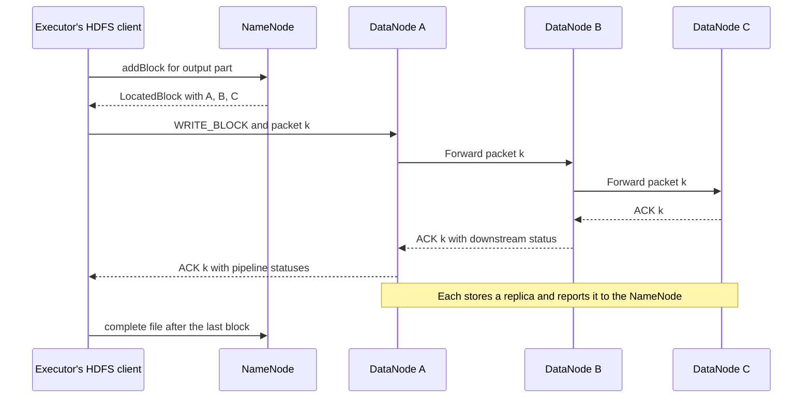

# HDFS DataNode: following one packet through three replicas

[component index](README.md) | [PySpark on YARN walkthrough](../pyspark-on-yarn.md)

A DataNode stores and serves **replicated HDFS block bytes**. It receives a
block identity, not a Parquet path, Spark partition ID, or YARN container ID.
The [NameNode](hdfs-namenode.md) resolves the path and chooses write targets.
A worker can run both a DataNode and a NodeManager: stopping an executor does
not delete HDFS data, and a local Spark shuffle file is not an HDFS replica.

## Flow at a glance

1. **HDFS writer**: Send packet 42 of an output block to DataNode A.
2. **DataNodes A, B and C**: Write local replicas as A forwards the packet to B and B forwards it to C.
3. **Pipeline ACK**: Return packet 42's status from C through B and A to the writer.

> **Key distinction:** A successful packet ACK neither closes the HDFS file nor commits the Spark job.

> **Interactive explorer:** [Open in Spark Visualizer](https://nuthanreddy.github.io/spark-visualizer/#component=hdfs-datanode) to step through commands, wire payloads, category filters, and fault simulations on the live cluster canvas.

## Runtime boundary and local state

The DataNode is a storage-service JVM, started and stopped by cluster operations.
The NameNode monitors its heartbeats and reconciles block reports; operators
monitor failed volumes and transfer errors. The service and its replicas outlive
the Spark application that wrote the file.

On ordinary disk storage, a block pool and block ID identify local replica
data (e.g. `blk_123`); an accompanying `blk_123_<generationStamp>.meta` holds
checksum metadata. The generation stamp distinguishes versions during recovery.
A replica being written (`RBW`) and a finalized replica are different states.
Finalizing one block on one node does not close the file in the namespace.

## Three independent conversations

| Caller and protocol | Input | Response or side effect |
|---|---|---|
| Reader to a DataNode, `DataTransferProtocol.readBlock` | Extended block identity, block token when enabled, offset within block, length, checksum request | `DataXceiver` checks access; `BlockSender` streams packets for the range with checksum information. The reader normally needs only **one** healthy replica. Configured short-circuit local reads can avoid the data TCP path. |
| Writer or upstream DataNode to a DataNode, `DataTransferProtocol.writeBlock` | Block, access token, construction stage, remaining pipeline targets, checksum settings, then sequenced packets | A `BlockReceiver` writes the local replica and forwards packets downstream where applicable. A `PacketResponder` returns per-packet pipeline status upstream; an ordinary packet acknowledgement is not an `fsync` guarantee. |
| DataNode to NameNode, `DatanodeProtocol` RPC | Registration, capacity/liveness heartbeats, full inventory (`blockReport`), and incremental received/deleted reports | The NameNode updates its location map and may return transfer or invalidation commands. A source DataNode transfers bytes to a target; a heartbeat carries commands and status, not replica contents. |

## Worked flow: writing one paid-orders output block

Assume a replicated file with three available targets, A, B, and C. This
replication factor has **no relationship** to the walkthrough's three Spark
executors. One executor can write all three replicas through one pipeline.

1. Spark's output task obtains a `LocatedBlock` for its part file. The HDFS client connects to A's **data-transfer address**. A sets up the connection to B; B sets up the connection to C. The client does not upload the same packet to all three.
2. The client's `DataStreamer` tracks sent packets awaiting acknowledgements. A, B, and C populate their local replicas as packets flow; acknowledgements travel in reverse order. A successful pipeline acknowledgement retires that sequence number at the client.
3. If B fails mid-block, the client can rebuild a pipeline with the surviving nodes, coordinate a new generation stamp with the NameNode, and resend outstanding packets. Whether a replacement joins immediately depends on policy and available nodes. This recovery happens inside the same Spark task; it is not a YARN container retry.
4. At end of block the replicas are finalized and reported; the writer separately asks the NameNode to complete the file. Later, a scan task chooses one available replica to read, verifies checksums, and can switch replicas without Spark retrying the whole task.

## What a failure means

| Observation | Consequence and evidence |
|---|---|
| Input listing works, one executor's read times out | Check the advertised DataNode transfer address and the node's transfer log from the affected worker's network. A NameNode RPC success or a running YARN container does not test that route. |
| `ChecksumException` on one replica | The HDFS client can try another replica and report corruption. Correlate the `blk_...` in executor/DataNode logs with `hdfs fsck <file> -files -blocks -locations`; if no readable copy remains, the scan cannot reconstruct the missing bytes. |
| Slow or failed write pipeline | The writer waits on downstream acknowledgements. Inspect the pipeline members named in the HDFS client logs, volume errors, and transfer latency, not just the writer JVM. If the pipeline cannot recover, the output task can fail. |
| DataNode stops heartbeating | `hdfs dfsadmin -report` distinguishes live from dead nodes. With a surviving healthy replica the file can remain readable while the NameNode schedules re-replication. A missing heartbeat by itself does not prove a disk was erased. |

## Sources

- Hadoop 3.4.1: [replica placement, integrity, and pipelining](https://hadoop.apache.org/docs/r3.4.1/hadoop-project-dist/hadoop-hdfs/HdfsDesign.html) and [HDFS diagnostic commands](https://hadoop.apache.org/docs/r3.4.1/hadoop-project-dist/hadoop-hdfs/HDFSCommands.html).
- Hadoop 3.4.1 source: [data-transfer protocol fields](https://github.com/apache/hadoop/blob/4d7825309348956336b8f06a08322b78422849b1/hadoop-hdfs-project/hadoop-hdfs-client/src/main/java/org/apache/hadoop/hdfs/protocol/datatransfer/DataTransferProtocol.java), [DataNode read/write handlers](https://github.com/apache/hadoop/blob/4d7825309348956336b8f06a08322b78422849b1/hadoop-hdfs-project/hadoop-hdfs/src/main/java/org/apache/hadoop/hdfs/server/datanode/DataXceiver.java#L580-L930), and [packet receipt and acknowledgement](https://github.com/apache/hadoop/blob/4d7825309348956336b8f06a08322b78422849b1/hadoop-hdfs-project/hadoop-hdfs/src/main/java/org/apache/hadoop/hdfs/server/datanode/BlockReceiver.java).
- Hadoop 3.4.1 source: [client-side send and ACK queues](https://github.com/apache/hadoop/blob/4d7825309348956336b8f06a08322b78422849b1/hadoop-hdfs-project/hadoop-hdfs-client/src/main/java/org/apache/hadoop/hdfs/DataStreamer.java#L100-L117) and [DataNode reporting loop](https://github.com/apache/hadoop/blob/4d7825309348956336b8f06a08322b78422849b1/hadoop-hdfs-project/hadoop-hdfs/src/main/java/org/apache/hadoop/hdfs/server/datanode/BPServiceActor.java#L666-L757).
