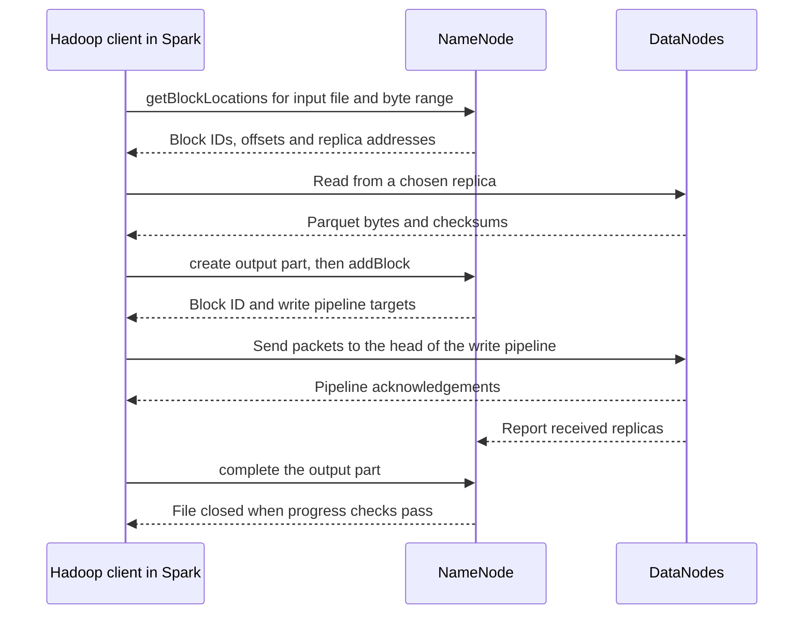

# HDFS NameNode: resolving a path without touching its bytes

[component index](README.md) | [PySpark on YARN walkthrough](../pyspark-on-yarn.md)

For `hdfs:///warehouse/orders`, the NameNode answers **which files exist,
which blocks cover a byte range, and where those blocks are reported**. The
executor reads the Parquet bytes from a [DataNode](hdfs-datanode.md). This
page follows ordinary replicated files in one HDFS nameservice, not erasure
coding, WebHDFS, or Spark shuffle storage.

## Flow at a glance

1. **HDFS client**: Ask where to read byte 4096 of an orders part file.
2. **NameNode**: Return block 123 and its reported replica addresses on DataNodes A and B.
3. **DataNode A**: Serve the requested range directly to the client that chose A.

> **Key distinction:** The NameNode supplies block locations; the chosen DataNode supplies the Parquet bytes.

Show the animated flow

## Runtime boundary and state

The NameNode is a long-lived Hadoop service, started, monitored, and stopped by
cluster operations, not by YARN or Spark. In an HA nameservice one active NameNode
owns namespace mutations; configured failover can promote a standby. With
Quorum Journal Manager, the active writes edits to a majority of JournalNodes,
the standby tails edits, and DataNodes report to the NameNodes. A second copy
of the namespace is not a second copy of the Parquet data.

| State held by the NameNode | How it changes |
|---|---|
| Directory tree and file inodes: names, ownership, permissions, replication policy, and each file's ordered block IDs | Namespace operations update memory and journal edits; an `fsimage` checkpoint plus subsequent edits reconstructs the namespace on restart. |
| Block locations: block ID to reported DataNode storage replicas, with node health and capacity | DataNode registrations, heartbeats, and full/incremental block reports maintain this live map. An `fsimage` is not an inventory of which disks are alive today. |
| Files under construction, writer leases, and block progress | `create` establishes a writer; lease renewals keep it live. `addBlock` attaches blocks; `complete` checks progress before finalizing. If a writer disappears, lease recovery can reconcile the last block rather than treating an unfinished file as closed. |

## Peer contracts

| Path | Input | Output or decision |
|---|---|---|
| Hadoop filesystem client to `ClientProtocol` (Hadoop RPC) | `getListing(path, startAfter, needLocation)`; `getBlockLocations(path, offset, length)` | A batch of directory entries, or `LocatedBlocks` covering the requested range. A located block supplies identity, file offset, replica endpoints, and a block access token when enabled. No data packets. |
| Writer to the same RPC service | `create(path, permissions, clientName, flags, ..., replication, blockSize, ...)`; `addBlock(path, clientName, previous, excludedNodes, fileId, ...)` | File status for the new file, then a `LocatedBlock` with selected targets. Placement considers eligible storage, rack topology, policy, and failed/excluded nodes; a target is not evidence that its bytes have been written. |
| Writer closing or publishing a file | `complete(path, clientName, lastBlock, fileId)`; a rename-based output committer may later request a rename | `complete` returns a boolean; `false` can mean the caller must retry while block progress catches up. A successful rename changes namespace entries, not the location of every replica. Spark's dataset commit is separate from closing one file. |
| DataNodes to `DatanodeProtocol` (Hadoop RPC) | `sendHeartbeat` gives health/capacity information; `blockReport` gives inventory; `blockReceivedAndDeleted` reports changes | Reconcile actual replicas against desired replication. Heartbeat replies can ask a live DataNode to copy or invalidate a block. The NameNode selects the work; it does not copy the bytes. |

Inside [`FSNamesystem.getAdditionalBlock`](https://github.com/apache/hadoop/blob/4d7825309348956336b8f06a08322b78422849b1/hadoop-hdfs-project/hadoop-hdfs/src/main/java/org/apache/hadoop/hdfs/server/namenode/FSNamesystem.java#L3047-L3090),
Hadoop validates the request under a read lock and can return the last block
if it recognizes a retry. For a new block it chooses DataNode targets outside
the namespace write lock, then takes that lock to attach the allocation to the
file. It syncs the edits before returning the block to the writer.

## Worked flow: from a scan to one output part

1. During input discovery a Hadoop client lists `/warehouse/orders`. For a task reading part of a file, the client obtains or reuses block locations and picks a suitable replica. A file split or Spark partition need not equal one HDFS block.
2. An output task opens a part file for `/reports/paid-orders-by-region`, possibly under a committer's work path. The active NameNode checks path permissions and create flags, records the under-construction inode and lease, and returns file status.
3. When the writer needs space, `addBlock` allocates a block ID and picks targets. The writer exchanges bytes and acknowledgements with DataNodes alone. Their replica reports and the writer's close request arrive independently.
4. The NameNode checks the writer and block progress before closing the inode. Closure need not wait for the *desired* replication factor on every block. File close, background re-replication, and publication by [Spark's file commit protocol](file-commit-protocol.md) are distinct events.

## Where a failure shows up

- **Listing fails before a task reads:** check the effective nameservice, submitting identity, path permissions, and NameNode RPC/HA health. Idle YARN slots cannot fix an `AccessControlException` or a call directed to a standby.
- **Listings work, but creates fail with `SafeModeException`:** check `hdfs dfsadmin -safemode get` and live DataNode reports. At startup, the NameNode can serve metadata reads while withholding writes as it learns how many blocks have checked in.
- **Listing succeeds, but a range cannot be read:** run `hdfs fsck <file> -files -blocks -locations`. No usable replicas and a reported replica whose data-transfer address the executor cannot reach are different failures. A healthy NameNode UI proves neither replica integrity nor network access.

## Sources

- Hadoop 3.4.1: [HDFS architecture and safe mode](https://hadoop.apache.org/docs/r3.4.1/hadoop-project-dist/hadoop-hdfs/HdfsDesign.html), [HA with shared edits](https://hadoop.apache.org/docs/r3.4.1/hadoop-project-dist/hadoop-hdfs/HDFSHighAvailabilityWithQJM.html), and [HDFS diagnostic commands](https://hadoop.apache.org/docs/r3.4.1/hadoop-project-dist/hadoop-hdfs/HDFSCommands.html).
- Hadoop 3.4.1 source: [client RPC contracts](https://github.com/apache/hadoop/blob/4d7825309348956336b8f06a08322b78422849b1/hadoop-hdfs-project/hadoop-hdfs-client/src/main/java/org/apache/hadoop/hdfs/protocol/ClientProtocol.java), [write allocation, lease, and close logic](https://github.com/apache/hadoop/blob/4d7825309348956336b8f06a08322b78422849b1/hadoop-hdfs-project/hadoop-hdfs/src/main/java/org/apache/hadoop/hdfs/server/namenode/FSDirWriteFileOp.java), and [DataNode reporting interface](https://github.com/apache/hadoop/blob/4d7825309348956336b8f06a08322b78422849b1/hadoop-hdfs-project/hadoop-hdfs/src/main/java/org/apache/hadoop/hdfs/server/protocol/DatanodeProtocol.java).
