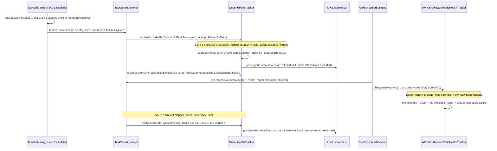

# HealthTracker: driver ExcludeOnFailure vs YARN AM node health tracking

[component index](README.md)

`HealthTracker` is **not** a YARN NodeManager disk-health probe and is **not** the same object as the YARN ApplicationMaster's `YarnAllocatorNodeHealthTracker`. Spark separates failure-driven node/executor exclusion across **two distinct trackers** (applicable identically to PySpark, Scala, and Java jobs): inside the [driver JVM](spark-driver.md), [`TaskSchedulerImpl`](task-scheduler.md) lazily owns `HealthTracker` (plus per-stage `TaskSetExcludelist`) when `spark.excludeOnFailure.enabled=true` to steer task offers away from executors and hosts producing task or fetch failures; inside the [ApplicationMaster JVM](application-master.md), [`YarnAllocator`](yarn-allocator.md) owns `YarnAllocatorNodeHealthTracker` to track container launch failures (`spark.yarn.executor.launch.excludeOnFailure.enabled`) and synchronize the merged exclusion list with the [YARN ResourceManager](resource-manager.md). In YARN client mode, those two trackers run on completely different machines.

## Flow at a glance

1. **Stage-level containment (`TaskSetExcludelist`)**: When tasks fail on an executor or node, `TaskSetManager` records attempts against `task.maxTaskAttemptsPerExecutor` (1) and `task.maxTaskAttemptsPerNode` (2) so retries immediately move to healthy peers.
2. **App-wide promotion (`HealthTracker`)**: Once a `TaskSet` succeeds elsewhere (or on fetch failure if enabled), `TaskSchedulerImpl` updates `HealthTracker`. Excluding `maxFailedExecutorsPerNode` (2 default) **distinct** excluded executors on one host excludes the entire node for `spark.excludeOnFailure.timeout` (1h default).
3. **Offer filtering and AM sync**: `TaskSchedulerImpl.resourceOffers()` skips excluded executors/nodes, while `YarnSchedulerBackend` reads `scheduler.excludedNodes()` and forwards them via `RequestExecutors` to `YarnAllocator`, which merges them with `YarnAllocatorNodeHealthTracker` and calls `amClient.updateBlacklist`.
4. **Timeout expiry**: Once `now > nextExpiryTime`, `HealthTracker.applyExcludeOnFailureTimeout()` clears expired executors and nodes, posts unexcluded listener events, and re-admits repaired hosts without restarting the app.

> **Key distinction:** Driver `HealthTracker` (`spark.excludeOnFailure.enabled`) filters task offers and excludes a host once `distinct excluded executors >= maxFailedExecutorsPerNode`, whereas AM `YarnAllocatorNodeHealthTracker` (`spark.yarn.executor.launch.excludeOnFailure.enabled`) tracks container launch failures with strict `failuresOnHost > maxFailuresPerHost` before updating YARN RM exclusions.

> **Interactive explorer:** [Open in Spark Visualizer](https://nuthanreddy.github.io/spark-visualizer/#component=health-tracker) to step through commands, wire payloads, language modes, category filters, and fault simulations on the live cluster canvas.

## Driver `HealthTracker` vs AM `YarnAllocatorNodeHealthTracker`

| Dimension | Driver [`HealthTracker`][ht-class] + [`TaskSetExcludelist`][tse-class] | AM [`YarnAllocatorNodeHealthTracker`][yanht-class] |
|---|---|---|
| **Hosting JVM** | Driver JVM (`TaskSchedulerImpl.healthTrackerOpt`, [`TaskSchedulerImpl.scala:98`][tsi-ht]) | YARN ApplicationMaster JVM (`YarnAllocator`; separate host from driver in client mode) |
| **Enable flag** | `spark.excludeOnFailure.enabled` (`false` default) | `spark.yarn.executor.launch.excludeOnFailure.enabled` (`false` default) |
| **Failure signal** | Task attempt failures in successful TaskSets (`application.maxFailedTasksPerExecutor`, default 2) and fetch failures (`fetchFailure.enabled`, default `false`) | YARN container allocation / executor launch failures reported to `handleResourceAllocationFailure(hostOpt)` |
| **Node exclusion threshold** | **`excludedExecsOnNode.size >= MAX_FAILED_EXEC_PER_NODE`** ([`HealthTracker.scala:284-311`][ht-update]), counting **distinct excluded executors** on that host (default `2`) | **Strict `failuresOnHost > maxFailuresPerHost`** ([`YarnAllocatorNodeHealthTracker.scala:92-101`][yanht-strict]), where `maxFailuresPerHost` defaults to `MAX_FAILED_EXEC_PER_NODE` (`2`, meaning 3 launch failures on one host) |
| **Action taken** | Filters `TaskSchedulerImpl.resourceOffers()` ([`TaskSchedulerImpl.scala:599-605`][tsi-offers]), optionally kills/decommissions excluded executors (`killExcludedExecutors`), publishes `scheduler.excludedNodes()` ([`TaskSchedulerImpl.scala:1233-1234`][tsi-nodes]), and posts `SparkListener*Excluded` events | Merges `spark.yarn.exclude.nodes ++ schedulerExcludedNodeList ++ allocatorExcludedNodeList` and sends diffs to RM via `amClient.updateBlacklist(additions, removals)` ([`YarnAllocatorNodeHealthTracker.scala:117-146`][yanht-sync]) |

### Why `HealthTracker` counts distinct excluded executors and waits for TaskSet success

Two deliberate guards prevent a single bad task or deterministic user-code bug from excluding an entire cluster:

1. **Wait for successful TaskSet (`updateExcludedForSuccessfulTaskSet`):** Ordinary task exceptions are tracked inside [`TaskSetExcludelist`][tse-class] first (`spark.excludeOnFailure.task.maxTaskAttemptsPerExecutor=1`, `task.maxTaskAttemptsPerNode=2`, `stage.maxFailedTasksPerExecutor=2`, `stage.maxFailedExecutorsPerNode=2`). Only when that `TaskSet` completes on healthy peers does `TaskSchedulerImpl` promote the executor failures into application-wide [`HealthTracker`][ht-update] -- proving the code itself is runnable elsewhere.
2. **Distinct excluded executors per node (`nodeToExcludedExecs`):** At [`HealthTracker.scala:299-311`][ht-update], each excluded executor is added to `nodeToExcludedExecs(node)` (which is intentionally **not** cleared in `handleRemovedExecutor` so successive bad executors on the same broken host still accumulate until timeout). A host is excluded only when `excludedExecsOnNode.size >= MAX_FAILED_EXEC_PER_NODE` (e.g., both Exec-1 and Exec-3 excluded on `worker-a`).

## Failure promotion, offer filtering, AM sync, and 1h expiry flow

1. **Lock-free snapshot read (`scheduler.excludedNodes()`).** Every method on `HealthTracker` except `excludedNodeList()` is guarded by `TaskSchedulerImpl`'s lock. `HealthTracker` mirrors `nodeIdToExcludedExpiryTime.keySet` into an `AtomicReference[Set[String]]` (`_excludedNodeList`) so [`YarnSchedulerBackend.prepareRequestExecutors`][ysb-req] (`YarnSchedulerBackend.scala:146-155`) can read `scheduler.excludedNodes()` without lock contention, strip excluded hosts from locality hints, and include `excludedNodes` in `RequestExecutors`.
2. **Cluster vs client transport to the AM.** In YARN cluster mode, `YarnSchedulerBackend` dispatches `RequestExecutors` to `YarnAM` locally inside the shared AM/driver `NettyRpcEnv`; in client mode, `YarnClientSchedulerBackend` sends `RequestExecutors` over remote Netty TCP to the AM container.
3. **Lazy timeout sweep (`applyExcludeOnFailureTimeout`).** On every `resourceOffers()` call ([`TaskSchedulerImpl.scala:599`][tsi-offers]), `applyExcludeOnFailureTimeout()` ([`HealthTracker.scala:105-145`][ht-class]) short-circuits in O(1) while `now <= nextExpiryTime`. Once the earliest expiry passes, it removes timed-out executors and nodes, cleans `nodeToExcludedExecs`, refreshes `_excludedNodeList`, and emits both `SparkListener*Unexcluded` and legacy `*Unblacklisted` events.

## Inputs, outputs, and state

| Boundary | Contract |
|---|---|
| Inputs | Failed task reports from `TaskSetManager` (`TaskSetExcludelist`), fetch-failure callbacks, `spark.excludeOnFailure.enabled`, `spark.excludeOnFailure.timeout` (`1h`), `task.maxTaskAttemptsPerExecutor` (`1`), `task.maxTaskAttemptsPerNode` (`2`), `stage.maxFailedTasksPerExecutor` (`2`), `stage.maxFailedExecutorsPerNode` (`2`), `application.maxFailedTasksPerExecutor` (`2`), `application.maxFailedExecutorsPerNode` (`2`), `killExcludedExecutors`, plus AM `spark.yarn.executor.launch.excludeOnFailure.enabled` and `spark.yarn.exclude.nodes`. |
| Owned state | Driver `HealthTracker`: `executorIdToFailureList`, `executorIdToExcludedStatus`, `nodeIdToExcludedExpiryTime`, `nodeToExcludedExecs` (distinct excluded executors per host), `AtomicReference[Set[String]] _excludedNodeList`, and `nextExpiryTime`. AM `YarnAllocatorNodeHealthTracker`: `schedulerExcludedNodeList`, `allocatorExcludedNodeList`, `excludeNodes`, and `currentExcludededYarnNodes`. |
| Outputs | `isExecutorExcluded` / `isNodeExcluded` predicates gating `resourceOffers()`, optional executor kill/decommission requests, `SparkListenerExecutorExcluded`/`NodeExcluded`/`Unexcluded` events for [SparkUI](spark-ui.md), `RequestExecutors(excludedNodes)` to YARN AM, and `amClient.updateBlacklist` calls to YARN RM. |

## Failure clues and diagnosis

- **`Aborting TaskSet ... because task cannot run anywhere due to node and executor excludeOnFailure`:** Every live executor or host is currently excluded for the task/stage/application. Check whether a cluster-wide external dependency outage (such as a bad HDFS path, Kerberos ticket expiry, or broken library) caused healthy nodes to fail sequentially, or increase cluster size / reduce exclusion aggressiveness.
- **Bad host stays in scheduling rotation despite repeated task failures on one executor:** Verify `spark.excludeOnFailure.enabled=true` (it is off by default). Also remember that excluding **one** executor does not exclude the host when `application.maxFailedExecutorsPerNode=2` (default) -- two distinct executors on that node must be excluded before node-level exclusion triggers.
- **YARN keeps granting failing containers on the same bad NodeManager despite driver `spark.excludeOnFailure.enabled=true`:** If containers die during localization or JVM bootstrap before running Spark tasks, driver `HealthTracker` never sees task failures. Enable AM-side `spark.yarn.executor.launch.excludeOnFailure.enabled=true` and note that [`YarnAllocatorNodeHealthTracker`][yanht-strict] requires `failuresOnHost > maxFailuresPerHost` (strict `>`, so 3 launch failures when `maxFailuresPerHost=2`).
- **Executors remain excluded in Spark UI for an hour after a transient issue clears:** Expected behavior under default `spark.excludeOnFailure.timeout=1h`; `applyExcludeOnFailureTimeout()` clears them automatically once the timeout elapses on a subsequent `resourceOffers()` pass.
- **In client mode, driver exclusion logs appear on the submit host while AM RM blacklist logs appear in the YARN AM container:** Check both log locations; driver `HealthTracker` runs on the client host whereas `YarnAllocatorNodeHealthTracker` runs inside the AM container.

[ht-class]: https://github.com/apache/spark/blob/dada2a6db5d73b152d6ba16e4fe21406f86abfe3/core/src/main/scala/org/apache/spark/scheduler/HealthTracker.scala#L52-L145
[ht-update]: https://github.com/apache/spark/blob/dada2a6db5d73b152d6ba16e4fe21406f86abfe3/core/src/main/scala/org/apache/spark/scheduler/HealthTracker.scala#L265-L345
[tse-class]: https://github.com/apache/spark/blob/dada2a6db5d73b152d6ba16e4fe21406f86abfe3/core/src/main/scala/org/apache/spark/scheduler/TaskSetExcludelist.scala#L40-L145
[tsi-ht]: https://github.com/apache/spark/blob/dada2a6db5d73b152d6ba16e4fe21406f86abfe3/core/src/main/scala/org/apache/spark/scheduler/TaskSchedulerImpl.scala#L96-L100
[tsi-offers]: https://github.com/apache/spark/blob/dada2a6db5d73b152d6ba16e4fe21406f86abfe3/core/src/main/scala/org/apache/spark/scheduler/TaskSchedulerImpl.scala#L598-L606
[tsi-nodes]: https://github.com/apache/spark/blob/dada2a6db5d73b152d6ba16e4fe21406f86abfe3/core/src/main/scala/org/apache/spark/scheduler/TaskSchedulerImpl.scala#L1233-L1235
[ysb-req]: https://github.com/apache/spark/blob/dada2a6db5d73b152d6ba16e4fe21406f86abfe3/resource-managers/yarn/src/main/scala/org/apache/spark/scheduler/cluster/YarnSchedulerBackend.scala#L146-L156
[yanht-class]: https://github.com/apache/spark/blob/dada2a6db5d73b152d6ba16e4fe21406f86abfe3/resource-managers/yarn/src/main/scala/org/apache/spark/deploy/yarn/YarnAllocatorNodeHealthTracker.scala#L47-L90
[yanht-strict]: https://github.com/apache/spark/blob/dada2a6db5d73b152d6ba16e4fe21406f86abfe3/resource-managers/yarn/src/main/scala/org/apache/spark/deploy/yarn/YarnAllocatorNodeHealthTracker.scala#L91-L105
[yanht-sync]: https://github.com/apache/spark/blob/dada2a6db5d73b152d6ba16e4fe21406f86abfe3/resource-managers/yarn/src/main/scala/org/apache/spark/deploy/yarn/YarnAllocatorNodeHealthTracker.scala#L116-L148
