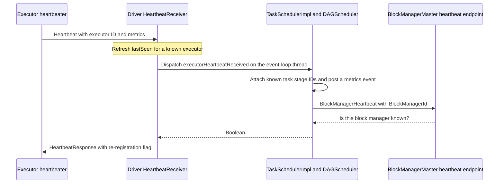

# HeartbeatReceiver: executor liveness at the driver

[component index](README.md)

A Spark executor can be healthy from YARN's perspective yet unreachable from its Spark driver. `HeartbeatReceiver` is a **named Spark RPC endpoint in the driver JVM**. It records contact from known executor IDs, forwards in-flight metrics and detects long gaps. It does not use task completion, the availability of YARN containers, or the [dynamic allocation idle deadline](executor-monitor.md) as its liveness signal.

## Flow at a glance

1. **Last contact**: At 0 seconds the driver hears from executor 7.
2. **120-second check**: Keep executor 7 at the exact 120-second timeout.
3. **180-second check**: Expire the silent executor and request a replacement.

> **Watch for:** The driver measures a gap between heartbeats it receives. A timeout is not proof that YARN killed the container.

> **Interactive explorer:** [Open in Spark Visualizer](https://nuthanreddy.github.io/spark-visualizer/#component=heartbeat-receiver) to step through commands, wire payloads, category filters, and fault simulations on the live cluster canvas.

## Owner and wire contract

`SparkContext` [registers the endpoint before creating the task scheduler][start], then sends `TaskSchedulerIsSet`. The receiver also listens on the management queue: executor-added and executor-removed notifications become local RPCs that insert or delete `executorLastSeen(id)`. The endpoint owns this map of **driver receipt times**, not executor clock readings. Its `onStart` schedules `ExpireDeadHosts` checks; [`SparkContext.stop()`][sc-stop] stops the endpoint, whose [`onStop`][expire] cancels the checks and shuts down the event-loop and kill threads.

Each executor JVM [looks up the driver's endpoint][sender] and starts its own `executor-heartbeater`, with a [randomized first delay][timer]. This works even with no running tasks and no Python worker. [Executor shutdown][sender-stop] stops the sender. The [request and response types][messages] are:

| Direction | Payload and meaning |
|---|---|
| Executor to driver: `Heartbeat` | Executor ID, `(taskId, accumulator updates)` for running tasks, `BlockManagerId`, and executor metric peaks keyed by `(stageId, stageAttemptId)`. Not a task result or a list of container asks. |
| Driver to executor: `HeartbeatResponse` | One flag: `reregisterBlockManager`. If true and the executor is not stopping, it calls `BlockManager.reregister()`. This is **storage registration**, not an instruction to launch or re-register the executor with YARN. |

## Receipt and reply

The receiver [updates `lastSeen` before dispatching metric processing][receive]. `TaskSchedulerImpl` [joins task IDs to current task sets][join] and omits per-task updates it can no longer identify. `DAGScheduler` [posts `SparkListenerExecutorMetricsUpdate` and asks the storage endpoint][forward]; the [storage reply][storage] determines the flag on the normal path. An unknown executor ID or not-yet-ready scheduler gets a reply without that forwarding; while the context is running the flag is true. This also handles a late, in-flight heartbeat after removal.

## Worked timeout: executor 7 goes silent

Suppose the last receipt is at `t=0`, the timeout is 120 s and checks fall at `t=60,120,180`. The comparison is **strictly greater than** the timeout, so the first two checks do not expire `7`. At `t=180`, the driver removes the entry and submits work to its separate kill thread. It [requests kill-and-replace without lowering the executor target][replace] and sends the coarse-grained backend `RemoveExecutor` with a heartbeat-timeout loss reason so task loss does not depend on a later disconnect. This is a replacement request, not a guaranteed YARN grant.

**Which timeout fired?** The driver uses `spark.storage.blockManagerHeartbeatTimeoutMs` if set, otherwise `spark.network.timeout`; `spark.network.timeoutInterval` controls the check cadence. The executor separately times out its own RPC, counts consecutive failures, resets the count on success and can exit on reaching its limit. [Driver thresholds][thresholds]; [executor handling][report]. A timeout is evidence of **missing communication**, not proof of a dead node: a long JVM pause, a delayed driver or a network break can look alike. The [AM's `allocate` heartbeat to the RM][yarn] reports resource requests/grants/completions; NodeManager-to-RM node health is another YARN channel. Neither supplies the Spark receiver's timestamps.

[start]: https://github.com/apache/spark/blob/dada2a6db5d73b152d6ba16e4fe21406f86abfe3/core/src/main/scala/org/apache/spark/SparkContext.scala#L633-L653
[sc-stop]: https://github.com/apache/spark/blob/dada2a6db5d73b152d6ba16e4fe21406f86abfe3/core/src/main/scala/org/apache/spark/SparkContext.scala#L2698-L2708
[messages]: https://github.com/apache/spark/blob/dada2a6db5d73b152d6ba16e4fe21406f86abfe3/core/src/main/scala/org/apache/spark/HeartbeatReceiver.scala#L37-L69
[thresholds]: https://github.com/apache/spark/blob/dada2a6db5d73b152d6ba16e4fe21406f86abfe3/core/src/main/scala/org/apache/spark/HeartbeatReceiver.scala#L75-L118
[receive]: https://github.com/apache/spark/blob/dada2a6db5d73b152d6ba16e4fe21406f86abfe3/core/src/main/scala/org/apache/spark/HeartbeatReceiver.scala#L120-L168
[sender]: https://github.com/apache/spark/blob/dada2a6db5d73b152d6ba16e4fe21406f86abfe3/core/src/main/scala/org/apache/spark/executor/Executor.scala#L482-L504
[sender-stop]: https://github.com/apache/spark/blob/dada2a6db5d73b152d6ba16e4fe21406f86abfe3/core/src/main/scala/org/apache/spark/executor/Executor.scala#L652-L670
[timer]: https://github.com/apache/spark/blob/dada2a6db5d73b152d6ba16e4fe21406f86abfe3/core/src/main/scala/org/apache/spark/Heartbeater.scala#L33-L51
[report]: https://github.com/apache/spark/blob/dada2a6db5d73b152d6ba16e4fe21406f86abfe3/core/src/main/scala/org/apache/spark/executor/Executor.scala#L1544-L1590
[join]: https://github.com/apache/spark/blob/dada2a6db5d73b152d6ba16e4fe21406f86abfe3/core/src/main/scala/org/apache/spark/scheduler/TaskSchedulerImpl.scala#L900-L920
[forward]: https://github.com/apache/spark/blob/dada2a6db5d73b152d6ba16e4fe21406f86abfe3/core/src/main/scala/org/apache/spark/scheduler/DAGScheduler.scala#L564-L581
[storage]: https://github.com/apache/spark/blob/dada2a6db5d73b152d6ba16e4fe21406f86abfe3/core/src/main/scala/org/apache/spark/storage/BlockManagerMasterHeartbeatEndpoint.scala#L35-L57
[expire]: https://github.com/apache/spark/blob/dada2a6db5d73b152d6ba16e4fe21406f86abfe3/core/src/main/scala/org/apache/spark/HeartbeatReceiver.scala#L210-L257
[replace]: https://github.com/apache/spark/blob/dada2a6db5d73b152d6ba16e4fe21406f86abfe3/core/src/main/scala/org/apache/spark/SparkContext.scala#L2100-L2117
[yarn]: https://github.com/apache/spark/blob/dada2a6db5d73b152d6ba16e4fe21406f86abfe3/resource-managers/yarn/src/main/scala/org/apache/spark/deploy/yarn/YarnAllocator.scala#L439-L470
