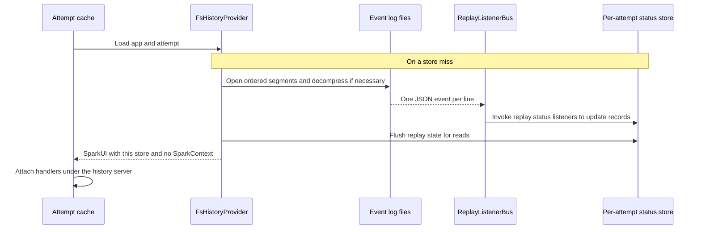

# Spark History Server: rebuilding an application view from files

[component index](README.md)

The History Server is an **optional, separate JVM service** for many Spark applications. It can run before, during or after any particular YARN application. It does not receive executor heartbeats, contact a dead driver for its status store, restart jobs, or serve as the YARN ResourceManager. Its input is the driver's [event log](event-log.md); its output is an application/attempt listing and reconstructed web and REST views.

## Flow at a glance

1. **Log scan**: The server scans the shared log directory and lists attempts from application events.
2. **Attempt lookup**: On a cache miss, the provider reuses a saved store or rebuilds one by replaying the attempt's log.
3. **History page**: The server reads that attempt's store to show recorded stages and tasks without a running driver.

> **Watch for:** An attempt can still appear in progress if the driver died before writing the application-end event.

> **Interactive explorer:** [Open in Spark Visualizer](https://nuthanreddy.github.io/spark-visualizer/#component=history-server) to step through commands, wire payloads, category filters, and fault simulations on the live cluster canvas.

## Who starts it and what it needs

A cluster operator or service manager starts and stops the daemon, not `spark-submit`, `SparkContext` or the AM. Spark provides `start-history-server.sh` and `stop-history-server.sh`. [`HistoryServer.main`][main] creates the configured `ApplicationHistoryProvider`, binds the web server (default `spark.history.ui.port=18080`), starts the provider and installs a shutdown hook. [`HistoryServer.stop()`][attach] stops the web server and provider; the filesystem provider [stops its workers and closes stores][provider-stop].

The usual `FsHistoryProvider` needs read access to the same underlying filesystem location the driver wrote to: set the application's `spark.eventLog.dir` and the server's [`spark.history.fs.logDirectory`][settings] accordingly. The server does not enable event logging for applications. It has two different jobs:

| Path | Input, state and output |
|---|---|
| **Discover attempts** | The provider [periodically scans][poll] accessible log roots. `EventLogFileReader` recognizes a single log or a rolling directory; the provider tracks file size, segment index and completion state to [decide what changed][scan]. A [listing replay][listing] filters for log start, application start/end and environment records. It indexes app and attempt metadata rather than building a task table for every app. |
| **Open one attempt** | A browser request under `/history/<appId>/<attemptId>/` or an API lookup goes through the application cache. On a miss, the provider [selects the recorded attempt][open], tries a valid local disk store if configured, otherwise builds the needed store from the log. A bounded [cache keyed by app and optional attempt ID][cache] reuses attached UIs. Eviction detaches handlers; it is not deletion of the event log. |

## How replay constructs a UI without a driver

[`rebuildAppStore`][rebuild] creates `ReplayListenerBus`, an `AppStatusListener(live=false, lastUpdateTime=...)` and any plugin listeners. It reads [ordered segments][reader]; replay decodes each accepted line with `JsonProtocol` and dispatches it synchronously. There is **no live scheduler callback and no live async queue**. Closing the tracking wrapper [flushes pending state without closing the underlying store][flush]. The provider constructs `SparkUI` with `None` instead of a `SparkContext`; the history server attaches its handlers to the existing HTTP server. For SQL, the [history plugin][sql] installs a replay listener and adds a SQL tab if it found executions. Similar screens to the [live UI](spark-ui.md) do not imply identical evidence or working job controls.

## Worked example: an application listed as incomplete

Suppose the orders driver flushed a stage-completed record and then its container was killed before writing application end or finalizing the log. On a later scan the listing can show the app as in progress. Opening that attempt can show the completed stage and the tasks whose records survived; it **cannot** establish that the Parquet write committed or that the driver is still alive. Check the YARN attempt diagnostics and the output commit evidence for those questions. If a running writer instead finalizes the log later, a scan can [invalidate the stale UI][invalidate]; a subsequent load can reflect the new records.

**Diagnosing missing history:** an empty listing calls for checking log location, permissions, scan interval and whether the driver wrote application start; a listed attempt whose first detail page is slow may simply be replaying a cold log. A partial final JSON line in a possibly truncated log can be tolerated; [malformed JSON midstream raises an error, while unknown event classes are skipped with warnings][parse]. A fresh replay cannot recover events dropped before write, unlogged stdout/stderr or records removed by optional [rolling-log compaction][compact] or the [filesystem cleaner][clean]. The cache is not an archive.

[main]: https://github.com/apache/spark/blob/dada2a6db5d73b152d6ba16e4fe21406f86abfe3/core/src/main/scala/org/apache/spark/deploy/history/HistoryServer.scala#L290-L326
[attach]: https://github.com/apache/spark/blob/dada2a6db5d73b152d6ba16e4fe21406f86abfe3/core/src/main/scala/org/apache/spark/deploy/history/HistoryServer.scala#L151-L205
[settings]: https://github.com/apache/spark/blob/dada2a6db5d73b152d6ba16e4fe21406f86abfe3/core/src/main/scala/org/apache/spark/internal/config/History.scala#L29-L57
[poll]: https://github.com/apache/spark/blob/dada2a6db5d73b152d6ba16e4fe21406f86abfe3/core/src/main/scala/org/apache/spark/deploy/history/FsHistoryProvider.scala#L329-L373
[scan]: https://github.com/apache/spark/blob/dada2a6db5d73b152d6ba16e4fe21406f86abfe3/core/src/main/scala/org/apache/spark/deploy/history/FsHistoryProvider.scala#L634-L699
[listing]: https://github.com/apache/spark/blob/dada2a6db5d73b152d6ba16e4fe21406f86abfe3/core/src/main/scala/org/apache/spark/deploy/history/FsHistoryProvider.scala#L1060-L1092
[open]: https://github.com/apache/spark/blob/dada2a6db5d73b152d6ba16e4fe21406f86abfe3/core/src/main/scala/org/apache/spark/deploy/history/FsHistoryProvider.scala#L414-L456
[cache]: https://github.com/apache/spark/blob/dada2a6db5d73b152d6ba16e4fe21406f86abfe3/core/src/main/scala/org/apache/spark/deploy/history/ApplicationCache.scala#L53-L142
[provider-stop]: https://github.com/apache/spark/blob/dada2a6db5d73b152d6ba16e4fe21406f86abfe3/core/src/main/scala/org/apache/spark/deploy/history/FsHistoryProvider.scala#L526-L549
[reader]: https://github.com/apache/spark/blob/dada2a6db5d73b152d6ba16e4fe21406f86abfe3/core/src/main/scala/org/apache/spark/deploy/history/EventLogFileReaders.scala#L220-L258
[rebuild]: https://github.com/apache/spark/blob/dada2a6db5d73b152d6ba16e4fe21406f86abfe3/core/src/main/scala/org/apache/spark/deploy/history/FsHistoryProvider.scala#L1428-L1477
[flush]: https://github.com/apache/spark/blob/dada2a6db5d73b152d6ba16e4fe21406f86abfe3/core/src/main/scala/org/apache/spark/status/ElementTrackingStore.scala#L170-L191
[sql]: https://github.com/apache/spark/blob/dada2a6db5d73b152d6ba16e4fe21406f86abfe3/sql/core/src/main/scala/org/apache/spark/sql/execution/ui/SQLHistoryServerPlugin.scala#L25-L35
[invalidate]: https://github.com/apache/spark/blob/dada2a6db5d73b152d6ba16e4fe21406f86abfe3/core/src/main/scala/org/apache/spark/deploy/history/FsHistoryProvider.scala#L1119-L1149
[parse]: https://github.com/apache/spark/blob/dada2a6db5d73b152d6ba16e4fe21406f86abfe3/core/src/main/scala/org/apache/spark/scheduler/ReplayListenerBus.scala#L207-L262
[compact]: https://github.com/apache/spark/blob/dada2a6db5d73b152d6ba16e4fe21406f86abfe3/core/src/main/scala/org/apache/spark/deploy/history/EventLogFileCompactor.scala#L39-L79
[clean]: https://github.com/apache/spark/blob/dada2a6db5d73b152d6ba16e4fe21406f86abfe3/core/src/main/scala/org/apache/spark/internal/config/History.scala#L84-L109
