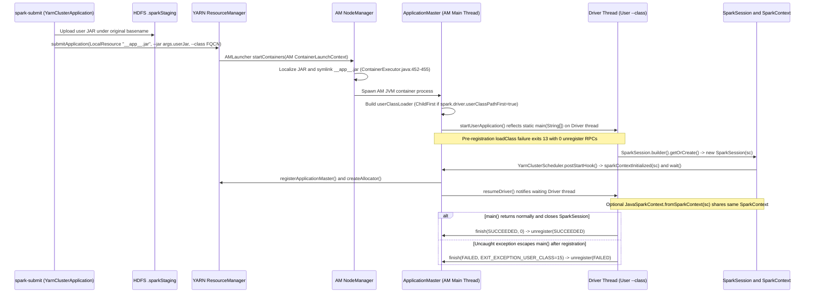

# JVM user application (--class): Scala and Java entry on YARN

[component index](README.md)

The JVM user application entry path runs Scala and Java `--class` programs **directly inside the Driver JVM** with **zero** `python-driver` subprocess, `PythonRunner`, or `py4j-gateway` socket. Every `SparkSession`, `SparkContext`, `Dataset[T]`, and RDD call is a direct in-JVM method invocation. How the user's `public static void main(String[])` is loaded, which JVM hosts it, and what exit code YARN records depend sharply on whether `spark-submit` runs in YARN **cluster mode** (`YarnClusterApplication` -> `ApplicationMaster.startUserApplication`) or YARN **client mode** (`SparkSubmit` -> `JavaMainApplication` on the submit host, with `ExecutorLauncher` as the remote AM).

## Flow at a glance

1. **Submit dispatch and JAR staging**: In cluster mode, `SparkSubmit` invokes `YarnClusterApplication`, which passes `--jar args.userJar`, uploads the JAR under its original basename into HDFS `.sparkStaging/<appId>/`, and registers the YARN `LocalResource` symlink alias `__app__.jar`. In client mode, `SparkSubmit` wraps the user class in `JavaMainApplication` locally and launches `ExecutorLauncher` as the AM.
2. **Reflection `main()` and `SparkContext` rendezvous**: In cluster mode, Hadoop's NodeManager launch script creates the `__app__.jar` symlink in the AM working directory; `ApplicationMaster` builds `userClassLoader` (`ChildFirstURLClassLoader` if `spark.driver.userClassPathFirst=true`), reflects `main(String[])` on the `"Driver"` thread, pauses it in `YarnClusterScheduler.postStartHook()`, registers the AM with the RM, and calls `resumeDriver()`.
3. **In-JVM session creation and exit accounting**: User code creates `new SparkSession(sc)` (and optionally wraps the exact same `SparkContext` via `JavaSparkContext.fromSparkContext(sc)`). Uncaught `main()` failures exit with `EXIT_EXCEPTION_USER_CLASS` (`15`) after cluster AM registration, `EXIT_SC_NOT_INITED` (`13`) before registration (with 0 `unregisterApplicationMaster` calls), or `SparkExitCode.CLASS_NOT_FOUND` (`101`) when `SparkSubmit` cannot load the class in client mode.

> **Key distinction:** Cluster mode runs the user `--class` inside the YARN AM container's `"Driver"` thread (where uncaught exceptions report AM exit `15`, and pre-registration class lookup failures exit `13` with zero RM unregister), whereas client mode runs `JavaMainApplication` inside the submit JVM (where an uncaught exception without `sc.stop(n)` lets `SparkContext`'s shutdown hook send `Shutdown(0)` so YARN can report `SUCCEEDED/0` even while `spark-submit` exits non-zero).

> **Interactive explorer:** [Open in Spark Visualizer](https://nuthanreddy.github.io/spark-visualizer/#component=jvm-user-app&lang=scala) to step through commands, wire payloads, category filters, and fault simulations on the live cluster canvas.

## Cluster mode vs client mode lifecycle

| Stage | YARN cluster mode (`--deploy-mode cluster`) | YARN client mode (`--deploy-mode client`) |
|---|---|---|
| **`SparkSubmit` dispatch** | Sets `childMainClass = YarnClusterApplication` and passes `--jar <primaryResource>` ([`SparkSubmit`][submit-yarn]). | Loads user `--class` in the submit JVM and wraps it in [`JavaMainApplication`][java-main] (`SparkSubmit.scala:1024`), which copies `SparkConf` entries into `sys.props` and calls `mainMethod.invoke(null, args)`. |
| **User JAR staging and symlink** | [`Client.prepareLocalResources`][client-dist] / `distribute()` uploads the JAR under its **original basename** (e.g. `orders-assembly.jar`) into HDFS `.sparkStaging/<appId>/` (unless `local:` URI skips upload) and registers its YARN `LocalResource` key as [`Client.APP_JAR_NAME`][app-jar-name] (`"__app__.jar"`). Hadoop's NodeManager launch script creates the `__app__.jar` symlink in the container working directory ([`ContainerExecutor.java:452-455`][hadoop-symlink]). AM command receives `--jar args.userJar` ([`Client`][client-am-jar]). | User JAR sits directly on `SparkSubmit`'s local `childClasspath` on the submit host (and is distributed to executors via `spark.jars`). Remote AM runs `ExecutorLauncher` without `--jar` or `--class`. |
| **ClassLoader selection** | [`ApplicationMaster`][am-cl] inspects `Client.isUserClassPathFirst(sparkConf, isDriver = true)` (`spark.driver.userClassPathFirst`, [`Client`][user-cp-first]): `ChildFirstURLClassLoader` when `true`, `MutableURLClassLoader` when `false`. Sets it as the `"Driver"` thread's context class loader. | `SparkSubmit` builds `ChildFirstURLClassLoader` or `MutableURLClassLoader` on the submit JVM based on `spark.driver.userClassPathFirst` before loading `mainClass`. |
| **Driver / AM rendezvous** | [`ApplicationMaster.startUserApplication()`][am-start] loads `args.userClass` and spawns the `"Driver"` thread. When user code builds `SparkContext`, [`YarnClusterScheduler.postStartHook()`][cluster-hook] calls [`ApplicationMaster.sparkContextInitialized(sc)`][am-rendezvous], fulfilling `sparkContextPromise` and calling `wait()` to pause the `"Driver"` thread until [`runDriver()`][am-run-driver] calls `registerAM()`, `createAllocator()`, and `resumeDriver()`. | `SparkContext` starts `YarnClientSchedulerBackend` on the submit host, launches the remote `ExecutorLauncher` AM, and waits for the AM to connect back via `RegisterClusterManager`. |
| **Session & Java RDD API** | `SparkSession.builder().getOrCreate()` initializes `SparkContext` and constructs [`new SparkSession(sc, ...)`][ss-create] in-JVM. Java RDD code calls [`JavaSparkContext.fromSparkContext(sc)`][jsc-wrap], creating a thin wrapper sharing the **exact same** `SparkContext` and `SparkEnv`. | Identical in-JVM `SparkSession` / `SparkContext` / `JavaSparkContext.fromSparkContext(sc)` behavior inside the submit JVM. |
| **Missing `--class` failure** | `userClassLoader.loadClass(args.userClass)` throws inside [`startUserApplication()`][am-start] before `registerAM()` (`registered == false`). `ApplicationMaster.run()` catches it and calls `finish()`, which overrides `exitCode` to [`EXIT_SC_NOT_INITED` (`13`)][am-finish]. Because `registered == false`, [`unregister()`][am-finish] is a no-op (**0** `unregisterApplicationMaster` RPCs). | `SparkSubmit` catches `ClassNotFoundException` or `NoClassDefFoundError` and throws `SparkUserAppException(`[`SparkExitCode.CLASS_NOT_FOUND`][exit-codes]` = 101)` ([`SparkSubmit`][submit-cnf]) before any YARN application is submitted. |
| **Uncaught `main()` exception** | After AM registration, the `"Driver"` thread's `InvocationTargetException` handler records `FinalApplicationStatus.FAILED` with [`EXIT_EXCEPTION_USER_CLASS` (`15`)][am-start] and unregisters `FAILED` with the RM (on the final attempt). | [`SparkSubmit`][submit-cnf] unwraps `InvocationTargetException` and rethrows (exiting non-zero locally, never AM exit `15`). If `SparkContext` is still active and user code did not call `sc.stop(nonZero)`, [`SparkContext`'s shutdown hook][sc-hook] calls `stop()` (`stop(0)`), which calls `signalDriverStop(0)` -> [`Shutdown(0)`][yarn-shutdown], causing the client-mode AM to unregister **`SUCCEEDED/0`** with YARN! |

## Cluster-mode startup, rendezvous, and exit sequence

## Inputs, outputs, and state

| Boundary | Contract |
|---|---|
| Inputs | `--class <FQCN>`, primary user JAR (`args.userJar` or `local:` URI), application CLI arguments, `spark.driver.userClassPathFirst`, `--jars`, and localized `__spark_conf__` properties. |
| Owned state | Cluster AM `userClassLoader` (`MutableURLClassLoader` or `ChildFirstURLClassLoader`), reflected `public static main(String[])` `Method`, `userClassThread` (`"Driver"`), `sparkContextPromise`, and AM attempt flags (`registered`, `finished`, `unregistered`, `exitCode`, `finalStatus`); in Java apps, thin `JavaSparkContext` facade referencing the single underlying `SparkContext`. |
| Outputs | Direct in-JVM `SparkSession` / `SparkContext` / `Dataset[T]` / RDD calls (zero Py4J loopback IPC), AM exit code (`0`, `13`, `15`) or submit JVM exit code (`0`, `1`, `101`), and RM `FinalApplicationStatus`. |

## Failure clues and diagnosis

- **Cluster AM exits with code `13` (`EXIT_SC_NOT_INITED`) and no `Unregistering ApplicationMaster` log:** Either `userClassLoader.loadClass(args.userClass)` failed before `registerAM()`, the reflected `main` method on `--class` was not `static` (for example pointing `--class` at a Scala `class` instead of a companion `object`, which fails before AM registration so `finish()` records `13`), or `main()` returned/threw before initializing `SparkContext` (or timed out waiting for `sparkContextPromise`). Because `registered` remained `false`, `unregister()` was skipped so YARN can retry up to `maxAppAttempts`. Inspect AM stderr for `ClassNotFoundException` or pre-init errors.
- **Cluster AM exits with code `15` (`EXIT_EXCEPTION_USER_CLASS`):** User Scala/Java `main()` threw an uncaught exception after `registerAM()` completed. Contrast this with PySpark cluster exceptions, which wrap as `SparkUserAppException(1)`.
- **Client-mode `spark-submit` exits `101` before any YARN application ID appears:** `SparkSubmit` failed with `ClassNotFoundException` or `NoClassDefFoundError` (`SparkExitCode.CLASS_NOT_FOUND = 101`). Verify the JAR path, fat-JAR packaging, and `--class` spelling.
- **Client-mode `spark-submit` fails with a Java/Scala exception, yet YARN ResourceManager UI shows `SUCCEEDED`:** The uncaught exception terminated the client JVM without calling `sc.stop(nonZero)`. `SparkContext`'s shutdown hook ran `stop(0)` and sent `Shutdown(0)` to the `ExecutorLauncher` AM. Catch fatal errors in client `main()` and call `sc.stop(1)` (or run in cluster mode) when YARN must record `FAILED`.
- **Dependency conflict (`NoSuchMethodError` / `LinkageError`) between user JAR and Spark JARs:** Enable `spark.driver.userClassPathFirst=true` (and `spark.executor.userClassPathFirst=true` for executors) so [`ApplicationMaster`][am-cl] switches from `MutableURLClassLoader` to `ChildFirstURLClassLoader`, or shade conflicting libraries in the assembly JAR.

[submit-yarn]: https://github.com/apache/spark/blob/dada2a6db5d73b152d6ba16e4fe21406f86abfe3/core/src/main/scala/org/apache/spark/deploy/SparkSubmit.scala#L825-L843
[submit-cnf]: https://github.com/apache/spark/blob/dada2a6db5d73b152d6ba16e4fe21406f86abfe3/core/src/main/scala/org/apache/spark/deploy/SparkSubmit.scala#L1002-L1060
[exit-codes]: https://github.com/apache/spark/blob/dada2a6db5d73b152d6ba16e4fe21406f86abfe3/core/src/main/scala/org/apache/spark/util/SparkExitCode.scala#L20-L50
[java-main]: https://github.com/apache/spark/blob/dada2a6db5d73b152d6ba16e4fe21406f86abfe3/core/src/main/scala/org/apache/spark/deploy/SparkApplication.scala#L39-L55
[client-dist]: https://github.com/apache/spark/blob/dada2a6db5d73b152d6ba16e4fe21406f86abfe3/resource-managers/yarn/src/main/scala/org/apache/spark/deploy/yarn/Client.scala#L594-L620
[client-am-jar]: https://github.com/apache/spark/blob/dada2a6db5d73b152d6ba16e4fe21406f86abfe3/resource-managers/yarn/src/main/scala/org/apache/spark/deploy/yarn/Client.scala#L1120-L1142
[app-jar-name]: https://github.com/apache/spark/blob/dada2a6db5d73b152d6ba16e4fe21406f86abfe3/resource-managers/yarn/src/main/scala/org/apache/spark/deploy/yarn/Client.scala#L1435
[user-cp-first]: https://github.com/apache/spark/blob/dada2a6db5d73b152d6ba16e4fe21406f86abfe3/resource-managers/yarn/src/main/scala/org/apache/spark/deploy/yarn/Client.scala#L1773-L1779
[hadoop-symlink]: https://github.com/apache/hadoop/blob/rel/release-3.4.1/hadoop-yarn-project/hadoop-yarn/hadoop-yarn-server/hadoop-yarn-server-nodemanager/src/main/java/org/apache/hadoop/yarn/server/nodemanager/ContainerExecutor.java#L452-L455
[am-cl]: https://github.com/apache/spark/blob/dada2a6db5d73b152d6ba16e4fe21406f86abfe3/resource-managers/yarn/src/main/scala/org/apache/spark/deploy/yarn/ApplicationMaster.scala#L84-L95
[am-finish]: https://github.com/apache/spark/blob/dada2a6db5d73b152d6ba16e4fe21406f86abfe3/resource-managers/yarn/src/main/scala/org/apache/spark/deploy/yarn/ApplicationMaster.scala#L365-L403
[am-rendezvous]: https://github.com/apache/spark/blob/dada2a6db5d73b152d6ba16e4fe21406f86abfe3/resource-managers/yarn/src/main/scala/org/apache/spark/deploy/yarn/ApplicationMaster.scala#L405-L420
[am-run-driver]: https://github.com/apache/spark/blob/dada2a6db5d73b152d6ba16e4fe21406f86abfe3/resource-managers/yarn/src/main/scala/org/apache/spark/deploy/yarn/ApplicationMaster.scala#L496-L540
[am-start]: https://github.com/apache/spark/blob/dada2a6db5d73b152d6ba16e4fe21406f86abfe3/resource-managers/yarn/src/main/scala/org/apache/spark/deploy/yarn/ApplicationMaster.scala#L741-L795
[cluster-hook]: https://github.com/apache/spark/blob/dada2a6db5d73b152d6ba16e4fe21406f86abfe3/resource-managers/yarn/src/main/scala/org/apache/spark/scheduler/cluster/YarnClusterScheduler.scala#L29-L37
[ss-create]: https://github.com/apache/spark/blob/dada2a6db5d73b152d6ba16e4fe21406f86abfe3/sql/core/src/main/scala/org/apache/spark/sql/classic/SparkSession.scala#L1050-L1076
[jsc-wrap]: https://github.com/apache/spark/blob/dada2a6db5d73b152d6ba16e4fe21406f86abfe3/core/src/main/scala/org/apache/spark/api/java/JavaSparkContext.scala#L48-L65
[sc-hook]: https://github.com/apache/spark/blob/dada2a6db5d73b152d6ba16e4fe21406f86abfe3/core/src/main/scala/org/apache/spark/SparkContext.scala#L761-L771
[yarn-shutdown]: https://github.com/apache/spark/blob/dada2a6db5d73b152d6ba16e4fe21406f86abfe3/resource-managers/yarn/src/main/scala/org/apache/spark/scheduler/cluster/YarnSchedulerBackend.scala#L330-L337
