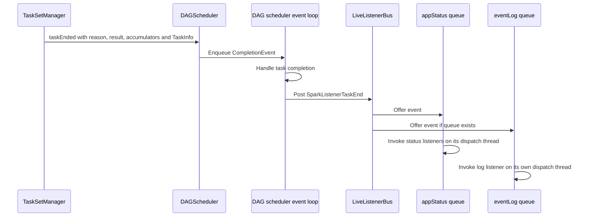

# LiveListenerBus: from scheduler events to listener callbacks

[component index](README.md)

`DAGScheduler.taskEnded(...)` and `SparkListener.onTaskEnd(...)` sound alike but have different jobs. The first hands a completion to the scheduler so it can decide what to do next. The second notifies a subscriber about what happened. `LiveListenerBus` delivers those notifications **inside the driver JVM**. It is neither the scheduler's event loop nor the executor-to-driver RPC transport.

## Flow at a glance

1. **DAG scheduler**: While handling a task completion, the scheduler posts a task-end event.
2. **Listener bus**: The bus offers the event to each active queue without waiting for its listeners.
3. **Queue threads**: Each queue delivers accepted events in order, calling its listeners one at a time.

> **Watch for:** A full `eventLog` queue can drop a task-end event even when the live UI shows the task as finished.

Show the animated flow

## A task completion, across the two boundaries

For example, when an orders map task finishes, [`TaskSetManager` notifies the DAG scheduler][callback]. [`taskEnded` enqueues a `CompletionEvent`][dag-input], and the [DAG event loop][dag-loop] handles it. The [published `SparkListenerTaskEnd`][dag-output] contains stage and attempt IDs, task type, end reason, `TaskInfo` and metrics, **not the returned task result**. The scheduler does not wait for the UI row or event-log write. A management listener can take subsequent action, but its callback is not the scheduler's completion acknowledgement.

## Ownership, queues and delivery

`SparkContext` [creates the live bus and registers the status listener early][sc-create]. Before `start`, posts accumulate in a driver-side list. Once the initial internal listeners and configured `spark.extraListeners` are registered, the context [starts the bus][sc-start]. It starts each existing queue, offers the buffered events to it, clears the startup buffer and registers bus metrics. Queues are [created on first subscription][routes]. A listener added to an existing queue can receive events still waiting there, but the bus does not replay events already dispatched.

| Named queue | Consumers and output |
|---|---|
| `appStatus` | The status listener updates the store that serves the [live UI](spark-ui.md). SQL can register another status listener here. |
| `eventLog` | When enabled, the [event logger](event-log.md) serializes selected events to the application log. |
| `executorManagement` | The [heartbeat receiver](heartbeat-receiver.md) watches executor add/remove events. With dynamic allocation, the allocation listener and [monitor](executor-monitor.md) also consume events here. |
| `shared` | User listeners, including `spark.extraListeners`, receive callbacks without running on the scheduler's thread. |

`post` [offers the same event to every current queue][post]. Each has a bounded FIFO and a single `spark-listener-group-<name>` daemon. That daemon takes one event, invokes the listeners in that queue serially, then takes the next. [`SparkListenerBus` selects the typed callback][dispatch] (`onTaskEnd`, `onExecutorAdded`, etc.); unmatched event types go to `onOtherEvent`. FIFO is per queue, not a global ordering or completion barrier across threads. A slow status listener can delay other status listeners without waiting for the event logger.

## Delivery limits and shutdown

The [enqueue operation][overflow] is a non-blocking `offer`. If a queue is full, the new event is **dropped for that queue**; there is no retry or request to slow a scheduler. Thus a stage can appear in the live UI but be missing from history, or vice versa. For a discrepancy, check the named queue in the driver warning and its `queue.<name>.numDroppedEvents`, `.size` and `.listenerProcessingTime` [metrics][worker]. `numEventsPosted` counts bus posts, not deliveries. The [capacity setting][capacity] can be overridden per queue; increasing it buys time but does not fix a persistently slow listener.

An exception in one callback is normally logged and dispatch continues; [an interrupted listener is removed][listener-errors]. On orderly shutdown `SparkContext` [posts application end, then stops the bus][sc-stop]. New posts are ignored; each queue puts a stop marker behind queued events and waits for its thread (indefinitely by default, or up to the [configured join timeout][shutdown]). A driver crash provides no such drain. The [History Server](history-server.md) uses a separate, synchronous replay bus, not these live queues.

[callback]: https://github.com/apache/spark/blob/dada2a6db5d73b152d6ba16e4fe21406f86abfe3/core/src/main/scala/org/apache/spark/scheduler/TaskSetManager.scala#L935-L953
[dag-input]: https://github.com/apache/spark/blob/dada2a6db5d73b152d6ba16e4fe21406f86abfe3/core/src/main/scala/org/apache/spark/scheduler/DAGScheduler.scala#L549-L562
[dag-loop]: https://github.com/apache/spark/blob/dada2a6db5d73b152d6ba16e4fe21406f86abfe3/core/src/main/scala/org/apache/spark/scheduler/DAGScheduler.scala#L5501-L5520
[dag-output]: https://github.com/apache/spark/blob/dada2a6db5d73b152d6ba16e4fe21406f86abfe3/core/src/main/scala/org/apache/spark/scheduler/DAGScheduler.scala#L3565-L3585
[sc-create]: https://github.com/apache/spark/blob/dada2a6db5d73b152d6ba16e4fe21406f86abfe3/core/src/main/scala/org/apache/spark/SparkContext.scala#L534-L543
[sc-start]: https://github.com/apache/spark/blob/dada2a6db5d73b152d6ba16e4fe21406f86abfe3/core/src/main/scala/org/apache/spark/SparkContext.scala#L3261-L3286
[routes]: https://github.com/apache/spark/blob/dada2a6db5d73b152d6ba16e4fe21406f86abfe3/core/src/main/scala/org/apache/spark/scheduler/LiveListenerBus.scala#L64-L108
[post]: https://github.com/apache/spark/blob/dada2a6db5d73b152d6ba16e4fe21406f86abfe3/core/src/main/scala/org/apache/spark/scheduler/LiveListenerBus.scala#L126-L183
[dispatch]: https://github.com/apache/spark/blob/dada2a6db5d73b152d6ba16e4fe21406f86abfe3/core/src/main/scala/org/apache/spark/scheduler/SparkListenerBus.scala#L25-L104
[worker]: https://github.com/apache/spark/blob/dada2a6db5d73b152d6ba16e4fe21406f86abfe3/core/src/main/scala/org/apache/spark/scheduler/AsyncEventQueue.scala#L50-L117
[overflow]: https://github.com/apache/spark/blob/dada2a6db5d73b152d6ba16e4fe21406f86abfe3/core/src/main/scala/org/apache/spark/scheduler/AsyncEventQueue.scala#L168-L205
[capacity]: https://github.com/apache/spark/blob/dada2a6db5d73b152d6ba16e4fe21406f86abfe3/core/src/main/scala/org/apache/spark/internal/config/package.scala#L1121-L1131
[listener-errors]: https://github.com/apache/spark/blob/dada2a6db5d73b152d6ba16e4fe21406f86abfe3/core/src/main/scala/org/apache/spark/util/ListenerBus.scala#L102-L142
[sc-stop]: https://github.com/apache/spark/blob/dada2a6db5d73b152d6ba16e4fe21406f86abfe3/core/src/main/scala/org/apache/spark/SparkContext.scala#L2638-L2670
[shutdown]: https://github.com/apache/spark/blob/dada2a6db5d73b152d6ba16e4fe21406f86abfe3/core/src/main/scala/org/apache/spark/scheduler/AsyncEventQueue.scala#L139-L165
