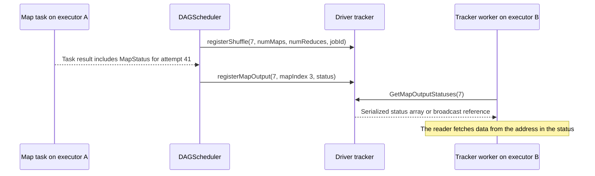

# MapOutputTrackerMaster: the driver's directory of map outputs

[component index](README.md) | [Executor-side tracker](map-output-tracker-worker.md)

When a reduce task needs shuffle 7, the driver can tell it **which map attempts produced usable output, where, and roughly how large each reduce block is**. `MapOutputTrackerMaster` owns that directory for the application. It does not hold the map's records, open its index file, or forward its bytes. This page follows the ordinary blocking, pull-based shuffle.

## Flow at a glance

1. **Map task**: Reports where attempt 41 wrote its blocks for shuffle 7.
2. **Driver scheduler**: Records that status in the tracker's slot for map partition 3.
3. **Driver tracker**: Answers executor lookups with locations and size estimates.

> **Key distinction:** A retry can put a new attempt in slot 3. The tracker tells executors where to fetch the new output; it never forwards the shuffle bytes.

Show the animated flow

## What the driver stores

| Key or field | Meaning |
| --- | --- |
| `shuffleStatuses(shuffleId)` | A `ShuffleStatus` for one shuffle. `DAGScheduler` registers it when creating the shuffle map stage, with the number of input map partitions and output reduce partitions. |
| `mapStatuses(mapIndex)` | One accepted `MapStatus` for this **input** partition, or `null` if no output is available. There is not a slot per task attempt. A per-shuffle read/write lock guards the slots and the available-output count. |
| `status.mapId`, `status.location` | The ID used in the physical block name (normally the task attempt ID) and the serving `BlockManagerId`. The location can point to an executor's block server or to the optional [external shuffle service](external-shuffle-service.md). |
| `status.getSizeForBlock(reduceId)` | Estimated bytes for this **output** partition. Compact encodings preserve the distinction between empty and nonempty blocks; these sizes are not file offsets. |

For example, `shuffleStatuses(7).mapStatuses(3)` can describe attempt **41**. A reader of reduce partition **2** needs `ShuffleBlockId(7, 41, 2)`, not `(7, 3, 2)`. A retry can put a different attempt in slot 3 without renumbering the map partition. The old fetch protocol uses the map partition ID as `mapId` instead. See the [slot layout][slots], [map task's ID choice][map-id], and [MapStatus contract][status].

## From registration to a reducer's lookup

1. The driver `SparkEnv` [creates the master and registers the `MapOutputTracker` RPC endpoint][env]. At [stage creation][register], the scheduler registers the shuffle if needed. On task success, [`DAGScheduler` checks the completion's epoch][completion], then registers the result using `smt.partitionId`, **not** `status.mapId`. [`addMapOutput`][add] updates the slot, a reverse map from map ID to index, and, for a newly available slot, the count. [`ShuffleMapStage`][ready] uses that count for readiness and the missing indices for recomputation.
2. On a worker cache miss, the [endpoint][endpoint] enqueues `GetMapOutputMessage(shuffleId, context)`. A [dispatcher thread][dispatch] replies on the original RPC context, so serialization does not block the endpoint's normal dispatch thread. The request is for the **whole shuffle's status array**, not a reduce partition's records.
3. The first lookup [serializes and caches][cache] the snapshot. Below `spark.shuffle.mapOutput.minSizeForBroadcast` the [encoder][encode] returns compressed metadata directly; **at or above** the threshold it broadcasts that metadata and returns a serialized broadcast reference. Both replies describe the same files. The driver can also [sum size estimates by reducer][stats] without fetching any data.

## Loss, cleanup, and diagnosis

A fetch failure with a known map index can make the scheduler [unregister the output][unregister]. [`removeMapOutput` clears the slot and invalidates the cached snapshot][remove-slot] **only if the current location matches the reported address**; `unregisterMapOutput` [advances the epoch][bump]. This prevents a delayed failure at one address from removing a replacement at a different address through that slot update. Executor- or host-level loss can [invalidate more than one slot][loss]. When retry is allowed, the **scheduler**, not the tracker, [resubmits the affected stages][resubmit]; later tasks carry an epoch that makes workers discard stale metadata.

**Diagnostic:** If a reducer logs `Missing an output location`, correlate that shuffle's map-stage completions with driver logs for ignored completions or lost shuffle files. A missing status is not an empty reduce block. If the reducer already has an address and reports an index-file or connection error instead, continue at the [resolver](shuffle-block-resolver.md) or the serving process.

At cleanup, `ContextCleaner` [requests shuffle removal before unregistering its directory entry][clean]. At application shutdown `SparkEnv` calls `stop`; the [master stops its dispatch pool and endpoint and clears the directory][stop]. Neither action makes tracker RPCs a file-deletion protocol.

[env]: https://github.com/apache/spark/blob/dada2a6db5d73b152d6ba16e4fe21406f86abfe3/core/src/main/scala/org/apache/spark/SparkEnv.scala#L736-L759
[register]: https://github.com/apache/spark/blob/dada2a6db5d73b152d6ba16e4fe21406f86abfe3/core/src/main/scala/org/apache/spark/scheduler/DAGScheduler.scala#L773-L785
[completion]: https://github.com/apache/spark/blob/dada2a6db5d73b152d6ba16e4fe21406f86abfe3/core/src/main/scala/org/apache/spark/scheduler/DAGScheduler.scala#L4094-L4116
[slots]: https://github.com/apache/spark/blob/dada2a6db5d73b152d6ba16e4fe21406f86abfe3/core/src/main/scala/org/apache/spark/MapOutputTracker.scala#L63-L108
[map-id]: https://github.com/apache/spark/blob/dada2a6db5d73b152d6ba16e4fe21406f86abfe3/core/src/main/scala/org/apache/spark/scheduler/ShuffleMapTask.scala#L97-L113
[status]: https://github.com/apache/spark/blob/dada2a6db5d73b152d6ba16e4fe21406f86abfe3/core/src/main/scala/org/apache/spark/scheduler/MapStatus.scala#L38-L89
[add]: https://github.com/apache/spark/blob/dada2a6db5d73b152d6ba16e4fe21406f86abfe3/core/src/main/scala/org/apache/spark/MapOutputTracker.scala#L218-L245
[ready]: https://github.com/apache/spark/blob/dada2a6db5d73b152d6ba16e4fe21406f86abfe3/core/src/main/scala/org/apache/spark/scheduler/ShuffleMapStage.scala#L107-L132
[endpoint]: https://github.com/apache/spark/blob/dada2a6db5d73b152d6ba16e4fe21406f86abfe3/core/src/main/scala/org/apache/spark/MapOutputTracker.scala#L602-L632
[dispatch]: https://github.com/apache/spark/blob/dada2a6db5d73b152d6ba16e4fe21406f86abfe3/core/src/main/scala/org/apache/spark/MapOutputTracker.scala#L844-L892
[cache]: https://github.com/apache/spark/blob/dada2a6db5d73b152d6ba16e4fe21406f86abfe3/core/src/main/scala/org/apache/spark/MapOutputTracker.scala#L455-L478
[encode]: https://github.com/apache/spark/blob/dada2a6db5d73b152d6ba16e4fe21406f86abfe3/core/src/main/scala/org/apache/spark/MapOutputTracker.scala#L1739-L1785
[stats]: https://github.com/apache/spark/blob/dada2a6db5d73b152d6ba16e4fe21406f86abfe3/core/src/main/scala/org/apache/spark/MapOutputTracker.scala#L1161-L1193
[unregister]: https://github.com/apache/spark/blob/dada2a6db5d73b152d6ba16e4fe21406f86abfe3/core/src/main/scala/org/apache/spark/scheduler/DAGScheduler.scala#L4236-L4244
[remove-slot]: https://github.com/apache/spark/blob/dada2a6db5d73b152d6ba16e4fe21406f86abfe3/core/src/main/scala/org/apache/spark/MapOutputTracker.scala#L325-L335
[bump]: https://github.com/apache/spark/blob/dada2a6db5d73b152d6ba16e4fe21406f86abfe3/core/src/main/scala/org/apache/spark/MapOutputTracker.scala#L995-L1003
[loss]: https://github.com/apache/spark/blob/dada2a6db5d73b152d6ba16e4fe21406f86abfe3/core/src/main/scala/org/apache/spark/MapOutputTracker.scala#L1063-L1087
[resubmit]: https://github.com/apache/spark/blob/dada2a6db5d73b152d6ba16e4fe21406f86abfe3/core/src/main/scala/org/apache/spark/scheduler/DAGScheduler.scala#L4281-L4317
[clean]: https://github.com/apache/spark/blob/dada2a6db5d73b152d6ba16e4fe21406f86abfe3/core/src/main/scala/org/apache/spark/ContextCleaner.scala#L236-L250
[stop]: https://github.com/apache/spark/blob/dada2a6db5d73b152d6ba16e4fe21406f86abfe3/core/src/main/scala/org/apache/spark/MapOutputTracker.scala#L1415-L1426
