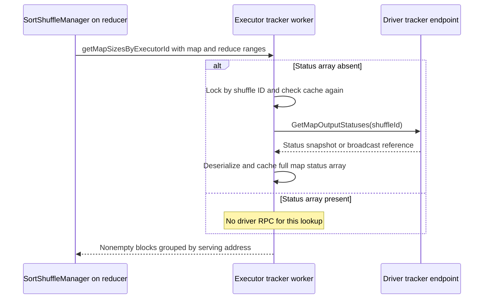

# MapOutputTrackerWorker: the executor's shuffle lookup cache

[component index](README.md) | [Driver-side tracker](map-output-tracker-master.md) | [Shuffle reader](shuffle-reader.md)

Before an executor fetches any shuffle bytes, it needs a list of blocks and serving addresses. `MapOutputTrackerWorker` turns a shuffle ID and partition ranges into that list. It is one JVM object shared by tasks on a YARN executor, not a Python worker, a YARN service, or a thread that copies files.

## Flow at a glance

1. **Shuffle manager**: Asks which blocks contain data for reduce partition 2 of shuffle 7.
2. **Executor tracker**: Reuses cached map statuses or asks the driver for them.
3. **Shuffle reader**: Receives nonempty block IDs grouped by serving address.

> **Watch for:** A zero size means the block is empty and can be skipped. A missing map status means the location is unknown and the lookup fails.

Show the animated flow

## Input and output

| Input to `getMapSizesByExecutorId` | How the worker uses it |
| --- | --- |
| `shuffleId` | Key in the executor's `mapStatuses` cache and argument to the driver's `GetMapOutputStatuses` RPC on a miss. |
| `[startMapIndex, endMapIndex)` | Slice of **logical input partitions** in the status array. `Int.MaxValue` as the end means all remaining entries. |
| `[startPartition, endPartition)` | Range of **reduce partition IDs** to read within each selected map output. A task reading reducer 2 alone passes `[2, 3)`. |

The result is an iterator grouped by `BlockManagerId`. Each group contains `(ShuffleBlockId(shuffleId, status.mapId, reduceId), estimatedBytes, mapIndex)` tuples. For example, if entry **3** of shuffle **7** describes attempt **41** on executor A, the tuple for reduce **2** names `shuffle_7_41_2` but still carries `3`. The name lets the server find attempt 41's files; the separate index lets the scheduler identify the input partition on failure. No byte offsets, streams, or file contents are in this result. See the [range conversion and zero-size filter][convert] and the [reader call site][manager].

## Cache miss versus cache hit

The executor's [`SparkEnv` constructs the worker][env] and resolves a reference to the **driver's** endpoint; it does not register a second master endpoint. On the ordinary pull path the [lookup][lookup] asks for map statuses only. The [cache-miss branch][miss] uses a per-shuffle `KeyLock` and rechecks the cache inside the lock: concurrent successful misses for the same shuffle need only one fetch. The [wire decoder][decode] either decompresses the inline array or resolves the broadcast and decodes its contents. This is still a metadata transfer. Tasks on another executor have their own cache.

For each requested map slot, the worker validates the status, then tests the estimated size for each requested reducer. **Zero size** means a known empty block and is skipped; a **null slot** is an unknown map location and fails the lookup. It does not synthesize an empty partition. `SortShuffleManager` hands the grouped result to `BlockStoreShuffleReader`, whose fetcher chooses local disk, another executor, or an optional external shuffle service.

## Invalidation, failure, and lifetime

The driver [stamps the current epoch on each task in a task set][stamp]. Before running it, the executor [calls `updateEpoch(task.epoch)`][apply-epoch]. A **higher** epoch [clears the worker's caches across shuffles][epoch-cache]; an equal or older epoch leaves them alone. There is no periodic poll and no driver push of replacement locations. A `RemoveShuffle` message [evicts just that shuffle][remove]. At executor shutdown `SparkEnv` [calls `stop`][env-stop]; the worker inherits the [no-op base implementation][base-stop]. Its state dies with the executor rather than stopping the driver's endpoint.

**Diagnostic:** `Don't have map outputs for shuffle ...` followed by `Got the map output locations` is a normal cold lookup. A [null status][validate] throws `MetadataFetchFailedException`; the conversion handler clears cached statuses and rethrows. The resulting [fetch-failed reason][failure] has no block-manager address and uses `-1` for both map identifiers. The reported partition on this path is the **first requested reduce ID**, not the missing map index. Look for lost map outputs on the driver. In contrast, `Error communicating with MapOutputTracker` comes from the [RPC ask][ask]; start with driver endpoint reachability rather than a producer's `.data` file.

[env]: https://github.com/apache/spark/blob/dada2a6db5d73b152d6ba16e4fe21406f86abfe3/core/src/main/scala/org/apache/spark/SparkEnv.scala#L736-L759
[manager]: https://github.com/apache/spark/blob/dada2a6db5d73b152d6ba16e4fe21406f86abfe3/core/src/main/scala/org/apache/spark/shuffle/sort/SortShuffleManager.scala#L120-L142
[lookup]: https://github.com/apache/spark/blob/dada2a6db5d73b152d6ba16e4fe21406f86abfe3/core/src/main/scala/org/apache/spark/MapOutputTracker.scala#L1483-L1542
[miss]: https://github.com/apache/spark/blob/dada2a6db5d73b152d6ba16e4fe21406f86abfe3/core/src/main/scala/org/apache/spark/MapOutputTracker.scala#L1667-L1698
[decode]: https://github.com/apache/spark/blob/dada2a6db5d73b152d6ba16e4fe21406f86abfe3/core/src/main/scala/org/apache/spark/MapOutputTracker.scala#L1789-L1827
[convert]: https://github.com/apache/spark/blob/dada2a6db5d73b152d6ba16e4fe21406f86abfe3/core/src/main/scala/org/apache/spark/MapOutputTracker.scala#L1951-L1966
[stamp]: https://github.com/apache/spark/blob/dada2a6db5d73b152d6ba16e4fe21406f86abfe3/core/src/main/scala/org/apache/spark/scheduler/TaskSetManager.scala#L233-L238
[apply-epoch]: https://github.com/apache/spark/blob/dada2a6db5d73b152d6ba16e4fe21406f86abfe3/core/src/main/scala/org/apache/spark/executor/Executor.scala#L883-L890
[epoch-cache]: https://github.com/apache/spark/blob/dada2a6db5d73b152d6ba16e4fe21406f86abfe3/core/src/main/scala/org/apache/spark/MapOutputTracker.scala#L1702-L1725
[remove]: https://github.com/apache/spark/blob/dada2a6db5d73b152d6ba16e4fe21406f86abfe3/core/src/main/scala/org/apache/spark/storage/BlockManagerStorageEndpoint.scala#L58-L70
[env-stop]: https://github.com/apache/spark/blob/dada2a6db5d73b152d6ba16e4fe21406f86abfe3/core/src/main/scala/org/apache/spark/SparkEnv.scala#L283-L305
[base-stop]: https://github.com/apache/spark/blob/dada2a6db5d73b152d6ba16e4fe21406f86abfe3/core/src/main/scala/org/apache/spark/MapOutputTracker.scala#L784-L789
[validate]: https://github.com/apache/spark/blob/dada2a6db5d73b152d6ba16e4fe21406f86abfe3/core/src/main/scala/org/apache/spark/MapOutputTracker.scala#L2003-L2010
[failure]: https://github.com/apache/spark/blob/dada2a6db5d73b152d6ba16e4fe21406f86abfe3/core/src/main/scala/org/apache/spark/shuffle/FetchFailedException.scala#L58-L72
[ask]: https://github.com/apache/spark/blob/dada2a6db5d73b152d6ba16e4fe21406f86abfe3/core/src/main/scala/org/apache/spark/MapOutputTracker.scala#L656-L668
