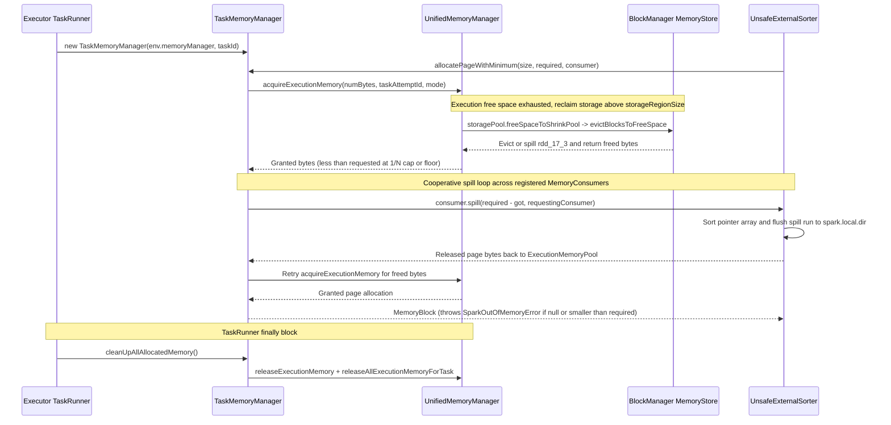

# UnifiedMemoryManager and TaskMemoryManager: execution/storage pooling and spill

[component index](README.md)

`UnifiedMemoryManager` and `TaskMemoryManager` are **not** cluster-wide memory schedulers, do **not** run as standalone YARN daemons, and do **not** track or bound external Python worker RSS. Inside each JVM ([driver](spark-driver.md) and every [executor](executor.md)), [`SparkEnv`](spark-env.md) owns one `UnifiedMemoryManager` that dynamically splits JVM heap and optional off-heap memory between execution operators and [BlockManager](block-manager.md) storage. Each running [task attempt](task-attempt.md) gets its own `TaskMemoryManager` to allocate Tungsten pages, arbitrate cooperative spills across operators, and audit memory leaks at task exit. This memory architecture applies identically to PySpark, Scala, and Java jobs for all JVM-side SQL, DataFrame, shuffle, and cache work; for PySpark UDFs, external `python3` worker processes sit outside this manager and are policed only by YARN container PMEM/cgroups (`spark.executor.memoryOverhead` or `spark.executor.pyspark.memory`).

## Flow at a glance

1. **Per-JVM unified budget**: `SparkEnv.initializeMemoryManager` creates one `UnifiedMemoryManager` reserving 300 MiB for JVM overhead and dividing the remaining `spark.memory.fraction` (0.6 default) into soft execution and storage regions via `spark.memory.storageFraction` (0.5 default).
2. **Per-task allocation and borrowing**: `Executor.TaskRunner` constructs a `TaskMemoryManager` per task; `UnsafeExternalSorter` acquires Tungsten pages via `allocatePageWithMinimum`, while object `ExternalSorter` acquires memory via `Spillable.acquireMemory`. Execution can borrow free storage and evict cached RDD blocks back down to `storageRegionSize`.
3. **Cooperative spill and OOM guard**: When execution cannot grow within the task's `1/(2N)..1/N` fair-share window, `TaskMemoryManager` invokes `spill()` on registered `MemoryConsumer`s; if `allocatePage` still receives `null` or a page smaller than `required`, `MemoryConsumer` throws `SparkOutOfMemoryError`.
4. **Teardown and leak audit**: In `TaskRunner`'s `finally` block, `cleanUpAllAllocatedMemory()` frees all remaining Tungsten pages back to `UnifiedMemoryManager` and flags any non-zero leaked bytes.

> **Key distinction:** `UnifiedMemoryManager` and `TaskMemoryManager` govern only JVM on-heap and configured off-heap pools inside each `SparkEnv`. They never see or evict external `python3` worker RSS, so YARN container PMEM kills (exit 143) during Python UDFs occur outside Spark's managed memory pools.

> **Interactive explorer:** [Open in Spark Visualizer](https://nuthanreddy.github.io/spark-visualizer/#component=memory-manager) to step through commands, wire payloads, language modes, category filters, and fault simulations on the live cluster canvas.

## Pool regions and per-JVM vs per-task ownership

Each executor `SparkEnv` initializes `UnifiedMemoryManager` in [`SparkEnv.createExecutorEnv`][env-exec-init] (`offHeapAllowed = true`), while the driver initializes its own instance in [`SparkContext`][sc-mem-init] with `offHeapAllowed = isLocal` (non-local drivers do not run tasks or size container memory for off-heap blocks). Inside `UnifiedMemoryManager`, four pools enforce two strict conservation invariants ([`assertInvariants`][umm-class]): `onHeapExecutionMemoryPool.poolSize + onHeapStorageMemoryPool.poolSize == maxHeapMemory` and `offHeapExecutionMemoryPool.poolSize + offHeapStorageMemoryPool.poolSize == maxOffHeapMemory`.

| Layer | Cardinality and owner | Responsibility and key mechanics |
|---|---|---|
| [`UnifiedMemoryManager`][umm-class] | 1 per JVM (`SparkEnv`) | Computes `maxHeapMemory = (systemMemory - 300 MiB) * spark.memory.fraction` ([`getMaxMemory`][umm-max]) and `onHeapStorageRegionSize = maxHeapMemory * spark.memory.storageFraction`. Arbitrates borrowing between execution and storage pools, and optionally subtracts polled unmanaged memory (such as RocksDB state stores) when `spark.memory.unmanaged.pollingInterval > 0`. |
| [`ExecutionMemoryPool`][exec-pool] | 2 per JVM (on-heap, off-heap) | Tracks per-task usage across `N` active tasks. Caps each task at `1/N` of `computeMaxExecutionPoolSize()` and blocks in `lock.wait()` until a task can reach at least `1/(2N)` of `poolSize` before forcing a spill. |
| [`StorageMemoryPool`][storage-pool] | 2 per JVM (on-heap, off-heap) | Backs `BlockManager` `MemoryStore` for [RDD cache](rdd-cache.md) and broadcast blocks. Can borrow `executionPool.memoryFree` when storage fills, but can never evict active execution memory. Shrinks via `freeSpaceToShrinkPool` when execution reclaims borrowed space. |
| [`TaskMemoryManager`][tmm-fields] | 1 per `TaskRunner` ([`Executor.scala`][exec-tmm]) | Owns an 8192-entry Tungsten `pageTable` encoding 64-bit pointers (`13`-bit page index + `51`-bit offset, max page ~17 GiB on heap), tracks registered `MemoryConsumer`s by identity, drives cooperative spilling, and frees all task memory in `cleanUpAllAllocatedMemory()`. |

### Tungsten page consumers vs object `ExternalSorter`

Operators acquire execution memory through two distinct paths on `TaskMemoryManager`:

- **Tungsten binary operators (`UnsafeExternalSorter`, `BytesToBytesMap`, `UnsafeFixedWidthAggregationMap`)**: Subclass `MemoryConsumer` and request contiguous `MemoryBlock` pages through `MemoryConsumer.allocatePage(size, required)` -> [`TaskMemoryManager.allocatePageWithMinimum`][tmm-alloc] -> `UnifiedMemoryManager.acquireExecutionMemory`. Records are packed into off-heap or `long[]`-backed on-heap pages addressed by 64-bit page-table pointers.
- **JVM object operators (`ExternalSorter`, `ExternalAppendOnlyMap`)**: Mix in [`Spillable`][spillable-acquire] (`Spillable.scala:86-109`), periodically sampling collection size (every 32 elements) and calling `acquireMemory(2 * currentMemory - myMemoryThreshold)` directly against `TaskMemoryManager.acquireExecutionMemory` rather than allocating Tungsten pages. When granted bytes fall short, `Spillable.maybeSpill` flushes the JVM object collection to disk.

## Dynamic borrowing, eviction, and spill pipeline

1. **Execution reclaims storage (`maybeGrowExecutionPool`).** Inside [`UnifiedMemoryManager.acquireExecutionMemory`][umm-exec], whenever `executionPool.memoryFree` cannot cover a request, `maybeGrowExecutionPool` computes `math.max(storagePool.memoryFree, storagePool.poolSize - storageRegionSize)`. It first reclaims unused storage capacity and, if storage previously grew beyond `storageRegionSize`, asks [`StorageMemoryPool.freeSpaceToShrinkPool`][storage-pool] -> `MemoryStore.evictBlocksToFreeSpace` to demote unpinned cached blocks (spilling to `DiskStore` under `MEMORY_AND_DISK`, or dropping under `MEMORY_ONLY`). Blocks sitting inside `storageRegionSize` remain protected from execution eviction.
2. **Fair-share arbitration (`1/(2N)..1/N`).** [`ExecutionMemoryPool.acquireMemory`][exec-pool] registers `taskAttemptId` in `memoryForTask` and wakes waiting tasks via `lock.notifyAll()`. Each active task is capped at `maxPoolSize / numActiveTasks` (`1/N`) and guaranteed at least `poolSize / (2 * numActiveTasks)` (`1/(2N)`) before being forced to spill; if other tasks currently hold too much memory, the newer task waits in `lock.wait()` until peers release space.
3. **Cooperative consumer spill and the OOM boundary.** When `UnifiedMemoryManager` returns fewer bytes than requested, [`TaskMemoryManager.acquireExecutionMemory`][tmm-spill] builds a `TreeMap` of registered `MemoryConsumer`s in the same `MemoryMode`, assigning the requesting consumer key `0` so peers spill before self-spilling. It selects the smallest consumer holding at least the deficit (or the largest consumer if none suffices) and calls `consumer.spill(requested, requestingConsumer)` -- for example, [`UnsafeExternalSorter.spill()`][unsafe-spill] sorts its in-memory pointer array and writes a spill file under `spark.local.dir`. Crucially, in [`MemoryConsumer.allocatePage` and `allocateArray`][mc-oom] (`MemoryConsumer.java:138-145`), if the returned block satisfies `page == null || page.size() < required`, Spark immediately calls `throwOom(page, required)` to raise `SparkOutOfMemoryError` alongside a single-snapshot per-consumer usage breakdown ([`logMemoryUsageAndGetBreakdown`][tmm-breakdown]).
4. **Task exit and leak detection.** In [`Executor.TaskRunner`][exec-cleanup]'s `finally` block, `taskMemoryManager.cleanUpAllAllocatedMemory()` ([`TaskMemoryManager.java:925-960`][tmm-cleanup]) frees every remaining `MemoryBlock` in `pageTable`, releases `acquiredButNotUsed`, and calls `releaseAllExecutionMemoryForTask(taskAttemptId)`. If the task succeeded without exception yet `freedMemory > 0`, Spark logs `Managed memory leak detected` (or throws an internal `SparkException` if `spark.unsafe.exceptionOnMemoryLeak=true`).

## Inputs, outputs, and state

| Boundary | Contract |
|---|---|
| Inputs | `SparkConf` sizing (`spark.memory.fraction=0.6`, `spark.memory.storageFraction=0.5`, `spark.memory.offHeap.enabled`, `spark.memory.offHeap.size`, `spark.buffer.pageSize`, `spark.memory.unmanaged.pollingInterval`), task execution requests (`acquireExecutionMemory`, `allocatePageWithMinimum`), and storage requests (`acquireStorageMemory`, `acquireUnrollMemory`). |
| Owned state | Per-JVM `UnifiedMemoryManager` on-heap/off-heap `ExecutionMemoryPool` (`memoryForTask` map) and `StorageMemoryPool` (`poolSize`, `memoryUsed`), plus optional unmanaged memory counters. Per-task `TaskMemoryManager` 8192-slot `pageTable`, `allocatedPages` `BitSet`, identity `consumers` set, and peak on-heap/off-heap counters. |
| Outputs | Allocated Tungsten `MemoryBlock` pages and byte grants, `MemoryStore.evictBlocksToFreeSpace` callbacks, cooperative `MemoryConsumer.spill()` invocations, `TaskMetrics` (`memoryBytesSpilled`, `diskBytesSpilled`, `peakExecutionMemory`), and `SparkOutOfMemoryError` with bounded consumer breakdown. |

## Failure clues and diagnosis

- **`SparkOutOfMemoryError` (`UNABLE_TO_ACQUIRE_MEMORY`) with consumer breakdown:** Triggered at [`MemoryConsumer.java:138-145`][mc-oom] when `page == null || page.size() < required` after storage reclaim and all consumer spills. Inspect the embedded breakdown (and the uncapped executor log dump from `logMemoryUsage`) to see whether a non-spillable consumer (such as a broadcast hash map or oversized single record) or too many concurrent cores (`1/N` fair share) starved the failing operator.
- **YARN container killed with exit 143 / PMEM exceeded during PySpark UDFs while JVM heap looks healthy:** `UnifiedMemoryManager` does not monitor or cap external `python3` worker processes. Increase `spark.executor.memoryOverhead` or set `spark.executor.pyspark.memory` (which applies `RLIMIT_AS` in [python-worker](python-worker.md)), and reduce Arrow batch sizes (`spark.sql.execution.arrow.maxRecordsPerBatch`).
- **Heavy `memoryBytesSpilled` / `diskBytesSpilled` despite large cached RDD headroom:** Cached blocks below `onHeapStorageRegionSize` (`spark.memory.storageFraction`) are immune from execution eviction, and `ExecutionMemoryPool` divides execution memory across `N` concurrent tasks. Lower `spark.memory.storageFraction`, unpersist unused RDDs, or reduce `spark.executor.cores` per JVM to raise each task's `1/N` share.
- **`TID ... waiting for at least 1/2N of execution pool to be free` in executor logs:** Normal fair-share backpressure from [`ExecutionMemoryPool.acquireMemory`][exec-pool] when newly launched tasks wait for older tasks holding large execution buffers to spill or finish. Persistent stalls indicate an operator holding execution memory without releasing or spilling.
- **`Managed memory leak detected; size = ...` at task completion:** Returned by [`cleanUpAllAllocatedMemory`][tmm-cleanup] when a custom operator or consumer failed to free Tungsten pages before returning. Enable `spark.unsafe.exceptionOnMemoryLeak=true` in tests to fail fast on the offending task.
- **`INVALID_EXECUTOR_MEMORY.SYSTEM_MEMORY` at startup:** Thrown by [`UnifiedMemoryManager.getMaxMemory`][umm-max] when JVM heap is below `1.5 * 300 MiB` (`450 MiB`), leaving insufficient room above the 300 MiB reserved system memory floor.

[env-exec-init]: https://github.com/apache/spark/blob/dada2a6db5d73b152d6ba16e4fe21406f86abfe3/core/src/main/scala/org/apache/spark/SparkEnv.scala#L511-L526
[sc-mem-init]: https://github.com/apache/spark/blob/dada2a6db5d73b152d6ba16e4fe21406f86abfe3/core/src/main/scala/org/apache/spark/SparkContext.scala#L641-L647
[umm-class]: https://github.com/apache/spark/blob/dada2a6db5d73b152d6ba16e4fe21406f86abfe3/core/src/main/scala/org/apache/spark/memory/UnifiedMemoryManager.scala#L58-L130
[umm-exec]: https://github.com/apache/spark/blob/dada2a6db5d73b152d6ba16e4fe21406f86abfe3/core/src/main/scala/org/apache/spark/memory/UnifiedMemoryManager.scala#L131-L246
[umm-max]: https://github.com/apache/spark/blob/dada2a6db5d73b152d6ba16e4fe21406f86abfe3/core/src/main/scala/org/apache/spark/memory/UnifiedMemoryManager.scala#L446-L504
[exec-pool]: https://github.com/apache/spark/blob/dada2a6db5d73b152d6ba16e4fe21406f86abfe3/core/src/main/scala/org/apache/spark/memory/ExecutionMemoryPool.scala#L94-L162
[storage-pool]: https://github.com/apache/spark/blob/dada2a6db5d73b152d6ba16e4fe21406f86abfe3/core/src/main/scala/org/apache/spark/memory/StorageMemoryPool.scala#L83-L135
[tmm-fields]: https://github.com/apache/spark/blob/dada2a6db5d73b152d6ba16e4fe21406f86abfe3/core/src/main/java/org/apache/spark/memory/TaskMemoryManager.java#L58-L195
[tmm-spill]: https://github.com/apache/spark/blob/dada2a6db5d73b152d6ba16e4fe21406f86abfe3/core/src/main/java/org/apache/spark/memory/TaskMemoryManager.java#L196-L315
[tmm-breakdown]: https://github.com/apache/spark/blob/dada2a6db5d73b152d6ba16e4fe21406f86abfe3/core/src/main/java/org/apache/spark/memory/TaskMemoryManager.java#L597-L612
[tmm-alloc]: https://github.com/apache/spark/blob/dada2a6db5d73b152d6ba16e4fe21406f86abfe3/core/src/main/java/org/apache/spark/memory/TaskMemoryManager.java#L648-L678
[tmm-cleanup]: https://github.com/apache/spark/blob/dada2a6db5d73b152d6ba16e4fe21406f86abfe3/core/src/main/java/org/apache/spark/memory/TaskMemoryManager.java#L925-L960
[mc-oom]: https://github.com/apache/spark/blob/dada2a6db5d73b152d6ba16e4fe21406f86abfe3/core/src/main/java/org/apache/spark/memory/MemoryConsumer.java#L108-L147
[spillable-acquire]: https://github.com/apache/spark/blob/dada2a6db5d73b152d6ba16e4fe21406f86abfe3/core/src/main/scala/org/apache/spark/util/collection/Spillable.scala#L86-L109
[unsafe-spill]: https://github.com/apache/spark/blob/dada2a6db5d73b152d6ba16e4fe21406f86abfe3/core/src/main/java/org/apache/spark/util/collection/unsafe/sort/UnsafeExternalSorter.java#L223-L255
[exec-tmm]: https://github.com/apache/spark/blob/dada2a6db5d73b152d6ba16e4fe21406f86abfe3/core/src/main/scala/org/apache/spark/executor/Executor.scala#L825-L838
[exec-cleanup]: https://github.com/apache/spark/blob/dada2a6db5d73b152d6ba16e4fe21406f86abfe3/core/src/main/scala/org/apache/spark/executor/Executor.scala#L912-L932
