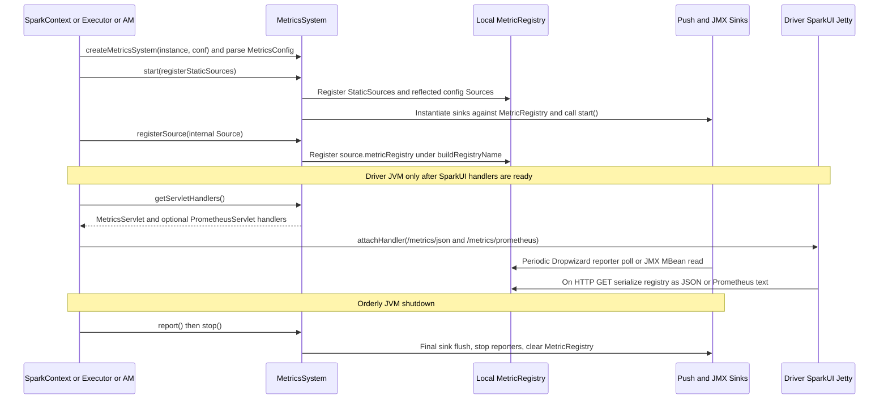

# MetricsSystem: per-JVM Dropwizard sources and sinks

[component index](README.md)

`MetricsSystem` is **not** a standalone cluster daemon, does **not** aggregate executor metrics over RPC, and does **not** power the [live Spark UI](spark-ui.md) Jobs, Stages, or Executors tables (which read `AppStatusStore` via [LiveListenerBus](listener-bus.md)). It is Spark's configurable Dropwizard (`com.codahale.metrics`) telemetry wrapper inside a JVM. On classic PySpark on YARN, **three independent `MetricsSystem` instances** run in separate roles: inside the **Driver JVM** (`SparkEnv.scala:829`), inside each **Executor JVM** (`SparkEnv.scala:835`), and inside the **YARN ApplicationMaster** (`ApplicationMaster.scala:487`). Neither the Python driver nor Python workers host a `MetricsSystem`.

## Flow at a glance

1. **Source registration**: Each JVM registers internal, static, and configured Dropwizard `Source`s into its local `MetricRegistry` under `<namespace>.<executorId>.<sourceName>`.
2. **Sink dispatch**: Configured sinks (`GraphiteSink`, `JmxSink`, `CsvSink`, `ConsoleSink`, `Slf4jSink`, `StatsdSink`) poll or expose that JVM's registry independently, with no cross-JVM rollup.
3. **Driver UI servlets**: After `metricsSystem.start()`, `SparkContext` mounts `metricsSystem.getServletHandlers` onto `SparkUI` (`/metrics/json` by default, `/metrics/prometheus` when configured).

> **Key distinction:** `MetricsSystem` is per-JVM Dropwizard telemetry, not a cluster collector. Querying `/metrics/json` on the driver UI returns only the driver JVM's `MetricRegistry`, never executor or AM registries.

> **Interactive explorer:** [Open in Spark Visualizer](https://nuthanreddy.github.io/spark-visualizer/#component=metrics-system) to step through commands, wire payloads, category filters, and fault simulations on the live cluster canvas.

## Three independent instances on YARN

Each YARN role creates its own `MetricsSystem`, its own Dropwizard `MetricRegistry`, and its own sink instances. In YARN **cluster mode**, the ApplicationMaster container JVM hosts both the `applicationMaster` instance and the `driver` instance as two separate `MetricsSystem` objects; in **client mode**, the `driver` instance runs on the submitting host while `applicationMaster` runs in the YARN AM container.

| Role (`instance`) | Where created, started, and stopped | Registry naming and built-in sources | Web servlets mounted? |
|---|---|---|---|
| **Driver** (`"driver"`) | Created in [`SparkEnv.create`][env-create] (`SparkEnv.scala:829`) without starting. Started in [`SparkContext`][sc-start] (`SparkContext.scala:705`) only after `TaskScheduler` assigns `spark.app.id`. Flushed via `report()` in [`SparkContext.stop()`][sc-report], then stopped in [`SparkEnv.stop()`][env-stop] (`SparkEnv.scala:306`). | `<spark.metrics.namespace or spark.app.id>.driver.<sourceName>`. Registers [`StaticSources`][static-sources] (`CodegenMetrics`, `HiveCatalogMetrics`) and configured `driver.source.*` / `*.source.*` when `spark.metrics.staticSources.enabled=true`, plus [`LiveListenerBus`][bus-source], `DAGSchedulerSource`, `BlockManagerSource`, `JVMCPUSource`, `ExecutorMetricsSource`, `ExecutorAllocationManagerSource` (if dynamic allocation is on), `AppStatusSource` (if enabled), and plugin sources ([driver registrations][sc-sources]). | Yes. [`SparkContext`][sc-servlets] attaches `metricsSystem.getServletHandlers` to `SparkUI` after `start()`. |
| **Executor** (`"executor"`) | Created and immediately started in [`SparkEnv.create`][env-create] (`SparkEnv.scala:835`) after setting `spark.executor.id` in `SparkConf`. Flushed via `report()` in [`Executor.stop()`][exec-stop], then stopped in [`SparkEnv.stop()`][env-stop] (`SparkEnv.scala:306`). | `<spark.metrics.namespace or spark.app.id>.<executorId>.<sourceName>`. Registers `StaticSources` and configured `executor.source.*` / `*.source.*` when `spark.metrics.staticSources.enabled=true`, plus `ExecutorSource` (thread pool, filesystem stats, task counters), `JVMCPUSource`, [`ExecutorMetricsSource`](executor-metrics-poller.md) (if enabled), and `blockManager.shuffleMetricsSource` ([executor registrations][exec-sources]). | No. Executors do not bind a `SparkUI` Jetty server, so servlet sinks are never mounted there. |
| **ApplicationMaster** (`"applicationMaster"`) | Created in [`ApplicationMaster.createAllocator`][am-create] (`ApplicationMaster.scala:487`), started with `ms.start(false)`. Flushed via `report()` and stopped in the AM's `finally` block ([AM shutdown][am-stop]). | Uses `source.sourceName` directly ([`buildRegistryName`][ms-naming]). Registers [`ApplicationMasterSource`][am-source] with `sourceName = <prefix>.applicationMaster` (`prefix` from [`spark.yarn.metrics.namespace`][yarn-ns] or `appId`), exposing `YarnAllocator` gauges (`numExecutorsFailed`, `numExecutorsRunning`, `numReleasedContainers`, `numLocalityAwareTasks`, `numContainersPendingAllocate`). Passing `registerStaticSources = false` skips `StaticSources` and reflected `*.source.*` loading (SPARK-25277) to avoid colliding with driver static sources in cluster mode. | No. The AM does not mount `MetricsSystem` servlet handlers on an HTTP server. |

Why does the driver defer `start()` while executors start inside `SparkEnv.create`? [`buildRegistryName`][ms-naming] prefixes `driver` and `executor` sources with `<metricsNamespace>.<executorId>.<sourceName>`, where `metricsNamespace` falls back to `spark.app.id`. On an executor, `spark.app.id` is already present from driver bootstrap and `SparkEnv` sets `spark.executor.id` right before creating `MetricsSystem`. On the driver, `spark.app.id` is not known until `TaskScheduler` starts (for YARN, after obtaining the YARN application ID), so `SparkEnv` creates the driver `MetricsSystem` dormant and `SparkContext` starts it once `spark.app.id` is set.

## Source -> MetricRegistry -> Sink pipeline and SparkUI mounting

1. **Parse configuration (`MetricsConfig`).** Construction calls [`metricsConfig.initialize()`][ms-config], layering settings in ascending precedence: built-in defaults (`*.sink.servlet.class=MetricsServlet`, `*.sink.servlet.path=/metrics/json`, plus Standalone master/applications paths), then the file from `spark.metrics.conf` or `metrics.properties` on the classpath ([file loader][ms-file]), then any `spark.metrics.conf.*` keys in `SparkConf`. Properties are grouped by the prefix before the first dot (`driver`, `executor`, `applicationMaster`, or wildcard `*`), and instance-specific keys inherit unset keys from `*`.
2. **Register sources (`MetricRegistry`).** Each `Source` owns its own Dropwizard `MetricRegistry` of gauges, counters, histograms, meters, or timers. [`registerSource`][ms-naming] wraps that sub-registry into `MetricsSystem.registry` under `buildRegistryName(source)`. On `start(true)`, `MetricsSystem` registers `StaticSources.allSources` and instantiates configured `source.<name>.class` entries (such as `JvmSource`) by reflection ([`registerSources`][ms-reflect]). Component-owned sources (such as `DAGSchedulerSource` or `ExecutorSource`) are registered before or after `start()`.
3. **Wire sinks and UI servlets.** [`registerSinks`][ms-reflect] inspects `sink.<name>.class` for the current instance. Two sink names receive special handling: `servlet` instantiates [`MetricsServlet`][servlet] and `prometheusServlet` instantiates [`PrometheusServlet`][prom-servlet]; neither is added to the periodic `sinks` list. Every other sink is instantiated with `(Properties, MetricRegistry)` (falling back to a 3-arg constructor passing `null` for `SecurityManager`), added to `sinks`, and started in `start()`. On the driver, `SparkContext` calls [`metricsSystem.getServletHandlers`][ms-lifecycle] (which requires `running == true`) and attaches the returned Jetty `ServletContextHandler`s to [`SparkUI`][sc-servlets].

| Sink class | Delivery mechanism | Default period or path | Notes in `dada2a6` |
|---|---|---|---|
| [`MetricsServlet`][servlet] | Pull (Jetty HTTP JSON) | `/metrics/json` (enabled by default via `MetricsConfig`) | Mounted only on the driver's `SparkUI` (and Standalone Master/Worker). Serializes the driver `MetricRegistry` on demand with Dropwizard `MetricsModule`. `sample=true` includes histogram samples. |
| [`PrometheusServlet`][prom-servlet] | Pull (Jetty HTTP text) | No default (commonly `/metrics/prometheus`) | Opt-in via `*.sink.prometheusServlet.class` and `path`. Emits `metrics_<normalized_key>*` Prometheus lines from the local `MetricRegistry`. Distinct from `SparkUI`'s built-in [`PrometheusResource`][prom-resource] (`/metrics/executors/prometheus`, enabled by [`spark.ui.prometheus.enabled=true`][ui-prom]), which reads `AppStatusStore.executorList(true)` rather than `MetricsSystem`. |
| [`GraphiteSink`][graphite] | Push (TCP or UDP) | `10 SECONDS` | Requires `host` and `port` (throws if missing). Supports `prefix`, `protocol` (`tcp` default or `udp`), and `regex` metric filter. |
| [`JmxSink`][jmx] | Pull (JMX MBeans) | On-demand (no poll timer) | Starts a Dropwizard `JmxReporter` exposing the JVM's `MetricRegistry` as platform MBeans. `report()` is a no-op. |
| [`CsvSink`][csv] | Push (local CSV files) | `10 SECONDS`, dir `/tmp/` | Writes one CSV file per metric into `directory` on the local host filesystem. |
| [`ConsoleSink`][console] | Push (stdout) | `10 SECONDS` | Prints registry snapshots to JVM stdout via `ConsoleReporter`. |
| [`Slf4jSink`][slf4j] | Push (SLF4J logger) | `10 SECONDS` | Logs registry snapshots through `Slf4jReporter` into the JVM's log stream. |
| [`StatsdSink`][statsd] | Push (UDP StatsD) | `10 SECONDS`, `127.0.0.1:8125` | Supports `prefix` and `regex` filter through `StatsdReporter`. |

Every periodic sink validates its cadence with [`MetricsSystem.checkMinimalPollingPeriod`][ms-period], rejecting anything shorter than 1 second.

## Inputs, outputs, and state

| Boundary | Contract |
|---|---|
| Inputs | `instance` string (`"driver"`, `"executor"`, `"applicationMaster"`), `SparkConf` (`spark.metrics.conf`, `spark.metrics.conf.*`, `spark.metrics.namespace`, `spark.app.id`, `spark.executor.id`, `spark.metrics.staticSources.enabled`, `spark.yarn.metrics.namespace`), optional `metrics.properties` file, and `Source` registrations. |
| Owned state | Per-JVM Dropwizard `MetricRegistry`, `sources` and `sinks` buffers, `metricsServlet: Option[MetricsServlet]`, `prometheusServlet: Option[PrometheusServlet]`, `running: Boolean`, and parsed `MetricsConfig.perInstanceSubProperties`. |
| Outputs | Periodic or on-demand exports through configured Dropwizard reporters (`GraphiteReporter`, `JmxReporter`, `CsvReporter`, `ConsoleReporter`, `Slf4jReporter`, `StatsdReporter`), plus Jetty `ServletContextHandler`s returned by `getServletHandlers` for `SparkUI`. |

## Failure clues and diagnosis

- **Driver `/metrics/json` shows no executor or AM metrics:** Expected behavior, not a sink outage. `MetricsSystem` never ships Dropwizard registries across JVMs, and only `SparkContext` mounts `getServletHandlers` onto `SparkUI`. To inspect executor or AM Dropwizard metrics, configure a push or JMX sink (`GraphiteSink`, `StatsdSink`, `Slf4jSink`, `CsvSink`, `JmxSink`) for the `executor` / `applicationMaster` (or `*`) instance, or scrape the driver's `/metrics/executors/prometheus` endpoint (backed by `AppStatusStore` and [executor heartbeats](executor-metrics-poller.md)).
- **`/metrics/prometheus` returns 404 while `/metrics/executors/prometheus` works:** `MetricsConfig.setDefaultProperties` registers `MetricsServlet` (`/metrics/json`) automatically, **not** `PrometheusServlet`. You must configure `*.sink.prometheusServlet.class=org.apache.spark.metrics.sink.PrometheusServlet` and `*.sink.prometheusServlet.path=/metrics/prometheus`. Meanwhile `/metrics/executors/prometheus` is served by `PrometheusResource` inside `SparkUI`, independent of `MetricsSystem`.
- **JVM startup fails inside `MetricsSystem.start()`:** Unlike [`registerSources`][ms-reflect] (which logs and skips broken source classes), [`registerSinks`][ms-reflect] logs and **rethrows** any sink instantiation exception, including missing Graphite `host`/`port`, an invalid Graphite `protocol`, a `ClassNotFoundException`, or a polling period below 1 second.
- **Unprefixed metric names (`Using default name ...` warning):** Logged by [`buildRegistryName`][ms-naming] if a `driver` or `executor` source is registered while `spark.app.id` (and `spark.metrics.namespace`) or `spark.executor.id` is unset.
- **Custom `metrics.properties` takes effect on the driver but not on executors:** A local filesystem path in `spark.metrics.conf` must exist at that path on every NodeManager host (or be shipped with `--files` and referenced by filename). Setting `spark.metrics.conf.<instance>.sink.*` directly in `SparkConf` avoids file distribution gaps because executors fetch `SparkConf` from the driver during bootstrap.
- **Final metrics missing for a crashed container:** Orderly shutdown calls `metricsSystem.report()` before `stop()` in [`SparkContext`][sc-report], [`Executor`][exec-stop], and [`ApplicationMaster`][am-stop]. A `SIGKILL` (such as a YARN container memory kill) skips that final flush, leaving push sinks with only the last scheduled poll before termination.

[env-create]: https://github.com/apache/spark/blob/dada2a6db5d73b152d6ba16e4fe21406f86abfe3/core/src/main/scala/org/apache/spark/SparkEnv.scala#L825-L838
[env-stop]: https://github.com/apache/spark/blob/dada2a6db5d73b152d6ba16e4fe21406f86abfe3/core/src/main/scala/org/apache/spark/SparkEnv.scala#L283-L309
[sc-start]: https://github.com/apache/spark/blob/dada2a6db5d73b152d6ba16e4fe21406f86abfe3/core/src/main/scala/org/apache/spark/SparkContext.scala#L703-L705
[sc-servlets]: https://github.com/apache/spark/blob/dada2a6db5d73b152d6ba16e4fe21406f86abfe3/core/src/main/scala/org/apache/spark/SparkContext.scala#L752-L755
[sc-sources]: https://github.com/apache/spark/blob/dada2a6db5d73b152d6ba16e4fe21406f86abfe3/core/src/main/scala/org/apache/spark/SparkContext.scala#L774-L785
[sc-report]: https://github.com/apache/spark/blob/dada2a6db5d73b152d6ba16e4fe21406f86abfe3/core/src/main/scala/org/apache/spark/SparkContext.scala#L2672-L2676
[am-create]: https://github.com/apache/spark/blob/dada2a6db5d73b152d6ba16e4fe21406f86abfe3/resource-managers/yarn/src/main/scala/org/apache/spark/deploy/yarn/ApplicationMaster.scala#L486-L493
[am-stop]: https://github.com/apache/spark/blob/dada2a6db5d73b152d6ba16e4fe21406f86abfe3/resource-managers/yarn/src/main/scala/org/apache/spark/deploy/yarn/ApplicationMaster.scala#L274-L284
[am-source]: https://github.com/apache/spark/blob/dada2a6db5d73b152d6ba16e4fe21406f86abfe3/resource-managers/yarn/src/main/scala/org/apache/spark/deploy/yarn/ApplicationMasterSource.scala#L24-L50
[exec-sources]: https://github.com/apache/spark/blob/dada2a6db5d73b152d6ba16e4fe21406f86abfe3/core/src/main/scala/org/apache/spark/executor/Executor.scala#L329-L341
[exec-stop]: https://github.com/apache/spark/blob/dada2a6db5d73b152d6ba16e4fe21406f86abfe3/core/src/main/scala/org/apache/spark/executor/Executor.scala#L651-L688
[ms-lifecycle]: https://github.com/apache/spark/blob/dada2a6db5d73b152d6ba16e4fe21406f86abfe3/core/src/main/scala/org/apache/spark/metrics/MetricsSystem.scala#L71-L120
[ms-naming]: https://github.com/apache/spark/blob/dada2a6db5d73b152d6ba16e4fe21406f86abfe3/core/src/main/scala/org/apache/spark/metrics/MetricsSystem.scala#L131-L179
[ms-reflect]: https://github.com/apache/spark/blob/dada2a6db5d73b152d6ba16e4fe21406f86abfe3/core/src/main/scala/org/apache/spark/metrics/MetricsSystem.scala#L181-L240
[ms-period]: https://github.com/apache/spark/blob/dada2a6db5d73b152d6ba16e4fe21406f86abfe3/core/src/main/scala/org/apache/spark/metrics/MetricsSystem.scala#L245-L263
[ms-config]: https://github.com/apache/spark/blob/dada2a6db5d73b152d6ba16e4fe21406f86abfe3/core/src/main/scala/org/apache/spark/metrics/MetricsConfig.scala#L42-L86
[ms-file]: https://github.com/apache/spark/blob/dada2a6db5d73b152d6ba16e4fe21406f86abfe3/core/src/main/scala/org/apache/spark/metrics/MetricsConfig.scala#L119-L150
[static-sources]: https://github.com/apache/spark/blob/dada2a6db5d73b152d6ba16e4fe21406f86abfe3/core/src/main/scala/org/apache/spark/metrics/source/StaticSources.scala#L22-L28
[bus-source]: https://github.com/apache/spark/blob/dada2a6db5d73b152d6ba16e4fe21406f86abfe3/core/src/main/scala/org/apache/spark/scheduler/LiveListenerBus.scala#L171-L183
[servlet]: https://github.com/apache/spark/blob/dada2a6db5d73b152d6ba16e4fe21406f86abfe3/core/src/main/scala/org/apache/spark/metrics/sink/MetricsServlet.scala#L32-L64
[prom-servlet]: https://github.com/apache/spark/blob/dada2a6db5d73b152d6ba16e4fe21406f86abfe3/core/src/main/scala/org/apache/spark/metrics/sink/PrometheusServlet.scala#L42-L134
[prom-resource]: https://github.com/apache/spark/blob/dada2a6db5d73b152d6ba16e4fe21406f86abfe3/core/src/main/scala/org/apache/spark/status/api/v1/PrometheusResource.scala#L38-L120
[ui-prom]: https://github.com/apache/spark/blob/dada2a6db5d73b152d6ba16e4fe21406f86abfe3/core/src/main/scala/org/apache/spark/ui/SparkUI.scala#L121-L125
[graphite]: https://github.com/apache/spark/blob/dada2a6db5d73b152d6ba16e4fe21406f86abfe3/core/src/main/scala/org/apache/spark/metrics/sink/GraphiteSink.scala#L29-L102
[jmx]: https://github.com/apache/spark/blob/dada2a6db5d73b152d6ba16e4fe21406f86abfe3/core/src/main/scala/org/apache/spark/metrics/sink/JmxSink.scala#L26-L41
[csv]: https://github.com/apache/spark/blob/dada2a6db5d73b152d6ba16e4fe21406f86abfe3/core/src/main/scala/org/apache/spark/metrics/sink/CsvSink.scala#L28-L72
[console]: https://github.com/apache/spark/blob/dada2a6db5d73b152d6ba16e4fe21406f86abfe3/core/src/main/scala/org/apache/spark/metrics/sink/ConsoleSink.scala#L27-L63
[slf4j]: https://github.com/apache/spark/blob/dada2a6db5d73b152d6ba16e4fe21406f86abfe3/core/src/main/scala/org/apache/spark/metrics/sink/Slf4jSink.scala#L27-L63
[statsd]: https://github.com/apache/spark/blob/dada2a6db5d73b152d6ba16e4fe21406f86abfe3/core/src/main/scala/org/apache/spark/metrics/sink/StatsdSink.scala#L44-L82
[yarn-ns]: https://github.com/apache/spark/blob/dada2a6db5d73b152d6ba16e4fe21406f86abfe3/resource-managers/yarn/src/main/scala/org/apache/spark/deploy/yarn/config/package.scala#L262-L266
