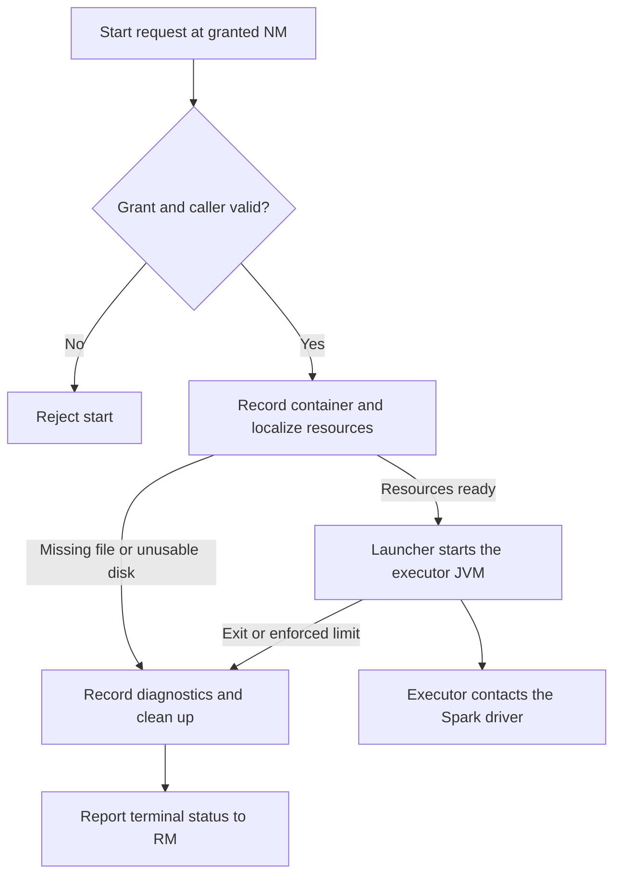

# YARN NodeManager: from a grant to a process on one worker

[component index](README.md) | [PySpark on YARN walkthrough](../pyspark-on-yarn.md)

The NodeManager (NM) turns an authorized launch request into a local process
and reports how it ended. It is a long-lived Hadoop JVM, normally one per YARN
worker, started and stopped by the cluster's service manager. The
[ResourceManager](resource-manager.md) monitors its heartbeats; the NM monitors
its own disks and container processes. It does not assign itself work or run
the Spark task scheduler.

## Flow at a glance

1. **NodeManager**: Accepts a valid executor start request for its node.
2. **Localizer**: Fails to fetch a required file from staging.
3. **NodeManager**: Reports the failed container to the ResourceManager on a heartbeat.

> **Watch for:** If localization fails, the executor never starts. Check the NodeManager's localizer log rather than the executor's stderr.

> **Interactive explorer:** [Open in Spark Visualizer](https://nuthanreddy.github.io/spark-visualizer/#component=node-manager) to step through commands, wire payloads, category filters, and fault simulations on the live cluster canvas.

## Inputs, outputs, and local state

| Boundary | Input | Output or state change |
|---|---|---|
| NM to RM: `ResourceTracker` | On startup, `NodeStatusUpdaterImpl` registers its node ID, resources, and HTTP port. Later it sends health and container statuses on `nodeHeartbeat`. | The RM learns which worker is available. Heartbeat responses may carry cleanup IDs or a resync instruction. The HTTP port is not the NM's launch RPC address. |
| RM or AM to NM: `ContainerManagementProtocol` | `startContainers` carries a container token and `ContainerLaunchContext` per start. The latter holds commands, local resource descriptors, environment, and credentials. The RM is the caller for the managed AM; the AM is the caller for executors. | `ContainerManagerImpl` checks caller authorization and the grant, including its node and expiry. It enqueues local initialization; the response lists successful requests and per-container failures, or the RPC itself can fail. Success is not a readiness probe. |
| NM to filesystem and OS | Local resource URI, type, timestamp, and visibility; command and environment; local and log directories | The localizer reuses eligible cached resources or fetches them, for example from HDFS. The launcher uses a `ContainerExecutor` to start the process. The NM tracks the container by ID and captures its exit diagnostics. |
| AM to NM, or RM via heartbeat | `getContainerStatuses` or `stopContainers` by ID; RM cleanup instructions | The NM returns statuses or schedules termination and cleanup. Final status also travels via NM heartbeat to RM and then on the AM's allocation heartbeat. |

The NM owns the worker's localized resources, working directories, and logs,
not the HDFS replicas on a colocated DataNode. If Spark's [external shuffle
service](external-shuffle-service.md) is installed as an NM auxiliary service, it can serve local
shuffle files after an executor exits. It has a separate protocol and listener;
the container-management RPC never carries shuffle blocks.

## Worked flow: why an accepted start can still fail

1. In the paid-orders job, Spark's AM receives a grant for `worker-b`. Its `ExecutorRunnable` calls the NM at the grant's `NodeId`, with a launch context that names `YarnCoarseGrainedExecutorBackend`, the driver URL, and the Spark executor ID.
2. The NM checks the request and records a node-side container. As each jar or configuration file arrives, `ContainerImpl` tracks which resources are still pending. It queues the launch only when none remain. A missing staged file can end the container **before Java starts**.
3. Once resources are ready, the local launcher starts the JVM. The executor connects to the driver; the NM does not register on its behalf. An executable that exits immediately and a JVM that cannot reach the driver therefore require different evidence.
4. The NM tracks process exit and enforces resource limits according to node configuration. For a PySpark workload, child Python processes can contribute to the container's memory usage. On completion it reports the exit status and diagnostics, cleans up container resources, and handles logs according to retention and aggregation settings.

## Diagnose at the last successful boundary

| Symptom | What to inspect |
|---|---|
| Grant exists, but no executor startup output | Look up the container ID in the NM daemon/localizer log. Check staging URI, permissions, and `yarn.nodemanager.local-dirs`; there may be no executor `stderr` if launch never happened. |
| JVM starts, but no Spark tasks arrive | Read that container's `stderr` for driver registration errors and compare the advertised driver address with the worker's network view. A successful NM start does not establish a Spark RPC connection. |
| One worker stops receiving new containers | `yarn node -status <node_id>` distinguishes an unhealthy report from a lost heartbeat. Check `yarn.nodemanager.local-dirs` and `yarn.nodemanager.log-dirs`: the NM can exclude one bad disk without declaring the entire node unhealthy. |
| Containers vanish after a worker outage | The RM can mark the node lost and Spark can replace executors; lost local shuffle files may require recomputation. A daemon restart with NM recovery configured can instead reattach to surviving containers. |

For aggregated logs use `yarn logs -applicationId <app_id>` when aggregation
is enabled; otherwise consult the worker's retained logs. Neither is the Spark
event log.

## Sources

- Hadoop 3.4.1: [NM health checks, restart, and auxiliary services](https://hadoop.apache.org/docs/r3.4.1/hadoop-yarn/hadoop-yarn-site/NodeManager.html) and [YARN application launch contracts](https://hadoop.apache.org/docs/r3.4.1/hadoop-yarn/hadoop-yarn-site/WritingYarnApplications.html).
- Hadoop 3.4.1 source: [`ContainerManagerImpl` start validation and response](https://github.com/apache/hadoop/blob/4d7825309348956336b8f06a08322b78422849b1/hadoop-yarn-project/hadoop-yarn/hadoop-yarn-server/hadoop-yarn-server-nodemanager/src/main/java/org/apache/hadoop/yarn/server/nodemanager/containermanager/ContainerManagerImpl.java#L927-L1051) and [`ContainerImpl` localization and launch transitions](https://github.com/apache/hadoop/blob/4d7825309348956336b8f06a08322b78422849b1/hadoop-yarn-project/hadoop-yarn/hadoop-yarn-server/hadoop-yarn-server-nodemanager/src/main/java/org/apache/hadoop/yarn/server/nodemanager/containermanager/container/ContainerImpl.java).
- Spark integration: [`ExecutorRunnable` builds the context and calls the NM](https://github.com/apache/spark/blob/dada2a6db5d73b152d6ba16e4fe21406f86abfe3/resource-managers/yarn/src/main/scala/org/apache/spark/deploy/yarn/ExecutorRunnable.scala#L92-L123), [including the driver URL and executor ID](https://github.com/apache/spark/blob/dada2a6db5d73b152d6ba16e4fe21406f86abfe3/resource-managers/yarn/src/main/scala/org/apache/spark/deploy/yarn/ExecutorRunnable.scala#L195-L211).
- Optional service: [`YarnShuffleService` is an NM auxiliary service, not its container manager](https://github.com/apache/spark/blob/dada2a6db5d73b152d6ba16e4fe21406f86abfe3/common/network-yarn/src/main/java/org/apache/spark/network/yarn/YarnShuffleService.java).
