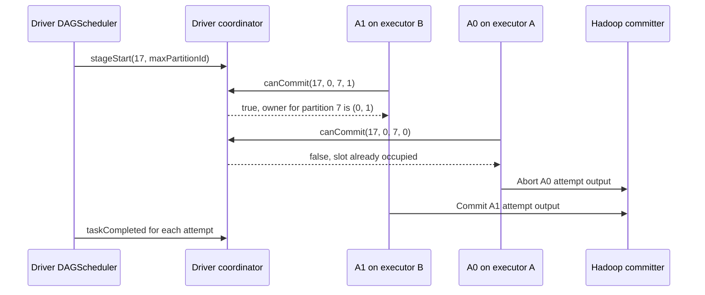

# OutputCommitCoordinator: authorizing competing task attempts

[component index](README.md)

If two attempts compute the same Spark partition, **which one may call the underlying committer?** `OutputCommitCoordinator` answers with a Boolean. It runs the decision in the **driver JVM** (inside the AM container in YARN cluster mode); an executor's `SparkEnv` holds a client with a reference to the driver's RPC endpoint. It does not accept rows, inspect file paths, rename files, or decide that the whole write succeeded. Those are responsibilities of the [writer](file-format-writer.md) and [file commit protocol](file-commit-protocol.md).

## Flow at a glance

1. **Speculative attempt A1**: Ask first to commit partition 7 of stage 17.
2. **Driver coordinator**: Grant A1 the slot for partition 7 and deny A0's later request.
3. **Executor attempts**: A1 calls the Hadoop task committer; A0 aborts its own output.

> **Key distinction:** A grant lets A1 try a task commit; the grant itself neither moves a file nor commits the job.

> **Interactive explorer:** [Open in Spark Visualizer](https://nuthanreddy.github.io/spark-visualizer/#component=output-commit-coordinator) to step through commands, wire payloads, category filters, and fault simulations on the live cluster canvas.

## Contract and lifetime

| Operation | State transition or result |
|---|---|
| `stageStart(stageId, maxPartitionId)` from `DAGScheduler` | Create `StageState` with `maxPartitionId + 1` owner slots; reuse existing state on a retry of the same stage. State is indexed by **Spark partition ID**, not by a directory such as `region=east`. |
| `canCommit(stage, stageAttempt, partition, attemptNumber)` from executor | Ask the driver endpoint and wait up to the RPC ask timeout. Under synchronization, the driver denies a known failed attempt, a request for a stage with no state, or any request for a slot that already has an owner. Otherwise set the owner to `(stageAttempt, taskAttempt)` and return `true`. |
| `taskCompleted(..., reason)` from scheduler | `Success` keeps the owner; `TaskCommitDenied` leaves it alone. Other failures are recorded per partition. Only failure of **the current owner** clears its slot. Stage attempt is part of the identity because task-attempt numbers can repeat across stage attempts. |
| `stageEnd` / driver shutdown | `DAGScheduler` ends coordinator state when the stage will not retry. Late requests cannot recreate it. Driver shutdown clears the in-memory state; this is not a persistent lock in HDFS. |

The [RPC setup][rpc], [request client][client], [synchronized decision][decision], [task completion rules][completion], and [stage teardown][teardown] show where the decision is made and when it stops applying.

## Trace: the speculative copy asks first

Assume stage 17, stage attempt 0, Spark partition 7, Hadoop `needsTaskCommit=true`, and coordination enabled. A0 (attempt 0) starts first but its speculative copy A1 (attempt 1) reaches commit first.

1. The Hadoop adapter calls `SparkHadoopMapRedUtil.commitTask`. If `needsTaskCommit` is false, it skips the physical task commit **and** the RPC. If coordination is disabled, it can call Hadoop directly. With the usual `spark.hadoop.outputCommitCoordination.enabled=true`, it asks even if speculation is off: concurrent attempts are not limited to speculation. [Caller and gates][gate].
2. The key being contested is `(stageId=17, partitionId=7)`; its value becomes `(stageAttempt=0, taskAttempt=1)`. This is **first eligible request**, not first-launched task, lowest attempt number, or first completed filesystem write. Another Spark partition writing `region=east` uses a different slot. The service does not coordinate independent jobs writing the same path.
3. After `true`, A1 can still fail in Hadoop `commitTask`. A denial makes A0 abort its attempt output and throw `CommitDeniedException`. The executor reports `KILLED` with `TaskCommitDenied`; this denial does not count toward the task failure limit. It does not reserve another turn for A0. [Executor reporting][denied], [failure accounting][reason].
4. If the scheduler instead receives an ordinary failure for A1, the driver records `(0, 1)` as failed and clears the owner. A new attempt A2 can win; a late request from failed A1 cannot. A0's denial cannot clear A1's slot. If A1 succeeds, the slot stays occupied until stage cleanup. Only later does the writer collect successful task messages and invoke filesystem **job** commit. [Scheduler callback][callback], [competing-attempt tests][tests].

## Reading the evidence

`TaskCommitDenied (Driver denied task commit)` for one attempt alongside a successful sibling is normally the race working as intended. Compare stage ID **and stage attempt**, partition ID, and task attempt number in the driver and executor logs. An RPC timeout is different: the caller did not receive a Boolean; it is not evidence that no grant was recorded. `Error committing the output of task` after a grant is a filesystem/committer failure. If every task succeeded and the driver then fails during `commitJob`, investigate the filesystem job commit, not the permission table. None of these grants guarantees exactly-once external side effects or atomic dataset visibility.

[rpc]: https://github.com/apache/spark/blob/dada2a6db5d73b152d6ba16e4fe21406f86abfe3/core/src/main/scala/org/apache/spark/SparkEnv.scala#L840-L845
[client]: https://github.com/apache/spark/blob/dada2a6db5d73b152d6ba16e4fe21406f86abfe3/core/src/main/scala/org/apache/spark/scheduler/OutputCommitCoordinator.scala#L46-L110
[decision]: https://github.com/apache/spark/blob/dada2a6db5d73b152d6ba16e4fe21406f86abfe3/core/src/main/scala/org/apache/spark/scheduler/OutputCommitCoordinator.scala#L176-L213
[completion]: https://github.com/apache/spark/blob/dada2a6db5d73b152d6ba16e4fe21406f86abfe3/core/src/main/scala/org/apache/spark/scheduler/OutputCommitCoordinator.scala#L120-L173
[teardown]: https://github.com/apache/spark/blob/dada2a6db5d73b152d6ba16e4fe21406f86abfe3/core/src/main/scala/org/apache/spark/scheduler/DAGScheduler.scala#L5113-L5122
[gate]: https://github.com/apache/spark/blob/dada2a6db5d73b152d6ba16e4fe21406f86abfe3/core/src/main/scala/org/apache/spark/mapred/SparkHadoopMapRedUtil.scala#L41-L102
[denied]: https://github.com/apache/spark/blob/dada2a6db5d73b152d6ba16e4fe21406f86abfe3/core/src/main/scala/org/apache/spark/executor/Executor.scala#L1096-L1100
[reason]: https://github.com/apache/spark/blob/dada2a6db5d73b152d6ba16e4fe21406f86abfe3/core/src/main/scala/org/apache/spark/TaskEndReason.scala#L236-L253
[callback]: https://github.com/apache/spark/blob/dada2a6db5d73b152d6ba16e4fe21406f86abfe3/core/src/main/scala/org/apache/spark/scheduler/DAGScheduler.scala#L3904-L3915
[tests]: https://github.com/apache/spark/blob/dada2a6db5d73b152d6ba16e4fe21406f86abfe3/core/src/test/scala/org/apache/spark/scheduler/OutputCommitCoordinatorSuite.scala#L172-L241
