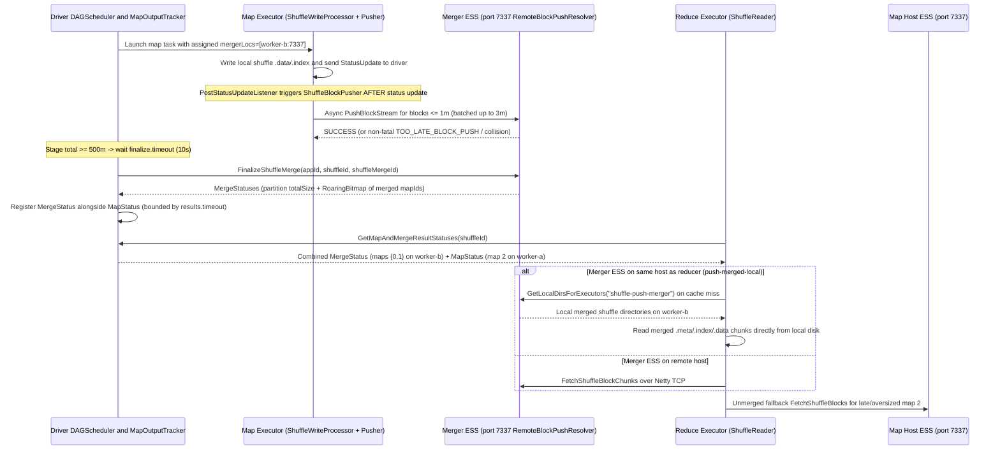

# Push-based shuffle: best-effort ESS merging and fallback reads

[component index](README.md)

Push-based shuffle is **not** a replacement for local sort-based shuffle writes and does **not** eliminate original map output files. It is an optional, best-effort optimization on YARN with **External Shuffle Service (ESS) ON** (`spark.shuffle.service.enabled=true`) that converts large numbers of small random shuffle reads into sequential merged chunk reads. After a map task writes its local shuffle `.data`/`.index` files and reports completion to the driver, `ShuffleBlockPusher` asynchronously streams small per-reducer blocks (`<= 1m` default) to driver-assigned ESS merger hosts running `RemoteBlockPushResolver`, which append them into per-partition merged `.data`/`.index`/`.meta` files. Reducers read merged chunks sequentially (using `push-merged-local` disk reads when co-located with the merger ESS, or remote `FetchShuffleBlockChunks`) and automatically fall back to original unmerged blocks for any oversized, colliding, or late-pushed map output.

## Flow at a glance

1. **ESS + client activation and merger selection**: Requires **ESS ON**, ESS-side `spark.shuffle.push.server.mergedShuffleFileManagerImpl=org.apache.spark.network.shuffle.RemoteBlockPushResolver` (overriding default no-op `NoOpMergedShuffleFileManager`), `spark.shuffle.push.enabled=true`, `spark.io.encryption.enabled=false`, and a relocation-capable serializer. `DAGScheduler` obtains merger ESS hosts from `YarnSchedulerBackend`.
2. **Post-status-update push and ESS merge**: `ShuffleWriteProcessor` registers a `PostStatusUpdateListener` so `ShuffleBlockPusher.initiateBlockPush()` starts only **after** the map task finishes writing and sends its status update. Blocks `<= spark.shuffle.push.maxBlockSizeToPush` (`1m` default) stream over `PushBlockStream` to `RemoteBlockPushResolver`; pushes arriving after finalize get non-fatal `TOO_LATE_BLOCK_PUSH`.
3. **Merge finalization and dual-path reducer reads**: When total stage shuffle size `>= spark.shuffle.push.minShuffleSizeToWait` (`500m` default), `DAGScheduler` waits `spark.shuffle.push.finalize.timeout` before sending `FinalizeShuffleMerge` and bounds reply wait by `spark.shuffle.push.results.timeout`, storing two-layer `MergeStatus` bitmaps in `MapOutputTrackerMaster`. Reducers fetch combined statuses via `GetMapAndMergeResultStatuses`, reading same-host mergers via `push-merged-local` (`shuffle-push-merger` dir lookup + local disk read) and missing maps via standard `FetchShuffleBlocks` fallback.

> **Key distinction:** Push-based shuffle requires **ESS ON** (the exact opposite of YARN [`BlockManagerDecommissioner`](block-manager-decommissioner.md), which requires ESS OFF) AND server-side `RemoteBlockPushResolver` configured on every NodeManager ESS. Pushes are best-effort and triggered **after** map status reporting; `MergeStatus` on the driver tracks only partition totals and a roaring bitmap of merged map indices, while chunk offsets and sizes stay in `.meta`/`.index` files on the merger ESS.

> **Interactive explorer:** [Open in Spark Visualizer](https://nuthanreddy.github.io/spark-visualizer/#component=push-based-shuffle) to step through commands, wire payloads, category filters, and fault simulations on the live cluster canvas.

## Activation prerequisites and config gates

[`Utils.isPushBasedShuffleEnabled`][utils-pbs] enforces all client-side preconditions (logging a warning and silently falling back to regular shuffle if any fail), while [`YarnShuffleService.newMergedShuffleFileManagerInstance`][ess-mgr] loads the server-side merger implementation inside each NodeManager ESS:

| Scope | Required setting / condition | Default / failure consequence |
|---|---|---|
| **ESS (NodeManager `yarn-site.xml`)** | `spark.shuffle.push.server.mergedShuffleFileManagerImpl = org.apache.spark.network.shuffle.RemoteBlockPushResolver` | Defaults to [`NoOpMergedShuffleFileManager`][ess-mgr], silently disabling server-side merge even when client flags are on. |
| **Client (`SparkConf`)** | `spark.shuffle.service.enabled=true`, `spark.master=yarn`, `spark.shuffle.push.enabled=true` | Disabled (`false`) by default; non-YARN or ESS OFF disables push-based shuffle with a warning. |
| **Encryption & serializer** | `spark.io.encryption.enabled=false` and a serializer with `supportsRelocationOfSerializedObjects == true` (e.g. `KryoSerializer` or `UnsafeRowSerializer`) | Enabling I/O encryption or using a non-relocatable serializer disables push-based shuffle ([`Utils.scala:2638-2673`][utils-pbs]). |
| **Merger count thresholds** | Active merger count `>= max(mergersMinStaticThreshold, ceil(numPartitions * mergersMinThresholdRatio))` | Defaults `5` and `0.05` ([`config/package.scala:2981-3005`][pbs-confs]); small clusters (e.g. 2 workers) must lower these so [`YarnSchedulerBackend.getShufflePushMergerLocations`][yarn-mergers] activates merging. |
| **Per-block and stage size gates** | Per-block `<= spark.shuffle.push.maxBlockSizeToPush` (default **`1m`**, [`ShuffleBlockPusher.scala:424-448`][pusher-elig]); stage total `>= spark.shuffle.push.minShuffleSizeToWait` (default **`500m`**, [`DAGScheduler.scala:3640-3644`][dag-wait]) | Blocks `> 1m` are never pushed (read unmerged). Stages `< 500m` call `scheduleShuffleMergeFinalize(delay = 0, registerMergeResults = false)` immediately without waiting. |
| **Finalize vs results timeouts** | `spark.shuffle.push.finalize.timeout` (default `10s`) vs `spark.shuffle.push.results.timeout` (default `10s`, [`config/package.scala:2949-2970`][pbs-confs]) | `finalize.timeout` is how long the driver waits **before** sending `FinalizeShuffleMerge`; `results.timeout` bounds how long it waits **for** merger replies before starting reducers. |

## Post-status push, two-layer `MergeStatus`, and `push-merged-local` reads

Four design boundaries distinguish push-based shuffle from standard sort shuffle:

1. **Deferred push via `PostStatusUpdateListener`**: Inside [`ShuffleWriteProcessor.write`][swp-push], Spark deliberately does **not** push from inside `SortShuffleWriter`. Instead, it registers a `PostStatusUpdateListener` on `TaskContext` so [`ShuffleBlockPusher.initiateBlockPush()`][pusher-init] fires only after the task result status update has been sent to the driver, ensuring speculative duplicates cannot silently merge stale data ahead of driver tracking. Push I/O runs asynchronously on `BLOCK_PUSHER_POOL` and never fails the map task.
2. **Non-fatal rejection & intact local fallback**: On the ESS, [`RemoteBlockPushResolver.receiveBlockDataAsStream()`][resolver-recv] drains and rejects late pushes arriving after [`finalizeShuffleMerge()`][resolver-fin] with `TOO_LATE_BLOCK_PUSH` (and older attempts with `TOO_OLD_ATTEMPT_PUSH`) while keeping the shared Netty channel alive for other active shuffles. Original unmerged files remain intact on the mapper host's ESS.
3. **Two-layer metadata split (`MergeStatus` vs ESS `.meta`/`.index`)**: Per [`MergeStatus.scala`][merge-status], the driver's `MergeStatus` records only `location`, `shuffleMergeId`, `mapTracker: RoaringBitmap`, and partition `totalSize`. Per-chunk offsets and chunk sizes live exclusively in the per-partition `.meta` and `.index` files on the merger ESS so driver memory does not grow with chunk count.
4. **Reducer fetch routing (`GetMapAndMergeResultStatuses` and `push-merged-local`)**: When `dependency.isShuffleMergeFinalizedMarked` is `true`, [`SortShuffleManager.getReader()`][sort-reader] calls `mapOutputTracker.getPushBasedShuffleMapSizesByExecutorId()`, sending [`GetMapAndMergeResultStatuses`][mot-rpc] instead of `GetMapOutputStatuses`. In [`ShuffleBlockFetcherIterator`][sbfi-local], if the merger `BlockManagerId` shares the reducer's host, Spark routes the blocks to `pushMergedLocalBlocks`: on first-lookup cache miss, `HostLocalDirManager` sends `GetLocalDirsForExecutors` with `"shuffle-push-merger"` ([`ExternalBlockHandler.java:246-253`][ebh-dirs]) to the local ESS and reads merged chunks straight off local disk. Remote mergers serve `FetchShuffleBlockChunks`, while any map absent from the `RoaringBitmap` (late, oversized `> 1m`, or failed push) is fetched via standard `FetchShuffleBlocks` fallback.

## Inputs, outputs, and state

| Boundary | Contract |
|---|---|
| Inputs | Completed local shuffle `.data`/`.index` files, `YarnSchedulerBackend` ESS merger `BlockManagerId` list, client `spark.shuffle.push.*` configs (`enabled`, `maxBlockSizeToPush=1m`, `maxBlockBatchSize=3m`, `minShuffleSizeToWait=500m`, `finalize.timeout=10s`, `results.timeout=10s`), and NodeManager ESS `mergedShuffleFileManagerImpl=RemoteBlockPushResolver`. |
| Owned state | Executor `ShuffleBlockPusher` bounded in-flight push queues (`BLOCK_PUSHER_POOL`); ESS `RemoteBlockPushResolver` per-`(appId, shuffleId, reduceId)` `AppShufflePartitionInfo` open `.data`/`.index`/`.meta` files and `RoaringBitmap`; driver `MapOutputTrackerMaster` dual `MapStatus` + `MergeStatus` registries; reducer `HostLocalDirManager` cache for `shuffle-push-merger` directories. |
| Outputs | Sequential merged shuffle files (`shuffleMerged_<shuffleId>_<mergeId>_<reduceId>.{data,index,meta}`) on merger ESS hosts, `MergeStatus` bitmaps registered in `MapOutputTrackerMaster`, `ShuffleReadMetrics` (`remoteMergedBlocksFetched`, `localMergedBlocksFetched`, `mergedFetchFallbackCount`), and seamless unmerged fallback reads. |

## Failure clues and diagnosis

- **Zero merged blocks fetched (`remoteMergedBlocksFetched == 0`, `localMergedBlocksFetched == 0`) with no job errors:** Check four common causes in order: (1) NodeManager ESS is missing `spark.shuffle.push.server.mergedShuffleFileManagerImpl=org.apache.spark.network.shuffle.RemoteBlockPushResolver` (left on default `NoOpMergedShuffleFileManager`); (2) driver logs show the `Utils.isPushBasedShuffleEnabled` warning (ESS disabled, `spark.io.encryption.enabled=true`, or non-relocatable serializer); (3) available merger ESS hosts are below `max(mergersMinStaticThreshold, numPartitions * mergersMinThresholdRatio)`; or (4) total stage shuffle bytes fell below `spark.shuffle.push.minShuffleSizeToWait` (`500m`), causing immediate finalize with `registerMergeResults=false`.
- **High `TOO_LATE_BLOCK_PUSH` counts and high `mergedFetchFallbackCount`:** Map pushes did not finish before `DAGScheduler` sent `FinalizeShuffleMerge` after `spark.shuffle.push.finalize.timeout` (`10s`). This is non-fatal (reducers fall back to original map blocks), but indicates network/disk saturation on mergers or a too-short `finalize.timeout`.
- **Large individual partitions never appear in merged chunks:** Expected for any partition block larger than `spark.shuffle.push.maxBlockSizeToPush` (default `1m`, [`ShuffleBlockPusher.scala:424-448`][pusher-elig]); large blocks are already sequential enough to fetch directly from the mapper ESS without extra network writes.
- **Cannot enable both Push-Based Shuffle and YARN executor decommission on the same job:** Push-based shuffle requires `spark.shuffle.service.enabled=true`, whereas [`YarnAllocator`](block-manager-decommissioner.md) disables YARN `DECOMMISSIONING` node handling whenever `spark.shuffle.service.enabled=true` (SPARK-39018). Choose ESS + Push-Based Shuffle or ESS OFF + `BlockManagerDecommissioner` per workload.

[utils-pbs]: https://github.com/apache/spark/blob/dada2a6db5d73b152d6ba16e4fe21406f86abfe3/core/src/main/scala/org/apache/spark/util/Utils.scala#L2638-L2673
[ess-mgr]: https://github.com/apache/spark/blob/dada2a6db5d73b152d6ba16e4fe21406f86abfe3/common/network-yarn/src/main/java/org/apache/spark/network/yarn/YarnShuffleService.java#L358-L378
[pbs-confs]: https://github.com/apache/spark/blob/dada2a6db5d73b152d6ba16e4fe21406f86abfe3/core/src/main/scala/org/apache/spark/internal/config/package.scala#L2938-L3072
[yarn-mergers]: https://github.com/apache/spark/blob/dada2a6db5d73b152d6ba16e4fe21406f86abfe3/resource-managers/yarn/src/main/scala/org/apache/spark/scheduler/cluster/YarnSchedulerBackend.scala#L181-L210
[swp-push]: https://github.com/apache/spark/blob/dada2a6db5d73b152d6ba16e4fe21406f86abfe3/core/src/main/scala/org/apache/spark/shuffle/ShuffleWriteProcessor.scala#L74-L115
[pusher-init]: https://github.com/apache/spark/blob/dada2a6db5d73b152d6ba16e4fe21406f86abfe3/core/src/main/scala/org/apache/spark/shuffle/ShuffleBlockPusher.scala#L105-L175
[pusher-elig]: https://github.com/apache/spark/blob/dada2a6db5d73b152d6ba16e4fe21406f86abfe3/core/src/main/scala/org/apache/spark/shuffle/ShuffleBlockPusher.scala#L420-L465
[resolver-recv]: https://github.com/apache/spark/blob/dada2a6db5d73b152d6ba16e4fe21406f86abfe3/common/network-shuffle/src/main/java/org/apache/spark/network/shuffle/RemoteBlockPushResolver.java#L644-L715
[resolver-fin]: https://github.com/apache/spark/blob/dada2a6db5d73b152d6ba16e4fe21406f86abfe3/common/network-shuffle/src/main/java/org/apache/spark/network/shuffle/RemoteBlockPushResolver.java#L762-L810
[dag-wait]: https://github.com/apache/spark/blob/dada2a6db5d73b152d6ba16e4fe21406f86abfe3/core/src/main/scala/org/apache/spark/scheduler/DAGScheduler.scala#L3625-L3650
[merge-status]: https://github.com/apache/spark/blob/dada2a6db5d73b152d6ba16e4fe21406f86abfe3/core/src/main/scala/org/apache/spark/scheduler/MergeStatus.scala#L39-L58
[sort-reader]: https://github.com/apache/spark/blob/dada2a6db5d73b152d6ba16e4fe21406f86abfe3/core/src/main/scala/org/apache/spark/shuffle/sort/SortShuffleManager.scala#L120-L145
[mot-rpc]: https://github.com/apache/spark/blob/dada2a6db5d73b152d6ba16e4fe21406f86abfe3/core/src/main/scala/org/apache/spark/MapOutputTracker.scala#L583-L635
[ebh-dirs]: https://github.com/apache/spark/blob/dada2a6db5d73b152d6ba16e4fe21406f86abfe3/common/network-shuffle/src/main/java/org/apache/spark/network/shuffle/ExternalBlockHandler.java#L243-L256
[sbfi-local]: https://github.com/apache/spark/blob/dada2a6db5d73b152d6ba16e4fe21406f86abfe3/core/src/main/scala/org/apache/spark/storage/ShuffleBlockFetcherIterator.scala#L411-L435
