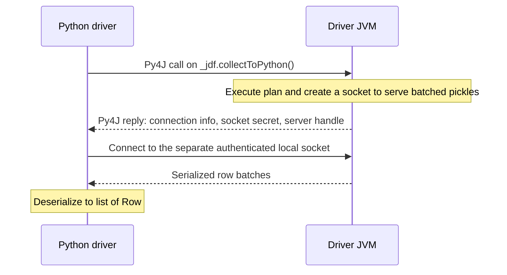

# Py4J gateway: the local Python-to-JVM bridge

[component index](README.md)

Classic PySpark uses Py4J so the [Python driver](python-driver.md) can invoke methods on
live objects in the [driver JVM](spark-driver.md). A Python `_jsc` or `_jdf` is a handle
to a JVM object, not a copy of a context or dataset. The [JVM listener][server] binds
**loopback**: inside the AM container in YARN cluster mode, on the submit host in client
mode. Executors do not connect to this port. Their messages use [Spark RPC](rpc-env.md);
executor-side Python workers have a different protocol. Spark Connect's remote session
is not this bridge.

## Flow at a glance

1. **Python DataFrame**: Calls collectToPython on the driver JVM through Py4J.
2. **Driver JVM**: Returns connection details for a separate data socket.
3. **Python driver**: Reads row batches from that socket into a list.

> **Key distinction:** A successful Py4J call tests the local bridge, not the executors' route to the driver.

Show the animated flow

## Bootstrap and lifetime

1. **JVM publishes connection details.** For a submitted `.py` file, `deploy.PythonRunner`
   creates `Py4JServer(SparkConf)`. The server generates an authentication secret and
   requests Java port `0` (an ephemeral port). With `PYSPARK_PIN_THREAD=true`, the default,
   it uses `ClientServer` to preserve Python/JVM thread affinity; otherwise it uses
   `GatewayServer`. The runner [joins the initialization thread][order] before
   [passing the actual port and secret][handoff] in the child's environment.
2. **Python attaches.** Under a lock, [`SparkContext._ensure_initialized`][cache] caches
   the gateway and its `jvm` view. Despite the name `launch_gateway(conf)`, when
   `PYSPARK_GATEWAY_PORT` exists the [attach branch][attach] reads the integer port and
   secret and **spawns nothing**. It builds the corresponding authenticated `ClientServer`
   or `JavaGateway`, imports JVM class names, and returns the gateway. A caller needing
   JVM-to-Python callbacks can [start a separate callback listener][client].
3. **Use and release.** Each call names a JVM target, method, and arguments. A scalar
   can come back as a Python value; an object can come back as a proxy for the next call.
   For a submitted script [the runner closes the listener after the child exits][cleanup].
   Stopping the SparkContext does not itself close that listener.

## One action, two local channels

Compare the [Python call sites][calls] for `_jdf.count()` (a scalar) and `DataFrame.collect()`
(a `list[Row]`). For `collect`, the [JVM method][collect] returns an
[`Array[Any]` describing where to read][shape]. A [separate data socket][socket] carries
the row batches over loopback, or over a Unix-domain socket when configured and supported.
The rows are not one Py4J reply per record.

## Diagnostic: `JAVA_GATEWAY_EXITED` is a different bootstrap

When Python starts first (for example a classic PySpark shell) and has **no** supplied
port, [`launch_gateway` starts `spark-submit`][fallback], then reads a connection-info file.
The [JVM publisher][publisher] writes the port and length-prefixed UTF-8 secret to a
temporary file and renames it into place; it watches stdin for the parent to exit.
`JAVA_GATEWAY_EXITED` is raised in this branch if no connection file was published when
the wait ends. Inspect that spawned JVM's startup output. In the ordinary
`spark-submit orders.py` attach branch, a refusal on the inherited port points instead
to the local driver JVM/listener, not executor-facing networking. Do not print the
gateway secret when checking the environment.

[server]: https://github.com/apache/spark/blob/dada2a6db5d73b152d6ba16e4fe21406f86abfe3/core/src/main/scala/org/apache/spark/api/python/Py4JServer.scala#L28-L69
[order]: https://github.com/apache/spark/blob/dada2a6db5d73b152d6ba16e4fe21406f86abfe3/core/src/main/scala/org/apache/spark/deploy/PythonRunner.scala#L60-L74
[handoff]: https://github.com/apache/spark/blob/dada2a6db5d73b152d6ba16e4fe21406f86abfe3/core/src/main/scala/org/apache/spark/deploy/PythonRunner.scala#L103-L109
[cache]: https://github.com/apache/spark/blob/dada2a6db5d73b152d6ba16e4fe21406f86abfe3/python/pyspark/core/context.py#L442-L465
[attach]: https://github.com/apache/spark/blob/dada2a6db5d73b152d6ba16e4fe21406f86abfe3/python/pyspark/java_gateway.py#L53-L64
[client]: https://github.com/apache/spark/blob/dada2a6db5d73b152d6ba16e4fe21406f86abfe3/python/pyspark/java_gateway.py#L139-L196
[cleanup]: https://github.com/apache/spark/blob/dada2a6db5d73b152d6ba16e4fe21406f86abfe3/core/src/main/scala/org/apache/spark/deploy/PythonRunner.scala#L119-L131
[calls]: https://github.com/apache/spark/blob/dada2a6db5d73b152d6ba16e4fe21406f86abfe3/python/pyspark/sql/classic/dataframe.py#L508-L530
[collect]: https://github.com/apache/spark/blob/dada2a6db5d73b152d6ba16e4fe21406f86abfe3/sql/core/src/main/scala/org/apache/spark/sql/classic/Dataset.scala#L2204-L2213
[socket]: https://github.com/apache/spark/blob/dada2a6db5d73b152d6ba16e4fe21406f86abfe3/core/src/main/scala/org/apache/spark/security/SocketAuthServer.scala#L53-L95
[shape]: https://github.com/apache/spark/blob/dada2a6db5d73b152d6ba16e4fe21406f86abfe3/core/src/main/scala/org/apache/spark/security/SocketAuthServer.scala#L162-L176
[fallback]: https://github.com/apache/spark/blob/dada2a6db5d73b152d6ba16e4fe21406f86abfe3/python/pyspark/java_gateway.py#L57-L120
[publisher]: https://github.com/apache/spark/blob/dada2a6db5d73b152d6ba16e4fe21406f86abfe3/core/src/main/scala/org/apache/spark/api/python/PythonGatewayServer.scala#L34-L76
