# Python driver: the main script and its JVM launcher

[component index](README.md)

For `spark-submit --master yarn ... orders.py 2026-11`, one Python interpreter runs
`orders.py` for this driver attempt. It reads arguments, executes ordinary Python code,
builds Spark operations, and receives action results or exceptions. It is **not** the
[driver JVM](spark-driver.md) or a Python worker processing an executor partition.
This classic PySpark launcher is `org.apache.spark.deploy.PythonRunner`, not the
[executor-side `org.apache.spark.api.python.PythonRunner`](python-runner.md) or Spark Connect.

## Flow at a glance

1. **Main script**: Defines a function to map over an RDD.
2. **Python driver**: Serializes the function and its captured values.
3. **Python worker**: Applies that function to records in its partition.

> **Key distinction:** The main script runs once per driver attempt, not once per partition.

> **Interactive explorer:** [Open in Spark Visualizer](https://nuthanreddy.github.io/spark-visualizer/#component=python-driver) to step through commands, wire payloads, category filters, and fault simulations on the live cluster canvas.

## Invocation contract

| Invoker | Input to `deploy.PythonRunner.main(args: Array[String])` | Where the script runs |
|---|---|---|
| `SparkSubmit`, client mode | Local primary script, local `--py-files` list, then application arguments | Child of the submit-side JVM, on the client host |
| AM user thread, cluster mode | Localized primary `.py` name, `""`, then application arguments. The empty second argument is intentional: the YARN client already prepared the launch `PYTHONPATH`. | Child of the AM/driver JVM, in the AM container |

The child sees the script as `sys.argv[0]` and `2026-11` as `sys.argv[1]`; the dependency
list is a **launcher** argument, not a script argument. Compare [client selection][client]
with [cluster submission][cluster], [AM argument construction][am-args], and
[YARN's localized Python path][yarn-path].

## What the launcher and script do, in order

1. **Choose the executable.** The JVM [checks in order][select]: `spark.pyspark.driver.python`,
   `spark.pyspark.python`, `PYSPARK_DRIVER_PYTHON`, `PYSPARK_PYTHON`, then `python3`.
   That interpreter must exist where the child will run. The runner [normalizes local
   paths][paths]: readable loose `.py` dependencies go into an importable directory;
   archives can be path entries themselves.
2. **Prepare the child.** The runner starts the authenticated local
   [Py4J gateway](py4j-gateway.md), waits for its port, then [builds the command][bootstrap]
   `ProcessBuilder([pythonExec, script, ...appArgs])`. Its `PYTHONPATH` combines resolved
   dependencies, Spark's Python path, and the inherited path. The [child environment][child-env]
   enables unbuffered output and supplies `PYSPARK_GATEWAY_PORT` and `PYSPARK_GATEWAY_SECRET`.
   The script attaches to this JVM rather than launching another.
3. **Run the application.** The [Python builder][session] returns a [SparkSession](spark-session.md)
   backed by a JVM session and [application context](spark-context.md). For example,
   `orders.where("status = 'PAID'").count()` calls [`_jdf.count()`][count] and returns a
   Python `int`. For a Python RDD function, by contrast, the driver [serializes the function
   and its serializers][rdd-command] into a `SimplePythonFunction` for distributed work.
   It does not rerun the main script for each partition.
4. **Propagate completion.** The JVM [merges the child's stderr into stdout, forwards it
   to its own stdout, and waits][exit]. Exit `0` lets `main` return `Unit`; a nonzero
   status becomes `SparkUserAppException(exitCode)`. The runner closes the gateway in
   `finally`. In cluster mode the [AM handles the user-thread outcome][outcome]; before
   registration its [early failure rule][early] can replace the child's exact exit code.

## Diagnostic: an import fails on the driver

If `orders.py` imports `order_rules` before constructing a session and raises
`ModuleNotFoundError`, find the **first Python traceback** in the AM container's stdout
(cluster) or submit process output (client). Check the chosen driver interpreter and
distributed module/archive on that host. Changing executor dependencies alone cannot fix
this failure: no partition has executed. A later AM message about context initialization
or user exit describes the consequence, not the missing module.

[client]: https://github.com/apache/spark/blob/dada2a6db5d73b152d6ba16e4fe21406f86abfe3/core/src/main/scala/org/apache/spark/deploy/SparkSubmit.scala#L568-L578
[cluster]: https://github.com/apache/spark/blob/dada2a6db5d73b152d6ba16e4fe21406f86abfe3/core/src/main/scala/org/apache/spark/deploy/SparkSubmit.scala#L824-L842
[am-args]: https://github.com/apache/spark/blob/dada2a6db5d73b152d6ba16e4fe21406f86abfe3/resource-managers/yarn/src/main/scala/org/apache/spark/deploy/yarn/ApplicationMaster.scala#L741-L768
[yarn-path]: https://github.com/apache/spark/blob/dada2a6db5d73b152d6ba16e4fe21406f86abfe3/resource-managers/yarn/src/main/scala/org/apache/spark/deploy/yarn/Client.scala#L984-L1019
[select]: https://github.com/apache/spark/blob/dada2a6db5d73b152d6ba16e4fe21406f86abfe3/core/src/main/scala/org/apache/spark/deploy/PythonRunner.scala#L42-L58
[paths]: https://github.com/apache/spark/blob/dada2a6db5d73b152d6ba16e4fe21406f86abfe3/core/src/main/scala/org/apache/spark/deploy/PythonRunner.scala#L141-L201
[bootstrap]: https://github.com/apache/spark/blob/dada2a6db5d73b152d6ba16e4fe21406f86abfe3/core/src/main/scala/org/apache/spark/deploy/PythonRunner.scala#L60-L86
[child-env]: https://github.com/apache/spark/blob/dada2a6db5d73b152d6ba16e4fe21406f86abfe3/core/src/main/scala/org/apache/spark/deploy/PythonRunner.scala#L97-L119
[session]: https://github.com/apache/spark/blob/dada2a6db5d73b152d6ba16e4fe21406f86abfe3/python/pyspark/sql/session.py#L575-L588
[count]: https://github.com/apache/spark/blob/dada2a6db5d73b152d6ba16e4fe21406f86abfe3/python/pyspark/sql/classic/dataframe.py#L505-L510
[rdd-command]: https://github.com/apache/spark/blob/dada2a6db5d73b152d6ba16e4fe21406f86abfe3/python/pyspark/core/rdd.py#L5106-L5136
[exit]: https://github.com/apache/spark/blob/dada2a6db5d73b152d6ba16e4fe21406f86abfe3/core/src/main/scala/org/apache/spark/deploy/PythonRunner.scala#L119-L131
[outcome]: https://github.com/apache/spark/blob/dada2a6db5d73b152d6ba16e4fe21406f86abfe3/resource-managers/yarn/src/main/scala/org/apache/spark/deploy/yarn/ApplicationMaster.scala#L760-L795
[early]: https://github.com/apache/spark/blob/dada2a6db5d73b152d6ba16e4fe21406f86abfe3/resource-managers/yarn/src/main/scala/org/apache/spark/deploy/yarn/ApplicationMaster.scala#L377-L393
