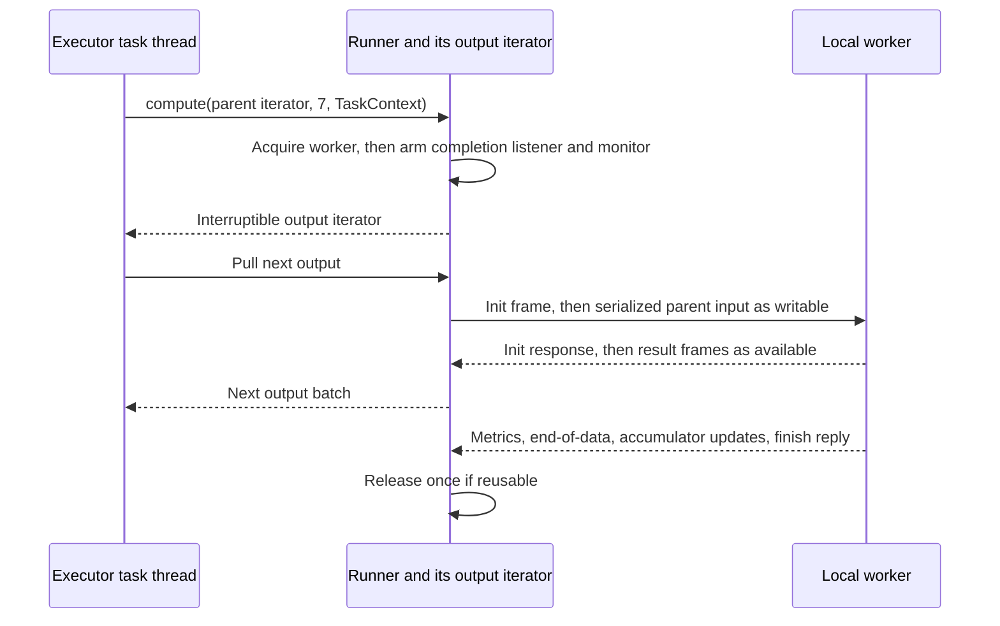

# BasePythonRunner: the executor JVM's side of a Python invocation

[component index](README.md)

`org.apache.spark.api.python.BasePythonRunner[IN, OUT]` turns an executor-side partition iterator into another iterator by exchanging data with a [local Python worker](python-worker.md). It is **not** [`org.apache.spark.deploy.PythonRunner`][driver], the launcher that starts the application script and sets up the classic driver's Py4J gateway. A SQL query or RDD action can use many executor-side runner invocations without starting another Python driver.

## Flow at a glance

1. **Executor runner**: The runner gets a local worker and gives the task an output iterator.
2. **Socket exchange**: As the task pulls output, the runner feeds input and reads results over the same socket.
3. **Clean finish**: The runner releases a reusable worker only after reading its final reply.

> **Watch for:** If the task stops reading early, cleanup closes the connection instead of returning the worker to the pool.

Show the animated flow

## Entry points and ownership

| Caller or peer | Interface |
|---|---|
| `PythonRDD.compute` | Creates `api.python.PythonRunner` for this split and calls `compute(parent.iterator, split.index, context)`. This concrete subclass uses `NON_UDF` and byte-array records/batches. The `PythonFunction` carries command bytes, executable/version, environment, includes, broadcast references, and an accumulator. [RDD entry][rdd]. |
| SQL Python operator | For example, `BatchEvalPythonExec` prepares pickled input batches and calls a SQL runner with `SQL_BATCHED_UDF`, argument metadata, and metrics. The base class supplies the lifecycle; subclass writers/readers define the command and data encoding. [SQL entry][sql]. |
| `SparkEnv` and [worker factory](python-worker-factory.md) | Acquire a worker for the effective executable/modules/environment; release it after a clean finish or close it on task cleanup. The factory and process may outlive `compute`; the `Writer`, `ReaderIterator`, and cancellation state belong to this invocation. |

## Trace: pull split 7 through a Python `mapPartitions`

1. `compute` derives executor-local settings (including local directories, task CPU allocation, and worker memory when specified) before obtaining the worker. It registers a task-completion listener and a cancellation monitor. It returns an `InterruptibleIterator`, **not** a materialized partition or a future for one. [Acquire and construct iterator][acquire].
2. `Writer.open` prepares a `START_OF_INIT_MESSAGE` frame: byte length, split index, Python version, task context, SparkFiles/includes, per-worker broadcast changes, eval type, runner/eval configuration, and command. The frame length covers the payload; input records follow separately. Broadcast IDs already installed for this worker need not be resent. [Header start][header-start], [header finish][header-end], [broadcast differences][broadcasts].
3. In the ordinary RDD path, pulling output drives a **non-blocking selector** on the task thread: read available output, feed buffered parent input when writable. On input exhaustion the RDD writer emits `END_OF_DATA_SECTION`, then `Writer.close` emits `END_OF_STREAM`. This allows progress in both directions without materializing the partition. Do not infer a dedicated writer thread for every task: at this revision the optional pipelined mode applies to UDF eval types, not `NON_UDF`, and uses a blocking channel and separate JVM writer. [Selector loop][selector], [buffering][buffer], [pipelined branch][pipeline].
4. `ReaderIterator` checks `START_OF_INIT_RESPONSE` before decoding any result. The RDD reader treats a nonnegative length as data and negative control values as metrics, Python exception, or end-of-data. It consumes accumulator updates and the worker's final reply before returning the process to the pool. `releasedOrClosed.compareAndSet(false, true)` prevents task cleanup from closing a reusable worker already handed to someone else. If the consumer stops early, the completion listener closes the unreleased channel. [Reader and metrics][reader], [RDD frames][frames], [terminal actions][terminal].

## If a task stalls or fails

Use the executor log's task identifier: `Times: total ... boot ... init ... finish` separates startup/initialization from time after init. A Python traceback in an init response points to worker setup or command loading; one after successful init points into input processing, user code, or result serialization. An I/O exception with a recorded writer failure can instead be **an upstream iterator failure**: inspect the earlier cause before blaming Python.

For cancellation, the monitor waits for an interrupted yet incomplete task, then can destroy its worker after `spark.python.task.killTimeout`. This is different from an optional idle I/O timeout and from eviction of an already released worker by the factory. See [error selection and cancellation][errors].

[driver]: https://github.com/apache/spark/blob/dada2a6db5d73b152d6ba16e4fe21406f86abfe3/core/src/main/scala/org/apache/spark/deploy/PythonRunner.scala#L38-L85
[rdd]: https://github.com/apache/spark/blob/dada2a6db5d73b152d6ba16e4fe21406f86abfe3/core/src/main/scala/org/apache/spark/api/python/PythonRDD.scala#L54-L92
[sql]: https://github.com/apache/spark/blob/dada2a6db5d73b152d6ba16e4fe21406f86abfe3/sql/core/src/main/scala/org/apache/spark/sql/execution/python/BatchEvalPythonExec.scala#L131-L149
[acquire]: https://github.com/apache/spark/blob/dada2a6db5d73b152d6ba16e4fe21406f86abfe3/core/src/main/scala/org/apache/spark/api/python/PythonRunner.scala#L690-L806
[header-start]: https://github.com/apache/spark/blob/dada2a6db5d73b152d6ba16e4fe21406f86abfe3/core/src/main/scala/org/apache/spark/api/python/PythonRunner.scala#L966-L982
[header-end]: https://github.com/apache/spark/blob/dada2a6db5d73b152d6ba16e4fe21406f86abfe3/core/src/main/scala/org/apache/spark/api/python/PythonRunner.scala#L1059-L1083
[broadcasts]: https://github.com/apache/spark/blob/dada2a6db5d73b152d6ba16e4fe21406f86abfe3/core/src/main/scala/org/apache/spark/api/python/PythonWorkerUtils.scala#L131-L191
[selector]: https://github.com/apache/spark/blob/dada2a6db5d73b152d6ba16e4fe21406f86abfe3/core/src/main/scala/org/apache/spark/api/python/PythonRunner.scala#L1440-L1490
[buffer]: https://github.com/apache/spark/blob/dada2a6db5d73b152d6ba16e4fe21406f86abfe3/core/src/main/scala/org/apache/spark/api/python/PythonRunner.scala#L1577-L1609
[pipeline]: https://github.com/apache/spark/blob/dada2a6db5d73b152d6ba16e4fe21406f86abfe3/core/src/main/scala/org/apache/spark/api/python/PythonRunner.scala#L810-L836
[reader]: https://github.com/apache/spark/blob/dada2a6db5d73b152d6ba16e4fe21406f86abfe3/core/src/main/scala/org/apache/spark/api/python/PythonRunner.scala#L1190-L1261
[frames]: https://github.com/apache/spark/blob/dada2a6db5d73b152d6ba16e4fe21406f86abfe3/core/src/main/scala/org/apache/spark/api/python/PythonRunner.scala#L1760-L1823
[terminal]: https://github.com/apache/spark/blob/dada2a6db5d73b152d6ba16e4fe21406f86abfe3/core/src/main/scala/org/apache/spark/api/python/PythonRunner.scala#L1276-L1290
[errors]: https://github.com/apache/spark/blob/dada2a6db5d73b152d6ba16e4fe21406f86abfe3/core/src/main/scala/org/apache/spark/api/python/PythonRunner.scala#L1291-L1368
