# Scalar Python UDF operator: crossing the executor JVM boundary

[component index](README.md) | [SQL physical planner](sql-planner.md)

`orders.where(F.col("status") == "PAID")` builds a **Catalyst expression** from
Python. An executor JVM can evaluate that comparison itself, and a data source
may push it down. In contrast, a scalar `PythonUDF` that remains in the plan is
`Unevaluable` as a normal JVM expression. Spark extracts it into a dedicated
operator. This page follows the **external-worker** path in classic batch
PySpark, not Spark Connect, a Python table function, or the separate in-process
Arrow evaluator present in this revision.

## Flow at a glance

1. **Executor JVM**: The operator keeps each order ID and sends only the status to Python.
2. **Python worker**: Runs the paid-status function and returns the results in input order.
3. **Row assembly**: The operator pairs each result with the oldest saved order ID.

> **Key distinction:** The scalar UDF returns one value per input; the JVM filter decides which orders to keep.



> **Interactive explorer:** [Open in Spark Visualizer](https://nuthanreddy.github.io/spark-visualizer/#component=python-udf-operator) to step through commands, wire payloads, category filters, and fault simulations on the live cluster canvas.

## How the driver chooses a path

The Python driver wraps the function and declared return type in a JVM
`UserDefinedPythonFunction`. On the driver JVM, `PythonUDF` describes the function,
input expressions, SQL result type, eval type, determinism and result ID.
`ExtractPythonUDFs` finds calls computable from a single child's attributes,
adds typed result attributes (such as `pythonUDF0`) and rewrites the parent to
read them. Eligible same-eval-type calls can share an operator; an intervening
JVM expression or incompatible eval type can require another operator. The
physical `PythonEvals` strategy maps the logical eval node to a concrete runner
path. This plan state belongs to the query, not the Python worker.

| Path | Executor JVM to local Python worker | Return path |
|---|---|---|
| `BatchEvalPythonExec` / `SQL_BATCHED_UDF` | `getInputIterator` converts the projected arguments to Java values and pickles batches. `PythonUDFWithNamedArgumentsRunner.compute` sends the byte arrays. | Unpickles returned batches and converts values with `EvaluatePython.makeFromJava` for the declared SQL type. |
| `ArrowEvalPythonExec` / e.g. `SQL_ARROW_BATCHED_UDF` | On row input, `ArrowPythonWithNamedArgumentRunner` with `BatchedPythonArrowInput` writes Arrow record batches. A supported columnar child can also be consumed directly when enabled. | Reads Arrow `ColumnarBatch` results; the row-input evaluator checks their data types and iterates the rows. An Arrow-optimized **regular** scalar UDF still has a per-value Python API; a scalar pandas UDF uses a different eval type and a series-oriented API. |

The comparison is about **row data**, not the serialization of the function
itself. `useArrow=False` explicitly selects the regular pickle path; requesting
Arrow does not convert a scalar function into a pandas UDF. For a regular
Arrow-optimized UDF, missing Python dependencies at construction or a configured
UDT fallback at extraction can select pickle. That is not a retry policy for
Python exceptions. [Python selection][py-selection] · [JVM descriptor][descriptor] ·
[extraction and rewrite][extract] · [strategy dispatch][dispatch] · [UDT fallback][udt].

## Trace: retain an order ID while Python evaluates its status

```python
from pyspark.sql import functions as F

@F.udf(returnType="boolean", useArrow=False)
def is_paid(status):
    return None if status is None else status == "PAID"

paid_ids = orders.where(is_paid("status")).select("order_id")
```

1. With experimental Python-to-Catalyst transpilation off, the filter consumes
   a boolean result attribute above `BatchEvalPython`; the comparison in the
   function body is **not** a JVM filter on `status`. The child supplies `status`
   for the UDF argument and `order_id` for the final projection.
2. `EvalPythonExec.doExecute` constructs a partition evaluator. For each task
   attempt, `EvalPythonPartitionEvaluator.eval` binds the arguments, deduplicates
   equivalent argument expressions and records their offsets (and names, if any).
   Only projected UDF arguments go to the worker; `order_id` need not cross the
   socket. The [executor-side runner](python-runner.md) communicates with a
   [local Python worker](python-worker.md); there is no call to the Python
   **driver** per row.
3. On the ordinary row path, the evaluator puts the required pass-through fields
   in a task-local FIFO `HybridRowQueue` before sending each input. Returned scalar
   results correspond **one-for-one, in input order**. Each result is paired with
   the oldest saved fields via `JoinedRow` and an `UnsafeProjection`. No key lookup
   or shuffle is involved. If no child fields are needed, the generic evaluator
   skips the queue and emits projected results directly.
4. For `(order_id, status)` inputs `(41, "PAID")`, `(42, NULL)`, `(43, "OPEN")`,
   Python returns `true`, `NULL`, `false`. The JVM filter retains only order `41`;
   **the filter**, not the scalar UDF operator, changed the row count. Task
   completion closes the queue. A reused Python process does not reuse that
   partition's queue or result rows. [Partition execution][exec] · [alignment][queue].

## Where time or failures show up

Use `paid_ids.explain("formatted")` to identify `BatchEvalPython` or
`ArrowEvalPython` and the JVM filter above it. Compare the SQL operator's **data
sent to Python workers**, **data returned**, **number of output rows**, and worker
timings with the native expression. Batching amortizes crossings but wide inputs
can make a single pickle buffer expensive; pickle row/estimated-byte limits and
Arrow record-batch limits are separate controls. A producer ahead of the worker
can also grow the pass-through queue until it spills to executor-local disk.

A user-function exception is returned to the executor as a Python error and
fails that task attempt; an incompatible Arrow result schema can instead fail
the JVM evaluator. Check the Python traceback or schema mismatch in the failed
task's executor log. A repeatable bad input is not fixed by a task retry, and
neither path silently substitutes `NULL` for a thrown exception.

**Implementation:** [pickle encoding][pickle-in] · [pickle runner and decoding][pickle-out] ·
[Arrow evaluator and type check][arrow] · [columnar input eligibility][columnar] ·
[Python SQL metrics][metrics] · [worker exception decoding][error].

[py-selection]: https://github.com/apache/spark/blob/dada2a6db5d73b152d6ba16e4fe21406f86abfe3/python/pyspark/sql/udf.py#L95-L152
[descriptor]: https://github.com/apache/spark/blob/dada2a6db5d73b152d6ba16e4fe21406f86abfe3/sql/catalyst/src/main/scala/org/apache/spark/sql/catalyst/expressions/PythonUDF.scala#L475-L501
[extract]: https://github.com/apache/spark/blob/dada2a6db5d73b152d6ba16e4fe21406f86abfe3/sql/core/src/main/scala/org/apache/spark/sql/execution/python/ExtractPythonUDFs.scala#L304-L382
[dispatch]: https://github.com/apache/spark/blob/dada2a6db5d73b152d6ba16e4fe21406f86abfe3/sql/core/src/main/scala/org/apache/spark/sql/execution/SparkStrategies.scala#L976-L993
[udt]: https://github.com/apache/spark/blob/dada2a6db5d73b152d6ba16e4fe21406f86abfe3/sql/catalyst/src/main/scala/org/apache/spark/sql/catalyst/expressions/PythonUDF.scala#L282-L293
[exec]: https://github.com/apache/spark/blob/dada2a6db5d73b152d6ba16e4fe21406f86abfe3/sql/core/src/main/scala/org/apache/spark/sql/execution/python/EvalPythonExec.scala#L36-L94
[queue]: https://github.com/apache/spark/blob/dada2a6db5d73b152d6ba16e4fe21406f86abfe3/sql/core/src/main/scala/org/apache/spark/sql/execution/python/EvalPythonEvaluatorFactory.scala#L78-L174
[pickle-in]: https://github.com/apache/spark/blob/dada2a6db5d73b152d6ba16e4fe21406f86abfe3/sql/core/src/main/scala/org/apache/spark/sql/execution/python/BatchEvalPythonExec.scala#L209-L299
[pickle-out]: https://github.com/apache/spark/blob/dada2a6db5d73b152d6ba16e4fe21406f86abfe3/sql/core/src/main/scala/org/apache/spark/sql/execution/python/BatchEvalPythonExec.scala#L130-L170
[arrow]: https://github.com/apache/spark/blob/dada2a6db5d73b152d6ba16e4fe21406f86abfe3/sql/core/src/main/scala/org/apache/spark/sql/execution/python/ArrowEvalPythonExec.scala#L238-L275
[columnar]: https://github.com/apache/spark/blob/dada2a6db5d73b152d6ba16e4fe21406f86abfe3/sql/core/src/main/scala/org/apache/spark/sql/execution/python/ArrowEvalPythonExec.scala#L119-L168
[metrics]: https://github.com/apache/spark/blob/dada2a6db5d73b152d6ba16e4fe21406f86abfe3/sql/core/src/main/scala/org/apache/spark/sql/execution/python/PythonSQLMetrics.scala#L54-L78
[error]: https://github.com/apache/spark/blob/dada2a6db5d73b152d6ba16e4fe21406f86abfe3/core/src/main/scala/org/apache/spark/api/python/PythonRunner.scala#L1263-L1275
