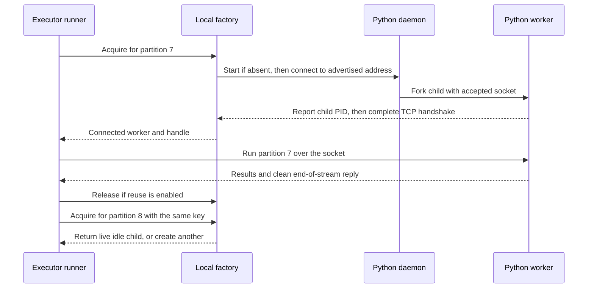

# PythonWorkerFactory: obtaining an executor-local interpreter

[component index](README.md)

`PythonWorkerFactory` answers a question for an executor task: **which local Python process and socket can this invocation use?** It does not know the function or send partition records. That is the [executor-side runner's](python-runner.md) job. On YARN the factory lives in the executor JVM; its daemon and [workers](python-worker.md) are processes in that executor's container, not new YARN allocations. It never lends out the Python driver that runs the submitted script.

## Flow at a glance

1. **Executor runner**: The runner requests a local worker for the task's Python environment.
2. **Worker factory**: If no worker is idle, the factory connects to its local Unix daemon.
3. **Socket handoff**: The daemon forks a child; the factory gives the runner that child's socket.

> **Key distinction:** The factory supplies the connection; the runner sends the function and the worker executes it.

Show the animated flow

## Ownership and interface

| Boundary | What crosses it |
|---|---|
| Runner to `SparkEnv` | Python executable, worker module, daemon module, effective environment, and daemon-mode request. `SparkEnv` caches factories by the first four; a conflicting daemon-mode request for the same key is an error. |
| Factory to runner | A `PythonWorker` (a JVM wrapper for the connected `SocketChannel` and selector), plus an optional `PythonWorkerHandle` for liveness, termination, and diagnostics. The wrapper is not the interpreter. |
| Task completion to factory | Release an eligible worker for reuse, or destroy a worker that must stop. A factory can outlive many attempts; `SparkEnv.stop()` stops its cached factories. No pool is shared between executors. |

The [factory lookup][lookup] is lazy. Each factory keeps its daemon process and listening address, a worker-to-handle map, a FIFO idle queue, and a separate map of directly launched processes. The [socket wrapper and factory state][state] distinguish an idle, connected child from a daemon that can fork another child.

## Trace: partition 7 needs Python; partition 8 arrives later

1. On the Unix daemon path, `create()` first dequeues idle workers. A live handle and refreshed, non-blocking channel can be handed back immediately. It discards unusable entries. With no match, it lazily starts `pythonExec -m pyspark.daemon pyspark.worker` (default modules). The daemon advertises an ephemeral loopback port or configured Unix-domain socket path on stdout. [Checkout][checkout] and [daemon startup][start].
2. The JVM connects; the daemon accepts and forks. The child reports its PID on the accepted socket. For TCP the JVM authenticates to the child; the Unix-domain mode skips the TCP secret exchange. The JVM gives **that connection**, not the daemon's stdin/stdout, to the runner. Concurrent invocations cannot borrow the same checked-out worker. [Connection and retry][connect]; [child loop][fork].
3. `spark.python.use.daemon` and `spark.python.worker.reuse` are separate switches. With a daemon but no reuse, later tasks can use the same daemon but not the finished child. With reuse, a clean protocol reply lets the runner release the child. A configured `spark.python.factory.idleWorkerMaxPoolSize` evicts the oldest idle worker on release; the monitor also drains a pool after inactivity. The idle cap is **not** a cap on concurrently running tasks. [Defaults][defaults], [pool cap][cap], [cleanup and release][cleanup].
4. Without a daemon (including Windows), the direction reverses: the JVM **listens**, launches `pythonExec -m workerModule`, and accepts the child's connection and PID. Release closes this worker's channel instead of queuing it. There is no promise of the same PID on a later task. [Direct launch][direct].

## If acquisition fails

| Executor-container clue | What to check first |
|---|---|
| `Bad data in ... standard output` during daemon startup | The first stdout bytes are the port or socket path. Inspect daemon stderr and the executor's Python path; even a `sitecustomize.py` print can corrupt this handshake. The task function has not run. |
| `Python worker failed to connect back` | This is the direct-launch accept/authentication/PID path. Check the nested cause and child stderr; verify the executable and modules in the executor environment, not just on the submit host. |
| Dead idle worker discarded, or daemon socket restart | A dead child is skipped. A daemon `SocketException` or connect timeout triggers **one** restart-and-retry; it is not a retry of the user's partition code. Inspect executor/container loss separately if all local workers disappeared. |

[lookup]: https://github.com/apache/spark/blob/dada2a6db5d73b152d6ba16e4fe21406f86abfe3/core/src/main/scala/org/apache/spark/SparkEnv.scala#L328-L345
[state]: https://github.com/apache/spark/blob/dada2a6db5d73b152d6ba16e4fe21406f86abfe3/core/src/main/scala/org/apache/spark/api/python/PythonWorkerFactory.scala#L40-L150
[checkout]: https://github.com/apache/spark/blob/dada2a6db5d73b152d6ba16e4fe21406f86abfe3/core/src/main/scala/org/apache/spark/api/python/PythonWorkerFactory.scala#L152-L180
[start]: https://github.com/apache/spark/blob/dada2a6db5d73b152d6ba16e4fe21406f86abfe3/core/src/main/scala/org/apache/spark/api/python/PythonWorkerFactory.scala#L338-L414
[connect]: https://github.com/apache/spark/blob/dada2a6db5d73b152d6ba16e4fe21406f86abfe3/core/src/main/scala/org/apache/spark/api/python/PythonWorkerFactory.scala#L188-L248
[fork]: https://github.com/apache/spark/blob/dada2a6db5d73b152d6ba16e4fe21406f86abfe3/python/pyspark/daemon.py#L211-L278
[defaults]: https://github.com/apache/spark/blob/dada2a6db5d73b152d6ba16e4fe21406f86abfe3/core/src/main/scala/org/apache/spark/internal/config/Python.scala#L24-L39
[cap]: https://github.com/apache/spark/blob/dada2a6db5d73b152d6ba16e4fe21406f86abfe3/core/src/main/scala/org/apache/spark/internal/config/Python.scala#L155-L164
[cleanup]: https://github.com/apache/spark/blob/dada2a6db5d73b152d6ba16e4fe21406f86abfe3/core/src/main/scala/org/apache/spark/api/python/PythonWorkerFactory.scala#L463-L571
[direct]: https://github.com/apache/spark/blob/dada2a6db5d73b152d6ba16e4fe21406f86abfe3/core/src/main/scala/org/apache/spark/api/python/PythonWorkerFactory.scala#L254-L336
