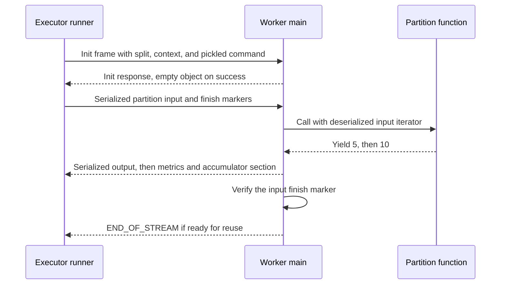

# Python worker: executing one partition's Python code

[component index](README.md)

`pyspark.worker` runs the supplied Python function in a process local to the executor. **Its unit of work is one invocation for a task attempt, not the application script.** The Python driver constructs the computation; the [runner](python-runner.md) in an executor JVM supplies the invocation over a socket. The [factory](python-worker-factory.md) may provide the same interpreter to later attempts. A PySpark DataFrame expression implemented entirely in the JVM does not need this worker just because the application was written in Python.

## Flow at a glance

1. **Python worker**: The worker sets up this task's context and loads the partition function.
2. **Partition function**: The function adds one to each input, turning 4 and 9 into 5 and 10.
3. **Result stream**: The worker streams those values to the executor JVM, then confirms a clean finish.

> **Key distinction:** Reuse keeps the interpreter alive, not the previous task's context or input iterator.

Show the animated flow

## Contract and state

| Lifetime | State and data |
|---|---|
| Process | Interpreter, imported modules, and a broadcast registry can survive reuse. The daemon's child loop calls `worker.main` again after a successful invocation when reuse is enabled. A directly launched worker's entry point instead connects back and calls `main` once. |
| Invocation | A new socket message receiver, `WorkerInitInfo`, Python `TaskContext`, eval type, function/serializers, metrics, and input iterator. The header includes the split index, driver Python version, task/attempt identifiers, local properties/resources, includes, and broadcast changes. |
| Output | Serialized results to the **local JVM**, plus an initialization reply, metrics, accumulator updates, and a finish reply. Worker stdout/stderr are diagnostics, not a record stream to the driver. |

See the [init message layout][layout], [receiver state transitions][receiver] and [daemon reuse decision][reuse]. `TaskContext` and accumulator state belong to an attempt; arbitrary user module globals do not. A retry may run on another process or node, so neither globals nor PIDs identify a logical partition.

## Trace: add one to each value in split 7

Suppose `rdd.mapPartitions(lambda values: (v + 1 for v in values))` receives `4, 9` in split 7. This is the classic RDD (`NON_UDF`) socket path, not an Arrow SQL UDF.

1. `main` wraps the socket in a `SparkSocketMessageReceiver`. `invoke_udf` decodes the length-delimited init frame, checks **major.minor** Python compatibility, applies the configured memory limit where supported, installs the task context, and resets spill and accumulator state. SparkFiles paths are added to the import path; broadcast changes add or remove IDs instead of discarding every cached broadcast. [Initialization][init], [version check][version], [files and broadcasts][files].
2. For `NON_UDF`, `read_command` reconstructs `(func, profiler, deserializer, serializer)`. For SQL UDFs/UDTFs the eval type instead selects a handler and its serializer; the RDD wire format is not universal. Only after those steps succeed does the worker send the successful `START_OF_INIT_RESPONSE`. It precedes any result; the JVM need not wait for it before feeding input. [Dispatch][dispatch].
3. `deserializer.load_stream` yields the input iterator. The worker calls the prepared `func(split_index, iterator)` and streams the returned iterator through `serializer.dump_stream`; `5, 10` are logical values, not necessarily two wire frames. A closable result iterator is closed even if serialization fails. [Processing][processing].
4. On normal completion it clears `TaskContext` and `BarrierTaskContext`, reports metrics, writes `END_OF_DATA_SECTION`, and sends accumulator updates. Only after reading the JVM's expected finish signal does it reply `END_OF_STREAM`. A wrong/unread marker means the streams are not aligned: it signals **do not reuse** and exits instead of interpreting leftover bytes as the next task. [Cleanup and reply][finish].

## If an attempt fails

| First observable boundary | Interpretation |
|---|---|
| Init response contains `error` | No output follows. Compare driver and executor Python versions for `PYTHON_VERSION_MISMATCH`; for missing modules, check the executor's deployed dependencies. `isPayloadError` distinguishes command-loading failures from worker setup, not all possible causes of import errors. |
| `PYTHON_EXCEPTION_THROWN` after successful init | Decoding input, executing the function, or encoding its output failed. Look at the Python traceback for the failing line and correlate the JVM's task attempt, not just a possibly reused PID. |
| Unexpected EOF, no Python traceback | Not a normal empty result. Check executor stderr and YARN container diagnostics for process loss; `spark.python.worker.faulthandler.enabled` can provide a traceback for some crashes. A killed container need not send any failure frame. |

The [worker exception boundary][finish] and the [JVM-side exception handling][jvm-errors] explain why these symptoms are different.

[layout]: https://github.com/apache/spark/blob/dada2a6db5d73b152d6ba16e4fe21406f86abfe3/python/pyspark/worker_message.py#L217-L280
[receiver]: https://github.com/apache/spark/blob/dada2a6db5d73b152d6ba16e4fe21406f86abfe3/python/pyspark/messages/spark_message_receiver.py#L51-L93
[reuse]: https://github.com/apache/spark/blob/dada2a6db5d73b152d6ba16e4fe21406f86abfe3/python/pyspark/daemon.py#L253-L278
[init]: https://github.com/apache/spark/blob/dada2a6db5d73b152d6ba16e4fe21406f86abfe3/python/pyspark/worker.py#L104-L175
[version]: https://github.com/apache/spark/blob/dada2a6db5d73b152d6ba16e4fe21406f86abfe3/python/pyspark/worker_util.py#L122-L174
[files]: https://github.com/apache/spark/blob/dada2a6db5d73b152d6ba16e4fe21406f86abfe3/python/pyspark/worker_util.py#L196-L288
[dispatch]: https://github.com/apache/spark/blob/dada2a6db5d73b152d6ba16e4fe21406f86abfe3/python/pyspark/worker.py#L164-L239
[processing]: https://github.com/apache/spark/blob/dada2a6db5d73b152d6ba16e4fe21406f86abfe3/python/pyspark/worker.py#L241-L290
[finish]: https://github.com/apache/spark/blob/dada2a6db5d73b152d6ba16e4fe21406f86abfe3/python/pyspark/worker.py#L290-L341
[jvm-errors]: https://github.com/apache/spark/blob/dada2a6db5d73b152d6ba16e4fe21406f86abfe3/core/src/main/scala/org/apache/spark/api/python/PythonRunner.scala#L1291-L1319
