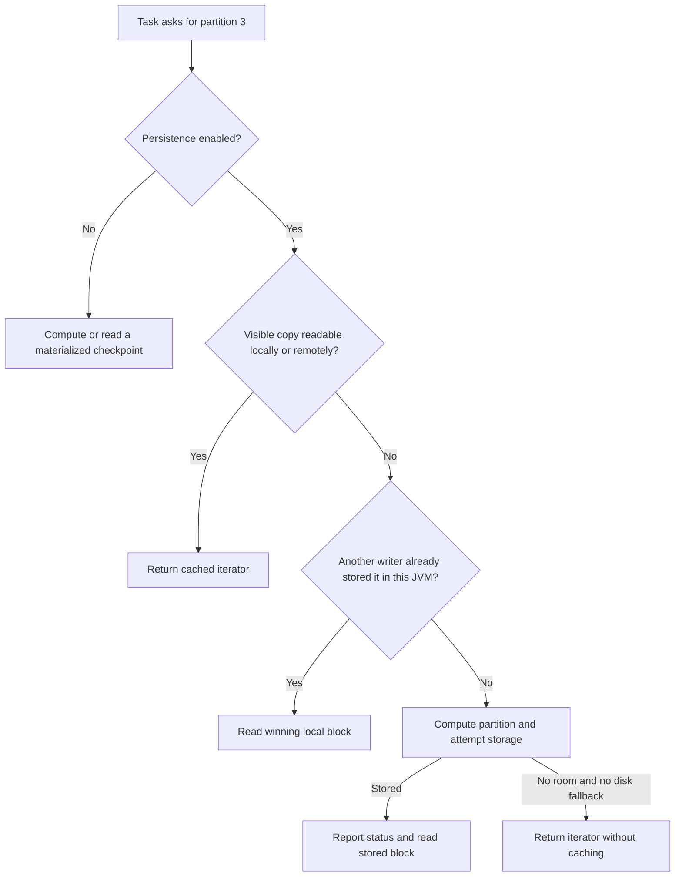

# RDD cache: deciding whether to read or recompute one partition

[component index](README.md) | [BlockManager](block-manager.md) | [BlockManagerMaster](block-manager-master.md)

`rdd.cache()` marks an RDD; it does **not** launch a job or create one cache process per executor. The driver keeps the RDD's persistence policy and lineage. When a task needs a partition, the executor's JVM `RDD.iterator` and `BlockManager` implement the read-or-compute decision. The unit of reuse is `RDDBlockId(rddId, partitionIndex)`, for example `rdd_17_3`: two different task attempts can ask for that same ID. It is not a Python object cache or the SQL plan cache. [RDD identity and registration][persist] · [block name][id] · [executor entry point][entry]

## Flow at a glance

1. **Task**: Look up one persisted partition by block ID.
2. **Cache hit**: Read records from a local or peer copy.
3. **Cache miss**: Compute that partition and try to cache it.

> **Watch for:** A task can return records on a miss even if the partition does not fit in the cache.

> **Interactive explorer:** [Open in Spark Visualizer](https://nuthanreddy.github.io/spark-visualizer/#component=rdd-cache) to step through commands, wire payloads, category filters, and fault simulations on the live cluster canvas.

## The driver records intent; tasks supply the data

In classic PySpark, `cache()` selects `StorageLevel.MEMORY_ONLY`; `persist(level)` sets `is_cached`, converts the level and calls `_jrdd.persist(...)`. Python's `MEMORY_ONLY` is **serialized**, replication `1`; it does not keep live Python objects in the JVM. For example, [`PythonRDD.compute`][pyrdd] runs the Python function and yields byte arrays. A cache hit on that RDD bypasses that compute, not any later Python transformation. On the JVM the first persist registers the RDD for accounting/cleanup and stores the requested level. The scheduler can prefer existing locations, but neither setting the level nor placing the task proves the partition is resident. [PySpark default][python-cache] · [Python-to-JVM call][python-persist] · [Python storage flags][levels] · [scheduler lookup][locality]

**Input to a cache lookup:** task attempt ID, RDD block ID, storage level, class tag and a lazy function to compute this partition. **Output to the task:** an interruptible iterator, whether its records came from memory, disk, a peer, or a fresh computation. The master sees only location and size updates for stored blocks. [RDD call and metrics][call] · [block manager contract][decision]

## Trace `rdd_17_3`

1. With level `NONE`, `iterator` bypasses the cache. Otherwise it calls `getOrCompute`. If a cache entry is eligible, lookup tries **local memory**, then **local disk**, then other locations. Disk data can be promoted back to memory. On a remote hit, the manager can read a same-host disk file directly or fetch serialized bytes from a peer and deserialize them. A remote hit returns the iterator; this lookup does **not** automatically install a new local replica. [Local read][local] · [remote read][remote] · [hit before put][decision]
2. On a miss, the manager obtains a write lock for this ID. Only the winning local writer calls the compute function on the ordinary path; a racing local reader can reuse the result. `computeOrReadCheckpoint` delegates to the checkpoint parent if materialized; otherwise it invokes the RDD's `compute` for this partition. A cache miss is not itself a new job or a command to recompute the whole RDD. [Writer race][race] · [checkpoint branch][checkpoint]
3. For a memory level, the manager tries to materialize the iterator as values or serialized bytes. If it cannot fit, a level allowing disk finishes writing there; `DISK_ONLY` goes directly to disk. If neither storage path succeeds for lack of space, it returns the partially unrolled iterator, including the already-read prefix. **The task can succeed and leave nothing cached.** A successful store reports status, optionally replicates, downgrades to a read lock and reads the block back. [Storage decisions][store] · [iterator fallback and readback][return]
4. Internally `Left(BlockResult)` means **a block supplied the result**, including one just written. It does not by itself mean this task avoided computation. `RDD.getOrCompute` tracks whether its compute function ran; only a true read of cached data increments input bytes from the block and input records as they are consumed. [Result and metrics branch][call]

The diagram shows the ordinary path. Optional `spark.rdd.cache.visibilityTracking.enabled` (default `false`) gates reuse on a successful producing task. A block can physically exist before it is visible; a contender reusing that local block may still be forced to run its compute function for accumulator updates. Visibility is distinct from memory admission. [Configuration][visibility-config] · [invisible-block branch][return]

## Eviction, recovery and diagnosis

Suppose a first `count()` populated `rdd_17_3`. With `MEMORY_AND_DISK`, memory eviction can leave the partition readable on local disk. With `MEMORY_ONLY`, it removes that local copy: a later action can still read a replica. An ordinary miss on all usable copies leads back to lineage; an actual [I/O failure while opening local disk data][io-error] can instead remove the bad entry and fail the current attempt. Memory eviction selects eligible, unlocked entries in the correct memory mode and avoids evicting another block of the same RDD just to admit the new one. A **finalized local checkpoint** is the exception to lineage recovery: if its last copy is gone, its placeholder parent throws rather than rerunning the original transformations. [Eviction choices][victims] · [drop to disk][drop] · [local checkpoint failure][lost]

Check the Spark UI **Storage** row for cached partition count, fraction cached, memory and disk size; `rdd.is_cached` only says persistence was requested. For a missing partition, check which tasks actually touched it, whether a put fell back to disk or returned an uncached iterator, and whether its executor disappeared. `unpersist(blocking=False)` removes the persistence policy and requests cluster-wide removal without waiting for deletion everywhere; `blocking=True` waits for the removal operation. Subsequent actions on an ordinary unpersisted RDD use its lineage again. [UI fields][ui] · [unpersist][unpersist] · [driver removal][removal]

[persist]: https://github.com/apache/spark/blob/dada2a6db5d73b152d6ba16e4fe21406f86abfe3/core/src/main/scala/org/apache/spark/rdd/RDD.scala#L148-L204
[id]: https://github.com/apache/spark/blob/dada2a6db5d73b152d6ba16e4fe21406f86abfe3/core/src/main/scala/org/apache/spark/storage/BlockId.scala#L51-L58
[entry]: https://github.com/apache/spark/blob/dada2a6db5d73b152d6ba16e4fe21406f86abfe3/core/src/main/scala/org/apache/spark/rdd/RDD.scala#L329-L340
[python-cache]: https://github.com/apache/spark/blob/dada2a6db5d73b152d6ba16e4fe21406f86abfe3/python/pyspark/core/rdd.py#L295-L309
[python-persist]: https://github.com/apache/spark/blob/dada2a6db5d73b152d6ba16e4fe21406f86abfe3/python/pyspark/core/rdd.py#L366-L374
[pyrdd]: https://github.com/apache/spark/blob/dada2a6db5d73b152d6ba16e4fe21406f86abfe3/core/src/main/scala/org/apache/spark/api/python/PythonRDD.scala#L54-L74
[levels]: https://github.com/apache/spark/blob/dada2a6db5d73b152d6ba16e4fe21406f86abfe3/python/pyspark/storagelevel.py#L86-L96
[locality]: https://github.com/apache/spark/blob/dada2a6db5d73b152d6ba16e4fe21406f86abfe3/core/src/main/scala/org/apache/spark/scheduler/DAGScheduler.scala#L640-L657
[call]: https://github.com/apache/spark/blob/dada2a6db5d73b152d6ba16e4fe21406f86abfe3/core/src/main/scala/org/apache/spark/rdd/RDD.scala#L430-L459
[decision]: https://github.com/apache/spark/blob/dada2a6db5d73b152d6ba16e4fe21406f86abfe3/core/src/main/scala/org/apache/spark/storage/BlockManager.scala#L1585-L1641
[local]: https://github.com/apache/spark/blob/dada2a6db5d73b152d6ba16e4fe21406f86abfe3/core/src/main/scala/org/apache/spark/storage/BlockManager.scala#L1173-L1206
[remote]: https://github.com/apache/spark/blob/dada2a6db5d73b152d6ba16e4fe21406f86abfe3/core/src/main/scala/org/apache/spark/storage/BlockManager.scala#L1304-L1364
[race]: https://github.com/apache/spark/blob/dada2a6db5d73b152d6ba16e4fe21406f86abfe3/core/src/main/scala/org/apache/spark/storage/BlockInfoManager.scala#L472-L530
[checkpoint]: https://github.com/apache/spark/blob/dada2a6db5d73b152d6ba16e4fe21406f86abfe3/core/src/main/scala/org/apache/spark/rdd/RDD.scala#L366-L377
[store]: https://github.com/apache/spark/blob/dada2a6db5d73b152d6ba16e4fe21406f86abfe3/core/src/main/scala/org/apache/spark/storage/BlockManager.scala#L1864-L1966
[return]: https://github.com/apache/spark/blob/dada2a6db5d73b152d6ba16e4fe21406f86abfe3/core/src/main/scala/org/apache/spark/storage/BlockManager.scala#L1641-L1672
[visibility-config]: https://github.com/apache/spark/blob/dada2a6db5d73b152d6ba16e4fe21406f86abfe3/core/src/main/scala/org/apache/spark/internal/config/package.scala#L3198-L3207
[victims]: https://github.com/apache/spark/blob/dada2a6db5d73b152d6ba16e4fe21406f86abfe3/core/src/main/scala/org/apache/spark/storage/memory/MemoryStore.scala#L462-L525
[drop]: https://github.com/apache/spark/blob/dada2a6db5d73b152d6ba16e4fe21406f86abfe3/core/src/main/scala/org/apache/spark/storage/BlockManager.scala#L2253-L2306
[io-error]: https://github.com/apache/spark/blob/dada2a6db5d73b152d6ba16e4fe21406f86abfe3/core/src/main/scala/org/apache/spark/storage/BlockManager.scala#L1205-L1224
[lost]: https://github.com/apache/spark/blob/dada2a6db5d73b152d6ba16e4fe21406f86abfe3/core/src/main/scala/org/apache/spark/rdd/LocalCheckpointRDD.scala#L50-L62
[ui]: https://github.com/apache/spark/blob/dada2a6db5d73b152d6ba16e4fe21406f86abfe3/core/src/main/scala/org/apache/spark/ui/storage/StoragePage.scala#L89-L106
[unpersist]: https://github.com/apache/spark/blob/dada2a6db5d73b152d6ba16e4fe21406f86abfe3/core/src/main/scala/org/apache/spark/rdd/RDD.scala#L206-L224
[removal]: https://github.com/apache/spark/blob/dada2a6db5d73b152d6ba16e4fe21406f86abfe3/core/src/main/scala/org/apache/spark/storage/BlockManagerMaster.scala#L223-L234
