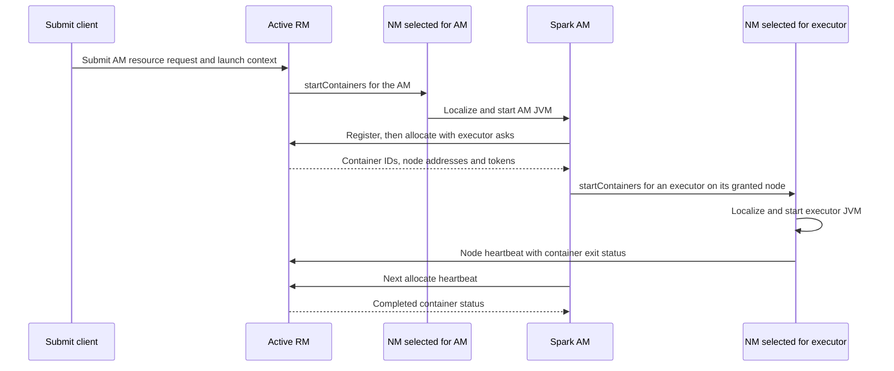

# YARN ResourceManager: who gets the next container?

[component index](README.md) | [PySpark on YARN walkthrough](../pyspark-on-yarn.md)

The ResourceManager (RM) grants a particular application a [container](yarn-container.md)
on a particular node. It also arranges the first launch, because there is no
[ApplicationMaster (AM)](application-master.md) yet to request it. **Only the NodeManager starts the
process.** The RM never receives `orders.py` task descriptions, rows, or
shuffle blocks.

## Flow at a glance

1. **RM scheduler**: Chooses a node with room for the AM container.
2. **RM launcher**: Asks that node's NodeManager to start the AM.
3. **ApplicationMaster**: Registers the new attempt with the ResourceManager.

> **Key distinction:** RUNNING means the AM registered. Spark may still have no executors.

Show the animated flow

## Runtime boundary and ownership

The RM is a long-lived Hadoop JVM shared by applications. Cluster operators or
their service manager start, monitor, and stop it. In an HA deployment, one RM
is active; a standby can take over manually or through configured automatic
failover. A Spark application finishing releases its resources, not the RM.

## Three callers, three contracts

| Caller and Hadoop RPC endpoint | Input | What the caller gets back |
|---|---|---|
| `spark-submit` to `ClientRMService` (`ApplicationClientProtocol`) | `getNewApplication()`, then `submitApplication(ApplicationSubmissionContext)` with application ID, queue, AM resource request, and AM launch context | The first call returns an ID and maximum resource capability. A submission acknowledgement is not a running AM. `getApplicationReport` returns state, current attempt, diagnostics, and final status. |
| NM to `ResourceTrackerService` (`ResourceTracker`) | `registerNodeManager` advertises a `NodeId` and capacity. `nodeHeartbeat` reports health and container statuses. | Registration response; heartbeat responses can identify containers or applications to clean up, or instruct the NM to resynchronize. This is **node** liveness. |
| Spark AM to `ApplicationMasterService` (`ApplicationMasterProtocol`) | `registerApplicationMaster`; repeated `allocate` calls with response ID, progress, updated resource asks, and IDs to release; finally `finishApplicationMaster` with final status and diagnostics | `allocate` can return zero or more grants, completed container statuses, headroom, and NM tokens. These calls also establish **attempt** liveness; headroom is not a promise of a grant. |

The RM holds separate records for the application (`RMApp`), its attempts,
registered nodes, and allocated containers. Its scheduler accounts for queue
usage and outstanding asks. An ask describes a count, resource vector, priority,
and locality (host, rack, or `*`), not a Spark partition. Available capacity
must fit on an eligible node under the configured scheduler's queue and placement
rules. Several nodes' spare memory cannot be combined into one container.

## Worked flow: one AM, then three executors

1. The client submits the paid-orders application. The scheduler must first fit the AM, not all four containers. While the attempt is waiting to launch or register, the application can still show `ACCEPTED`.
2. The RM's `AMLauncher` sends the selected NM a start request using the submitted AM launch context. When the AM registers, the application transitions to `RUNNING`; that does not mean any executor has registered with Spark.
3. The AM asks for three two-vcore executor containers. If only two fit, it can receive two now and the third later. Each grant identifies its own NM; **the AM**, not the RM, sends the executor launch instructions there.
4. As NMs report exits, the RM accounts for freed capacity and the AM learns of completions on `allocate`. The response ID matters: for an immediately repeated heartbeat whose reply was lost, the RM can return the cached reply instead of allocating twice.
5. On orderly finish the AM unregisters with a final status such as `SUCCEEDED`; YARN can then show application state `FINISHED`. An AM failure instead can trigger a **new attempt**, subject to limits. Neither path retries an individual Spark task.

## Where a failure shows up

| Observation | First distinction to make |
|---|---|
| Long-lived `ACCEPTED` | Compare `yarn application -status <app_id>` and `yarn applicationattempt -list <app_id>` with the RM scheduler view. No AM grant points to queue limits, node fit, or placement; an AM container ID points next to that NM's launch logs. |
| `RUNNING`, but zero Spark executors | Check AM asks versus grants. With no grant, inspect the queue and eligible nodes. With a grant, follow its ID to the [NodeManager](node-manager.md) and then to executor registration at the Spark driver. |
| RM unavailable | New submissions and allocations cannot progress against it. Existing processes need not die immediately. With work-preserving recovery, NMs report surviving containers and AMs resend outstanding asks; a fresh RM alone cannot reconstruct a Python driver stack. |

## Sources

- Hadoop 3.4.1: [YARN responsibilities](https://hadoop.apache.org/docs/r3.4.1/hadoop-yarn/hadoop-yarn-site/YARN.html), [RM failover](https://hadoop.apache.org/docs/r3.4.1/hadoop-yarn/hadoop-yarn-site/ResourceManagerHA.html), and [restart and state reconstruction](https://hadoop.apache.org/docs/r3.4.1/hadoop-yarn/hadoop-yarn-site/ResourceManagerRestart.html).
- Hadoop 3.4.1 source: [client and AM request/response records](https://github.com/apache/hadoop/blob/4d7825309348956336b8f06a08322b78422849b1/hadoop-yarn-project/hadoop-yarn/hadoop-yarn-api/src/main/proto/yarn_service_protos.proto), [NM heartbeat records](https://github.com/apache/hadoop/blob/4d7825309348956336b8f06a08322b78422849b1/hadoop-yarn-project/hadoop-yarn/hadoop-yarn-server/hadoop-yarn-server-common/src/main/proto/yarn_server_common_service_protos.proto), [AMLauncher](https://github.com/apache/hadoop/blob/4d7825309348956336b8f06a08322b78422849b1/hadoop-yarn-project/hadoop-yarn/hadoop-yarn-server/hadoop-yarn-server-resourcemanager/src/main/java/org/apache/hadoop/yarn/server/resourcemanager/amlauncher/AMLauncher.java), and [AM heartbeat handling](https://github.com/apache/hadoop/blob/4d7825309348956336b8f06a08322b78422849b1/hadoop-yarn-project/hadoop-yarn/hadoop-yarn-server/hadoop-yarn-server-resourcemanager/src/main/java/org/apache/hadoop/yarn/server/resourcemanager/ApplicationMasterService.java).
- Spark integration: [`YarnAllocator.allocateResources` consumes grants and completions](https://github.com/apache/spark/blob/dada2a6db5d73b152d6ba16e4fe21406f86abfe3/resource-managers/yarn/src/main/scala/org/apache/spark/deploy/yarn/YarnAllocator.scala#L439-L469).
