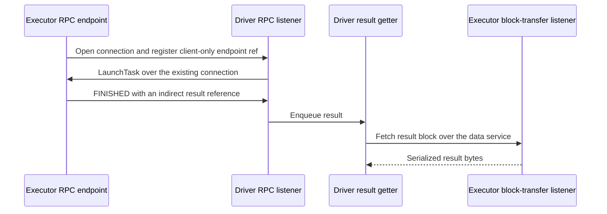

# RpcEnv: how a driver sends commands to an executor with no RPC listener

[component index](README.md) | [Networking and ports](../pyspark-on-yarn.md#protocols-and-listening-ports)

`RpcEnv` is Spark's JVM **control-message router**. An `RpcEndpoint` handles messages under a name; an `RpcEndpointRef` is the caller's handle to that endpoint. Multiple endpoints can share one listener. `send` is one-way, `ask` returns a future, and `askSync` blocks the caller for a reply. The router delivers messages or reports failures; it neither schedules tasks nor decides whether to replace a YARN container. [Endpoint-ref contract][contract]

## Flow at a glance

1. **Executor**: Open a connection and register its endpoint with the driver.
2. **Driver**: Send LaunchTask back over that same connection.
3. **Executor dispatcher**: Deliver the queued command to the local backend.

> **Key distinction:** Task launches need no Spark RPC listener on the executor. Fetching a result block uses a separate listener.

> **Interactive explorer:** [Open in Spark Visualizer](https://nuthanreddy.github.io/spark-visualizer/#component=rpc-env) to step through commands, wire payloads, category filters, and fault simulations on the live cluster canvas.

## Which side listens?

The driver builds a `NettyRpcEnv` with a bind address, advertised host and requested port. It starts a transport server and a name-verification endpoint; Spark records the **actual bound driver port**. The executor creates its main `RpcEnv` with `clientMode = true`: it can register endpoints and receive messages, but has **no listening Spark RPC port** (`rpcEnv.address == null`). Its bootstrap configuration fetcher is a separate, temporary client. This `clientMode` is a transport setting, not `--deploy-mode client`: YARN executors use it in **both** deploy modes. In cluster mode the AM uses the driver's `RpcEnv`; in client deploy mode the AM itself creates another client-only environment. [SparkEnv creation][env] / [Transport factory][factory] / [Cluster AM][cluster-am] / [Client AM][client-am]

## Route selection

| What the caller holds | Where the message goes |
|---|---|
| A ref whose address equals the sending environment's address | **Local.** Post the object directly to the dispatcher's inbox; no wire serialization, socket or inline invocation of the handler. A local `ask` uses a promise for its reply. This includes an executor sending to `self`. |
| A ref to a different environment with an attached `TransportClient` | **Remote, existing connection.** Serialize and send on that channel. This is how the driver reaches a client-only executor. |
| A remote ref without an attached client, but with a listening address | **Remote, by address.** A per-address `Outbox` queues messages while a connection thread opens a client, then drains the queue. A driver URI such as `spark://CoarseGrainedScheduler@driver.example:7078` names one endpoint; `7078` here is only an example. |

The address check happens first, then the attached-client check. A client-only ref renders as `spark-client://Executor`; copying that string to a third JVM does **not** give it a way to dial the original executor. [Address format][address] / [Send routing][send] / [Ask routing and timeout][ask] / [Outbox][outbox]

## Trace one `LaunchTask` on the wire

1. The [executor backend](executor-backend.md) looks up the driver's URI. `asyncSetupEndpointRefByURI` parses it and asks `RpcEndpointVerifier.CheckExistence(name)` on the driver. It then asks the driver to `RegisterExecutor` and includes its own `self` ref **inside the message**. [Name verification][lookup] / [Registration request][register]
2. On the driver, deserializing that embedded ref attaches the [incoming transport client][ref] to it. Because the executor advertised no listening address, the receiver fills in the **peer socket address** as `context.senderAddress`. The scheduler records that address to correlate disconnects and retains the actual endpoint ref for sending. It does not turn the peer's ephemeral source port into a listener. [Inbound address handling][receive] / [Driver registration][admission]
3. Later the driver sends `LaunchTask` on the retained ref. In the executor, the Netty I/O handler decodes the request and posts a one-way message by endpoint name. A dispatcher thread invokes `CoarseGrainedExecutorBackend.receive` on the endpoint named `Executor`; the backend hands off to the [task worker pool](executor.md). A regular remote **ask** uses the same routing to reach `receiveAndReply`; `context.reply` serializes the response through a transport callback, whereas a local reply completes the caller's promise. [Inbound dispatch][receive] / [Local versus remote reply][reply]

The reverse `LaunchTask` uses the existing control channel; the [indirect result](task-result-getter.md) uses a [different listener](block-transfer-service.md) for its bytes.

**State and threading.** Registration maps endpoint names to message loops. Each endpoint has an inbox: `OnStart` first, `receive` or `receiveAndReply` during its lifetime, `OnStop` last. Ordinary endpoints can handle messages concurrently after startup. `ThreadSafeRpcEndpoint` requests serial handling; an isolated endpoint gets its own pool, and `IsolatedThreadSafeRpcEndpoint` uses one dedicated thread. The Netty I/O threads, RPC dispatcher, connection pool, timeout scheduler and task threads are not interchangeable. [Dispatcher][dispatch] / [Inbox][inbox] / [Endpoint threading contracts][threads]

**Stop and diagnose.** Stopping an endpoint unregisters its name; shutting down the environment stops outboxes, timer and dispatcher and closes the transport. A disconnect generates endpoint events. The [YARN driver backend][loss], not Netty, decides how to disable the executor and obtain its loss reason. A missing registered name yields `RpcEndpointNotFoundException` at lookup. An **ask timeout** means no reply arrived before the deadline, not that the peer never handled the request; `ask` itself does not retry. If registration and launches work but shuffle or indirect result fetches fail, inspect the **separate [block-transfer listener][block]**. A working driver/executor control channel does not establish that storage data is reachable. [Connection events][events] / [Shutdown][stop]

[contract]: https://github.com/apache/spark/blob/dada2a6db5d73b152d6ba16e4fe21406f86abfe3/core/src/main/scala/org/apache/spark/rpc/RpcEndpointRef.scala#L40-L102
[env]: https://github.com/apache/spark/blob/dada2a6db5d73b152d6ba16e4fe21406f86abfe3/core/src/main/scala/org/apache/spark/SparkEnv.scala#L689-L728
[factory]: https://github.com/apache/spark/blob/dada2a6db5d73b152d6ba16e4fe21406f86abfe3/core/src/main/scala/org/apache/spark/rpc/netty/NettyRpcEnv.scala#L505-L530
[cluster-am]: https://github.com/apache/spark/blob/dada2a6db5d73b152d6ba16e4fe21406f86abfe3/resource-managers/yarn/src/main/scala/org/apache/spark/deploy/yarn/ApplicationMaster.scala#L502-L519
[client-am]: https://github.com/apache/spark/blob/dada2a6db5d73b152d6ba16e4fe21406f86abfe3/resource-managers/yarn/src/main/scala/org/apache/spark/deploy/yarn/ApplicationMaster.scala#L564-L581
[address]: https://github.com/apache/spark/blob/dada2a6db5d73b152d6ba16e4fe21406f86abfe3/core/src/main/scala/org/apache/spark/rpc/RpcEndpointAddress.scala#L24-L44
[send]: https://github.com/apache/spark/blob/dada2a6db5d73b152d6ba16e4fe21406f86abfe3/core/src/main/scala/org/apache/spark/rpc/netty/NettyRpcEnv.scala#L161-L204
[ask]: https://github.com/apache/spark/blob/dada2a6db5d73b152d6ba16e4fe21406f86abfe3/core/src/main/scala/org/apache/spark/rpc/netty/NettyRpcEnv.scala#L232-L285
[outbox]: https://github.com/apache/spark/blob/dada2a6db5d73b152d6ba16e4fe21406f86abfe3/core/src/main/scala/org/apache/spark/rpc/netty/Outbox.scala#L125-L222
[lookup]: https://github.com/apache/spark/blob/dada2a6db5d73b152d6ba16e4fe21406f86abfe3/core/src/main/scala/org/apache/spark/rpc/netty/NettyRpcEnv.scala#L121-L154
[register]: https://github.com/apache/spark/blob/dada2a6db5d73b152d6ba16e4fe21406f86abfe3/core/src/main/scala/org/apache/spark/executor/CoarseGrainedExecutorBackend.scala#L101-L116
[ref]: https://github.com/apache/spark/blob/dada2a6db5d73b152d6ba16e4fe21406f86abfe3/core/src/main/scala/org/apache/spark/rpc/netty/NettyRpcEnv.scala#L536-L573
[receive]: https://github.com/apache/spark/blob/dada2a6db5d73b152d6ba16e4fe21406f86abfe3/core/src/main/scala/org/apache/spark/rpc/netty/NettyRpcEnv.scala#L701-L733
[admission]: https://github.com/apache/spark/blob/dada2a6db5d73b152d6ba16e4fe21406f86abfe3/core/src/main/scala/org/apache/spark/scheduler/cluster/CoarseGrainedSchedulerBackend.scala#L263-L320
[reply]: https://github.com/apache/spark/blob/dada2a6db5d73b152d6ba16e4fe21406f86abfe3/core/src/main/scala/org/apache/spark/rpc/netty/NettyRpcCallContext.scala#L26-L67
[dispatch]: https://github.com/apache/spark/blob/dada2a6db5d73b152d6ba16e4fe21406f86abfe3/core/src/main/scala/org/apache/spark/rpc/netty/Dispatcher.scala#L39-L88
[inbox]: https://github.com/apache/spark/blob/dada2a6db5d73b152d6ba16e4fe21406f86abfe3/core/src/main/scala/org/apache/spark/rpc/netty/Inbox.scala#L78-L149
[threads]: https://github.com/apache/spark/blob/dada2a6db5d73b152d6ba16e4fe21406f86abfe3/core/src/main/scala/org/apache/spark/rpc/RpcEndpoint.scala#L138-L177
[loss]: https://github.com/apache/spark/blob/dada2a6db5d73b152d6ba16e4fe21406f86abfe3/resource-managers/yarn/src/main/scala/org/apache/spark/scheduler/cluster/YarnSchedulerBackend.scala#L274-L328
[events]: https://github.com/apache/spark/blob/dada2a6db5d73b152d6ba16e4fe21406f86abfe3/core/src/main/scala/org/apache/spark/rpc/netty/NettyRpcEnv.scala#L758-L781
[stop]: https://github.com/apache/spark/blob/dada2a6db5d73b152d6ba16e4fe21406f86abfe3/core/src/main/scala/org/apache/spark/rpc/netty/NettyRpcEnv.scala#L311-L352
[block]: https://github.com/apache/spark/blob/dada2a6db5d73b152d6ba16e4fe21406f86abfe3/core/src/main/scala/org/apache/spark/network/netty/NettyBlockTransferService.scala#L69-L94
