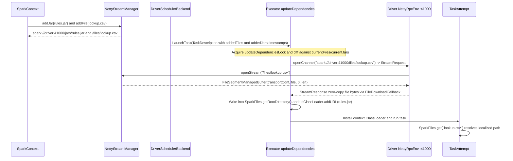

# RPC File Server (NettyStreamManager) and SparkFiles

[component index](README.md)

The RPC File Server (`NettyStreamManager`, implementing `RpcEnvFileServer`) is **not** a standalone HTTP server, does **not** upload submit-time resources to YARN `.sparkStaging` in HDFS, and does **not** carry shuffle or RDD block bytes (which travel over [`BlockTransferService`](block-transfer-service.md) or the [External Shuffle Service](external-shuffle-service.md)). It is an embedded Netty `StreamManager` inside the [driver's](spark-driver.md) [`NettyRpcEnv`](rpc-env.md) (bound on the driver RPC port, e.g. `:41000`) that serves files, JARs, and registered directories added dynamically at runtime via `SparkContext.addFile()` / `sc.addJar()` to [executors](executor.md) on demand. Both PySpark (`sc.addFile`, `sc.addPyFile`, `SparkFiles.get`) and Scala/Java (`sc.addJar`, `sc.addFile`, `SparkFiles.get`) use this exact transport for driver-local dynamic resources.

## Flow at a glance

1. **Dynamic registration on the driver**: Calling `sc.addFile()` or `sc.addJar()` on a local path registers the canonical `File` in `NettyStreamManager` (`/files` or `/jars` maps) and mints a `spark://<driverHost>:<rpcPort>/...` URI with a timestamp in `SparkContext`.
2. **Metadata-only task shipping**: When launching tasks, `TaskDescription` ships only the `addedFiles`, `addedJars`, and `addedArchives` URI-to-timestamp maps -- zero file payload bytes travel inside `LaunchTask`.
3. **On-demand Netty stream fetch**: Under `Executor.updateDependenciesLock`, `Executor.updateDependencies()` detects unseen timestamps and calls `Utils.fetchFile` -> `NettyRpcEnv.openChannel()`, streaming zero-copy `FileSegmentManagedBuffer` bytes from `NettyStreamManager.openStream()`.
4. **ClassLoader install and `SparkFiles.get()`**: Downloaded JARs are appended to `MutableURLClassLoader` via `addURL`, and tasks resolve localized files through `SparkFiles.get(filename)`.

> **Key distinction:** `NettyStreamManager` serves **runtime** `sc.addFile` / `sc.addJar` streams directly from the driver `RpcEnv` port (`:41000`), completely separate from submit-time YARN `.sparkStaging` HDFS localization (pre-launch) and `BlockTransferService` (`:42001`) shuffle/RDD block transfer.

> **Interactive explorer:** [Open in Spark Visualizer](https://nuthanreddy.github.io/spark-visualizer/#component=rpc-file-server) to step through commands, wire payloads, language modes, category filters, and fault simulations on the live cluster canvas.

## Route lookup, canonical containment, and comparison to other planes

`NettyStreamManager` ([`NettyStreamManager.scala:39-95`][nsm-all]) maintains three `ConcurrentHashMap[String, File]` registries (`files`, `jars`, `dirs`) and supports streaming only (`getChunk` throws `UnsupportedOperationException`). Inside [`openStream(streamId)`][nsm-open] (`NettyStreamManager.scala:54-68`), route resolution enforces two distinct lookup rules:

| Route prefix | Registration API | Lookup and path validation in `openStream` | Typical caller |
|---|---|---|---|
| `/files/<name>` | [`addFile(file)`][nsm-all] (called from [`SparkContext.addFile`][sc-addfile]) | Exact registered-name lookup in `files.get(fname)`. `addFile` stores `file.getCanonicalFile` and rejects registering a different path under the same basename. | `sc.addFile("lookup.csv")` / `sc.addPyFile(...)` |
| `/jars/<name>` | [`addJar(file)`][nsm-all] (called from [`SparkContext.addJar`][sc-addjar]) | Exact registered-name lookup in `jars.get(fname)`. Rejects conflicting paths under the same JAR filename. | `sc.addJar("rules.jar")` |
| `/<dir>/<relpath>` (e.g. `/classes/...`, `/dirs/...`) | [`addDirectory(baseUri, path)`][nsm-all] / `addDirectoryIfAbsent` | Looks up `dir = dirs.get(ftype)`, resolves `canonicalFile = new File(dir, fname).getCanonicalFile`, and enforces **canonical path containment**: `canonicalFile.getPath.startsWith(dir.getPath + File.separator)` (returns `null` if traversal escapes `dir`). | REPL class output directory (`SparkContext.scala:548`) and dynamic directories |

Contrast this plane with the other two file/data distribution paths on YARN:

- **YARN `.sparkStaging/<appId>` ([`yarn.Client`](yarn-client.md) + [`NodeManager`](node-manager.md)):** Uploads `--files`, `--py-files`, `--jars`, and `__spark_conf__` to HDFS **before** containers launch; NodeManager localizers pull from HDFS once per container without touching driver bandwidth.
- **Direct HCFS URIs (`hdfs://`, `s3a://`, `http://`):** When a user passes a cluster-accessible URI to `sc.addFile` or `sc.addJar`, [`Utils.doFetchFile`][utils-fetch] fetches directly from HDFS/object storage/HTTP rather than registering on `NettyStreamManager`.
- **Shuffle and RDD blocks ([`BlockTransferService`](block-transfer-service.md)):** Served over `:42001` (or ESS `:7337`) using chunked/stream block handlers, completely independent of driver `RpcEnv` `:41000`.

## Driver registration to executor `SparkFiles.get()` flow

1. **Driver registration.** For local filesystem paths, [`SparkContext.addFile`][sc-addfile] and [`SparkContext.addJar`][sc-addjar] register canonical paths in `env.rpcEnv.fileServer` ([`NettyRpcEnv.fileServer`][rpc-fs]) and record `(uri -> timestamp)` in `SparkContext`'s artifact maps.
2. **Serialized dependency sync on executors.** Before running a task, [`Executor.updateDependencies`][exec-deps] acquires `updateDependenciesLock` so concurrent task threads on the same executor do not download the same resource twice. It compares incoming `newFiles`, `newArchives`, and `newJars` timestamps against the session's `currentFiles` / `currentArchives` / `currentJars` maps and skips already-current entries.
3. **Netty streaming client (`files` module).** For `spark://` URIs, [`Utils.doFetchFile`][utils-fetch] invokes [`NettyRpcEnv.openChannel`][rpc-open] (`NettyRpcEnv.scala:361-425`), which lazily creates a separate `fileDownloadFactory` configured under the `files` transport module (`spark.files.io.*`, inheriting unset `spark.rpc.io.*` keys and RPC SSL options). `client.stream(path, FileDownloadCallback)` pipes incoming `ByteBuffer` chunks through a `java.nio.channels.Pipe` into `Utils.downloadFile`.
4. **Localizing into `SparkFiles` and `MutableURLClassLoader`.** Files land inside [`SparkFiles.getRootDirectory()`][spark-files] (`SparkEnv.get.driverTmpDir.getOrElse(".")`, or a per-session UUID subdirectory for isolated Spark Connect sessions), and new JARs are registered on `state.urlClassLoader.addURL(url)`. Task code calls [`SparkFiles.get(filename)`][spark-files] (`SparkFiles.scala:25-43`) to obtain the absolute localized file path; subsequent tasks on that executor reuse the cached files with zero additional RPCs.

## Inputs, outputs, and state

| Boundary | Contract |
|---|---|
| Inputs | Local file, JAR, and directory registrations from `SparkContext.addFile`, `addJar`, and REPL `addDirectory`; incoming Netty `StreamRequest` frames on Driver `RpcEnv` (`:41000`); `TaskDescription` `addedFiles`/`addedJars`/`addedArchives` timestamp maps; `spark.files.io.*`, `spark.files.overwrite`, and RPC SSL/auth configs. |
| Owned state | Driver `NettyStreamManager` `files`, `jars`, and `dirs` `ConcurrentHashMap[String, File]` registries; executor `updateDependenciesLock`, per-session `currentFiles`/`currentJars`/`currentArchives` timestamp caches, `MutableURLClassLoader`, and `NettyRpcEnv.fileDownloadFactory`. |
| Outputs | `spark://<driver>:<port>/{files,jars,<dir>}/...` URIs, zero-copy `FileSegmentManagedBuffer` streams over Driver `RpcEnv`, localized files under `SparkFiles.getRootDirectory()`, and dynamically loaded JAR URLs on executor task classloaders. |

## Failure clues and diagnosis

- **`FileNotFoundException` from `SparkFiles.get(...)` inside a task:** `SparkFiles.get` takes only the **basename** (for example `SparkFiles.get("lookup.csv")`, not a full driver directory path) and requires the file to have been added via `--files` or `sc.addFile`. In isolated sessions (Spark Connect), confirm the call runs within the active `JobArtifactSet` scope.
- **`File <name> was already registered with a different path` on the driver:** Raised by [`NettyStreamManager.addFile` / `addJar`][nsm-all] because `/files` and `/jars` are flat maps keyed by basename. Rename colliding files or serve a directory via `addFile(..., recursive = true)` / HDFS.
- **Executor startup or first-task stalls and stream timeouts against `driver:41000`:** Every executor pulls `spark://` files directly from the single driver JVM. Adding large multi-hundred-MB lookup files or models via `sc.addFile()` saturates the driver NIC and `spark.files.io.threads`; place large shared assets on HDFS (`hdfs://...`) or use YARN `--archives` / `--files` so NodeManagers fetch from HDFS instead.
- **`Invalid stream URI: <type> not found.` or `null` stream on `/dirs/...`:** `openStream` at [`NettyStreamManager.scala:54-68`][nsm-open] rejects unknown directory prefixes and returns `null` if a relative path resolves outside the registered canonical directory (`..` traversal).
- **Task sees stale file content after replacing a local driver file:** `Executor.updateDependencies` skips re-downloading unless the timestamp in `TaskDescription` advances and `spark.files.overwrite=true` allows overwriting an existing local file with different content.

[nsm-all]: https://github.com/apache/spark/blob/dada2a6db5d73b152d6ba16e4fe21406f86abfe3/core/src/main/scala/org/apache/spark/rpc/netty/NettyStreamManager.scala#L39-L95
[nsm-open]: https://github.com/apache/spark/blob/dada2a6db5d73b152d6ba16e4fe21406f86abfe3/core/src/main/scala/org/apache/spark/rpc/netty/NettyStreamManager.scala#L54-L68
[spark-files]: https://github.com/apache/spark/blob/dada2a6db5d73b152d6ba16e4fe21406f86abfe3/core/src/main/scala/org/apache/spark/SparkFiles.scala#L25-L43
[rpc-fs]: https://github.com/apache/spark/blob/dada2a6db5d73b152d6ba16e4fe21406f86abfe3/core/src/main/scala/org/apache/spark/rpc/netty/NettyRpcEnv.scala#L357-L360
[rpc-open]: https://github.com/apache/spark/blob/dada2a6db5d73b152d6ba16e4fe21406f86abfe3/core/src/main/scala/org/apache/spark/rpc/netty/NettyRpcEnv.scala#L361-L426
[sc-addfile]: https://github.com/apache/spark/blob/dada2a6db5d73b152d6ba16e4fe21406f86abfe3/core/src/main/scala/org/apache/spark/SparkContext.scala#L1867-L1905
[sc-addjar]: https://github.com/apache/spark/blob/dada2a6db5d73b152d6ba16e4fe21406f86abfe3/core/src/main/scala/org/apache/spark/SparkContext.scala#L2479-L2496
[exec-deps]: https://github.com/apache/spark/blob/dada2a6db5d73b152d6ba16e4fe21406f86abfe3/core/src/main/scala/org/apache/spark/executor/Executor.scala#L1453-L1535
[utils-fetch]: https://github.com/apache/spark/blob/dada2a6db5d73b152d6ba16e4fe21406f86abfe3/core/src/main/scala/org/apache/spark/util/Utils.scala#L652-L686
